## 目标：分析cn.damai的x-umt的生成
**从getUnifiedSign开始，分析java源码可得getUnifiedSign统一返回签名包括x-umt**
```text
mtopsdk.security.InnerSignImpl.getUnifiedSign result={x-sgext=JBOggnNCNshYiZcPIlKaM4KRspK7maGTs5i2kqGVoYOzl7qZspmxlLKZoZCykLKQspCykLKQspCykLKDt4Oyg7KQoZCykLKDsoOzg7ODs4Ozg7ODs4Oyg7KDsoOyg7KDsoOyg7KDsoOyg6GSoZChkKHC5MbnkLKDspCykLKDsoOwxOODsoOhk6GSoZOhw6GQysb1g7KDooCilKKAopChmN2R2ZHfktmR34ay/7v/s42yjd3C3ZG1l6+Qr5CvkK+Qr5avkqSRpJCkkKSRr5CvkbWYupm2lrSYu4ayhrL/5v/X9szy1JHM8teRx53dkbD/s5ivl7ONu5m3/7OT3eHl4cPhw+HD4cPhw+HD4cPhw+HD4cPhw+HD4cP/s5bdkN2R4P+wjbL/s8TdkKSR3ZHn/7eVsI20kLv/sJDdkK+S3ZKx/7OXtYavkayQspCyhrKGsoayhrKGsoayhrKGsoay/7GT3ZDdkrr/w5XH5sGX153dkrv/w/TR7a3ZsvrWw+73587Dnd2TsP+1z9vB5/Ln6cXpy++117+d3Q==, 

x-umt=Ma0B+kZLPOx3OAKgjqgB8/xwNbWa13SX, 

x-mini-wua=aVgQ7nEKfaeLHUqzPtyJt0/KlhplfaKJU8NtRALLrV1eIThvKUpv9qdz9szLvIPVPn1Uraw82V2aWiZcz3aRHRUGWMZ5e0jJEBSfgz/YL2ARrdCBp0NeDoI7t0IBbmBPzZuW9YciZgX31TkeJQe476JU2l4s46iJl9NeAKeSbEUQQXdckK/dewr6ZxIzEjMKNRYwIq8YtE8+BXRpSIDx+jrEpxA5Fb7akvxMs9v4UWsavfSeHj+uhOcB0, 

x-sign=azG34N007xAAKA6RB+1dglE5GWF+yA6YD185Dq3dQt2tgt6Hqvy9VsnrjrIGco6HMV8Nw1c1edF90sqcXqFCzL/MuAgOni4oPogOmA

}
```

```text
InnerProtocolParamBuilderImpl.buildParams():298   map2["umt"] = map4["x-umt"]
        ↑
InnerSignImpl.getUnifiedSign():506                返回 map4（x-sign/x-mini-wua/x-sgext/x-umt）
        ↑
InnerSignImpl:545   mUnifiedSign.getSecurityFactors(map3)   ← 分界线，x-umt 在这里被算出来
        ↑
mUnifiedSign = SecurityGuardManager.getInstance(ctx).getInterface(IUnifiedSecurityComponent.class)   :127
```
**插件类dex的dump**：hook defineClass，匹配到类时dump dex  -> 按 Android 16 实际签名从 `args[6]` 解析 `DexFile&`，捕获 middletier 插件 dex
**完整链路**

```text
1、map2["umt"]就是请求头中的x-umt
2、docommand(70102,...)返回map就带x-umt

InnerProtocolParamBuilderImpl:298   map2["umt"] = map4["x-umt"]
        ↑
InnerSignImpl:506-545               map4 = mUnifiedSign.getSecurityFactors(map3)
        ↑ mUnifiedSign = SecurityGuardManager.getInterface(IUnifiedSecurityComponent.class)  (:127)
        │
        ├─ 注册点：SecurityGuardMainPlugin.java:416 把 IUnifiedSecurityComponent 列进组件集合
        ├─ 装配点：middletierplugin/C0046.java:41-44  concurrentHashMap.put(IUnifiedSecurityComponent,
        │            C0058.m186(cls, plugin, context))        ← m186 = C0046.m134(cls, handler) 建动态代理
        ├─ 实现点：middletierplugin/p002/p004/C0058（混淆名 д.в.а）
        │           handler C0059.invoke 按方法名分发：init→m189、getSecurityFactors→m188
        └─ m188（=真正的 getSecurityFactors）：校验入参 appkey/data/useWua 必填，
                   取出 authCode/env/api/signKey/miniWua/requestId/bizId/flag，
                   然后：
                   doCommand(70103, {bizId})
                   doCommand(70102, {appkey, data, useWua, env, api, extParas, authCode,
                                     signKey, miniWua, requestId, bizId, flag})  ← 返回 map 就带 x-umt
```


**doCommand注册在 libsgmainso-6.8.260704.so 函数中对应的是：0x569e8，对进入时是70102指令的进行trace，找到实际x-umt位置**
```text
doCommandNative  location=libsgmainso-6.8.260704.so+0x569e8

gumtrace_70102_20570.log  L8QBGm5LPEfJ6wKgpW9+OkKdZRnIhX36
gumtrace_70102_13158.log  iiIBqKZLPCZkxAKgpB4cSY8yt+FFsatk   5102512
```

**使用taint工具追其在70102 trace文件中的生成位置，发现是从.bss段0x2c9ae8读取的**

```text
taint  gumtrace_70102_13158.log : 
        base+0x2c9ae8(.bss)   ← 0x100eec 
        ↓ 读取对象指针
        0x6ec7c2e0e0
        ↓ [obj+0]、[obj+8]
        0x6fa7cc8bb0, 0x20
        ↓ memcpy
        iiIBqKZLPCZkxAKgpB4cSY8yt+FFsatk
```

**用stackplz硬件断点追溯0x2c9ae8的写入**

```text
1、adb shell am set-debug-app cn.damai ， 设置app debug免被杀
2、frida attachModuleObserver，在sgmain.so加载时，发送SIGSTOP信号，暂停进程
3、./stackplz --pid "$(pidof cn.damai)" --brk-lib libsgmainso-6.8.260704.so --brk 0x2c9ae8:w --brk-len 8 --regs --stack --showpc --showtime 
4、kill -CONT $(pidof cn.damai)
```

**命中**

```text
PC=100F2C,LR=100F10
PC = 0x100A38,LR = 0x100A34
```

**同时抓包和观测，锚定具体的写入点**

ecapture + stackplz  -->  100a38是x-umt生成的地方，100f2c生成的应该是上一次的x-umt，也会携带在request body里面  -->  重点100a38

```bash
./stackplz -n cn.damai -l libsgmainso-6.8.260704.so -w '0x100a38[str:x0.]' -w '0x100f2c[str:x9.]'
```

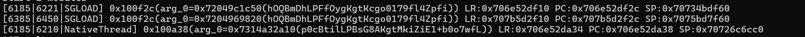

所以之后将100a38作为锚点，om clear之后会写入4次，但是100a38更新的x-umt值，最后一次必定是抓包smssend的x-umt值

```bash
./stackplz -n cn.damai -l libsgmainso-6.8.260704.so -w '0x100a38[str:x0.]'
```

**ida反编译100a38所在函数在sub_100490**

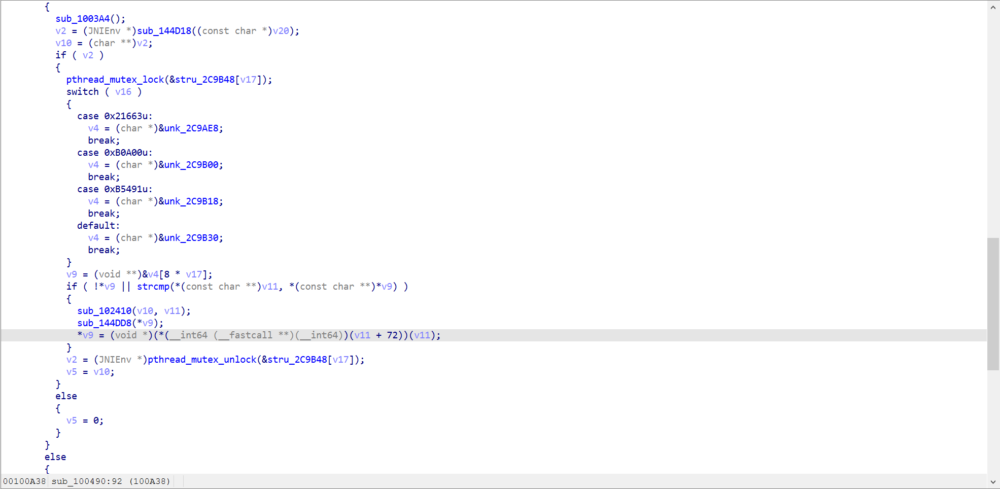


**0x100a0c的gumtrace 结合ida mcp 分析sub_100490 -> 丢给ai**
```text
        Java 静态方法返回 jstring                    【IDA 静态证据】
        │ 0xFF508：CallStaticObjectMethod
        ▼
        sub_1482BC(env, jstring)
        │ 0x148378：GetStringUTFChars
        │ 0x148414：memcpy，复制到 native 堆
        ▼
        sub_FF3D8 返回 char*
        │ 0x1007D8：保存到 [sp+0x90]
        ▼
        sub_144D18(char*)：构造源字符串对象
        │ 0x1007E4：保存到 [sp+0x88]
        │
        ────┼──── 当前 trace 从 0x100A14 开始 ──────────────
        │
        ▼
        源对象 0x6eb92db6d0                          【trace 动态证据】
        └─ data = 0x6fc9336f90
                │
                │ sub_144968：深拷贝
                ▼
        目标对象 0x6eb927c8a0
        └─ data = 0x6fc94250d0
                └─ "F6EB5y5LPF5mWwKguQSfn1ImP5xle2dT"
        │
        ▼
        0x100A38：保存目标对象指针
```

**lldb验证GetStringUTFChars返回0x14837c字符串与100a38处写入对象的字符串，初步确认一致**

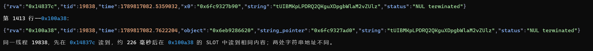


**stackplz关联到Java方法：在jmethodID和CallStaticObjectMethod和GetStringUTFChars处获取方法名、类名、传参、返回值。**

```text
cmd       = 61501799
selector    = 136803
```

```bash
[39782481248143|29683|29740|NativeThread] 0xff544(class_name=0x6cb7bd48ae(com/alibaba/one/android/sdk/OneMain), clazz=0x4b26, method=0x6d0039b4b0, name=0x6cb7bd4991(play), signature=0x6cb7bd4996((IIILjava/lang/Object;)Ljava/lang/Object;), value=0x6fc93d3a10(5y4BEGBLPEgk5AKguSVWlY2VsNcblWaW)) LR:0x6cb7a0a544 PC:0x6cb7a0a544 SP:0x6cb9de6c30
```

**OneMain.play 是 RegisterNatives(0x1ab010) 动态注册的函数**

**gumtrace 0x1AB010 给ai分析**
vmInterpreter是16a274，简单说也就是在vm里面，（16432C / 164334 / 164338：计算槽位） -> 1785B0读取x-umt返回
```text
1AB010
   └─ 1AB228 BLR → 1ACBF0
       └─ 1ACD1C BLR → 54260
           └─ 543C4 BLR → 1AA040
               └─ 跳板 → 1A583C
                   └─ 156294
                       └─ 151C40
                           └─ 1519B0
                               └─ 1666EC
                                   └─ 167AE4
                                       └─ 内部解释执行（解释器地址0x16A274）
                                          16432C / 164334 / 164338：计算槽位
                                           └─ 1785B0：读取已有字符串
  state
    │ +0x240，解引用
    ▼
  object
    │ +0x1A0，解引用
    ▼
  region
    │ +0x48974
    ▼
  slot = 0x6d490e2f48
    │ 1785B0：LDR X5,[X16,X1]
    ▼
  source = 0x6fc92ea610
    │ 此时完整字符串已经存在
    ▼
  复制到新的返回缓冲区
    ▼
  state+0x80 → 输出参数 → 1ACD20 返回值 → NewStringUTF


  object = *(void **)(state + 0x240);    // 16432C
  region = *(char **)(object + 0x1A0);   // 164334
  slot   = region + 0x48974;            // 164338
  source = *(char **)slot;              // 1785B0
```

**lldb写断点 ： 164338后设置slot和source写断点，命中0x18511c(一看就是vm的handler)，此处将字符串指针写入slot。**
这里handler实际提升成原指令的话，类似 `STR Xt, [Xn, Xm]`(x21是vPC，x25是寄存器内存区基址，后面是vm dispatch分发)

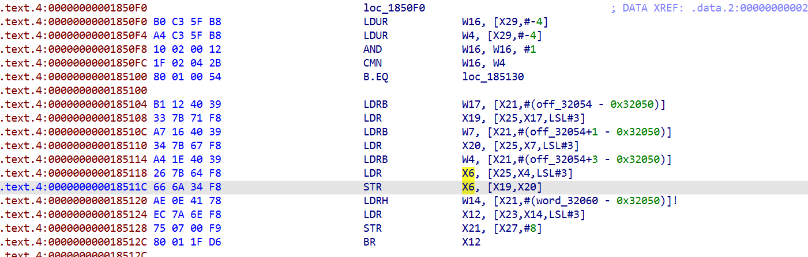

如果从0x18511c lldb继续往前追的话，
1.可以从vm进入开始，lldb找这里`[X25,X4,LSL#3]`的写入，但是这里其实是相当于找对vRegister(虚拟寄存器)的写入，肯定是非常多的地方 
2.在18511c这里断点，然后对`[X25,X4,LSL#3]`下写入断点，追踪后续写入，这里其实能追到，因为app会写4次(pm clear后初始化会写4次)，最后一次是有效值 
3.开始分析还原vm。因为这里的vm也是docommandnative函数一般会进入的vm，貌似只有这一个vm，后续想要再分析其他参数，有vm的分析也会更好做。但是也不是完全一次性还原，而是用到哪里还原到哪里。

**直接trace 16a274 vmInterpreter，分析vm结构，结合ida静态分析**

**然后AI给出了下面的方案，也就是这个vm有一个vmContext保存着每次进入vmInterpreter时候的module、index，module.index的组合可以看作一个函数。也就是进入18511c时候的module.index（相当于函数标识）可以拿到**
每次进入vmInterpreter时，x2、x3分别传module地址、index，当然识别module不能靠module地址，而是用module的sha256
```
18511C 命中时，可以直接从内存取回这次 16A274 的入口 x2/x3。

  ; 调用前
  1853F8  MOV  X2, X20
  1853FC  MOV  W3, W19
  185400  BL   16A274

  ; 进入后，保存原来的 X20/X19
  16A290  STUR X19, [X29,#-0x48]
  16A29C  STUR X20, [X29,#-0x50]

  因此，命中 18511C 或写入后的 185120 时：

  // 先核对确实由185400调用：
  *(uint64_t *)(x29 + 8) == SO_BASE + 0x185404;

  // 直接读回入口参数：
  entry_x2 = *(uint64_t *)(x29 - 0x50);
  entry_w3 = *(uint32_t *)(x29 - 0x48);

  LLDB：

  memory read -f x -s 8 -c 1 `$fp+8`
  memory read -f x -s 8 -c 1 `$fp-0x50`
  memory read -f x -s 4 -c 1 `$fp-0x48`

  新计划：

  1. stackplz 记录 16A274 的 PID、TID、SP、x2、x3。
  2. slot 写断点命中后，直接读上述两个入口参数及字符串。
  3. 找对应记录：

     PID、TID相同
     入口SP == 当前FP+0x10
     入口x2 == [FP-0x50]
     入口w3 == [FP-0x48]低32位
     地址重复使用时，取命中前最近一条。

  4. 放行，核对 100A38 字符串。

  不用当前 x19/x20：它们在 185108/185110 已被覆盖


结果：
  已匹配，同一 PID 15074：

  16A274入口：
  TID = 15371
  x2  = 0x7BEADAB7C0
  x3  = 0xEDA9
  SP  = 0x794A34D930

  18511C写入后：
  FP           = 0x794A34D920
  [FP-0x50]    = 0x7BEADAB7C0
  [FP-0x48]低32位 = 0xEDA9
  字节码偏移   = 0x3333C

  slot字符串：
  Fl4BzIdLPMxClAKgx8cpvN2awcx00feE

  100A38字符串：
  Fl4BzIdLPMxClAKgx8cpvN2awcx00feE
```

**获取module\index后，进入指定vmInterpreter用gumtrace trace出来代码进行分析**

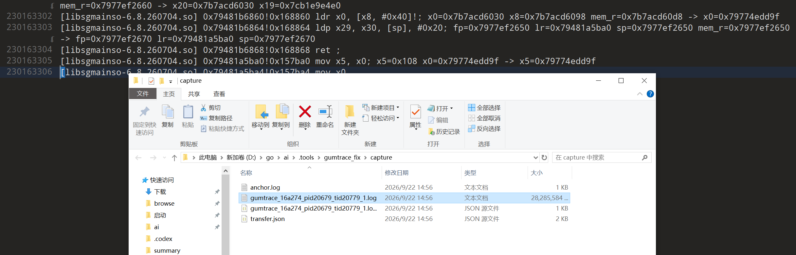

28G，2亿行的trace，给AI分析出来了

```
追到 Java 返回值了：

  CallStaticObjectMethod
  jmethod: sendReportBridgeMtop
  
  sendReportBridgeMtop
   → postRequest
   → syncRequest
   → getDataJsonObject
   → JSONObject.toString()
   → SUCCESS|{"ck":"...","dt":"...","ec":"200"}

  实际链条：

  SUCCESS|{"ck":"...","dt":"...","ec":...}
   → 取外层 dt（600字符）
   → 448字节
   → native运算
   → 内层JSON（433字节）
   → 取token
   → Mv4BaNFLPIz1bQKgx0c9O7c12zb3ARZJ
```

**然后对应之前pm clear后抓包的记录找到对应的包：`/gw/mtop.alibaba.cro.umid.reped/1.0/`**

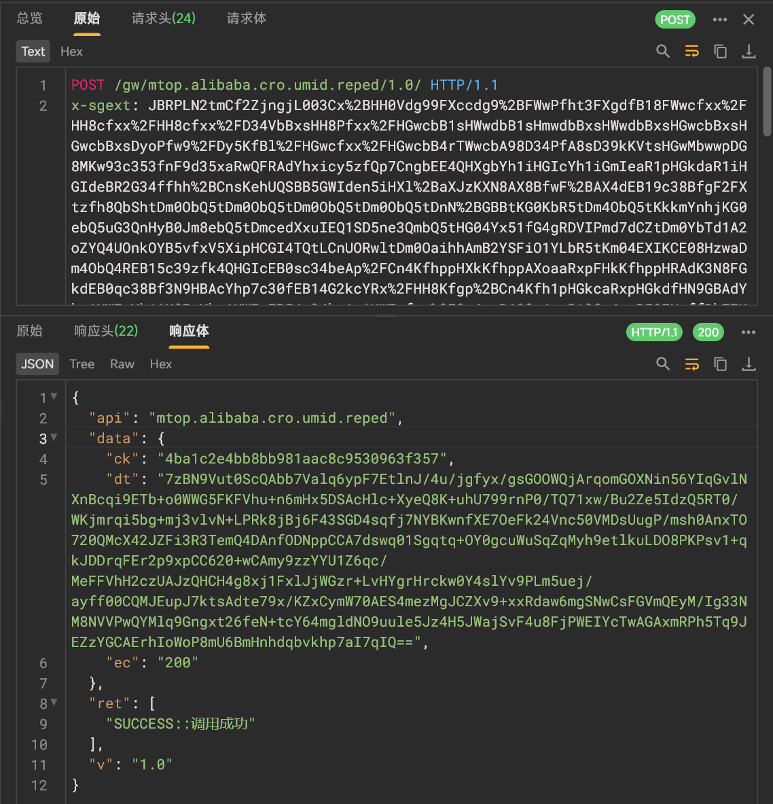

**接下来主要就是要构造发包了。主要上传可能影响dt生成的是request包里面：**

```
POST /gw/mtop.alibaba.cro.umid.reped/1.0/ HTTP/1.1
x-sgext | x-sign | x-mini-wua | x-utdid
```

以及请求体

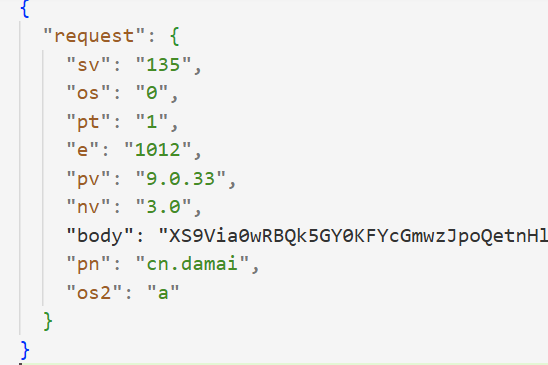

先看请求体里面request的body键，用之前trace里面解密响应的key、iv解密：

```
Base64 → AES-128-CBC → 去除 PKCS#7 → zlib → JSON
  key = iv = efdacedca8a69cde0b1711c8de9df510
```

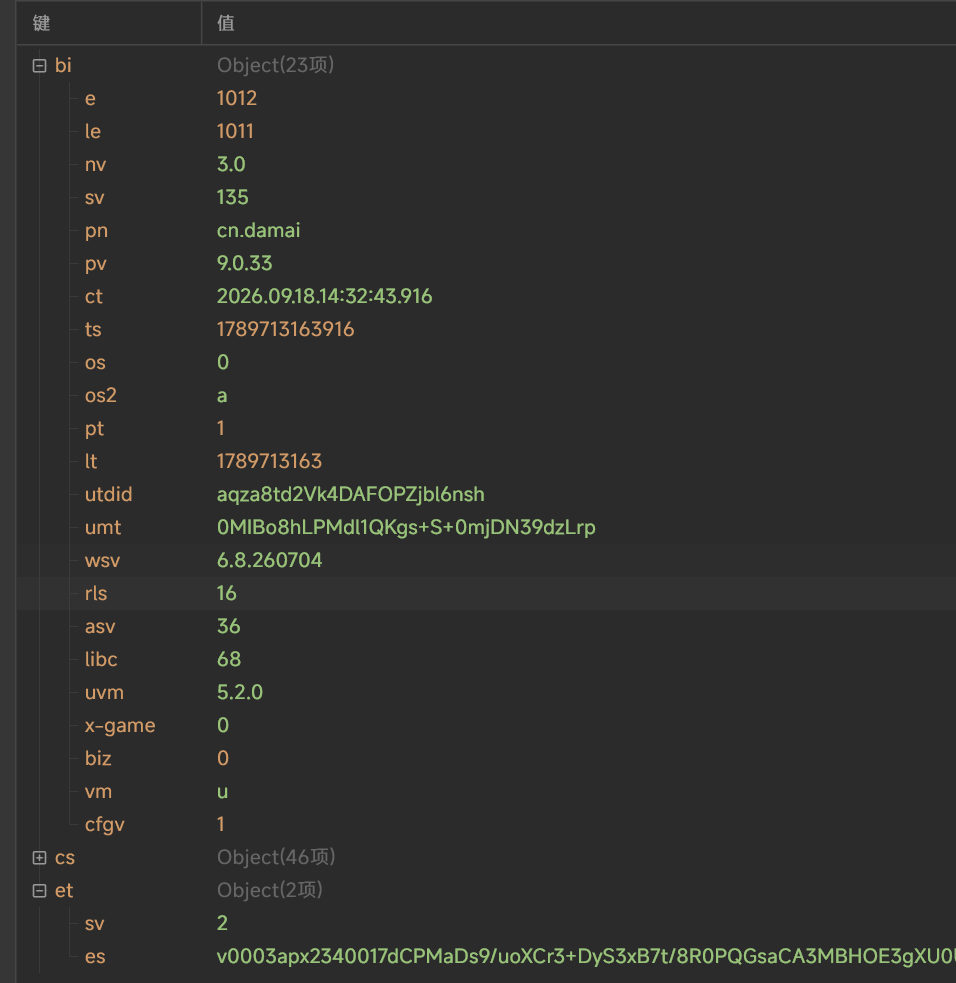

**关键值还是看得出来是 `et.es`**

**发包过程**

```
sendReportBridgeMtop → postRequest
    ├─ bArr 转字符串，放入 request.body
    ├─ syncRequest 发请求、收响应
    └─ 返回 SUCCESS|{"ck":...,"dt":...,"ec":"200"}
```

```
28GB trace 已找到 bArr 的 native 来源：

  // SO+0x157CA8
  bArr = NewByteArray(0x1640);
  // 返回：0x7cbe600e11

  // SO+0x157BB8
  SetByteArrayRegion(
      env,
      0x7cbe600e11,   // bArr
      0,
      0x1640,         // 5696 字节
      0x7beae789a0    // native 内容地址
  );

  // SO+0x1A5D78
  CallStaticObjectMethod(..., sendReportBridgeMtop, ..., bArr);
```

所以`et.es`的来源也要从SetByteArrayRegion的x4参数往回追溯

AI追溯后大致流程是：

```
→ 取到 ro.product.device=lynx 等字段值
→ 部分字段值先编码（lynx → |*~)）
→ 组织字段数据，并做位置变换
→ 压缩
→ Base64 编码、加上 # / ____ / | 等分隔符
→ 得到 4934 字符的 v0003apx... et.es明文
→【中间变换尚未逐步证实】，应该是加上其他采集的值
→ AES加密，变成5696 字节body密文，100027101 行交给 SetByteArrayRegion
→ 最终request请求体json里面的body键的值
```

**其实之前100a38写了三次，中间分析也只跟了其中一次，看包也能知道`reped`包发了四次，所以其实其中跟的一次分析的一次，et.es的生成只是其中一次，另外还有三次也应该要分析。**

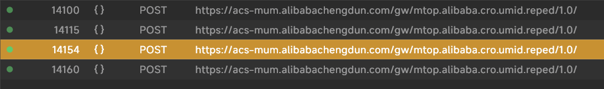

**分析到此，让AI解释一下vm结构：16a274参数：X1 - context（VM执行上下文）、module、index、VM寄存器区基址、handler分发表，后面都会频繁出现**

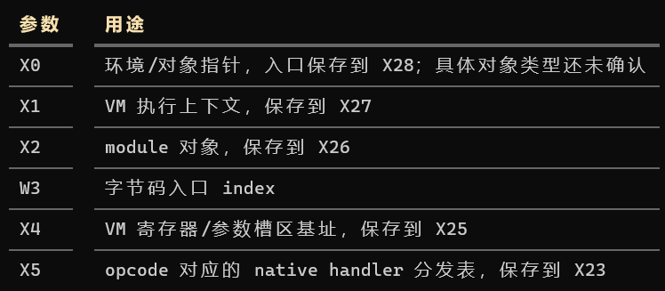

16a274保存相应结构：

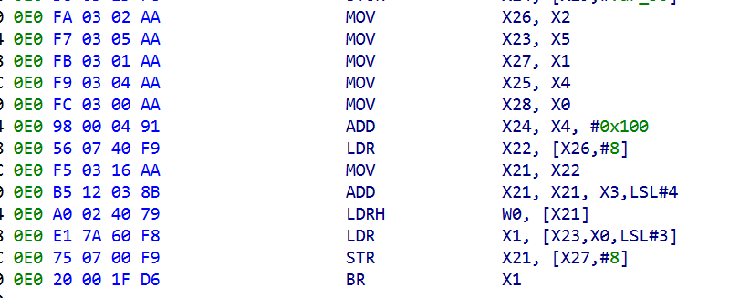

**通过hook sendReportBridgeMtop jni调用反追找到发包的模块：**
jni找到native地址，读取 VM 现场并反查虚拟调用者（也就是vm内部实现了BL，实际实现是直接BR虚拟被调用函数的代码，过程中有一个很重要的结构VM context，通过它查保存的虚拟返回地址）
```
实际流程是：
1. 在 `16a274` 入口保存 X1，即当前调用的 `vm context`。
2. 在发包瞬间读取当前指令：
   module       = *(uint64_t *)(context + 0x240);
   decoded_base = *(uint64_t *)(module + 0x08);
   current_pc   = *(uint64_t *)(context + 0x08);
   current_index = (current_pc - decoded_base) / 16; // 0x824a
   核对 `0x824a` 的 opcode 为 `0x16`，对应 handler `0x17566c`，确认它是此次 JNI 调用的虚拟指令。
3. 再读取 r31，找到**调用当前虚拟函数的位置**：
   caller_pc    = *(uint64_t *)(context + 0x138); // r31
   caller_index = (caller_pc - decoded_base) / 16; // 0x775f
4. 解码 `0x775f` 的 CALL：偏移为 `0xa5a`，因此目标是 `0x81b9`；核对该位置为 ENTER，确认函数入口。指令opcode是0x224，对应的handler `0x17ddac`可参考 VM结构.md
所以三者分别回答：
current_pc → 0x824a：现在执行哪条指令？
r31        → 0x775f：谁调用了当前函数？
CALL 目标  → 0x81b9：当前函数入口在哪里
```
**发送模块module：reped1、3、4包在同一次 16a274-onecore-eda9调用中**
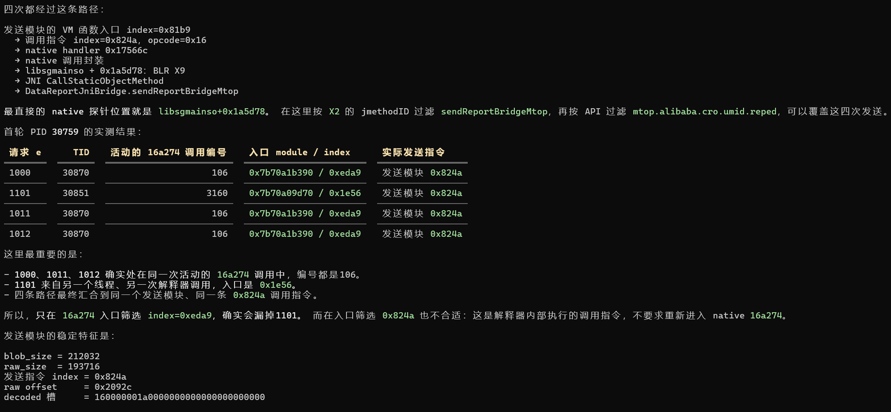
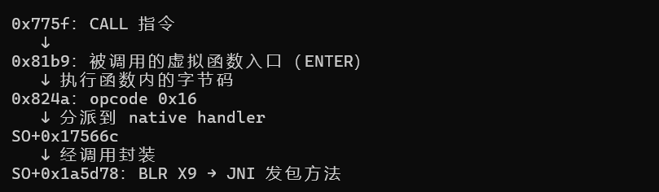

**结合之前分析到的module、index，以及这个发包模块，将module的vmCode dump下来结合handler分析，可以分析到下面这个流程。**
其实感觉直接在之前获得module、index时候就可以将vmCode dump下来，结合trace分析了。貌似走了弯路。

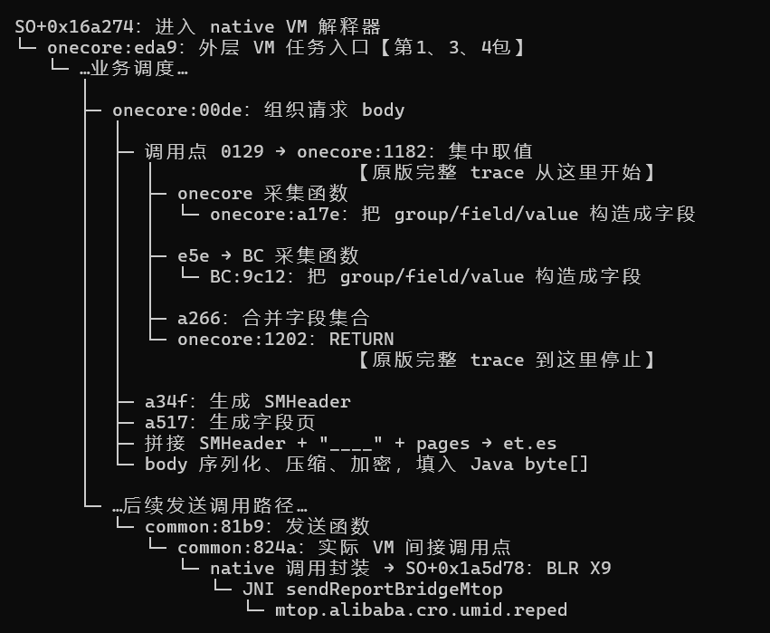

**gumtrace onecore:eda9直接trace产生70G日志，而且对于第三个reped包会按字节扫描framwork.zip，直接trace native原始字节码trace不下来。所以修改gumtrace进行handler trace**
结果：4个包的总trace缩小到1G，其中et.es某个字段b078.0299的handler trace切片：

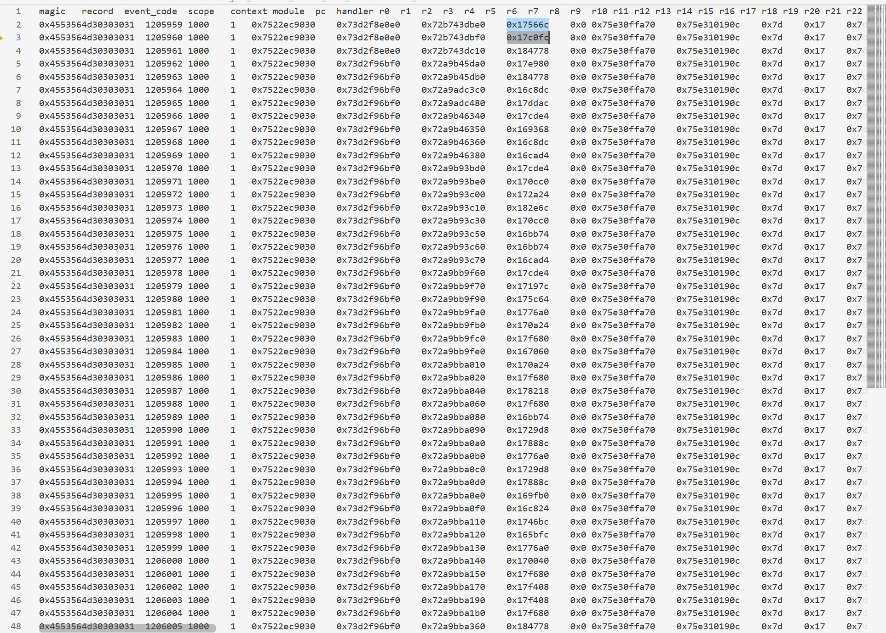

trace的时候也会做模块快照，主要是模块一些常量、字符串，在进入vmInterpreter时做。

**让AI分析这handler trace文件即可还原et.es的生成：**

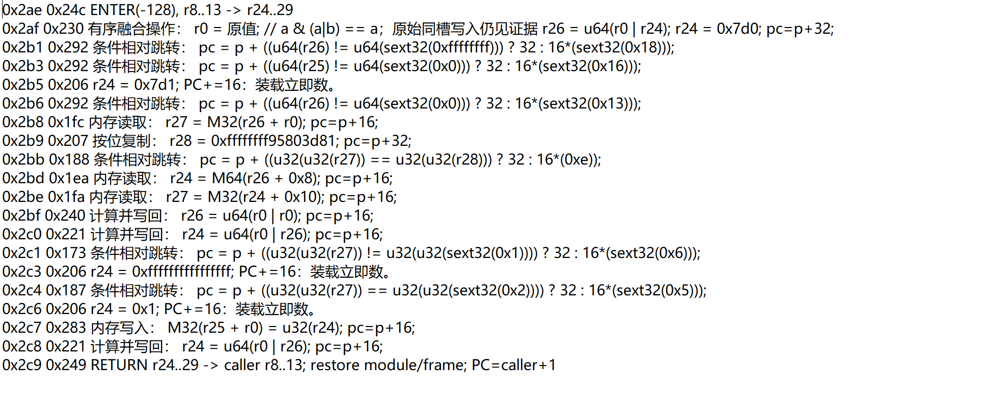
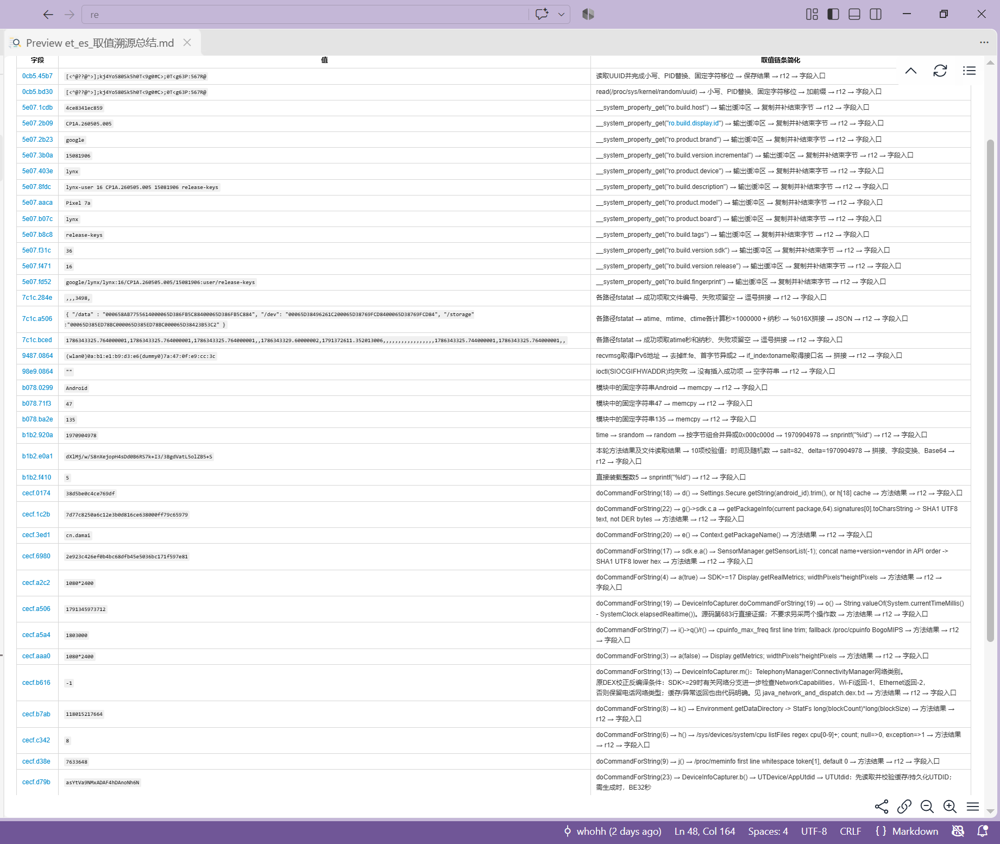
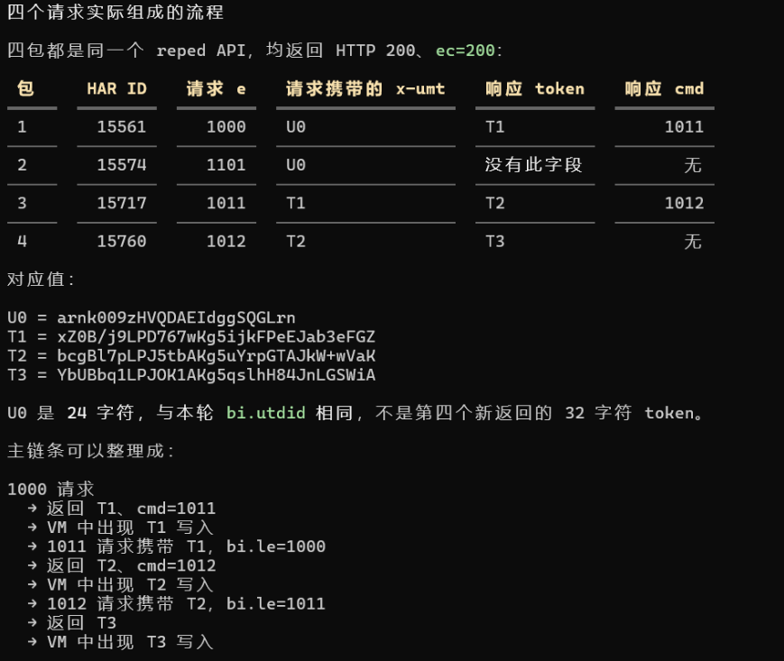

## 验证

把字段取值分成硬编码值和动态生成值，将硬编码值、动态生成值、算法分开，硬编码值如brand、cpuinfo、signature等，动态生成值如time、random返回值，用stackplz取动态生成值，结合之前生成的算法文件运算，生成最后的et.es与原执行hook取得的et.es比较，相同即取值和算法没问题。动态生成值要么用python函数生成，要么模拟其格式长度

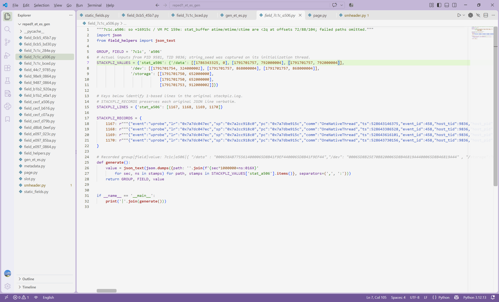

第1、2、4包的et.es差不多的，第3包的et.es多很多特征：

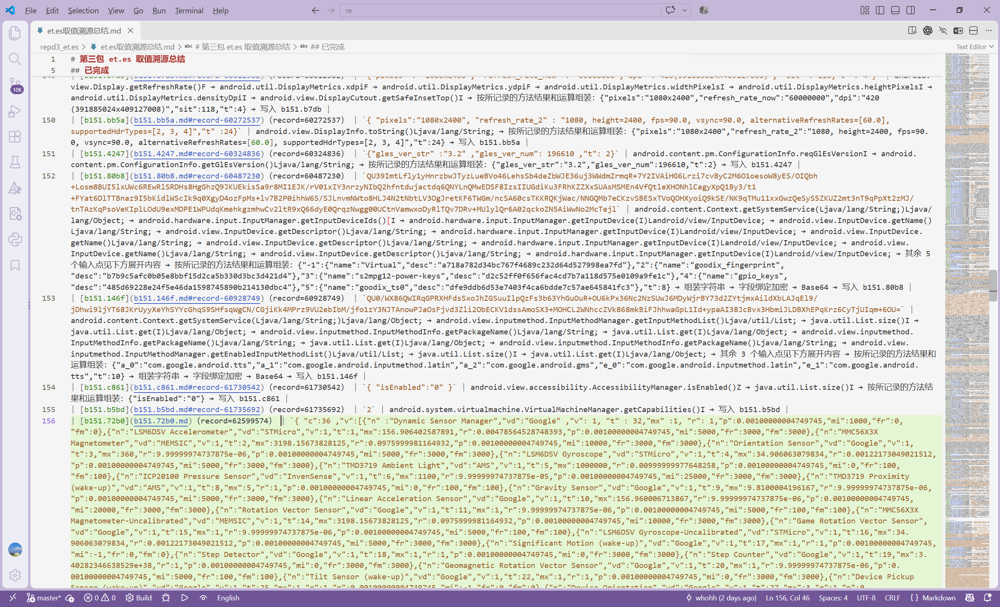

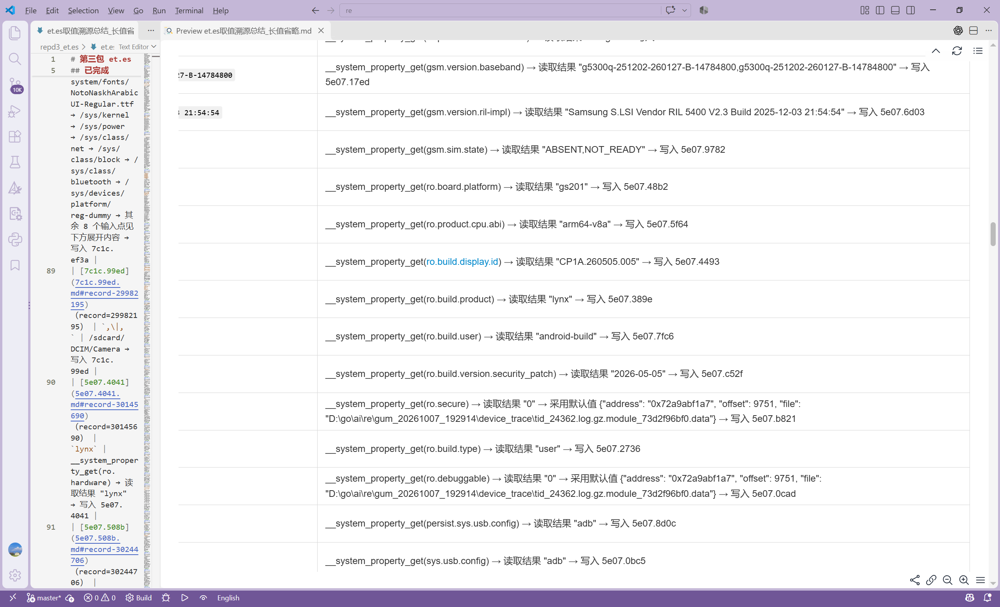

主要就是et.es的取值溯源，其他包里的参数header都差不多直接硬编码就行。
| 包 | VM 记录数 | 最终字段与 builder 匹配 |
|---|---:|---:|
| e1000 | 6,680,724 | 48/48 |
| e1101 | 5,343,718 | 50/50 |
| e1011 | **81,982,056** | **243/243** |
| e1012 | 11,220,362 | 55/55 |

## 这次主要工作还是AI做的

```
1、gumtrace AI进行修改，对handler进行trace；以及缩小了gumtrace内部某些结构的内存分配大小（code、slow、data），解决trace时崩溃问题（原先内存分配过大，多线程实例分配内存会分配不到）

2、分析过程：
    1、从arm64原始汇编trace
    2、从trace识别VM结构，如X21是vPC，X25是寄存器区基址，X27是vmContext，X23是handler表基址等；以及从trace获取 opcode<->handler地址 对应关系
    3、从静态arm64汇编，写出handler的大概语义如 r[pc[2]] = r[pc[6]] + u64(pc+8); pc += 16;
    4、修改后的gumtrace trace handler执行序列，在vmInterpreter入口会传入模块module、指令索引index，同时保存模块快照(device_trace下module/raw/decoded/blob/data/json/symbols)
    5、根据模块快照以及handler执行序列，首先识别enter handler，然后按enter到下一个enter划分函数，并按大概语义写出每个函数每条handler调用的实际语

3、AI使用：
    1、一开始约束好，减少其乱写文件乱加流程
    2、进度自己把控，每一次完成要验收提交，否则进度就是没走
    3、拆解任务，太大任务即使做完了，也不好验收
```

