# keepalive

### 目标：app保活逻辑代码还原。具体表现，强制停止运行app，强制停止按钮变灰后立即恢复可用状态，app仍然正常弹出窗口。

### 信息收集
`ApkCheckPack`检测下：
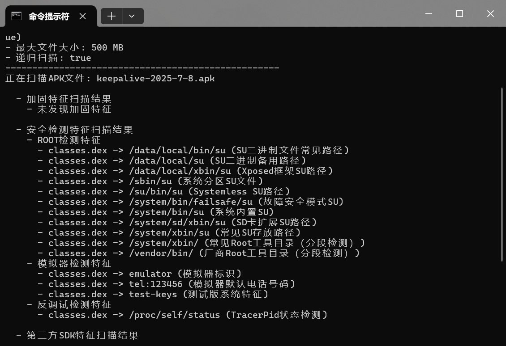
`AndroidManifest.xml`：主要关注`provider`和`service`
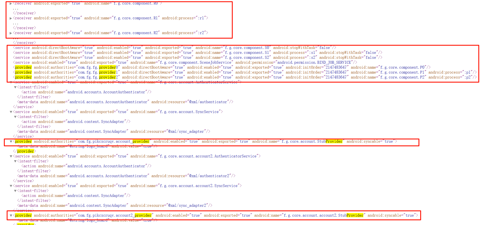
Java层：
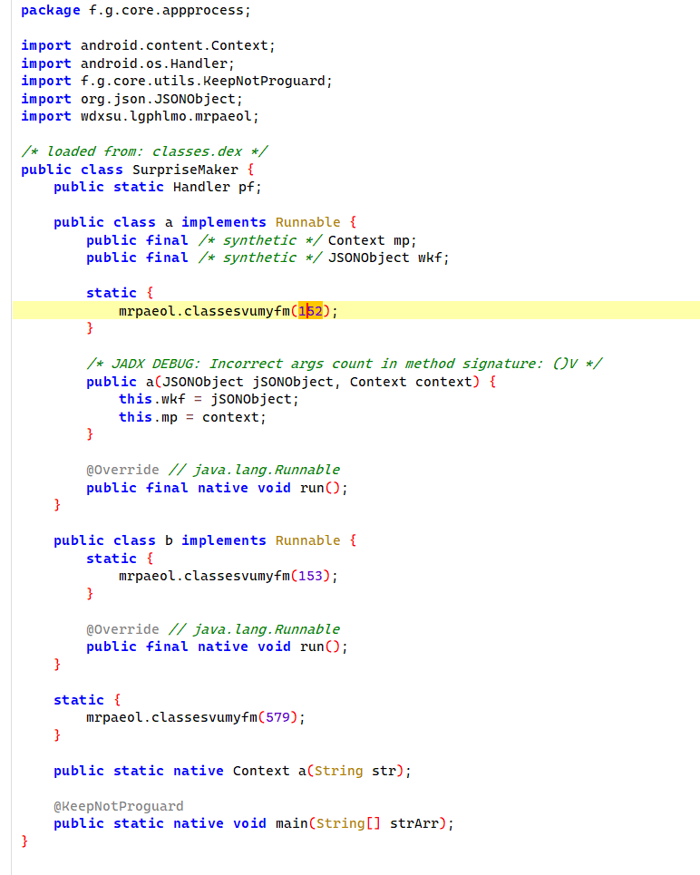
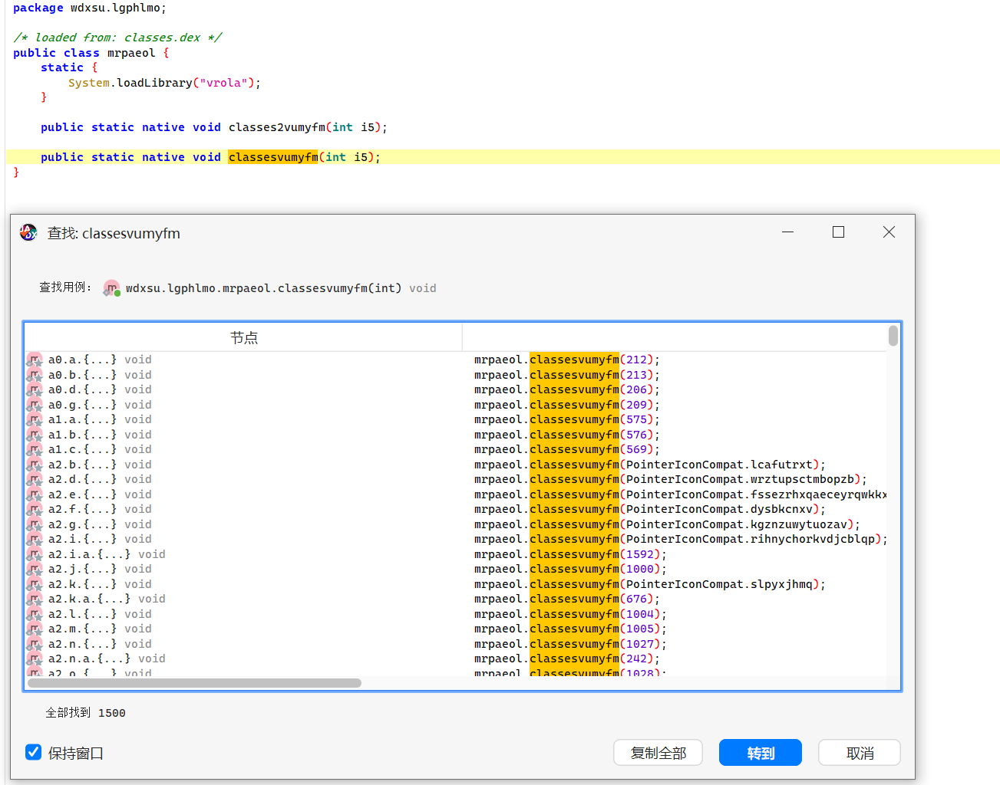

#### 调试app与复现功能:
`f.g.core.utils.CommenUtils$Companion.ca`发现调用这个函数进行校验。逻辑是检查assets目录下有无某个png，更换掉base.apk即可过掉校验
过掉后，强制停止，app不会被杀。查看进程
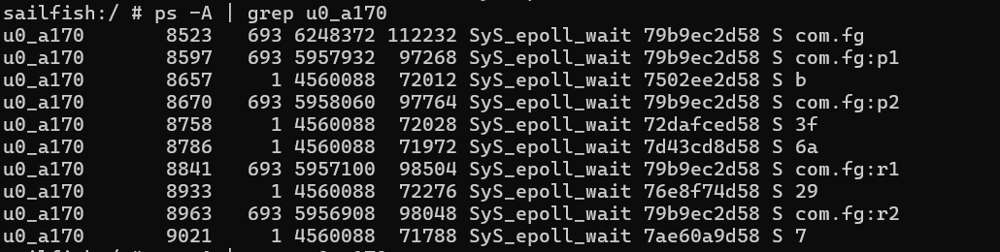
强制停止时，进程情况：是`app_process`启动的某些进程
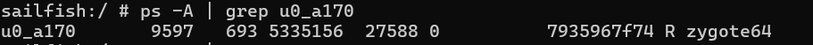
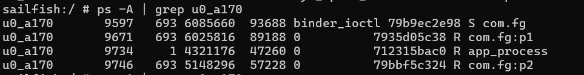
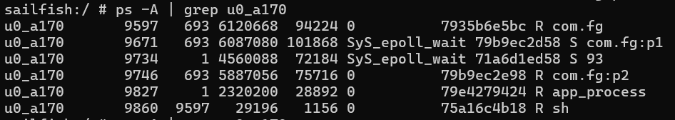
logcat，发现数字为名的进程没有killing，可能是主进程创建的
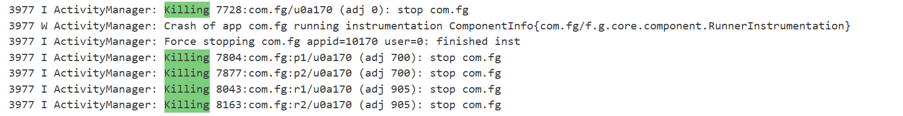
https://juejin.cn/post/7325733245165125673
**Android 按分组杀进程，但是对于UID相同但不在同一分组的会有一些延迟，这也是提高保活成功率的手段之一**
shell执行app_process方法：ProcessBuilder、Runtime.getRuntime().exec()、popen、fork() + execve()、system()
hook ProcessBuilder找到app_process的调用点
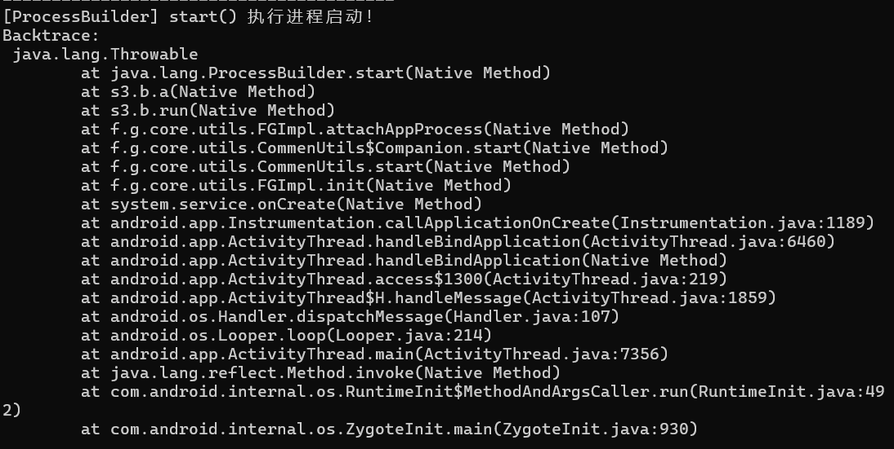
==hook了AMS的forceStopPackage方法，确实有被调用。然后hook binderproxy的transact方法，查看app调用了哪些系统服务。最后发现调用了AMS的`openContentUri`|`startActivity`|`startInstrumentation`服务，实现了重启app==
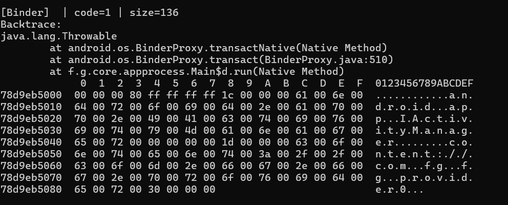
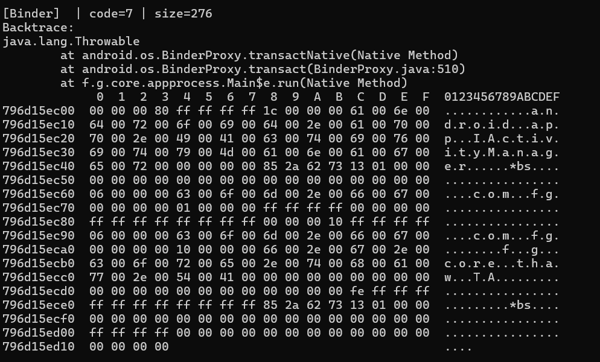
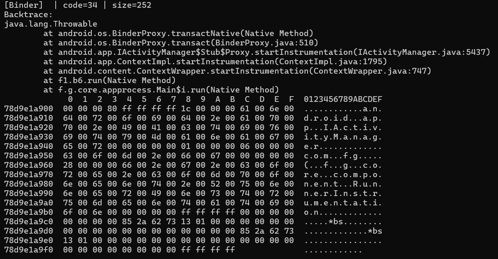

#### 根据Java层代码特征，看着像vmp，看下app的jni函数调用。
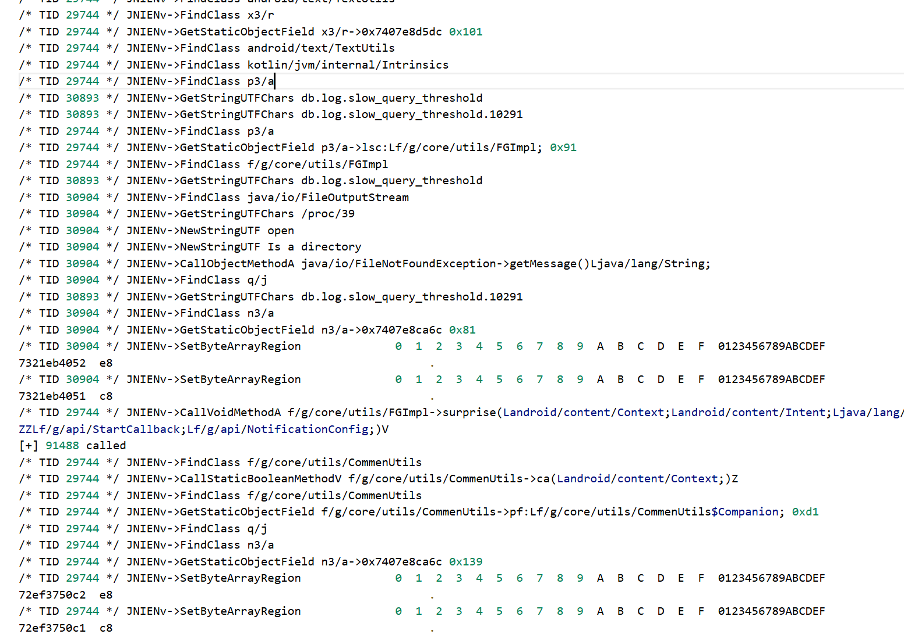
找一个函数跟踪看下如何调用的。
先看`classesvumyfm`与`classes2vumyfm`：`libvrola.so`的`JNI_OnLoad`中，`registerNatives`注册了`classesvumyfm`与`classes2vumyfm`，这2个函数功能其实也是`registerNatives`
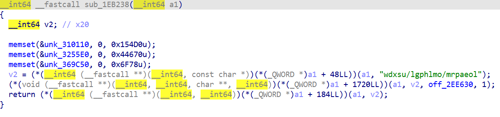
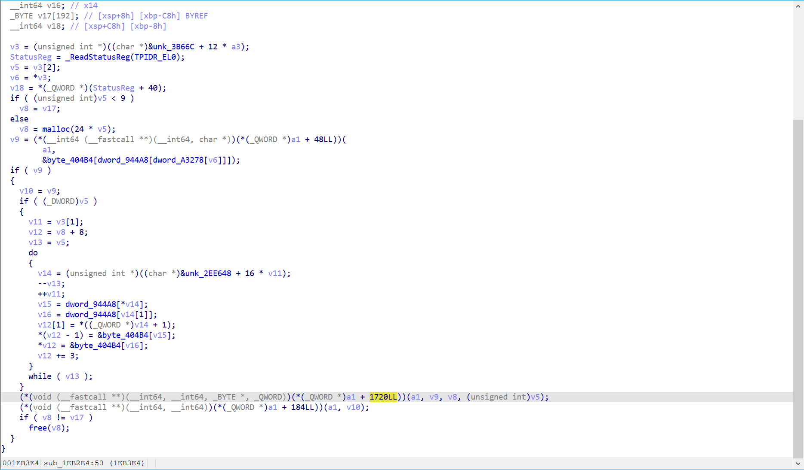
同时`byte_404B4`这个地址点进去看可以发现是大量的类名
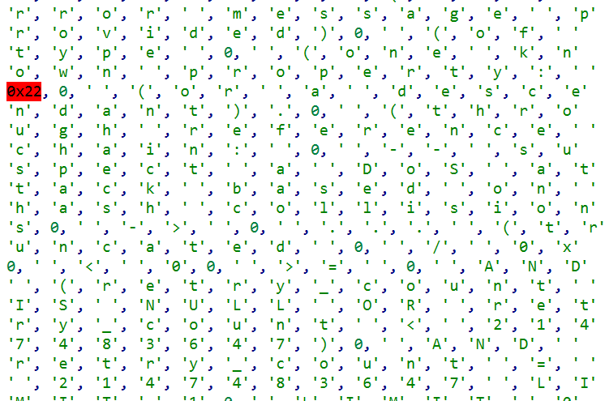
hook下`registerNatives`：大量`registerNatives`，应该都是`classesvumyfm`与`classes2vumyfm`调用的
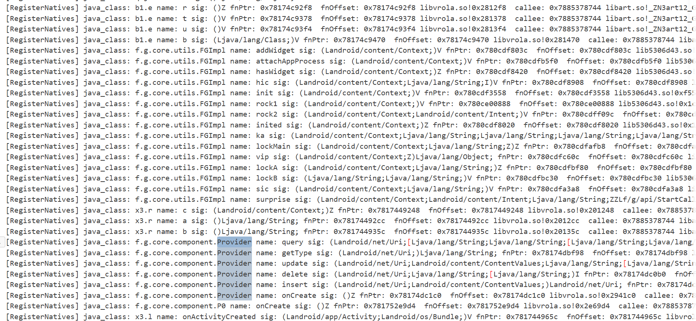
再通过`registerNatives`打印的函数地址，找2、3个函数看看，发现都是调用`libdfixx.so`中的`vmInterpret`，基本确定是`dex vmp`。
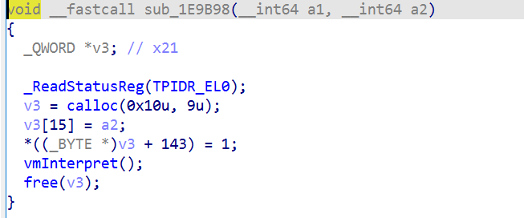
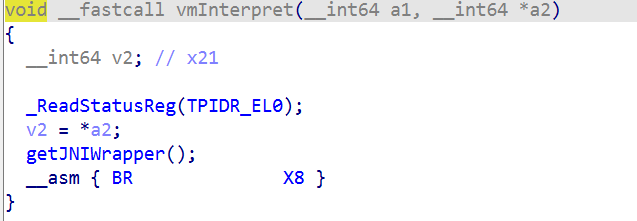
`dex vmp`特征，统一的入口函数如上的`vmInterpret`，大量的jni调用，因为要通过jni调用了实现java层中的功能，当然如果发现了大量的类名所在地址，其实这些就是dex文件中的`string`data区


### 解决办法
2种方法：
1、frida jnitrace加unidbg模拟执行。因为会调用大量jni，所以通过unidbg能复原基本逻辑。但是各种分支需要自己判断测试
2、逆向解释器`vmInterpret`还原出函数对应的smali代码。因为可以手写smali直接编译成dex，能被jadx解析，所以不用复原dex文件，写出smali即可。


### 实现
#### 2、逆向`vmInterpret`
总体思路：`vmInterpret`是`dex vmp`的解释器，逆向这个函数可以根据函数逻辑对应回原来的`dalvik`指令。同时还需要找到实际的类和方法等数据以还原smali语句。

###### 去除`BR`间接跳转
`vmInterpret`函数中大量`BR`与`BLR`，使得IDA无法分析。先去除`BR`间接跳转。由`dex vmp`的结构可知，需要根据`dalvik opcode`跳转执行，最常用就是`switch`结构。不管如何，需要分析`BR`的跳转逻辑。


这里用`unidbg`，拿到`system.service.onCreate`函数的`trace`。
`vminterpret`第一个`BR`，`0x18e20`处，跳转地址由X1（传入参数，偏移），X9（全局地址）决定。

全局地址`0x3e298`就是`switch_table`地址（该地址在`libdfixx.so`中）。将原dalvik指令映射为自实现的函数语句
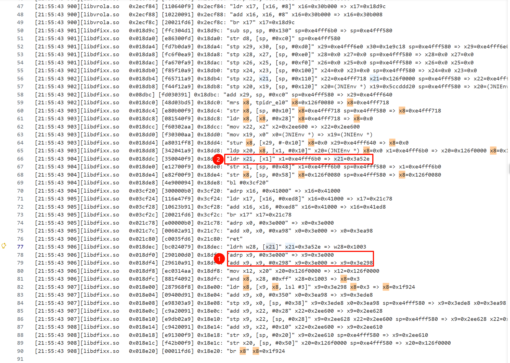
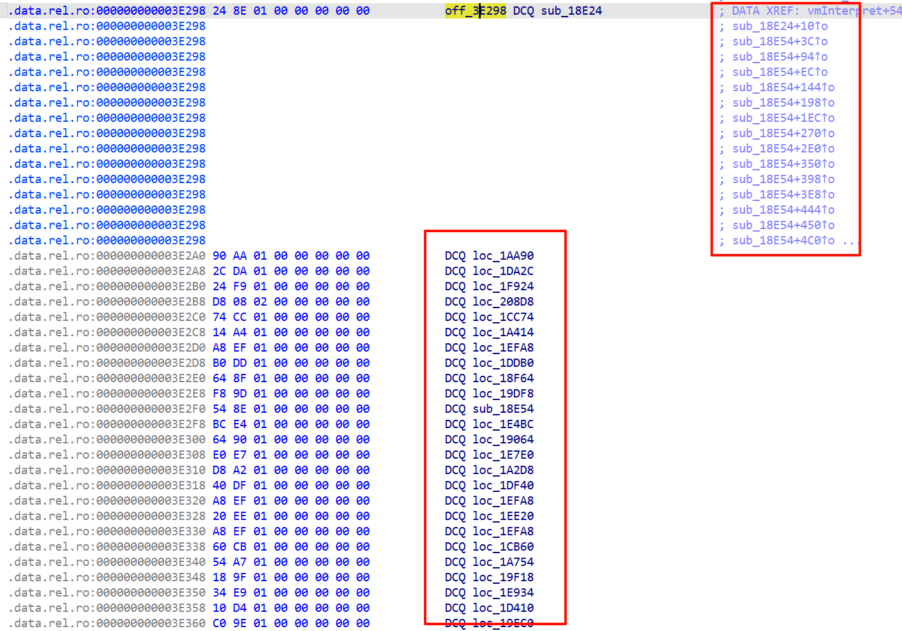

看看X1，`0x3a52e`，大胆猜测这就是原dex指令字节码所在。是硬编码在so文件中的。
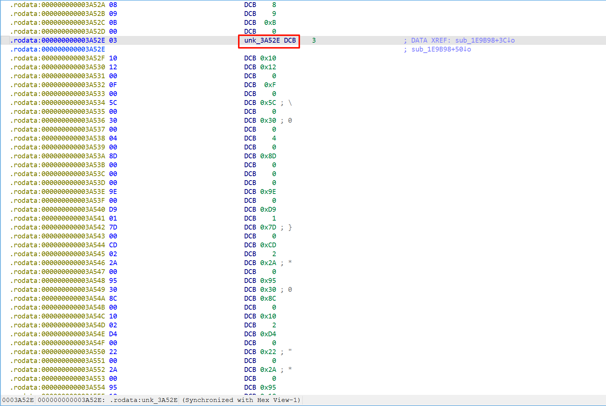


既然猜测`X1=0x3a52e`是原dex指令字节码所在（该地址在`libvrola.so`中），那么必然频繁取`0x3a52e`处的字节，然后解释执行。继续看日志后面，会发现频繁取`0x3a52e`后面的字节，然后根据`0x3e298`的映射进行`BR`跳转，所以也印证了上面的想法。


如何判断一条dalvik指令取完了，继续下一个循环？1、跳转地址出现在0x3e298映射表的时候（如下图①0x1b9a8）2、指令读取指针更新的时候，如下图②（0x3a52e=>0x3a534）。也看到，下面仍然是从0x3e298为基址取偏移处的值，进行跳转。再次印证想法。
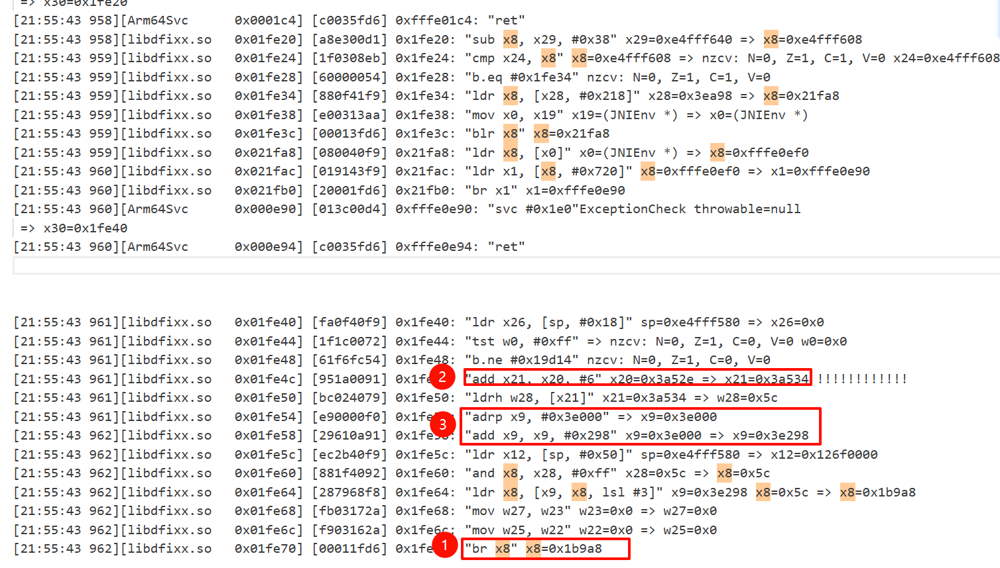

如果`0x3a52e`该地址处是完完全全的原dex指令字节码，那么很简单把`opcode`对应到smali的指令即可。但是这里不是。原因如下：
从日志中得到了第一条dalvik指令，以及对应的jni实现。
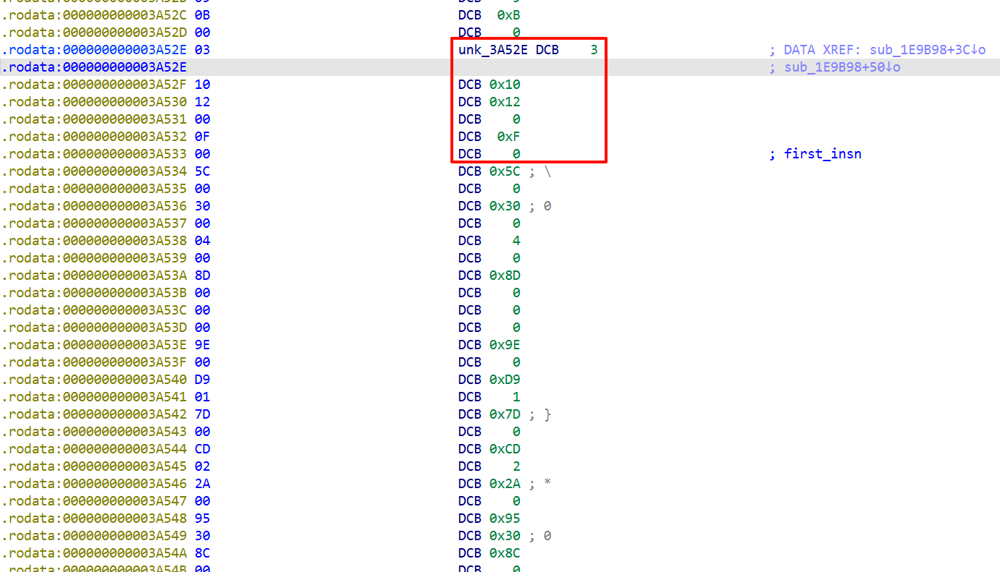
JNI实现为：下面简化版，实际有FindClass，GetMethodID


`CallNonVirtualVoidMethodA(system.service@258e2e41, android/app/Application, onCreate()) `
该jni对应的dalvik指令应该是：`invoke-super`，操作码为0x6f。不是上面的任一个字节。
`invoke-super {p0}, Landroid/app/Application;->onCreate()V`
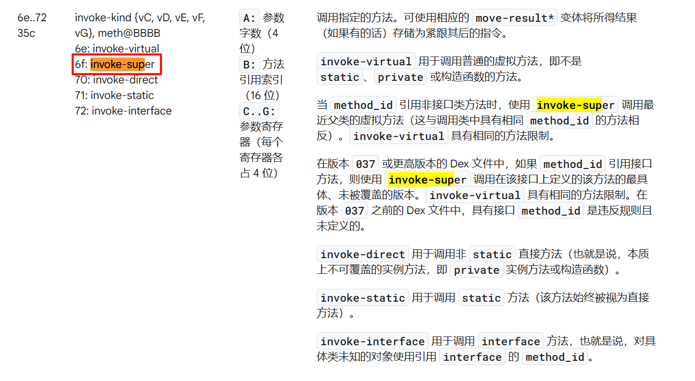


###### 修复`switch_table`
`0x3e298`是跳转表地址，先把他设置为IDA可识别的`switch_table`，然后所有通过该表跳转的`BR`都要声明。

全选`0x3e298`处loc地址，转为Array，size为256，也对应了`dalvik`指令256条

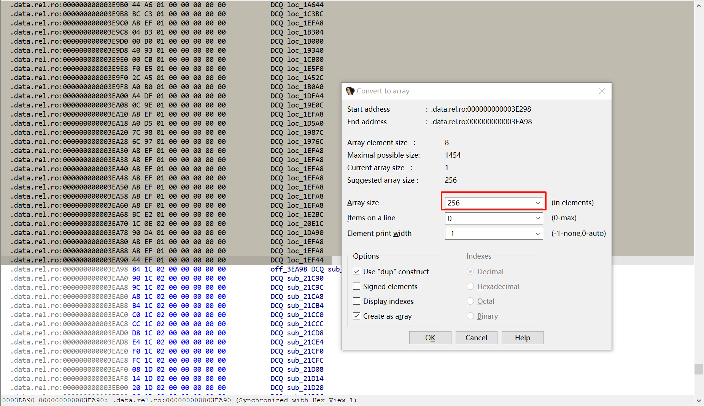

然后创建`switch table`，`input register of switch`比较重要，不填会反编译不出来。`start of the switch idiom`个人理解是通过`switch table`加偏移获取实际跳转地址的语句所在地址，如图

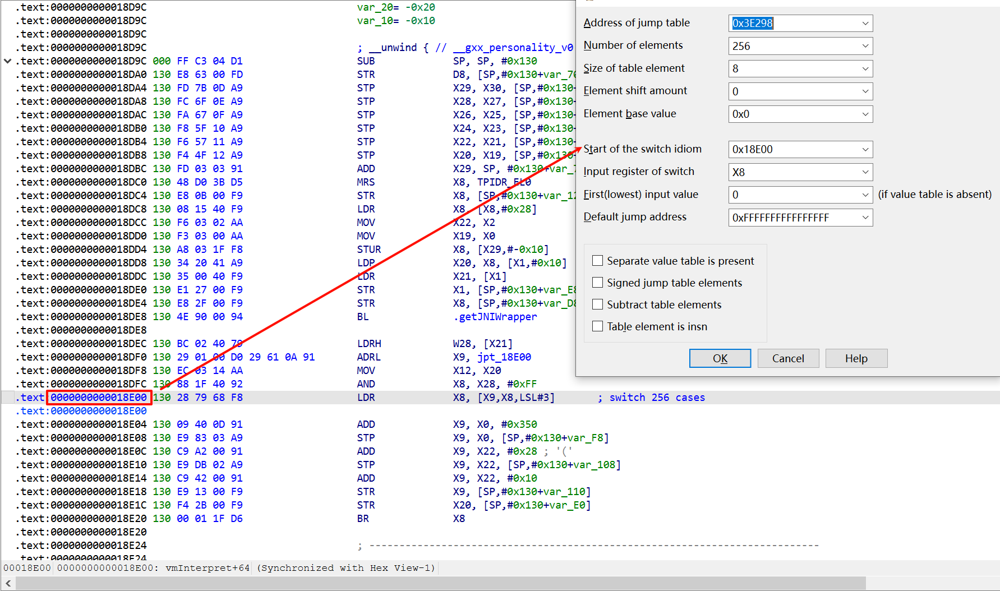


接下来有229处都需要patch，一个是用idapython接口，二个是影刀自动点击创建。都是一个结构，所以010editor搜索`LDR X8, [X9,X8,LSL#3]`的字节码就能得到所有需要patch的位置

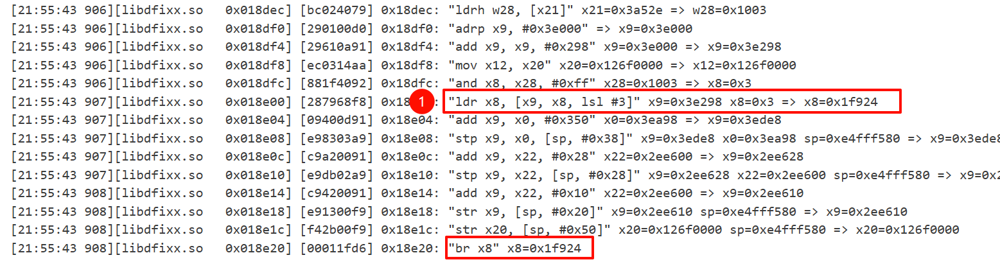

```bash
0x18e00,0x18E44,0x18EAC,0x18F04,0x18F5C,0x18FB4,0x19008,0x1905C,0x190D0,0x19140,0x191B0,0x19200,0x19250,0x192AC,0x19324,0x1938C,0x193E0,0x19430,0x19484,0x194D4,0x19534,0x19584,0x195D8,0x19644,0x196B0,0x1971C,0x19758,0x197A0,0x19818,0x19928,0x19970,0x19A04,0x19AB4,0x19C8C,0x19E3C,0x19E98,0x19EB8,0x19ED8,0x19F10,0x19F48,0x19FD8,0x1A050,0x1A0D8,0x1A148,0x1A1CC,0x1A1E8,0x1A200,0x1A25C,0x1A28C,0x1A2B0,0x1A2D0,0x1A324,0x1A34C,0x1A364,0x1A3A0,0x1A3C0,0x1A3F4,0x1A40C,0x1A448,0x1A468,0x1A49C,0x1A4C0,0x1A4E0,0x1A50C,0x1A524,0x1A548,0x1A568,0x1A580,0x1A5AC,0x1A5C4,0x1A5F4,0x1A61C,0x1A63C,0x1A708,0x1A818,0x1A8B0,0x1A94C,0x1A9EC,0x1AA88,0x1AB28,0x1ABCC,0x1AC78,0x1ACD8,0x1AD44,0x1ADB0,0x1AE1C,0x1AE88,0x1AEF0,0x1AF94,0x1AFF8,0x1B098,0x1B130,0x1B1C8,0x1B264,0x1B2FC,0x1B398,0x1B418,0x1B458,0x1B4D8,0x1B514,0x1B580,0x1B5EC,0x1B658,0x1B6C4,0x1B730,0x1B848,0x1B97C,0x1BA60,0x1BB4C,0x1BC3C,0x1BD28,0x1BE18,0x1BF0C,0x1BFF8,0x1C0AC,0x1C160,0x1C214,0x1C2C8,0x1C37C,0x1C410,0x1C46C,0x1C4C8,0x1C524,0x1C588,0x1C5E4,0x1C640,0x1C6A0,0x1C6FC,0x1C758,0x1C7B8,0x1C814,0x1C8B8,0x1C958,0x1C9B8,0x1CA5C,0x1CAF8,0x1CB58,0x1CBB4,0x1CC10,0x1CC6C,0x1CCD0,0x1CD34,0x1CD98,0x1CE30,0x1CEEC,0x1CF50,0x1CFB4,0x1D018,0x1D07C,0x1D0E0,0x1D144,0x1D1A8,0x1D20C,0x1D270,0x1D304,0x1D3A4,0x1D408,0x1D46C,0x1D4D0,0x1D534,0x1D598,0x1D5FC,0x1D66C,0x1D6DC,0x1D74C,0x1D7BC,0x1D830,0x1D894,0x1D8F8,0x1D95C,0x1D9C0,0x1DA24,0x1DA88,0x1DAEC,0x1DB50,0x1DBE0,0x1DC7C,0x1DCE0,0x1DD44,0x1DDA8,0x1DE0C,0x1DE70,0x1DED4,0x1DF38,0x1DF9C,0x1E000,0x1E08C,0x1E124,0x1E188,0x1E1EC,0x1E250,0x1E2B4,0x1E318,0x1E37C,0x1E3E4,0x1E44C,0x1E4B4,0x1E51C,0x1E584,0x1E5E8,0x1E64C,0x1E6B0,0x1E714,0x1E778,0x1E7D8,0x1E838,0x1E898,0x1E92C,0x1E9CC,0x1EA2C,0x1EA8C,0x1EAEC,0x1EB4C,0x1EBB0,0x1EC14,0x1ECAC,0x1ED50,0x1EDB4,0x1EE18,0x1EE7C,0x1EEDC,0x1EF3C,0x1EFA0,0x1F270,0x1F904,0x1FE64,0x20370,0x208C8,0x20E0C,
```

<details>
<summary>switch_table修复脚本</summary>
<div style="max-height: 400px; overflow-y: auto; padding: 0 10px;">

```python
import idaapi
import idautils
import idc

def bind_switch_to_jump_table(SWITCH_INSTR_ADDR):

    switch = idaapi.switch_info_t()
    switch.flags = switch.flags + idaapi.SWI_J32 + idaapi.SWI_USER + idaapi.SWI_ELBASE + idaapi.SWI_JSIZE
    switch.jumps = idaapi.ea_t(0x3e298)		  # 跳转表起始地址
    switch.set_jtable_size(256)
    switch.set_jtable_element_size(8) # size of table element
    switch.startea = idaapi.ea_t(SWITCH_INSTR_ADDR) # start of the switch idiom
    # switch.elbase = idaapi.ea_t(0x0)
    regnum = 137 # input register of switch
    reg_dttyp = 7
    switch.set_expr(regnum, reg_dttyp)
    res = idaapi.create_switch_table(idaapi.ea_t(SWITCH_INSTR_ADDR), switch)

    # print("bind_switch_to_jump_table(check)->")
    # print("flags->",switch.flags)
    # print("get_jtable_element_size->",switch.get_jtable_element_size())
    # print("get_vtable_element_size->",switch.get_vtable_element_size())
    # print("is_indirect->",switch.is_indirect())
    # print("is_user_defined->",switch.is_user_defined())
    # print("get_jtable_size->",switch.get_jtable_size())
    # print("jumps->",switch.jumps)
    # print("startea->",switch.startea)
    # print("lowcase->",switch.lowcase)
    # print("defjump->",switch.defjump)
    # print("jcases->",switch.jcases)
    # print("ncases->",switch.ncases)
    # print("elbase->",switch.elbase)
    # print("regnum->",switch.regnum)
    # print("regdtype->",switch.regdtype)
    # print("expr_ea->",switch.expr_ea)

    # switch = idaapi.switch_info_t()
    # idaapi.get_switch_info(switch,0x18e00)
    # switch_n = idaapi.switch_info_t()
    # switch_n.assign(switch)
    # switch_n.startea = idaapi.ea_t(SWITCH_INSTR_ADDR)
    # res = idaapi.create_switch_table(idaapi.ea_t(SWITCH_INSTR_ADDR), switch)


def main():
    SWITCH_INSTR_ADDR_List = [
        0x18e00,
        0x18E44,
        0x18EAC,
        0x18F04,
        0x18F5C,
        0x18FB4,
        0x19008,
        0x1905C,
        0x190D0,
        0x19140,
        0x191B0,
        0x19200,
        0x19250,
        0x192AC,
        0x19324,
        0x1938C,
        0x193E0,
        0x19430,
        0x19484,
        0x194D4,
        0x19534,
        0x19584,
        0x195D8,
        0x19644,
        0x196B0,
        0x1971C,
        0x19758,
        0x197A0,
        0x19818,
        0x19928,
        0x19970,
        0x19A04,
        0x19AB4,
        0x19C8C,
        0x19E3C,
        0x19E98,
        0x19EB8,
        0x19ED8,
        0x19F10,
        0x19F48,
        0x19FD8,
        0x1A050,
        0x1A0D8,
        0x1A148,
        0x1A1CC,
        0x1A1E8,
        0x1A200,
        0x1A25C,
        0x1A28C,
        0x1A2B0,
        0x1A2D0,
        0x1A324,
        0x1A34C,
        0x1A364,
        0x1A3A0,
        0x1A3C0,
        0x1A3F4,
        0x1A40C,
        0x1A448,
        0x1A468,
        0x1A49C,
        0x1A4C0,
        0x1A4E0,
        0x1A50C,
        0x1A524,
        0x1A548,
        0x1A568,
        0x1A580,
        0x1A5AC,
        0x1A5C4,
        0x1A5F4,
        0x1A61C,
        0x1A63C,
        0x1A708,
        0x1A818,
        0x1A8B0,
        0x1A94C,
        0x1A9EC,
        0x1AA88,
        0x1AB28,
        0x1ABCC,
        0x1AC78,
        0x1ACD8,
        0x1AD44,
        0x1ADB0,
        0x1AE1C,
        0x1AE88,
        0x1AEF0,
        0x1AF94,
        0x1AFF8,
        0x1B098,
        0x1B130,
        0x1B1C8,
        0x1B264,
        0x1B2FC,
        0x1B398,
        0x1B418,
        0x1B458,
        0x1B4D8,
        0x1B514,
        0x1B580,
        0x1B5EC,
        0x1B658,
        0x1B6C4,
        0x1B730,
        0x1B848,
        0x1B97C,
        0x1BA60,
        0x1BB4C,
        0x1BC3C,
        0x1BD28,
        0x1BE18,
        0x1BF0C,
        0x1BFF8,
        0x1C0AC,
        0x1C160,
        0x1C214,
        0x1C2C8,
        0x1C37C,
		0x1C410,
		0x1C46C,
		0x1C4C8,
		0x1C524,
		0x1C588,
		0x1C5E4,
		0x1C640,
		0x1C6A0,
		0x1C6FC,
		0x1C758,
		0x1C7B8,
		0x1C814,
		0x1C8B8,
		0x1C958,
		0x1C9B8,
		0x1CA5C,
		0x1CAF8,
		0x1CB58,
		0x1CBB4,
		0x1CC10,
		0x1CC6C,
		0x1CCD0,
		0x1CD34,
		0x1CD98,
		0x1CE30,
		0x1CEEC,
		0x1CF50,
		0x1CFB4,
		0x1D018,
		0x1D07C,
		0x1D0E0,
		0x1D144,
		0x1D1A8,
		0x1D20C,
		0x1D270,
		0x1D304,
		0x1D3A4,
		0x1D408,
		0x1D46C,
		0x1D4D0,
		0x1D534,
		0x1D598,
		0x1D5FC,
		0x1D66C,
		0x1D6DC,
		0x1D74C,
		0x1D7BC,
		0x1D830,
		0x1D894,
		0x1D8F8,
		0x1D95C,
		0x1D9C0,
		0x1DA24,
		0x1DA88,
		0x1DAEC,
		0x1DB50,
		0x1DBE0,
		0x1DC7C,
		0x1DCE0,
		0x1DD44,
		0x1DDA8,
		0x1DE0C,
		0x1DE70,
		0x1DED4,
		0x1DF38,
		0x1DF9C,
		0x1E000,
		0x1E08C,
		0x1E124,
		0x1E188,
		0x1E1EC,
		0x1E250,
		0x1E2B4,
		0x1E318,
		0x1E37C,
		0x1E3E4,
		0x1E44C,
		0x1E4B4,
		0x1E51C,
		0x1E584,
		0x1E5E8,
		0x1E64C,
		0x1E6B0,
		0x1E714,
		0x1E778,
		0x1E7D8,
		0x1E838,
		0x1E898,
		0x1E92C,
		0x1E9CC,
		0x1EA2C,
		0x1EA8C,
		0x1EAEC,
		0x1EB4C,
		0x1EBB0,
		0x1EC14,
		0x1ECAC,
		0x1ED50,
		0x1EDB4,
		0x1EE18,
		0x1EE7C,
		0x1EEDC,
		0x1EF3C,
		0x1EFA0,
		0x1F270,
		0x1F904,
		0x1FE64,
		0x20370,
		0x208C8,
		0x20E0C,
	]
	i = 0
	for SWITCH_INSTR_ADDR in SWITCH_INSTR_ADDR_List:
		print(f"{i}:bind_switch_to_jump_table({SWITCH_INSTR_ADDR})->")
		bind_switch_to_jump_table(SWITCH_INSTR_ADDR)
		i += 1
		# check(SWITCH_INSTR_ADDR)
	print("done!")

def check(SWITCH_INSTR_ADDR):
	switch = idaapi.switch_info_t()
	idaapi.get_switch_info(switch,SWITCH_INSTR_ADDR)
	print("flags->",switch.flags)
	print("get_jtable_element_size->",switch.get_jtable_element_size())
	print("get_vtable_element_size->",switch.get_vtable_element_size())
	print("is_indirect->",switch.is_indirect())
	print("is_user_defined->",switch.is_user_defined())
	print("get_jtable_size->",switch.get_jtable_size())
	print("jumps->",switch.jumps)
	print("startea->",switch.startea)
	print("lowcase->",switch.lowcase)
	print("defjump->",switch.defjump)
	print("jcases->",switch.jcases)
	print("ncases->",switch.ncases)
	print("elbase->",switch.elbase)
	print("regnum->",switch.regnum)
	print("regdtype->",switch.regdtype)
	print("expr_ea->",switch.expr_ea)

if __name__ == "__main__":
	main()


```
</div>
</details>

idapython创建switch_table后反编译：

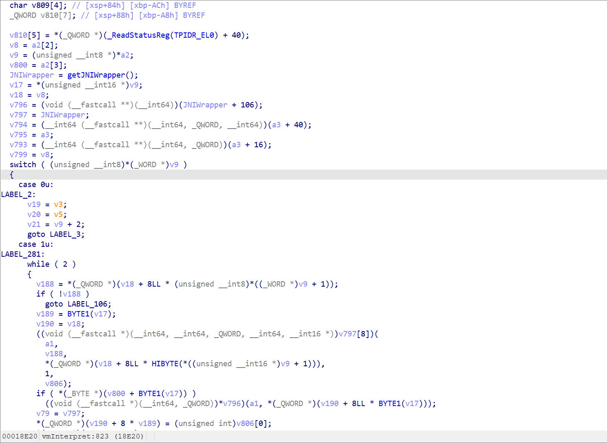

##### 逆向`vmInterpret`
发现是每条指令执行结束就跳转到swtich table查表
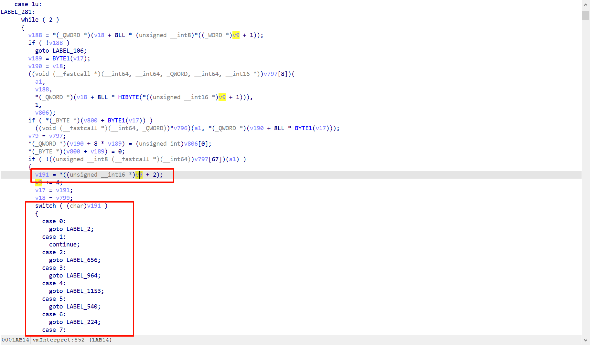


上面虽然将`switch table`修复了，但是`vmInterpret`还是不能看，各种局部变量v18，v118无法识别，以及函数结构实在太庞大。
本来准备分析`trace`中一条dalvik指令，看各种变量对应的是什么。但是有一种更好的方式：找一个不复杂的case，来分析对应的dalvik指令。比如dalvik指令`move vA, vB`，那么对应的case肯定是比较简单的。
比如：case 2
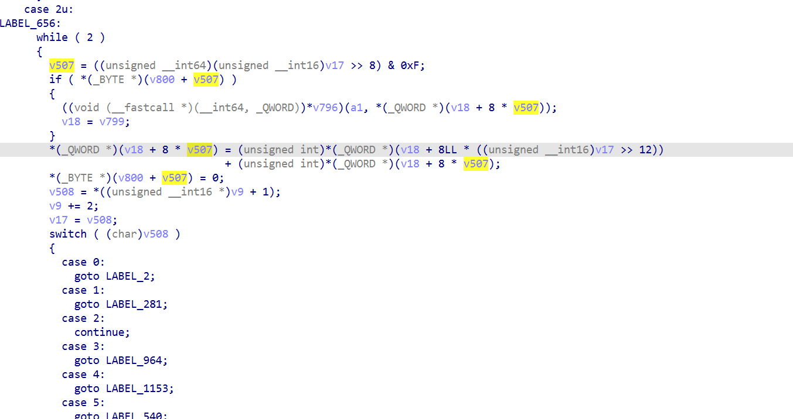
`v507`来自`v17`右移8位的低4位，`v17`来自a2，a2是X1寄存器来自调用者，可以看到`*a2`就是dalvik字节码地址`0x3a52e`。所以`v17`dalvik是字节码前2字节16位，`v507`是`v17`右移8位的低4位。
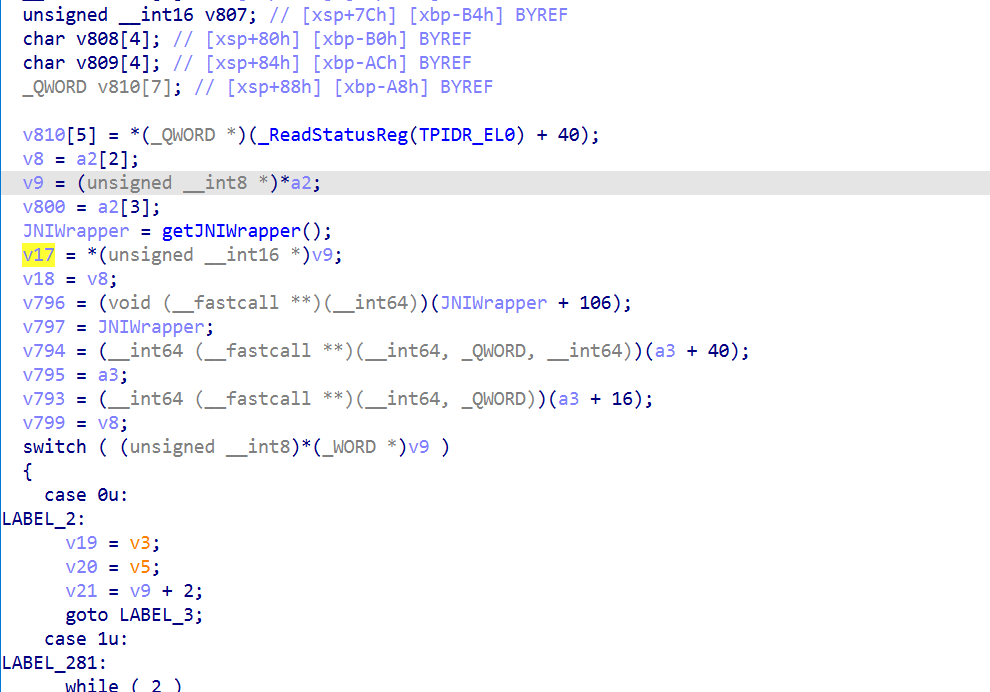
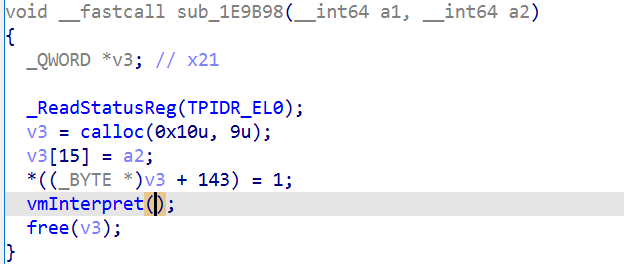
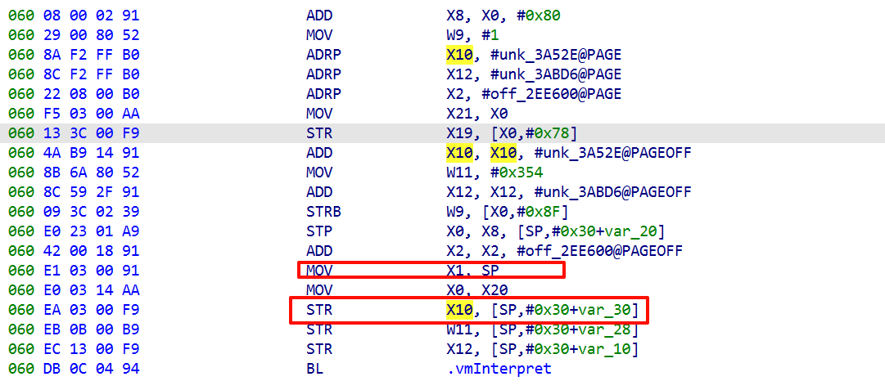
`v18`是个像基址一样的东西，来自a2偏移2个字节，在调用者中看来就是`[SP+16]`处的值，为calloc函数的返回值，确实是一个地址。
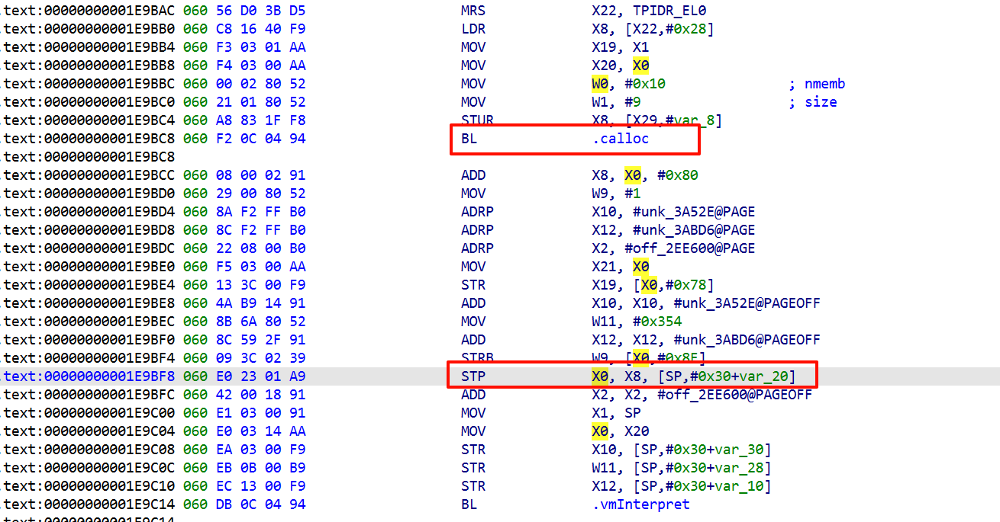
同时看函数功能，应该是add指令。这样就比较清晰了。在`dex vmp`中一般会申请一段内存空间，来作为dalvik寄存器使用，也就是smali语句中的v1、v2等寄存器。`v18`是内存空间起始地址，`v507`是字节码中读出的寄存器索引，用来访问内存空间中的寄存器值。`v796`是`JNIWrapper+106`为`DeleteLocalRef`函数。`v800+v507`处是对象引用标识，对应的是`v507`指示的寄存器中的对象是否引用对象，因为`dex vmp`需要这个标识来创建或者删除JNIEnv中的本地引用。
去官网找相关指令：https://source.android.google.cn/docs/core/runtime/instruction-formats?hl=zh-cn
可以看到只有这个格式是满足要求的，2字节指令长度，且高8位是2个不同寄存器索引。
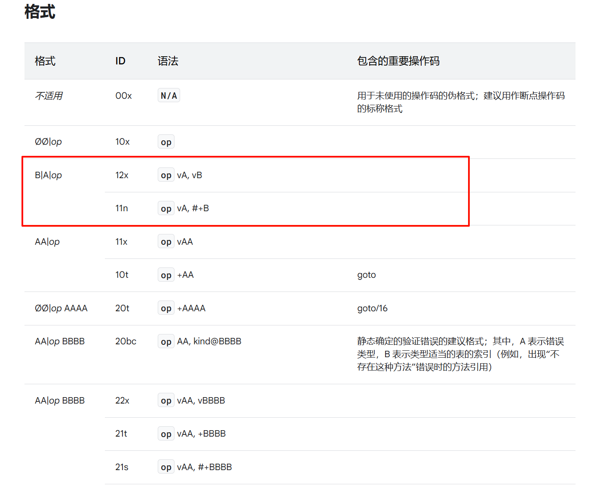
功能和add差不多，只能是：https://source.android.google.cn/docs/core/runtime/dalvik-bytecode?hl=zh-cn
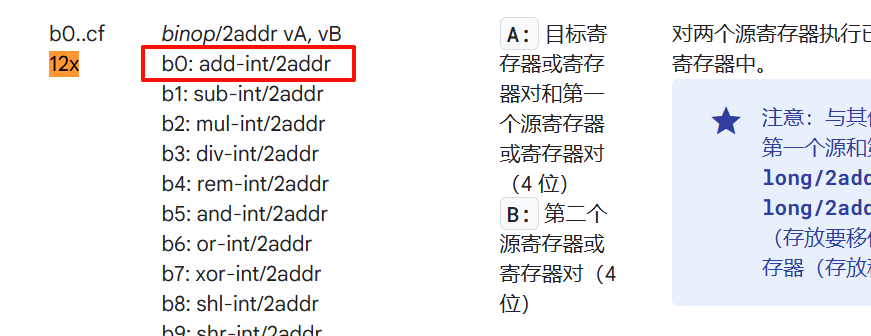
改下命名更直观如下：DvmBytes16代表字节码起始地址取16位字节码
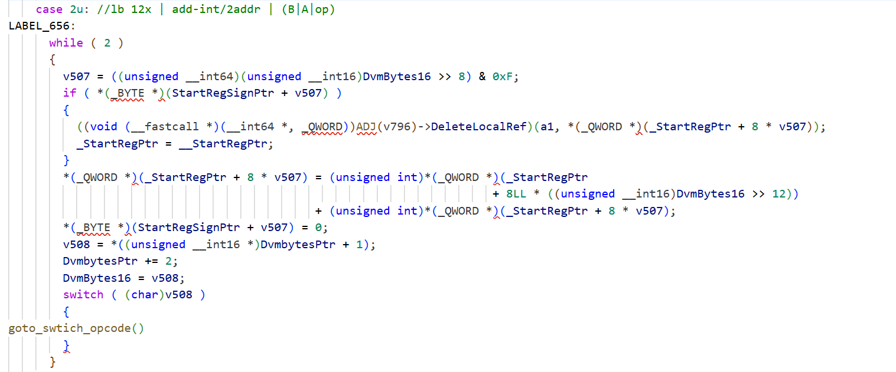


接下来各种变量结构可以相应分析复原了：
`getJNIWrapper`返回的是JNI函数的地址`0x3ea98`。`dex vmp`需要用到JNI函数实现对应的java功能。
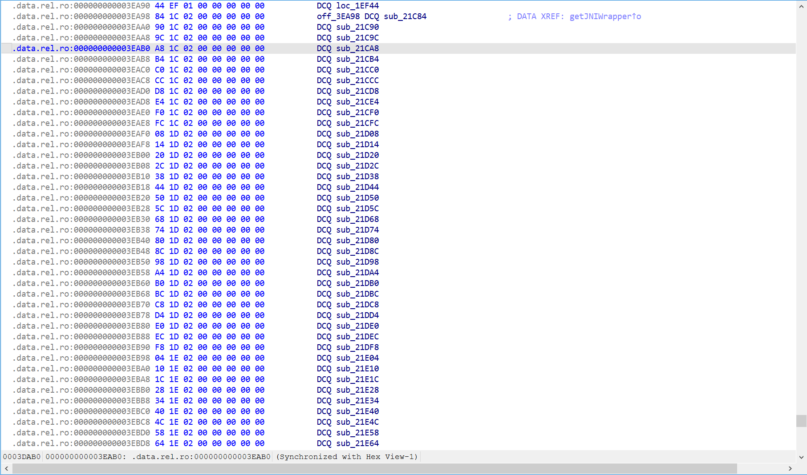
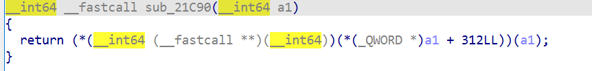

调用者：
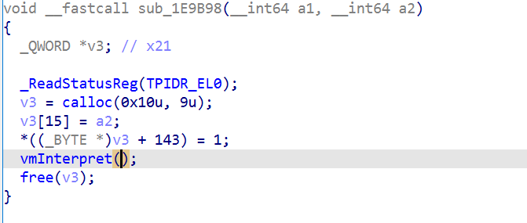
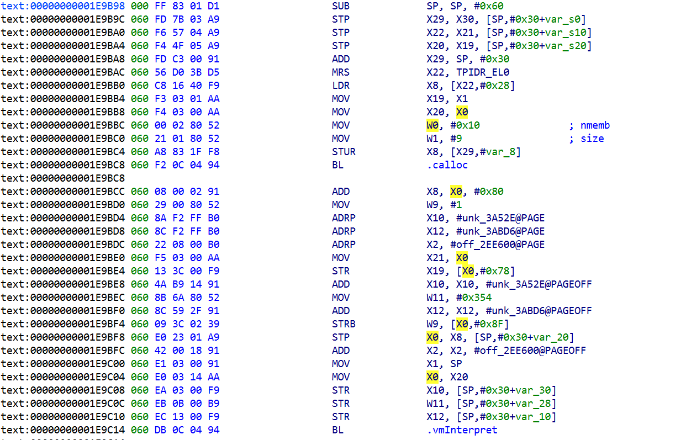
==**调用`vmInterpret`时:**==
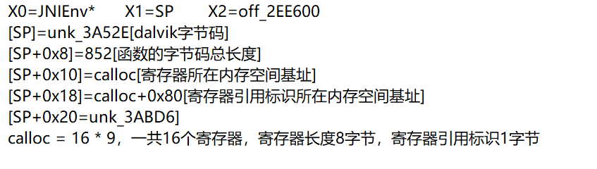
到目前，对于一条dalvik字节码，能知道他opcode对应的实现地址，能知道寄存器对应的变量，但是还缺少的就是类，方法，字符串等的索引，或者名字。其实和上面的X2传参off_2EE600有关。
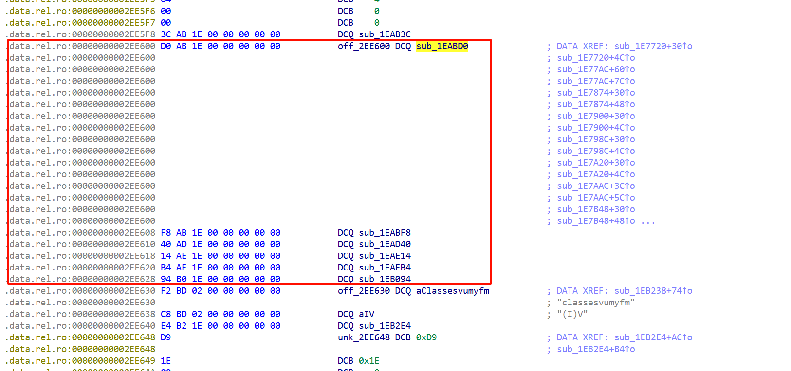
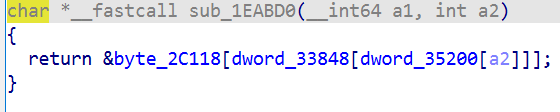

分析下是根据传入的index，在`byte_2C118`处取字符串，调用jni方法FindClass或者GetMethodID等获取相应的类或者方法ID对象。
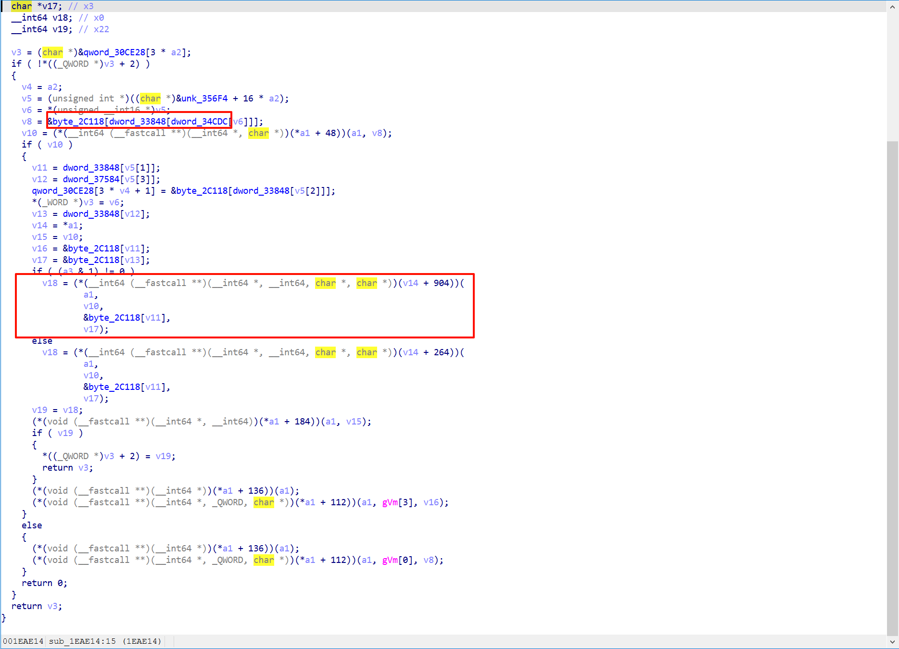
分析下`trace`：调用off_2EE600处的函数时，传参w1从字节码0x3a52e处获取的。所以类，方法，字符串等名字都可以通过off_2EE600处的函数获取，更准确就是`byte_2C118`里面获取，这应该就是原dex文件的`String`data区
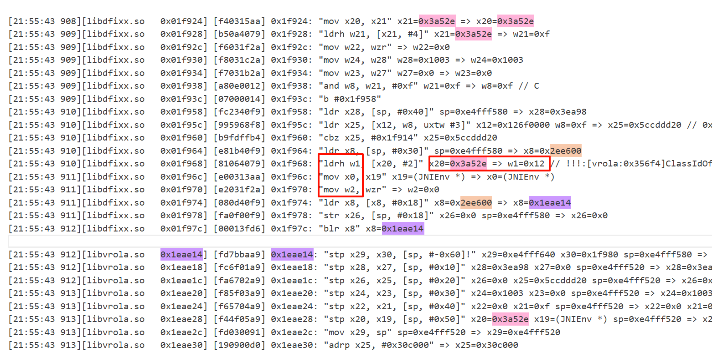
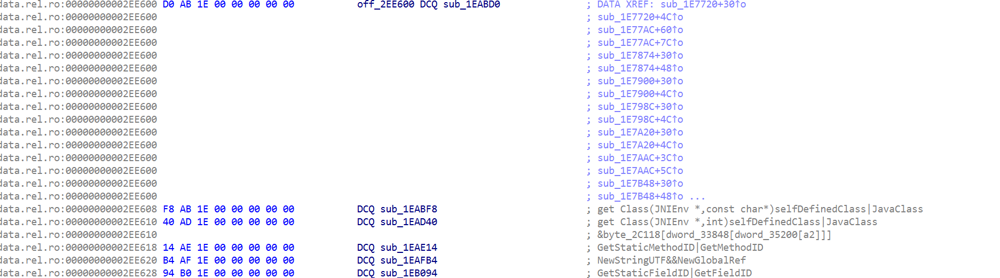
至此，各种变量结构可以相应分析复原了


创建结构并更改变量类型：
<details>
<summary>创建ida结构脚本</summary>
<div style="max-height: 400px; overflow-y: auto; padding: 0 10px;">

```python
import idaapi
import idc
import ida_bytes
import ida_funcs
import ida_typeinf
import re


# JDK/JRE 1.6
JNI_MAP = {
    13: "Throw",
    15: "ExceptionOccurred",
    17: "ExceptionClear",
    23: "DeleteLocalRef",
    24: "IsSameObject",
    25: "NewLocalRef",
    27: "AllocObject",
    32: "IsInstanceOf",
    36: "CallObjectMethodA",
    39: "CallBooleanMethodA",
    42: "CallByteMethodA",
    45: "CallCharMethodA",
    48: "CallShortMethodA",
    51: "CallIntMethodA",
    54: "CallLongMethodA",
    57: "CallFloatMethodA",
    60: "CallDoubleMethodA",
    63: "CallVoidMethodA",
    66: "CallNonvirtualObjectMethodA",
    69: "CallNonvirtualBooleanMethodA",
    72: "CallNonvirtualByteMethodA",
    75: "CallNonvirtualCharMethodA",
    78: "CallNonvirtualShortMethodA",
    81: "CallNonvirtualIntMethodA",
    84: "CallNonvirtualLongMethodA",
    87: "CallNonvirtualFloatMethodA",
    90: "CallNonvirtualDoubleMethodA",
    93: "CallNonvirtualVoidMethodA",
    95: "GetObjectField",
    96: "GetBooleanField",
    97: "GetByteField",
    98: "GetCharField",
    99: "GetShortField",
    100: "GetIntField",
    101: "GetLongField",
    102: "GetFloatField",
    103: "GetDoubleField",
    104: "SetObjectField",
    105: "SetBooleanField",
    106: "SetByteField",
    107: "SetCharField",
    108: "SetShortField",
    109: "SetIntField",
    110: "SetLongField",
    111: "SetFloatField",
    112: "SetDoubleField",
    116: "CallStaticObjectMethodA",
    119: "CallStaticBooleanMethodA",
    122: "CallStaticByteMethodA",
    125: "CallStaticCharMethodA",
    128: "CallStaticShortMethodA",
    131: "CallStaticIntMethodA",
    134: "CallStaticLongMethodA",
    137: "CallStaticFloatMethodA",
    140: "CallStaticDoubleMethodA",
    143: "CallStaticVoidMethodA",
    145: "GetStaticObjectField",
    146: "GetStaticBooleanField",
    147: "GetStaticByteField",
    148: "GetStaticCharField",
    149: "GetStaticShortField",
    150: "GetStaticIntField",
    151: "GetStaticLongField",
    152: "GetStaticFloatField",
    153: "GetStaticDoubleField",
    154: "SetStaticObjectField",
    155: "SetStaticBooleanField",
    156: "SetStaticByteField",
    157: "SetStaticCharField",
    158: "SetStaticShortField",
    159: "SetStaticIntField",
    160: "SetStaticLongField",
    161: "SetStaticFloatField",
    171: "GetArrayLength",
    172: "NewObjectArray",
    173: "GetObjectArrayElement",
    174: "SetObjectArrayElement",
    175: "NewBooleanArray",
    176: "NewByteArray",
    177: "NewCharArray",
    178: "NewShortArray",
    179: "NewIntArray",
    180: "NewLongArray",
    181: "NewFloatArray",
    182: "NewDoubleArray",
    199: "GetBooleanArrayRegion",
    200: "GetByteArrayRegion",
    201: "GetCharArrayRegion",
    202: "GetShortArrayRegion",
    203: "GetIntArrayRegion",
    204: "GetLongArrayRegion",
    205: "GetFloatArrayRegion",
    206: "GetDoubleArrayRegion",
    207: "SetBooleanArrayRegion",
    208: "SetByteArrayRegion",
    209: "SetCharArrayRegion",
    210: "SetShortArrayRegion",
    211: "SetIntArrayRegion",
    212: "SetLongArrayRegion",
    213: "SetFloatArrayRegion",
    214: "SetDoubleArrayRegion",
    217: "MonitorEnter",
    218: "MonitorExit",
    222: "GetPrimitiveArrayCritical",
    228: "ExceptionCheck",
    4: "GetVersion",
    5: "DefineClass",
    6: "FindClass",
    7: "FromReflectedMethod",
    8: "FromReflectedField",
    9: "ToReflectedMethod",
    10: "GetSuperclass",
    11: "IsAssignableFrom",
    12: "ToReflectedField",
    14: "ThrowNew",
    16: "ExceptionDescribe",
    18: "FatalError",
    19: "PushLocalFrame",
    20: "PopLocalFrame",
    21: "NewGlobalRef",
    22: "DeleteGlobalRef",
    26: "EnsureLocalCapacity",
    31: "GetObjectClass",
    33: "GetMethodID",
    94: "GetFieldID",
    113: "GetStaticMethodID",
    144: "GetStaticFieldID",
    162: "SetStaticDoubleField",
    163: "NewString",
    164: "GetStringLength",
    165: "GetStringChars",
    166: "ReleaseStringChars",
    167: "NewStringUTF",
    168: "GetStringUTFLength",
    169: "GetStringUTFChars",
    170: "ReleaseStringUTFChars",
    183: "GetBooleanArrayElements",
    184: "GetByteArrayElements",
    185: "GetCharArrayElements",
    186: "GetShortArrayElements",
    187: "GetIntArrayElements",
    188: "GetLongArrayElements",
    189: "GetFloatArrayElements",
    190: "GetDoubleArrayElements",
    191: "ReleaseBooleanArrayElements",
    192: "ReleaseByteArrayElements",
    193: "ReleaseCharArrayElements",
    194: "ReleaseShortArrayElements",
    195: "ReleaseIntArrayElements",
    196: "ReleaseLongArrayElements",
    197: "ReleaseFloatArrayElements",
    198: "ReleaseDoubleArrayElements",
    215: "RegisterNatives",
    216: "UnregisterNatives",
    219: "GetJavaVM",
    220: "GetStringRegion",
    221: "GetStringUTFRegion",
    226: "NewWeakGlobalRef",
    227: "DeleteWeakGlobalRef",
    229: "NewDirectByteBuffer",
    230: "GetDirectBufferAddress",
    231: "GetDirectBufferCapacity",
    232: "GetObjectRefType",
    233: "GetModule",
    234: "IsVirtualThread"
}

def create_jniwrapper_struct():
    # 定义内部函数get_imm，用于从函数中提取内存偏移量
    """
        # 获取指定地址的函数信息
    创建JNIWrapper结构体的函数，用于IDA Pro中分析JNI方法调用
        # 如果没有找到函数，返回None
    该函数通过分析特定地址范围内的指令，提取JNI方法信息，
        # 获取函数的起始和结束地址
    并创建一个结构体来表示JNI方法表的结构。
    """
    def get_imm(func_ea):
        # 遍历函数中的每条指令
        func = ida_funcs.get_func(func_ea)
            # 生成当前地址的反汇编指令字符串
        if not func: return None
            # 使用正则表达式匹配LDR指令中的内存地址
        start_ea = func.start_ea
            # 如果找到匹配项，返回计算后的偏移量（除以8）
        end_ea = func.end_ea
        ea = start_ea
        while ea <= end_ea:
            insn_str = idc.generate_disasm_line(ea, 0)
    # 定义JNIWrapper结构的起始地址
            m = re.search(r"LDR .*?\[.*?#0x([0-9A-Fa-f]+)\]", insn_str)
    # 定义JNIWrapper结构的结束地址
            if m:
    # 定义结构体名称
                return int(m.group(1), 16) // 8
    # 初始化偏移量
            ea += 4
    # 从起始地址开始遍历
        return None
    # 初始化字段列表
    START_ADDR = 0x3EA98
    # 遍历地址范围内的每个双字（8字节）
    END_ADDR = 0x3EDE8
        # 获取当前地址存储的函数地址
    STRUCT_NAME = "JNIWrapper"
    off = 0
    ea = START_ADDR
    field_list = []
    while ea <= END_ADDR:
        func_ea = ida_bytes.get_qword(ea)
        # 取JNI方法名（兜底用unk_偏移）
    #  print(get_imm(func_ea))
        name = JNI_MAP.get(get_imm(func_ea), f"unk_{off:X}")
        field_list.append((name,ida_typeinf.BTF_UINT64,off))
        ea += 8
        off += 8

    tif = ida_typeinf.tinfo_t()
    if tif.get_named_type(None, STRUCT_NAME):
        ida_typeinf.del_named_type(None, STRUCT_NAME, ida_typeinf.NTF_TYPE)

    udt = ida_typeinf.udt_type_data_t()
    udm = ida_typeinf.udm_t()
    for (name, type, offset) in field_list:
        udm.name = name
        udm.type = ida_typeinf.tinfo_t(type)
        udm.offset = offset
        udt.push_back(udm)
    if tif.create_udt(udt):
        tif.set_named_type(None, STRUCT_NAME)

def create_getmethod_struct():
    STRUCT_NAME = "off_2EE600"

    tif = ida_typeinf.tinfo_t()
    if tif.get_named_type(None, STRUCT_NAME):
        ida_typeinf.del_named_type(None, STRUCT_NAME, ida_typeinf.NTF_TYPE)

    field_list = [
        ("getStr",ida_typeinf.BTF_UINT64,0),
        ("getClassC",ida_typeinf.BTF_UINT64,8),
        ("getClassI",ida_typeinf.BTF_UINT64,16),
        ("getSOMethodID",ida_typeinf.BTF_UINT64,24),
        ("NewStringUTF_NewGlobalRef",ida_typeinf.BTF_UINT64,32),
        ("GetSOFieldID",ida_typeinf.BTF_UINT64,40),
        ]
    udt = ida_typeinf.udt_type_data_t()
    udm = ida_typeinf.udm_t()
    for (name, type, offset) in field_list:
        udm.name = name
        udm.type = ida_typeinf.tinfo_t(type)
        udm.offset = offset
        udt.push_back(udm)
    if tif.create_udt(udt):
        tif.set_named_type(None, STRUCT_NAME)

def create_codereg_struct():
    STRUCT_NAME = "Code_Reg"

    tif = ida_typeinf.tinfo_t()
    if tif.get_named_type(None, STRUCT_NAME):
        ida_typeinf.del_named_type(None, STRUCT_NAME, ida_typeinf.NTF_TYPE)

    field_list = [
        ("DvmbytesPtr",ida_typeinf.BTF_UINT64,0),
        ("DvmbytesLen",ida_typeinf.BTF_UINT64,8),
        ("StartRegPtr",ida_typeinf.BTF_UINT64,16),
        ("StartRegSignPtr",ida_typeinf.BTF_UINT64,24),
        ]
    udt = ida_typeinf.udt_type_data_t()
    udm = ida_typeinf.udm_t()
    for (name, type, offset) in field_list:
        udm.name = name
        udm.type = ida_typeinf.tinfo_t(type)
        udm.offset = offset
        udt.push_back(udm)
    if tif.create_udt(udt):
        tif.set_named_type(None, STRUCT_NAME)

create_jniwrapper_struct()
create_getmethod_struct()
create_codereg_struct()
```
</div>
</details>

创建好结构后更改变量类型即可，其他用结构体指针即可。指向结构体内成员的指针，用\_\_shifted()指针

<https://www.cnblogs.com/DirWang/p/18124003>

因为v796是<code><font style="color:rgba(0, 0, 0, 0.85);background-color:rgba(0, 0, 0, 0.04);">void (__fastcall **v796)(__int64)</font></code>，二级函数指针

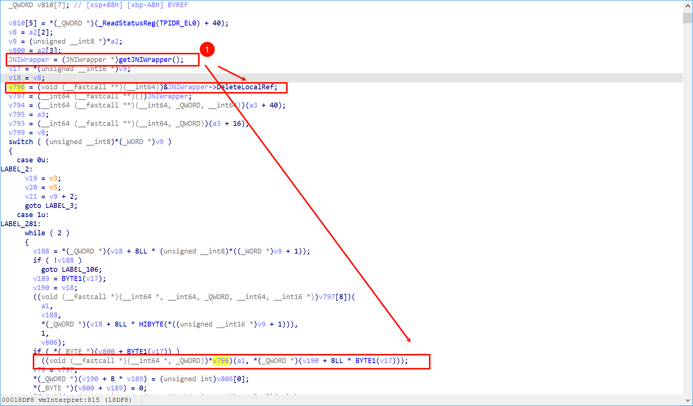


IDA重新编译后，将代码复制下来，非常直观。


接下来是写一个`reverse vmInterpret`，反向解析`dex vmp`字节码，写出smali指令即可。
如下，还原一条指令示例：
<details>
<summary>vminterpret还原示例代码</summary>
<div style="max-height: 400px; overflow-y: auto; padding: 0 10px;">

```python
import ida_bytes
import idaapi
from ida_idaapi import ea_t

def DWORD32(ptr):
    return ida_bytes.get_dword(ea_t(ptr))
def WORD16(ptr):
    return ida_bytes.get_word(ea_t(ptr))
def get_c_string(ptr):
    string = ida_bytes.get_strlit_contents(ea_t(ptr), -1, 0)
    return string.decode("utf-8", errors="replace")
def get_method(off):
    byte_2C118 = ea_t(0x2C118)
    dword_33848 = ea_t(0x33848)
    dword_34CDC = ea_t(0x34CDC)
    dword_37584 = ea_t(0x37584)
    DWORD_LENGTH = 4 

    unk_356F4 = ea_t(0x356F4)
    v5 = unk_356F4 + 16 * off
    v6 = WORD16(v5)
    class_name = get_c_string(byte_2C118 + DWORD32(dword_33848 + DWORD_LENGTH * DWORD32(dword_34CDC + DWORD_LENGTH * v6)))
    method_name = get_c_string(byte_2C118 + DWORD32(dword_33848 + DWORD_LENGTH * DWORD32(v5 + 4)))
    shorty = get_c_string(byte_2C118 + DWORD32(dword_33848 + DWORD_LENGTH * DWORD32(v5 + 8)))
    method_sig = get_c_string(byte_2C118 + DWORD32(dword_33848 + DWORD_LENGTH * DWORD32(dword_37584 + DWORD_LENGTH * DWORD32(v5 + 12))))
    # print(class_name, method_name, shorty, method_sig)
    return f"L{class_name};->{method_name}{method_sig}"
    
def main(X1,X2):
    PC = X1

    returned = False
    while (not returned):
        codes_16 = WORD16(X1)
        opcode = codes_16 & 0xFF
        match opcode:
            # 35c invoke-super A|G|op BBBB F|E|D|C
            case 0x03:
                insn_len = 6
                first_word = WORD16(X1)
                A = first_word >> 12
                G = first_word >> 8 & 0xF
                second_word = WORD16(X1+2)
                method_off = second_word
                third_word = WORD16(X1+4)
                C = third_word & 0xF
                D = third_word >> 4 & 0xF
                E = third_word >> 8 & 0xF
                F = third_word >> 12

                method = ""
                if(X2 == 0x2EE600):
                   method = get_method(method_off)
                elif(X2 == 0x30ADC8):
                    pass
                    
                if A > 0:
                    REG = [f"v{int(C)}", f"v{int(D)}", f"v{int(E)}", f"v{int(F)}",f"v{int(G)}"]
                    regs = ""
                    for i in range(A):
                        regs += REG[i] + ","
                    regs = regs[:-1]
                    print("invoke-super " + "{" + f"{regs}" + "}" + " " +  f", {method}")
                else:
                    pass
            # 3rc invoke-super/range
            case 0xdc:
                pass
        # print(hex(opcode))
        returned = True

if __name__ == "__main__":
    # libvrola.so
    off_2EE600 = 0x2EE600
    unk_3B460 = 0x3B460

    X1 = ea_t(unk_3B460)
    X2 = ea_t(off_2EE600)
    main(X1,X2)
```
</div>
</details>


需要看哪个函数写那个函数即可。还原效果如下：


主要代码：

`parse`函数解析特定格式，格式详见官方文档

`getmethod`获取方法名，是`off_2EE600`处函数的实现


`TAppend`添加smali语句所需信息，地址、label、长度，实际指令

`TREGNUMBER`保存该条指令用到的最大的v寄存器
opcode对照<https://quantiti.github.io/dalvik-opcodes/> 


##### 问题：
1、未知变量
遇到v5，v4不知道是什么，在该case中从未出现，查找发现应该是上一步操作的返回结果。


所以这里应该是move-result，查看dalvik指令格式，有三种格式的move-result。vminterpret中查找v5、v4也发现三种实现。具体区别在于结果是否引用类型，以及结果长度是单字还是双字。如：move-result-object vAA，result结果是object引用对象（并存在localref jnienv本地引用），长度是双字，所以下面`*(_BYTE *)(StartRegSignPtr + BYTE1(DvmBytes16)) = 1;`设置标志位为1，`*(_QWORD *)(_StartRegPtr + 8LL * BYTE1(DvmBytes16)) = LODWORD(v5) | ((unsigned __int64)(unsigned int)v4 << 32);`双字（8字节）赋值


2、IDA读取中文字符串失败


定位到`get_c_string`方法


看下该地址：


和上面字符串data区域还不一样，解码不出来。那猜测是中文字符串


调整参数type试试，不行就自实现。这几个都试了，最后还是读出来None


自实现了下可以了


3、smali语法问题
错误：


修改：


字符串escape问题：不能直接使用`const-string`指令的string，需要转义


4、字面量问题：dalvik中有符号常量，需按特定算法获取值


5、if跳转问题：dalvik中根据test结果跳转指令，可以通过存储label对应的address，在输出smali指令时一起输出label与goto label


6、最大的问题：不同dalvik指令的vmp函数实现可能相同，如何区别？如何根据一个函数倒推dalvik指令？
如图：不同case（jni调用都是CallXXXMethodA），代码几乎相同。如何确定是哪条dalvik指令

如下，2条指令的`vmInterpret`实现是一样的，现在需要确定`case 0xD8u`对应的dalvik指令：


解决：
①根据`vmInterpret`源码，确定指令格式


DvmbytesPtr是该条指令字节码开始的地方，可以看作PC指针。

DvmBytes16是PC当前字节码前2个字节，16位

StartRegSignPtr是寄存器标识开始的地方，基址

\_StartRegPtr是寄存器基址，vminterpret分配一段内存空间作为寄存器使用，这里即是内存空间的基址

BYTE1(DvmBytes16)是IDA解析显示的结果，其汇编指令是从某个寄存器的第8位开始取高8位（实际遇到要看实际汇编），这里即是取DvmBytes16的高8位

这里能确认的信息是，指令的格式是<font style="color:rgb(32, 33, 36);background-color:rgba(255, 255, 255, 0.95);">AA|</font>*<font style="color:rgb(32, 33, 36);">op</font>*<font style="color:rgb(32, 33, 36);background-color:rgba(255, 255, 255, 0.95);"> BBBB。①指示的是从当前（PC+1）处取16位，PC是16位的，所以即是取的BBBB，②是获取的DvmBytes16的高8位即AA，AA是寄存器index索引，加上\_StartRegPtr即是寄存器地址，③还可以看出BBBB应该是一个字面量，或者说立即数，而不是索引</font>

<font style="color:rgb(32, 33, 36);background-color:rgba(255, 255, 255, 0.95);">根据官方格式文档可以确定格式是如下几种</font>


基本可以确定是21s格式，const指令。

可以看到应该一个是const/16，一个是const-wide/16。由于`vminterpret`设计的寄存器是8字节64位的，所以不需要额外操作，在`vminterpret`实现看起来就是一模一样的。在java层或者smali层看起来就不太一样，const-wide/16，那么实际上是给1个寄存器对即2个寄存器赋值了，如const-wide/16 v0,0000 那么实际上是v0=0且v1=0，那么后续就不需要再给v1赋值了，这就是上下文的不同。

②根据上下文。跳过当前opcode是0xd8的指令，再看看下面指令


opcode为0x50


看下面这条代码，就是比较2个寄存器的大小，然后跳转的指令，比较的是DvmBytes16的高8位的高4位和低4位代表的寄存器。回到原指令，5250，003a，所以是比较v5与v2寄存器的大小。实际dalvik指令是`if-lt`

最后确定d8，根据下面比较v5与v2，v2是SDK\_INT，d8指令AA是05，所以d8指令（05d8,001a），即把26存到v5寄存器，d8即是<code><font style="color:rgb(32, 33, 36);background-color:rgba(255, 255, 255, 0.95);">const/16 vAA, #+BBBB</font></code>

总结：
①从反编译的`vmInterpret`源代码推测原dalvik指令  
②从官方文档查找格式相同，语义符合源代码功能的dalvik指令  
③注意操作的数据类型，int，float，long，double等
④通过上下文确定实际的dalvik指令  
⑤不必还原所有dalvik指令，业务功能并不会用到所有的
==⑥获取每条指令的长度，未实现的跳过，但打印出相关类方法名，直接打印出所有已实现未实现的，根据上下文能很快确定并还原所有指令==

7、批量获取`vmInterpret`调用参数
因为函数都通过registerNatives注册，知道所有的函数在libvrola.so中的地址。还原一个函数所需要的字节码地址、指令长度、寄存器个数、函数元信息，都是在调用vminterpret前准备好的，所以只需要模拟执行到vminterpret之前查看相关寄存器和内存数据即可得到。下面用unicorn来模拟执行获取了相关数据：


①是在BR 17的时候hook，比较got表项地址来判断是否在调用calloc或者vminterpret。②是当调用calloc时，寄存器数量由calloc第一个参数给出，如果不调用calloc，dex vmp寄存器是用栈来模拟。③是调用vminterpret时得出指令码地址、指令长度、函数元信息等。④是由于在执行MRS X19,TPIDR_EL0时读写未映射的内存，因为不影响我们需要的结果所以直接hook掉随意返回就行。


最后批量运行获取所有函数的相关信息即可。
**注意批量运行，要重置模拟器，最好寄存器内存全部重新映射重置。**

<details>
<summary>批量获取vminterpret调用参数</summary>
<div style="max-height: 400px; overflow-y: auto; padding: 0 10px;">

```python
from unicorn import *
from unicorn.x86_const import *
from unicorn.arm_const import *
from unicorn.arm64_const import *
import angr
from capstone import *

# 定义 amd64 架构的上下文
class amd64_ctx:
    # 架构寄存器映射
    regs = {
        'sp': UC_X86_REG_RSP,  # 堆栈指针寄存器（RSP）
        'bp': UC_X86_REG_RBP,  # 基指针寄存器（RBP）
    }

    def get_emu(self):
        # 创建并返回一个 X86-64 架构的模拟器对象
        emu = Uc(UC_ARCH_X86, UC_MODE_64)
        emu.mem_map(0, 0x1000)  # 映射内存，以避免访问 gs 或 fs 时发生异常
        return emu

# 定义 ARM 架构的上下文
class arm_ctx:
    # 架构寄存器映射
    regs = {
        'sp': UC_ARM_REG_SP,  # 堆栈指针寄存器（SP）
    }

    def get_emu(self):
        # 创建并返回一个 ARM 架构的模拟器对象（使用 THUMB 模式）
        return Uc(UC_ARCH_ARM, UC_MODE_THUMB)

# 定义 AARCH64 架构的上下文
class aarch64_ctx:
    # 架构寄存器映射
    regs = {
        'sp': UC_ARM64_REG_SP,  # 堆栈指针寄存器（SP）
    }

    def get_emu(self):
        # 创建并返回一个 AARCH64 架构的模拟器对象（使用 ARM 模式）
        return Uc(UC_ARCH_ARM64, UC_MODE_ARM)

binary = "libvrola.so"
# 初始化 angr 项目，加载目标二进制文件，禁用自动加载库
project = angr.Project(binary, load_options={'auto_load_libs': False})

# 根据架构类型选择对应的上下文对象
if project.arch.name == "ARMEL":
    arch_ctx = arm_ctx()
elif project.arch.name == "AMD64":
    arch_ctx = amd64_ctx()
elif project.arch.name == "AARCH64":
    arch_ctx = aarch64_ctx()
else:
    # 如果不支持的架构，抛出异常
    raise Exception("Unsupported architecture")


def get_info(target_method_vaddr,param_count):
    global project

    # 获取模拟器对象
    emu = arch_ctx.get_emu()

    # 设置堆栈地址和大小
    STACK_ADDRESS = 0x1234000
    STACK_SIZE = 0x3000

    # 为堆栈区域映射内存
    emu.mem_map(STACK_ADDRESS, STACK_SIZE)

    # 设置堆栈指针（SP）寄存器
    emu.reg_write(arch_ctx.regs['sp'], STACK_ADDRESS + STACK_SIZE - 0x1000)

    # 如果有基指针（BP）寄存器，设置 BP 寄存器
    if 'bp' in arch_ctx.regs:
        emu.reg_write(arch_ctx.regs['bp'], STACK_ADDRESS + STACK_SIZE - 0x1000 + 0x300)

    so_base = None
    so_base_getted = False

    # 映射二进制文件的各个段到模拟器内存
    for seg in project.loader.main_object.segments:
        # 计算段的起始地址和结束地址（对齐到页面边界）
        mem_start = seg.vaddr & ~0xFFF
        if not so_base_getted:
            so_base = mem_start
            so_base_getted = True
        mem_end = (seg.vaddr + seg.memsize + 0xFFF) & ~0xFFF
        
        try:
            # 映射内存区域
            emu.mem_map(mem_start, mem_end - mem_start)
        except:
            # 如果映射失败，尝试重新计算起始地址
            mem_start = (seg.vaddr + 0xFFF) & ~0xFFF
            if mem_start < mem_end and mem_start:
                emu.mem_map(mem_start, mem_end - mem_start)
            else:
                continue
        
        # 将段的内容写入模拟器内存
        emu.mem_write(seg.vaddr, project.loader.memory.load(seg.vaddr, seg.filesize))


    result = {
        "dalvik_bytes_ptr": None,
        "insn_number": None,
        "reg_number": None,
        "get_meta_ptr": None,
    }

    # print(hex(so_base))
    vminterpret_got_vaddr = 0x30b008
    vminterpret_got_paddr = so_base + vminterpret_got_vaddr
    # print(hex(vminterpret_got_paddr))

    calloc_got_vaddr = 0x30b010
    calloc_got_paddr = so_base + calloc_got_vaddr
    # print(hex(calloc_got_paddr))

    target_method_paddr = so_base + target_method_vaddr
    print(hex(target_method_paddr))

    cs = Cs(CS_ARCH_ARM64, CS_MODE_ARM)
    
    # TraceValue = 0x123456789ABCDEF0
    # emu.reg_write(UC_ARM64_REG_X1,TraceValue)
    def hook_code(uc, address, size, user_data):
        nonlocal result
        vminterpret_addr = int.from_bytes(uc.mem_read(vminterpret_got_paddr,8), byteorder='little')
        calloc_addr = int.from_bytes(uc.mem_read(calloc_got_paddr,8), byteorder='little')
        insns = cs.disasm(uc.mem_read(address, size), address)
        for insn in insns:
            # print(f"0x{address}:{insn.mnemonic} {insn.op_str}")
            if insn.mnemonic == "br" and insn.op_str == "x17":
                x17_val = uc.reg_read(UC_ARM64_REG_X17)
                if x17_val == calloc_addr:
                    reg_number = uc.reg_read(UC_ARM64_REG_W0)
                    result["reg_number"] = f"0x{reg_number:X}"
                    uc.reg_write(UC_ARM64_REG_X0, 0x80000000)
                    uc.reg_write(UC_ARM64_REG_PC, uc.reg_read(UC_ARM64_REG_LR))
                elif x17_val == vminterpret_addr:
                    X1_val = uc.reg_read(UC_ARM64_REG_X1)
                    X2_val = uc.reg_read(UC_ARM64_REG_X2)
                    dalvik_bytes_ptr = int.from_bytes(uc.mem_read(X1_val, 8), byteorder='little') - so_base
                    insn_number = int.from_bytes(uc.mem_read(X1_val+0x8, 4), byteorder='little')
                    get_meta_ptr = X2_val - so_base
                    # if result["reg_number"] == None:
                    #     start_local_reg_ptr = int.from_bytes(uc.mem_read(X1_val+0x10, 8), byteorder='little')
                    #     thiz_local_reg_ptr = None
                    #     for i in range(16):
                    #         reg_ptr = start_local_reg_ptr + i * 8
                    #         try:
                    #             reg_val = int.from_bytes(uc.mem_read(reg_ptr, 8), byteorder='little')
                    #             print(hex(reg_val))
                    #         except:
                    #             raise Exception(start_local_reg_ptr,i)
                    #         if reg_val == TraceValue:
                    #             thiz_local_reg_ptr = reg_ptr
                    #             break
                    #     if thiz_local_reg_ptr != None:
                    #         tmp = int(int(thiz_local_reg_ptr - start_local_reg_ptr)/8 + 1) + param_count
                    #         result["reg_number"] = f"0x{tmp:X}"
                    #     else:
                    #         raise Exception("thiz_local_reg_ptr == None")

                    result["dalvik_bytes_ptr"] = f"0x{dalvik_bytes_ptr:X}"
                    result["insn_number"] = f"0x{insn_number:X}"
                    result["get_meta_ptr"] = f"0x{get_meta_ptr:X}"
                    uc.emu_stop()
    def hook_mem_error(uc, access, address, size, value, user_data):
        page_start = address & 0xFFFFF000
        uc.mem_map(page_start, 0x1000, UC_PROT_READ | UC_PROT_WRITE)
        uc.mem_write(address, b"\x78\x56\x34\x12\x78\x56\x34\x12")
        return True
    emu.hook_add(UC_HOOK_MEM_READ_UNMAPPED, hook_mem_error)
    emu.hook_add(UC_HOOK_MEM_WRITE_UNMAPPED, hook_mem_error)
    emu.hook_add(UC_HOOK_CODE, hook_code)

    emu.emu_start(target_method_paddr, 0, timeout=5*1000*1000)
    return result

text = None
with open("registerNatives.log","r",encoding="utf-8") as f:
    text = f.read()
import re
registerd_method_text = re.compile("[RegisterNatives].*?java_class:(.*?)name:(.*?)sig:(.*?)fnPtr.*?libvrola.so!(.*?)callee").findall(text)
def get_java_param_count(signature):
    param_part = signature.split(")")[0].lstrip("(")
    count = 0
    i = 0
    len_param = len(param_part)
    while i < len_param:
        if param_part[i] == "L":
            semicolon_idx = param_part.find(";", i)
            if semicolon_idx == -1:
                raise Exception("Invalid signature")
            count += 1
            i = semicolon_idx + 1
        elif param_part[i] == "[":
            i += 1
        elif param_part[i] in {"Z", "B", "S", "C", "I", "J", "F", "D"}:
            count += 1
            i += 1
        else:
            i += 1
    return count
method_info = []
for each in registerd_method_text:
    dic = {}
    dic["class"] = each[0].strip()
    dic["name"] = each[1].strip()
    dic["sig"] = each[2].strip()
    dic["addr"] = each[3].strip()
    dic["param_count"] = get_java_param_count(dic["sig"])
    method_info.append(dic)

# method_info = [{"addr":"0x201720"}]
# method_info = method_info[3:40:]
final_info = []
for each in method_info:
    target_method_vaddr = int(each["addr"],16)
    param_count = int(each["param_count"])
    info = get_info(target_method_vaddr,param_count)
    print(info)
    merged = {**each, **info}
    final_info.append(merged)
import json
with open("method_info.json","w",encoding="utf-8") as f:
    f.write(json.dumps(final_info,indent=4,ensure_ascii=False))
```
</div>
</details>

最后结果如图：存储原来method、field、class等信息就2个地址，0x2EE600和0x30ADC8，所以`reverse vmInterpret`很轻松


8、寄存器个数问题
上一条通过unicorn获取`vmInterpret`调用参数中，③下面本来是用于计算函数所需寄存器个数，原来计算寄存器个数的方法，是根据x29的值确定的，也即假定了布局都是寄存器、MRS结果、X29这样。


但是出现错误：这里未知变量

查看smali代码：实际应该只有8个寄存器，所以寄存器个数计算错误，修改算法。不用MRS指令结果或者X29定位寄存器的结束位置。

因为从下面2个函数栈布局可以看出，实际寄存器个数是无法通过X29，或者寄存器起始地址，或者寄存器引用标识起始地址等确定的。即便jnienv*，thiz参数会从java层传到so层，但是如果函数中没有用到的话，也不会在smali指令中占有寄存器，所以也无法根据thiz的位置来确定寄存器结尾地址。

解决：统计smali指令中出现的最大寄存器序号，再计算出需要的寄存器个数。


9、一些dalvik指令dex vmp实现的区别

`move vA, vB`和`move-wide vA, vB`的核心区别
拷贝int值（32位）
```
const/4 v1, 0x10  # v1 = 16（32位int）
move v0, v1       # 把v1的32位数据拷贝到v0 → v0=16
```
拷贝long值（64位）
```
const-wide/16 v2, 0x1000  # v2+v3 = 4096（long，v2=低32位，v3=高32位）
move-wide v0, v2          # 把v2+v3的64位数据拷贝到v0+v1 → v0+v1=4096
```
虽然vminterpret寄存器是64位的，但是move与move-wide实现仍然有区别。因为在翻译原dalvik指令时，原dalvik指令move-wide是将数据存在寄存器对（2个寄存器中），所以翻译实现时也需要读取2个寄存器的值。
但是对于`const-wide/16`与`const/16`，在vminterpret的实现就一样的了，因为是直接从字面量（立即数）赋值给寄存器，所以不需要考虑寄存器对的问题。


dalvik指令`long-to-int`与`move`的实现一样：


区分只能根据上下文：这里能确定是`long-to-int`


其他、
jadx的警告，经查看可以忽略，应该不是反vminterpret代码算法问题


type inference类型推断，`o.pf`是`CopyOnWriteArrayList`类型


jadx-gui启动总是被360阻止，显示powershell危险命令行攻击。解决：添加环境变量
https://github.com/skylot/jadx/issues/2159


参考：
<https://hex-rays.com/blog/jump-tables>

<https://geneblue.github.io/2019/09/13/android/sec--android-dex-vmp/>

<https://bbs.kanxue.com/thread-281427.htm>

<https://www.cnblogs.com/theseventhson/p/14933920.html>

<https://www.cnblogs.com/DirWang/p/18036475>

<https://bbs.kanxue.com/thread-280240-1.htm>

<https://sechub.in/view/2378329>

<https://hex-rays.com/blog/jump-tables>

<https://www.cnblogs.com/DirWang/p/18036475>

<https://chujdk.github.io/mess/1345.html>

#### de-ollvm

##### 虚假控制流
###### 将不透明谓词处地址设置为只读，且不透明谓词全部给初始值为0
```python
import ida_segment
import ida_bytes

seg = ida_segment.get_segm_by_name('.bss')

for ea in range(seg.start_ea, seg.end_ea,4):
    ida_bytes.patch_bytes(ea, int(2).to_bytes(4,'little'))

'''
seg.perm: 由三位二进制数表示,例如一个segment为可读,不可写,不可执行,则seg.perm = 0b100
(seg.perm >> 2)&1: Read
(seg.perm >> 1)&1: Write
(seg.perm >> 0)&1: Execute
'''
seg.perm = 0b100
```

<details>
<summary>去除效果</summary>
<div style="max-height: 400px; overflow-y: auto; padding: 0 10px;">

```c
__int64 __fastcall sub_16560(
        __int64 a1,
        __int64 a2,
        __int64 a3,
        __int64 a4,
        __int64 a5,
        unsigned __int8 a6,
        unsigned __int8 a7,
        __int64 a8,
        __int64 a9)
{
  __int64 result; // x0
  int i; // w8
  int v11; // w8
  int m; // w8
  int j; // w8
  int k; // w8
  __int64 v15; // x25
  bool v16; // zf
  __int64 v17; // [xsp+10h] [xbp-C0h]
  char v18; // [xsp+18h] [xbp-B8h]
  unsigned int v19; // [xsp+20h] [xbp-B0h]
  unsigned int v20; // [xsp+24h] [xbp-ACh]
  __int64 v24; // [xsp+50h] [xbp-80h]
  __int64 v25; // [xsp+50h] [xbp-80h]
  bool v28; // [xsp+6Dh] [xbp-63h]
  __int64 v29; // [xsp+70h] [xbp-60h]
  __int64 v30; // [xsp+70h] [xbp-60h]

  v20 = a6;
  v19 = a7;
  _ReadStatusReg(TPIDR_EL0);
  result = 2051725295;
  for ( i = -36046801; i != -1499475256; i = -1499475256 )
  {
    v16 = (sub_10134(a1, a3) & 1) == 0;
    result = 2051725295;
    if ( v16 )
      v11 = 1217054787;
    else
      v11 = 1035306976;
    while ( 1 )
    {
      while ( v11 <= 1858588418 )
      {
        if ( v11 == 1035306976 )
        {
          for ( j = -783898252; j != -1030235349; j = -1030235349 )
          {
            v25 = (*(__int64 (__fastcall **)(__int64, __int128 *))(*(_QWORD *)a1 + 48LL))(a1, &xmmword_48180);
            for ( k = 2076280526; k != 1944233780; k = 1944233780 )
              ;
            v29 = (*(__int64 (__fastcall **)(__int64, __int64, __int64 *, __int128 *))(*(_QWORD *)a1 + 904LL))(
                    a1,
                    v25,
                    &qword_48ED8,
                    &xmmword_48C40);
            v15 = a1;
            v17 = (*(__int64 (__fastcall **)(__int64, __int64 *))(*(_QWORD *)a1 + 1336LL))(a1, &qword_48F08);
            v18 = sub_1486C(a1, v25, v29, a3, v17);
            (*(void (__fastcall **)(__int64, __int64))(*(_QWORD *)v15 + 184LL))(v15, v17);
            (*(void (__fastcall **)(__int64, __int64))(*(_QWORD *)v15 + 184LL))(v15, v25);
            v28 = v18 != 0;
            result = 2051725295;
          }
          if ( v28 )
            v11 = 2051725295;
          else
            v11 = 1217054787;
        }
        else
        {
          v11 = 1858588419;
        }
      }
      if ( v11 == 1858588419 )
        break;
      v24 = (*(__int64 (__fastcall **)(__int64, __int128 *))(*(_QWORD *)a1 + 48LL))(a1, &xmmword_48340);
      for ( m = 2076280526; m != 1944233780; m = 1944233780 )
        ;
      v30 = (*(__int64 (__fastcall **)(__int64, __int64, __int64 *, __int128 *))(*(_QWORD *)a1 + 904LL))(
              a1,
              v24,
              &qword_48358,
              &xmmword_48370);
      sub_10098(a1, v24, v30, a3, a4, a5, v20, v19, a8, a9);
      v11 = 1217054787;
      result = 2051725295;
    }
  }
  return result;
}

```
</div>
</details>

###### patch 不透明谓词的use，如`ldr x9, [x9,#y.120_ptr@PAGEOFF]`
<details>
<summary>patch脚本</summary>
<div style="max-height: 400px; overflow-y: auto; padding: 0 10px;">

```python
import ida_xref
import ida_idaapi
from ida_bytes import get_bytes, patch_bytes
from ida_segment import get_segm_by_name
import idc
from idaapi import ea_t


from keypatch import Keypatch_Asm, KS_ARCH_ARM64, KS_MODE_LITTLE_ENDIAN
kp_asm = Keypatch_Asm(arch=KS_ARCH_ARM64,mode=KS_MODE_LITTLE_ENDIAN)

# 将 ldr 寄存器, 不透明谓词 修改为 ldr 寄存器, 0
def do_patch(ea):
    """
    检查并替换不透明谓词的 ldr 操作，将其替换为 mov 寄存器, 0
    """
    # 获取指令字节
    disasm = idc.GetDisasm(ea)
    print(f"[指令] 地址: 0x{ea:x} | 指令: {disasm}")
    
    # 判断是否为 ldr 寄存器, [寄存器/内存] 指令 (例如 ldr x9, [x9,#y.120_ptr@PAGEOFF]， ldr x9, [x9])
    if disasm.lower().startswith("ldr"):
        dst_reg = disasm.replace("LDR", "").split(",")[0].strip()
        kp_asm.patch_code(
            address=ea,
            assembly=f"mov {dst_reg},{0}",
            syntax=None,# default syntax
            padding=False,# NOP padding
            save_origcode=True# save original code to comment
        )
    else:
        print(f"Unsupported instruction at {hex(ea)}")

def get_bss_segment():
    """
    获取 BSS 段的地址范围
    """
    seg = get_segm_by_name('.bss')
    if seg is None:
        print("BSS segment not found.")
        return None, None
    start_ea = ea_t(0x493e0)
    return start_ea, seg.end_ea

def patch_control_flow(start, end):
    """
    对指定的地址范围内的虚假控制流进行修复
    """
    for addr in range(start, end, 4):
        # 获取所有对该地址的交叉引用
        ref = ida_xref.get_first_dref_to(addr)
        print(f"Processing references for address {hex(addr)}".center(40, '-'))
        
        # 遍历所有交叉引用
        while ref != ida_idaapi.BADADDR:
            print(f"Patch reference at {hex(ref)}")
            do_patch(ref)
            ref = ida_xref.get_next_dref_to(addr, ref)

        print('-' * 40)

def main():
    # 获取 .bss 段的地址范围
    start, end = get_bss_segment()
    if start is None or end is None:
        return  # 如果找不到 .bss 段则退出
    
    # 对虚假控制流进行修复
    patch_control_flow(start, end)

if __name__ == "__main__":
    main()
```
</div>
</details>

###### patch 不透明谓词后继csel语句
<details>
<summary>patch脚本</summary>
<div style="max-height: 400px; overflow-y: auto; padding: 0 10px;">

```python
import idautils
import idc
import idaapi
from keypatch import Keypatch_Asm, KS_ARCH_ARM64, KS_MODE_LITTLE_ENDIAN

# ===================== 配置参数 =====================
# 目标地址范围（根据你的需求修改）
START_ADDR = 0x1860c  # 起始地址
END_ADDR = 0x1af64    # 结束地址

# ===================== 核心函数 =====================
def process_csel_instructions():
    
    kp_asm = Keypatch_Asm(arch=KS_ARCH_ARM64,mode=KS_MODE_LITTLE_ENDIAN)
    # 2. 遍历地址范围（ARM64 指令为 4 字节对齐，步长 4）
    addr = START_ADDR
    while addr <= END_ADDR:
        
        # 3. 获取指令详情
        insn = idautils.DecodeInstruction(addr)
        if not insn:
            addr += 4
            continue
        
        # 4. 判断是否为 CSEL 指令
        mnemonic = insn.get_canon_mnem()
        if mnemonic.lower() != "csel":
            addr += 4
            continue
        
        # 5. 打印 CSEL 指令地址和内容
        disasm = idc.GetDisasm(addr)
        print(f"[CSEL 指令] 地址: 0x{addr:x} | 指令: {disasm}")
        addr += 4
        continue
        

        # if addr in [0x10358,0x10638,0x1122c,0x1125c,0x1165c,0x11f20,0x12434,0x1250c,0x125b8,0x12668,0x12794] or addr >= 0x127c8:
        #     addr += 4
        #     continue
        disasm = disasm.replace("CSEL", "")
        # 6. 解析 CSEL 操作数（格式：csel Rd,Rn,Rm,cond）
        # 示例：csel x8,x8,x9,ne → 拆分为 ['x8', 'x8', 'x9', 'ne']
        try:
            # 拆分操作数（处理空格/逗号）
            operands = [op.strip() for op in disasm.split(",") if op.strip()]
            # 校验操作数数量（CSEL 必须是 4 个操作数：Rd,Rn,Rm,cond）
            if len(operands) != 4:
                addr += 4
                continue
            
            rd = operands[0]  # 目标寄存器（如 x8）
            rn = operands[1]  # 源寄存器1（如 x8）
            # rm = operands[2]  # 源寄存器2（如 x9）
            # cond = operands[3] # 条件（如 ne）
            
            kp_asm.patch_code(
                address=addr,
                assembly=f"mov {rd},{rn}",
                syntax=None,# default syntax
                padding=False,# NOP padding
                save_origcode=True# save original code to comment
            )
            print(f"[CSEL 指令] 地址: 0x{addr:x} patchto -> mov {rd},{rn}")
        
        except Exception as e:
            print(f"[解析失败] 0x{addr:x}: {disasm} → 错误: {str(e)}")
        
        # 步进到下一条指令
        addr += 4
        

# ===================== 执行脚本 =====================
if __name__ == "__main__":
    print("开始遍历并处理 CSEL 指令...")
    print(f"遍历范围：0x{START_ADDR:x} - 0x{END_ADDR:x}")
    process_csel_instructions()
    print("处理完成！")
```
</div>
</details>

##### 控制流平坦化
###### frida stalker trace + ghidra high pcode
拿到trace，然后pcode获取真实块虚假块添加到trace日志

像这种unpr未处理块，夹在2个real真实块之间，通常是虚假控制流。或者是真实块本身的跳转指令


跳转真实块，一般是通过eq或者ne条件，而不是le、gt那些。在pcode中就是`INT_EQUAL`，`INT_NOTEQUAL`


###### ghidra high pcode
==存在循环==
如图，`(register, 0x4048, 4)`是状态变量


看汇编可以看出，w9是状态变量，w8是上一个状态变量值，这里先比较，再把上一个状态变量赋值给w9。而在187b0即主分发块中，先将状态变量w9赋值给w8保存，所以定义形成循环。


之前看到一个解决办法是在找状态变量的定义时候，限制depth深度。但仍存在问题，状态变量是`MULTIEQUAL`通过赋值的

我的解决是：
从`(register, 0x4048, 4)`状态变量找到了`(unique, 0x100011a2, 4)`，`(unique, 0x100011a2, 4)`决定了状态变量的值，再从`0x100011a2`找到了`(unique, 0x10001132, 4) {def@00118824}`，他决定了`0x100011a2`的值，再从`0x10001132`找其定义，结果是状态变量`0x4048`，所以找到循环了，不应该再找


修复完勉强能看：


==函数传参控制状态变量==
IDA反编译中是这样的：`v7`是状态变量，取决于`a4`传参的值


在ghidra high pcode中是这样的：
`18828`处定义的`v7`取决于`3b200`

`3b200`数据流向如图。看到是通过`cbranch`控制的


在某个解决方法中，是直接忽略重复定义的状态变量

最后patch时也只patch出一条直接跳转语句，显然是不行的
`unconditional jump link: (basic@00118828, basic@00118d00)`

再看如何patch so才能修复
查看日志得知，是通过ldr内存来得到的`w9`，也就是状态变量`v7`。

其实这里不好patch，`18828`相当于一个中转块，指令很少。


所以对于==函数传参控制状态变量==这种混淆，还是通过trace来分析最好。可以辅助ghidra high pcode，找到真实块，找到真实块的关系进行分析。对于没有函数参数控制的，仍然可以通过脚本来patch
下面是参照别人的脚本写的ghidra patch脚本，主要改了`get_state_var`逻辑（统计cbranch最多的条件变量就是状态变量），`find_const_def_blocks`（查找状态变量的定义块）函数里，增加了检测来破坏状态变量的循环赋值

<details>
<summary>patch_flat.py</summary>
<div style="max-height: 400px; overflow-y: auto; padding: 0 10px;">

```python
#TODO write a description for this script
#@author 
#@category _NEW_
#@keybinding 
#@menupath 
#@toolbar 
#@runtime PyGhidra


#TODO Add User Code Here

# Ghidra script for deobfuscating OLLVM control flow flattening
# select the assembly for state var initialization in Ghidra code listing interface and run the script

import os
import binascii
import logging

from ghidra.app.decompiler import DecompInterface
from ghidra.program.model.mem import *
from ghidra.program.model.pcode import PcodeOp
from ghidra.app.plugin.assembler import Assemblers

logging.basicConfig(level=logging.DEBUG,
                    format='[%(asctime)s][%(levelname)s] - %(message)s',
                    datefmt='%m/%d/%Y %H:%M:%S %p')

def get_last_pcode(block):
    pcode_iterator = block.getIterator()
    while pcode_iterator.hasNext():
        pcode = pcode_iterator.next()
        if not pcode_iterator.hasNext():
            return pcode

# check if the var is state_var
def is_state_var(state_var, var, depth=0):
    logging.debug('comparing %s to state var %s, depth %d' % (var, state_var, depth))
    if depth > 1:
        logging.warning('reach max depth for is_state_var: %s' % var)
        return False
    # for temp var, find its definition
    if var.isUnique():
        var_def = var.getDef()
        logging.debug('temp var def: %s' % var_def)
        if var_def.getOpcode() == PcodeOp.COPY:
            var = var_def.getInput(0)
            logging.debug('update var to %s' % var)
        elif var_def.getOpcode() == PcodeOp.MULTIEQUAL:
            # include phi node inputs
            for input_var in var_def.getInputs():
                if is_state_var(state_var, input_var, depth+1):
                    return True
    return state_var.getAddress() == var.getAddress()

# value of state var may need to be updated before compared to const
def const_update(const):
    # signed to unsigned
    return const & 0xffffffff

# find blocks setting state var to consts
def find_const_def_blocks(mem, state_var, state_var_size, pcode, depth, res, def_block):
    # if depth > 10:
    #     logging.warning('reaching max depth in find_const_def_blocks')
    varnode = pcode.getOutput()
    if varnode.equals(state_var):
        # loop detected
        logging.warning('loop detected in find_const_def_blocks')
        return
    elif pcode is None:
        logging.warning('pcode is None')

    else:
        logging.debug('finding state var def in pcode %s of block %s, depth %d' % (pcode, pcode.getParent(), depth))
        if pcode.getOpcode() == PcodeOp.COPY:
            input_var = pcode.getInput(0)
            if def_block is None:
                # the block of COPY is the def block
                def_block = pcode.getParent()
                logging.debug('find COPY in block %s' % def_block)
            # is copying const to var?
            if input_var.isConstant():
                logging.debug('%s defines state var to const: %s' % (def_block, input_var))
                if def_block not in res:
                    res[def_block] = input_var.getOffset()
                else:
                    logging.warning('%s already defines state var to const %s, skipped' % (def_block, res[def_block]))
            else:
                # if input var is in ram, read its value
                if input_var.getAddress().getAddressSpace().getName() == u'ram':
                    if input_var.isAddress():
                        if state_var_size == 4:
                            ram_value = mem.getInt(input_var.getAddress())
                            res[def_block] = ram_value
                        elif state_var_size == 8:
                            ram_value = mem.getLong(input_var.getAddress())
                            res[def_block] = ram_value
                        else:
                            logging.warning('state var size %d not supported' % state_var_size)
                    else:
                        logging.warning('def of non-const input_var %s not found' % input_var)
                # not ram or const, trace back to const def
                else:
                    find_const_def_blocks(mem, state_var, state_var_size, input_var.getDef(), depth+1, res, def_block)

        elif pcode.getOpcode() == PcodeOp.MULTIEQUAL:
            for input_var in pcode.getInputs():
                find_const_def_blocks(mem, state_var, state_var_size, input_var.getDef(), depth+1, res, def_block)
        else:
            logging.warning('unsupported pcode %s, depth %d' % (pcode, depth))

class Patcher(object):
    def __init__(self, current_program):
        self.listing_db = current_program.getListing()
        self.asm = Assemblers.getAssembler(current_program)

    def patch_unconditional_jump(self, addr, target_addr):
        return None

    def patch_conditional_jump(self, ins, true_addr, false_addr):
        return None

    # patch the binary for updated CFG
    def do_patch(self, link):
        logging.debug('patching block for CFG %s' % str(link))

        block = link[0]
        ins = self.listing_db.getInstructions(block.getStop(), True).next()
        logging.debug('last ins in block to patch at %s: %s' % (block.getStop(), ins))

        patch_addr = ins.getMinAddress()

        # unconditional jump
        if len(link) == 2:
            target_addr = link[1].getStart().getOffset()
            asm_string = self.patch_unconditional_jump(patch_addr, target_addr)
            logging.debug('patching unconditional jump at %s to %s' % (patch_addr, asm_string))
            patched = self.asm.assembleLine(patch_addr, asm_string)
            if len(patched) > ins.getLength():
                logging.error('not enough space at %s for patch %s' % (patch_addr, asm_string))
                return None

        # conditional jump
        else:
            true_addr = link[1].getStart().getOffset()
            false_addr = link[2].getStart().getOffset()
            asm_string = self.patch_conditional_jump(ins, true_addr, false_addr)
            logging.debug('patching conditional jump at %s to %s' % (patch_addr, asm_string))

        if asm_string is not None:
            patch = self.asm.assemble(patch_addr, asm_string)
            patch_bytes = bytearray()
            patch_ins_iterator = patch.iterator()
            while patch_ins_iterator.hasNext():
                patch_bytes += bytearray(patch_ins_iterator.next().getBytes())
            return (patch_addr, patch_bytes)
        else:
            return None


class PatcherX86(Patcher):
    def __init__(self, current_program):
        super(PatcherX86, self).__init__(current_program)

    def patch_unconditional_jump(self, addr, target_addr):
        return 'JMP 0x%x' % target_addr

    def patch_conditional_jump(self, ins, true_addr, false_addr):
        op_str = str(ins.getMnemonicString())

        if op_str.startswith('CMOV'):
            return '%s 0x%x\nJMP 0x%x' % (op_str.replace('CMOV', 'J'), true_addr, false_addr)
        else:
            return None

class PatcherARM(Patcher):
    def __init__(self, current_program):
        super(PatcherARM, self).__init__(current_program)

    def patch_unconditional_jump(self, addr, target_addr):
        return 'b 0x%x' % target_addr

    def patch_conditional_jump(self, ins, true_addr, false_addr):
        op_str = str(ins.getMnemonicString())

        if op_str.startswith('cpy'):
            asm_string = '%s 0x%x\nb 0x%x' % (op_str.replace('cpy', 'b'), true_addr, false_addr)
        elif op_str.startswith('mov'):
            asm_string = '%s 0x%x\nb 0x%x' % (op_str.replace('mov', 'b'), true_addr, false_addr)
        else:
            logging.warning('ins %s not supported' % ins)
            asm_string = None

        return asm_string

class PatcherAArch64(PatcherARM):
    def __init__(self, current_program):
        super(PatcherAArch64, self).__init__(current_program)

    def patch_conditional_jump(self, ins, true_addr, false_addr):
        op_str = str(ins.getMnemonicString())

        if op_str == 'csel':
            # get the condition from the last operand
            condition = str(ins.getDefaultOperandRepresentation(3))
            # hack for CSEL: its pcode takes the last operand as def
            (true_addr, false_addr) = (false_addr, true_addr)
            asm_string = 'b.%s 0x%x\nb 0x%x' % (condition, true_addr, false_addr)
            return asm_string
        else:
            logging.warning('ins %s not supported' % ins)
            return None


def get_high_function(current_program, current_address):
    decomplib = DecompInterface()
    decomplib.openProgram(current_program)

    current_function = getFunctionContaining(current_address)
    decompile_res = decomplib.decompileFunction(current_function, 30, getMonitor())

    high_function = decompile_res.getHighFunction()
    return high_function

def get_state_var(high_function):
    basic_blocks = high_function.getBasicBlocks()

    def iter_java(iterator):
        res = []
        while iterator.hasNext():
            res.append(iterator.next())
        return res

    # CBRANCH用得最多的变量，即为state_var
    state_var = None
    cbranch_used_times = {}
    for basic_block in basic_blocks:
        # logger.debug(f"块地址: 0x{basic_block.getStart().getOffset():x}")
        pcode_ops = iter_java(basic_block.getIterator())
        for pcode_op in pcode_ops:
            if pcode_op.getOpcode() == PcodeOp.CBRANCH:
                # getDef拿到def该Varnode的PcodeOp
                pcode_op_def = pcode_op.getInput(1).getDef()
                if pcode_op_def != None:
                    for i in range(pcode_op_def.getNumInputs()):
                        inp_varnode = pcode_op_def.getInput(i)
                        if not inp_varnode.isConstant():
                            if inp_varnode not in cbranch_used_times.keys():
                                cbranch_used_times[inp_varnode] = 1
                            else:
                                cbranch_used_times[inp_varnode] += 1
    
    max_value = 0
    for key,value in cbranch_used_times.items():
        # logger.debug(f"{key}: {value}")
        if value > max_value:
            max_cbranch_used_varnode = key
            state_var = max_cbranch_used_varnode
            max_value = value
    logging.debug(f"状态变量: {state_var}, use次数: {max_value}")

    if state_var == None:
        logging.error("未找到状态变量state_var")
        return

    logging.info('state var is %s' % state_var)
    return state_var


# map const values of state var to blocks
def compute_const_map(high_function, state_var):
    const_map = {}

    for block in high_function.getBasicBlocks():
        # search for conditional jump
        if block.getOutSize() != 2:
            continue

        last_pcode = get_last_pcode(block)
        if last_pcode.getOpcode() != PcodeOp.CBRANCH:
            continue

        condition = last_pcode.getInput(1)

        condition_pcode = condition.getDef()
        logging.debug('condition pcode: %s' % condition_pcode)

        condition_type = condition_pcode.getOpcode()

        if not condition_type in (PcodeOp.INT_NOTEQUAL, PcodeOp.INT_EQUAL):
            continue

        in0 = condition_pcode.getInput(0)
        in1 = condition_pcode.getInput(1)

        if in0.isConstant():
            const_var = in0
            compared_var = in1
        elif in1.isConstant():
            const_var = in1
            compared_var = in0
        else:
            logging.debug('not const var in comparision, skipped')
            continue

        if is_state_var(state_var, compared_var):
            if condition_type == PcodeOp.INT_NOTEQUAL:
                target_block = block.getFalseOut()
            else:
                target_block = block.getTrueOut()
            const_map[const_var.getOffset()] = target_block
        else:
            logging.debug('state_var not involved in %s' % condition_pcode)


    logging.info('const_map map:\n%s' % '\n'.join('0x%x: %s' % kv for kv in const_map.items()))
    return const_map


def find_state_var_defs(mem, state_var):
    phi_node = state_var.getDef()

    state_var_defs = {}

    for state_var_def in phi_node.getInputs():
        if state_var_def == state_var:
            continue
        pcode = state_var_def.getDef()
        logging.debug('output %s of pcode %s in block %s defines state var' % (state_var_def, pcode, pcode.getParent()))

        find_const_def_blocks(mem, state_var,state_var.getSize(), pcode, 0, state_var_defs, None)

    logging.info('blocks defining state var:\n%s' % '\n'.join('%s: %s' % (b, hex(v)) for b, v in state_var_defs.items()))
    return state_var_defs


def gen_cfg(const_map, state_var_defs):
    links = []

    # basic blocks for CMOVXX
    cmovbb = []

    for def_block, const in state_var_defs.items():

        # unconditional jump
        if def_block.getOutSize() == 1:
            const = const_update(const)
            if const in const_map:
                link = (def_block, const_map[const])
                logging.debug('unconditional jump link: %s' % str(link))
                links.append(link)
            else:
                logging.warning('cannot find const 0x%x in const_map' % const)

        # conditional jump
        elif def_block.getOutSize() == 2:
            const = const_update(const)
            true_out = def_block.getTrueOut()
            false_out = def_block.getFalseOut()
            logging.debug('%s true out: %s, false out %s' % (def_block, true_out, false_out))

            # true out block has state var def
            if true_out in state_var_defs:
                true_out_const = const_update(state_var_defs[true_out])
                if true_out_const not in const_map:
                    logging.warning('true out cannot find map from const 0x%x to block' % true_out_const)
                    continue
                true_out_block = const_map[true_out_const]
                logging.debug('true out to block: %s' % true_out_block)

                if false_out in state_var_defs:
                    false_out_const = const_update(state_var_defs[false_out])
                    if false_out_const not in const_map:
                        logging.warning('false out cannot find map from const 0x%x to block' % false_out_const)
                        continue
                    else:
                        false_out_block = const_map[false_out_const]
                        logging.debug('false out to block: %s' % false_out_block)

                # false out doesn't have const def, then use the def in current block for the false out
                elif const in const_map:
                    false_out_block = const_map[const]
                else:
                    logging.warning('mapping of const %s in block %s not found' % (const, def_block))
                    continue

                link = (def_block, true_out_block, false_out_block)
                logging.debug('conditional jump link: %s' % str(link))

                # the link from CMOVXX should be ignored since the current conditional jump would do it
                cmovbb.append(true_out)
                links.append(link)

            # false out block has state var def
            elif false_out in state_var_defs:
                false_out_const = const_update(state_var_defs[false_out])
                if false_out_const not in const_map:
                    logging.warning('false out cannot find map from const 0x%x to block' % false_out_const)
                    continue
                false_out_block = const_map[false_out_const]
                logging.debug('false out to block: %s' % false_out_block)

                # true out doesn't have const def, then use the def in current block for the true out
                if const in const_map:
                    true_out_block = const_map[const]
                    link = (def_block, true_out_block, false_out_block)
                    logging.debug('conditional jump link: %s' % str(link))
                    links.append(link)
                else:
                    logging.warning('mapping of const %s in block %s not found' % (const, def_block))
            else:
                logging.warning('no state var def in either trueout or falseout of block %s' % def_block)
        else:
            logging.warning('output block counts %d not supported' % def_block.getOutSize())

    # skip the link for CMOVXX
    links_res = []
    for link in links:
        if link[0] not in cmovbb:
            links_res.append(link)
        else:
            logging.debug('skip %s as CMOVXX' % str(link))

    logging.info('generated CFG links:\n%s' % '\n'.join(str(link) for link in links_res))
    return links_res

def patch_cfg(current_program, cfg_links):
    patches = []

    arch = current_program.getLanguage().getProcessor().toString()

    if arch == u'x86':
        patcher = PatcherX86(current_program)
    elif arch == u'ARM':
        patcher = PatcherARM(current_program)
    elif arch == u'AARCH64':
        patcher = PatcherAArch64(current_program)
    else:
        logging.error('arch %s not supported' % arch)
        return patches

    for link in cfg_links:
        try:
            patch_info = patcher.do_patch(link)
            if patch_info is not None:
                patches.append(patch_info)
        except Exception as e:
            logging.warning('failed to patch %s' % str(link))
            logging.warning(e)

    logging.info('patches:\n%s' % '\n'.join('%s: %s' % (addr, binascii.hexlify(patch)) for addr, patch in patches))
    return patches

def save_patched(current_program, mem, patches):
    fpath = current_program.getExecutablePath()
    patched_pach = '%s-patched' % fpath
    fpath = fpath[1:]
    patched_pach = patched_pach[1:]

    file_data = None

    if os.path.exists(patched_pach):
        fpath = patched_pach

    with open(fpath, 'rb') as fin:
        file_data = bytearray(fin.read())

    for addr, patch_bytes in patches:
        offset = mem.getAddressSourceInfo(addr).getFileOffset()
        file_data[offset:offset+len(patch_bytes)] = patch_bytes

    with open(patched_pach, 'wb') as fout:
        fout.write(file_data)
        logging.info('save patched file as %s' % patched_pach)

if __name__ == '__main__':
    current_mem = currentProgram.getMemory()
    current_high_function = get_high_function(currentProgram, currentAddress)
    current_state_var = get_state_var(current_high_function)

    current_const_map = compute_const_map(current_high_function, current_state_var)
    for const, block in current_const_map.items():
        logging.debug(f"【状态变量指向】const: {const:x}, block: {block.getStart().getOffset():x}")

    current_state_var_defs = find_state_var_defs(current_mem, current_state_var)
    for def_block, const in current_state_var_defs.items():
        logging.debug(f"【状态变量定义】block def: {def_block.getStart().getOffset():x}, const: {const:x}")

    current_cfg_links = gen_cfg(current_const_map, current_state_var_defs)

    current_patches = patch_cfg(currentProgram, current_cfg_links)
    save_patched(currentProgram, current_mem, current_patches)
```
</div>
</details>

即便不好patch，仍然可以利用ghidra high pcode，来找出状态变量指向的块，以及定义状态变量的块，之间的关系，来辅助分析。
<details>
<summary>log_block_refer.py</summary>
<div style="max-height: 400px; overflow-y: auto; padding: 0 10px;">

```python
#TODO write a description for this script
#@author 
#@category _NEW_
#@keybinding 
#@menupath 
#@toolbar 
#@runtime PyGhidra


#TODO Add User Code Here

import os
import logging
from typing import Optional
import re

class LoggerUtil:
    _logfilepath: Optional[str] = None

    @classmethod
    def get_logger(cls, logger_name, log_level: int = logging.DEBUG, log_file_path: str = None) -> logging.Logger:
        logger = logging.getLogger(logger_name)
        logger.setLevel(log_level)
        logger.handlers.clear()
        
        log_format = logging.Formatter(
            '%(asctime)s - %(name)s - %(levelname)s - %(filename)s:%(lineno)d - %(message)s',
            datefmt='%Y-%m-%d %H:%M:%S'
        )
        
        # console_handler = logging.StreamHandler()
        # console_handler.setLevel(log_level)
        # console_handler.setFormatter(log_format)
        
        if cls._logfilepath is None:
            if log_file_path is not None:
                cls._logfilepath = log_file_path
            else:
                current_dir = os.path.dirname(os.path.realpath(__file__))
                cls._logfilepath = os.path.join(current_dir, f"{logger_name}.log")
        log_file_path = cls._logfilepath
        
        file_handler = logging.FileHandler(log_file_path, mode='a', encoding='utf-8')
        file_handler.setLevel(log_level)
        file_handler.setFormatter(log_format)
        
        # logger.addHandler(console_handler)
        logger.addHandler(file_handler)
        
        return logger
    
current_dir = r"D:\lxds\AAAwp\keepalive\deob_th_angr\mine\deflat\ghidra"
log_file_path = os.path.join(current_dir, 'deflat.log')
bin_path = os.path.join(current_dir, 'lib5306d43.so')

with open(log_file_path, 'w', encoding='utf-8') as f:
    f.truncate(0)
logger = LoggerUtil.get_logger(logger_name='deflat',log_level=logging.INFO,log_file_path=log_file_path)
logger.debug(bin_path)

from ghidra.app.decompiler import DecompInterface
from ghidra.program.model.pcode import PcodeOp

def iter_java(iterator):
        res = []
        while iterator.hasNext():
            res.append(iterator.next())
        return res

class DeWorker:
    def __init__(self):
        self.base = currentProgram.getImageBase().getOffset()
        self.cur_prog = currentProgram
        self.cur_addr = currentAddress
        self.monitor = getMonitor()
        self.init_high_function(self.cur_prog,self.cur_addr,self.monitor)
        self.init_state_var()

        self.cur_mem = currentProgram.getMemory()
    def get_high_function(self, program, address, monitor):
        decomplib = DecompInterface()
        decomplib.openProgram(program)

        func = getFunctionContaining(address)
        decompile_res = decomplib.decompileFunction(func, 30, monitor)
        
        high_function = decompile_res.getHighFunction()
        return high_function
    def init_high_function(self,program, address, monitor):
        self.high_function = self.get_high_function(program, address, monitor)
    def init_state_var(self):
        self.state_var = self.get_state_var()
    
    # check if the var is state_var / considered temporary variable / compare address only
    def is_state_var(self, state_var, var, depth=0):
        logger.debug('comparing %s to state var %s, depth %d' % (var, state_var, depth))
        if depth > 1:
            logger.warning('reach max depth for is_state_var: %s' % var)
            return False
        # for temp var, find its definition
        if var.isUnique():
            var_def = var.getDef()
            logger.debug('temp var def: %s' % var_def)
            if var_def.getOpcode() == PcodeOp.COPY:
                var = var_def.getInput(0)
                logger.debug('update var to %s' % var)
            elif var_def.getOpcode() == PcodeOp.MULTIEQUAL:
                # include phi node inputs
                for input_var in var_def.getInputs():
                    if self.is_state_var(state_var, input_var, depth+1):
                        return True
        return state_var.getAddress() == var.getAddress()
    def get_last_pcode(self,block):
        pcode_iterator = block.getIterator()
        while pcode_iterator.hasNext():
            pcode = pcode_iterator.next()
            if not pcode_iterator.hasNext():
                return pcode
    def get_state_var(self):
        basic_blocks = self.high_function.getBasicBlocks()

        # CBRANCH用得最多的变量，即为state_var
        state_var = None
        cbranch_used_times = {}
        for basic_block in basic_blocks:
            # logger.debug(f"块地址: 0x{basic_block.getStart().getOffset():x}")
            pcode_ops = iter_java(basic_block.getIterator())
            for pcode_op in pcode_ops:
                if pcode_op.getOpcode() == PcodeOp.CBRANCH:
                    # getDef拿到def该Varnode的PcodeOp
                    pcode_op_def = pcode_op.getInput(1).getDef()
                    if pcode_op_def != None:
                        for i in range(pcode_op_def.getNumInputs()):
                            inp_varnode = pcode_op_def.getInput(i)
                            if not inp_varnode.isConstant():
                                if inp_varnode not in cbranch_used_times.keys():
                                    cbranch_used_times[inp_varnode] = 1
                                else:
                                    cbranch_used_times[inp_varnode] += 1
        
        max_value = 0
        for key,value in cbranch_used_times.items():
            # logger.debug(f"{key}: {value}")
            if value > max_value:
                max_cbranch_used_varnode = key
                state_var = max_cbranch_used_varnode
                max_value = value
        logger.debug(f"状态变量: {state_var}, use次数: {max_value}")

        if state_var == None:
            logger.error("未找到状态变量state_var")
            return

        logger.info('state var is %s' % state_var)
        return state_var

    # map const values of state var to blocks
    def compute_const_map(self,state_var):
        const_map = {}

        for block in self.high_function.getBasicBlocks():
            # search for conditional jump
            if block.getOutSize() != 2:
                continue

            last_pcode = self.get_last_pcode(block)
            if last_pcode.getOpcode() != PcodeOp.CBRANCH:
                continue

            condition = last_pcode.getInput(1)

            condition_pcode = condition.getDef()
            logger.debug('condition pcode: %s' % condition_pcode)

            condition_type = condition_pcode.getOpcode()

            if not condition_type in (PcodeOp.INT_NOTEQUAL, PcodeOp.INT_EQUAL):
                continue

            in0 = condition_pcode.getInput(0)
            in1 = condition_pcode.getInput(1)

            if in0.isConstant():
                const_var = in0
                compared_var = in1
            elif in1.isConstant():
                const_var = in1
                compared_var = in0
            else:
                logger.debug('not const var in comparision, skipped')
                continue
            if self.is_state_var(state_var, compared_var):
                if condition_type == PcodeOp.INT_NOTEQUAL:
                    target_block = block.getFalseOut()
                else:
                    target_block = block.getTrueOut()
                const_map[const_var.getOffset()] = target_block
            else:
                logger.debug('state_var not involved in %s' % condition_pcode)


        logger.info('const_map map:\n%s' % '\n'.join('0x%x: %s' % kv for kv in const_map.items()))
        return const_map
    
    def find_const_def_blocks(self, mem, state_var, state_var_size, pcode, depth, res, def_block):
        # if depth > 10:
        #     logger.warning('reaching max depth in find_const_def_blocks')
        varnode = pcode.getOutput()
        if varnode.equals(state_var):
            # loop detected
            logger.warning('loop detected in find_const_def_blocks')
            return
        elif pcode is None:
            logger.warning('pcode is None')

        else:
            logger.debug('finding state var def in pcode %s of block %s, depth %d' % (pcode, pcode.getParent(), depth))
            if pcode.getOpcode() == PcodeOp.COPY:
                input_var = pcode.getInput(0)
                if def_block is None:
                    # the block of COPY is the def block
                    def_block = pcode.getParent()
                    logger.debug('find COPY in block %s' % def_block)
                # is copying const to var?
                if input_var.isConstant():
                    logger.debug('%s defines state var to const: %s' % (def_block, input_var))
                    if def_block not in res:
                        res[def_block] = [input_var.getOffset()]
                    else:
                        res[def_block].append(input_var.getOffset())
                        logger.warning('%s already defines state var to const %s, skipped' % (def_block, res[def_block]))
                else:
                    # if input var is in ram, read its value
                    if input_var.getAddress().getAddressSpace().getName() == u'ram':
                        if input_var.isAddress():
                            if state_var_size == 4:
                                ram_value = mem.getInt(input_var.getAddress())
                                if def_block not in res:
                                    res[def_block] = [ram_value]
                                else:
                                    res[def_block].append(ram_value)
                            elif state_var_size == 8:
                                ram_value = mem.getLong(input_var.getAddress())
                                if def_block not in res:
                                    res[def_block] = [ram_value]
                                else:
                                    res[def_block].append(ram_value)
                            else:
                                logger.warning('state var size %d not supported' % state_var_size)
                        else:
                            logger.warning('def of non-const input_var %s not found' % input_var)
                    # not ram or const, trace back to const def
                    else:
                        self.find_const_def_blocks(mem, state_var, state_var_size, input_var.getDef(), depth+1, res, def_block)

            elif pcode.getOpcode() == PcodeOp.MULTIEQUAL:
                for input_var in pcode.getInputs():
                    self.find_const_def_blocks(mem, state_var, state_var_size, input_var.getDef(), depth+1, res, def_block)
            else:
                logger.warning('unsupported pcode %s, depth %d' % (pcode, depth))

    def find_state_var_defs(self,mem, state_var):
        phi_node = state_var.getDef()

        state_var_defs = {}

        for state_var_def in phi_node.getInputs():
            if state_var_def == state_var:
                continue
            pcode = state_var_def.getDef()
            logger.debug('output %s of pcode %s in block %s defines state var' % (state_var_def, pcode, pcode.getParent()))

            self.find_const_def_blocks(mem, state_var,state_var.getSize(), pcode, 0, state_var_defs, None)

        logger.info('blocks defining state var:\n%s' % '\n'.join('%s: %s' % (b, ', '.join(map(hex, v))) for b, v in state_var_defs.items()))
        return state_var_defs


    def get_block_refer(self):
        state_var = self.state_var
        const_map = self.compute_const_map(state_var)
        for const, block in const_map.items():
            logger.info(f"state_var use -> const: {const:x}, block: {block.getStart().getOffset():x}")

        state_var_defs = self.find_state_var_defs(self.cur_mem, state_var)
        for def_block, const in state_var_defs.items():
            logger.info(f"state_var def -> block: {def_block.getStart().getOffset():x}, const: {', '.join(map(hex, const))}")

        

    def get_block_info(self):
        basic_blocks = self.high_function.getBasicBlocks()
        state_var = self.state_var

        fake_blocks = []
        real_blocks = []
        unprocess_blocks = []

        main_dispatcher_block = state_var.getDef().getParent()
        fake_blocks.append(main_dispatcher_block)
        # getDescendants拿到所有use state_var该Varnode的PcodeOp
        pcode_ops = iter_java(state_var.getDescendants())
        for pcode_op in pcode_ops:
            fake_blocks.append(pcode_op.getParent())
        # 有call调用的块，是真实块
        for basic_block in basic_blocks:
            pcode_ops = iter_java(basic_block.getIterator())
            for pcode_op in pcode_ops:
                if pcode_op.getOpcode() in [PcodeOp.CALL,PcodeOp.CALLIND,PcodeOp.CALLOTHER]:
                    real_blocks.append(basic_block)
        # 真实块调用定义的变量，使用该变量的块，也是真实块
        for basic_block in basic_blocks:
            pcode_ops = iter_java(basic_block.getIterator())
            for pcode_op in pcode_ops:
                if pcode_op.getOpcode() in [PcodeOp.CALL,PcodeOp.CALLIND,PcodeOp.CALLOTHER]:
                    oup = pcode_op.getOutput()
                    if oup != None:
                        tem_pcode_ops = iter_java(oup.getDescendants())
                        for tem_pcode_op in tem_pcode_ops:
                            if not tem_pcode_op.getParent().equals(main_dispatcher_block):
                                real_blocks.append(tem_pcode_op.getParent())

        real_blocks = list(set(real_blocks))
        fake_blocks = list(set(fake_blocks))
        for basic_block in basic_blocks:
            if basic_block not in fake_blocks and basic_block not in real_blocks:
                unprocess_blocks.append(basic_block)

        for real_block in real_blocks:
            if real_block in fake_blocks:
                logger.error(f"Attribute conflict -> block: 0x{real_block.getStart().getOffset():x}")
        for real_block in real_blocks:
            logger.debug(f"real_block: 0x{real_block.getStart().getOffset():x}")
            logger.debug("="*20)
        for fake_block in fake_blocks:
            logger.debug(f"fake_block: 0x{fake_block.getStart().getOffset():x}")
            logger.debug("="*20)
        for unprocess_block in unprocess_blocks:
            logger.debug(f"unprocess_block: 0x{unprocess_block.getStart().getOffset():x}")
            logger.debug("="*20)
        return {"real_blocks":real_blocks,"fake_blocks":fake_blocks,"unprocess_blocks":unprocess_blocks}

    def attach_blockinfo_to_log(self,file,block_info):
        lines = []
        with open(file,"r",encoding="utf-8") as f:
            lines = f.readlines()

        # pcode_op.getSeqnum().getTarget().getOffset() 获取每条pcodeop地址
        def get_block_addresses(block_list):
            addr_list = []
            for block in block_list:
                start_addr = block.getStart().getOffset()
                addr_list.append(start_addr-self.base)
            return addr_list
        real_blocks = block_info["real_blocks"]
        fake_blocks = block_info["fake_blocks"]
        unprocess_blocks = block_info["unprocess_blocks"]
        real_block_start_addrs = get_block_addresses(real_blocks)
        fake_block_start_addrs = get_block_addresses(fake_blocks)
        unprocess_block_start_addrs = get_block_addresses(unprocess_blocks)

        pattern = re.compile(r".*\[lib5306d43.so!(.*?)\].*")
        new_lines = []
        for line in lines:
            res = pattern.findall(line)
            if not res or len(res) == 0:
                new_lines.append(line)
                continue

            insn_addr = res[0]
            addr = int(insn_addr,16)
            
            if addr in real_block_start_addrs:
                logger.debug(f"真实块指令: 0x{addr:x}")
                attach_str = f"real({addr:x}) ↓"
                new_lines.append(attach_str + line)
                continue
            elif addr in fake_block_start_addrs:
                logger.debug(f"虚假块指令: 0x{addr:x}")
                attach_str = f"fake({addr:x}) ↓"
                new_lines.append(attach_str + line)
                continue
            elif addr in unprocess_block_start_addrs:
                logger.debug(f"未处理块指令: 0x{addr:x}")
                attach_str = f"unpr({addr:x}) ↓"
                new_lines.append(attach_str + line)
                continue
            else:
                attach_str = "\t\t"
                new_lines.append(attach_str + line)
                continue

        logger.debug("".join(new_lines))
        # with open(file,"w",encoding="utf-8") as f:
        #     f.writelines(new_lines)


if __name__ == "__main__":
    dw = DeWorker()
    block_info = dw.get_block_info()
    file = r"D:\lxds\AAAwp\keepalive\deob_th_angr\mine\deflat\ghidra\myfrida\log\merged.log"
    dw.attach_blockinfo_to_log(file,block_info)

    block_refer = dw.get_block_refer()

```
</div>
</details>

#### 总结
控制流平坦化：trace + ghidra high pcode最好最快，其次microcode

单用ghidra high pcode不够用。图中①是参数控制的状态变量的定义。

不过用ghidra pcode能快速定位虚假块


对于这种简单的函数（无参数控制的状态变量的定义），还是可以通过ghidra high pcode还原


参考：
https://rk700.github.io/2020/08/03/ghidra-ollvm-deobfuscation/
https://github.com/PAGalaxyLab/ghidra_scripts/blob/master/ollvm_deobf_fla.py


### 逻辑

**三种 Native 锁函数**
| 函数 | flock 调用 | 行为 |
|------|-----------|------|
| `lockA` | `flock(fd, LOCK_EX)` | 阻塞排他锁。拿不到就一直等。进程死亡时自动释放 |
| `lockB` | `flock(fd, LOCK_SH)` | 阻塞共享锁。拿不到就一直等。多个持有者可共存。进程死亡时释放 |
| `lockMain` | `flock(fd, LOCK_EX \| LOCK_NB)` | 非阻塞排他锁。拿不到立即返回 false |

**锁兼容性矩阵（flock 语义）**
| 请求类型 | 无人持有 | LOCK_SH 持有中 | LOCK_EX 持有中 |
|---------|---------|---------------|---------------|
| 请求 LOCK_SH |  成功 |  成功（共享共存） |  阻塞 |
| 请求 LOCK_EX |  成功 |  阻塞 |  阻塞 |

**执行顺序**
```
父进程 main p1 p2 r1 r2 启动

lockA 锁定自己的文件 .at_proc_p1

app_process 启动子进程 ap ap1 ap2 ar1 ar2

子进程 新建线程 , 准备Parcel数据 , lockB 父进程锁文件 .at_proc_p1 ，再 lockB 主进程 .fg_background.lc , 当这2个锁都获取到后，立即发送Parcel startActivity、startInstrumentation、openContentUri

子进程 lockA 锁定自己的文件 .at_proc_p1_b

父进程 main p1 p2 r1 r2 ，间隔执行 判断子进程锁文件 .at_proc_p1_b 若存在，则 lockA .at_proc_p1_b，获得锁后立即 重新启动子进程

主进程 main 注册 ActivityLifecycleCallbacks， 生命周期 onActivityStarted lockMain 获取 .fg_background.lc ，生命周期 onActivityStopped lockMain 释放 .fg_background.lc
```
**总结**
父进程通过lockA锁定自己的锁文件，子进程通过lockB获取父进程的锁文件，获取成功说明父进程死亡，再lockB获取主进程的锁文件，获取成功说明前台无activity
，所以立即重启主进程。
子进程锁定自己的锁文件后，父进程轮询文件，存在说明子进程创建完毕，lockA获取子进程锁文件，获取成功说明子进程死亡，则重启子进程。
主进程Activity生命周期lockMain去获取main锁文件。子进程因为阻塞在父进程的锁文件，所以主进程能成功获取main锁文件。即使获取不到也没问题，因为是非阻塞获取。

