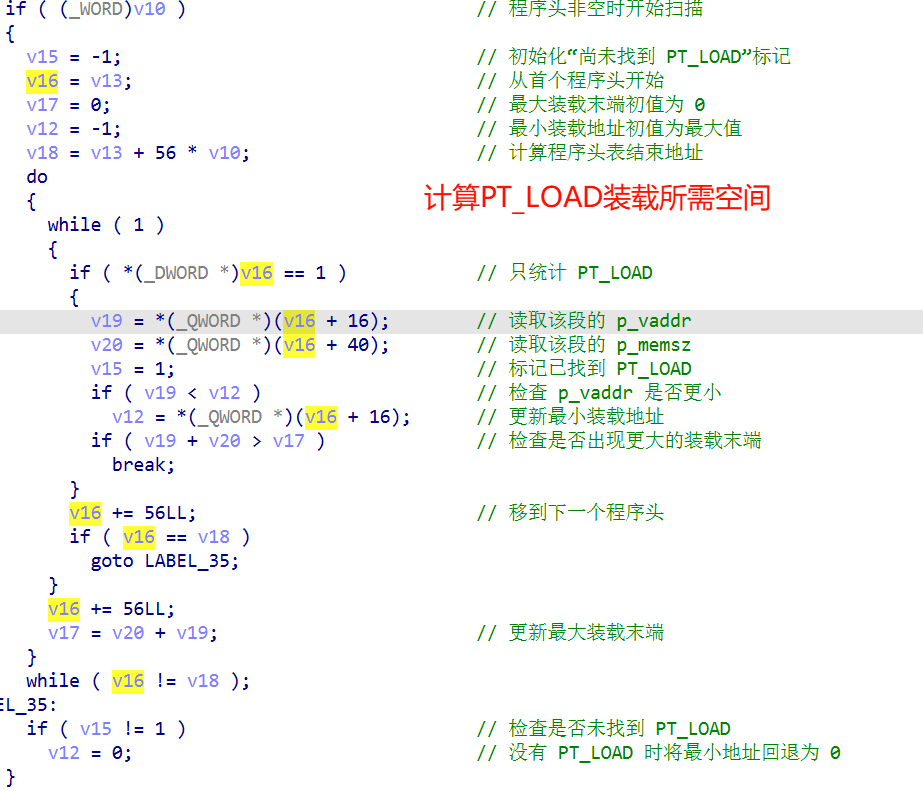
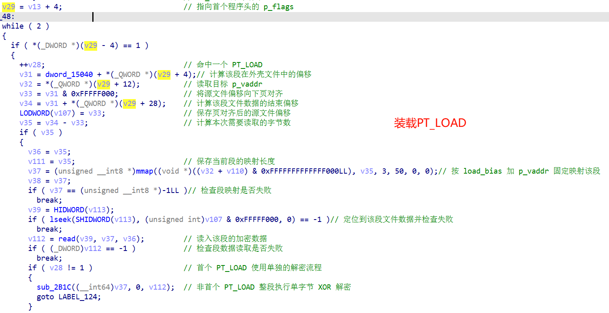
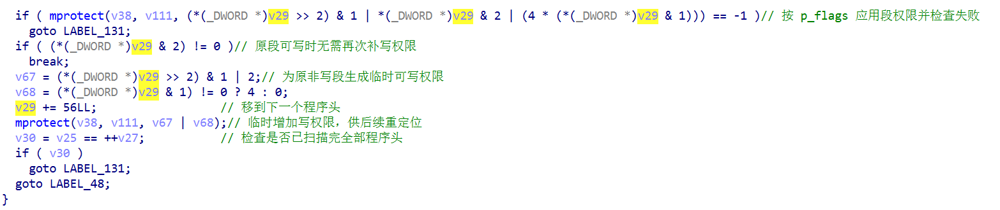
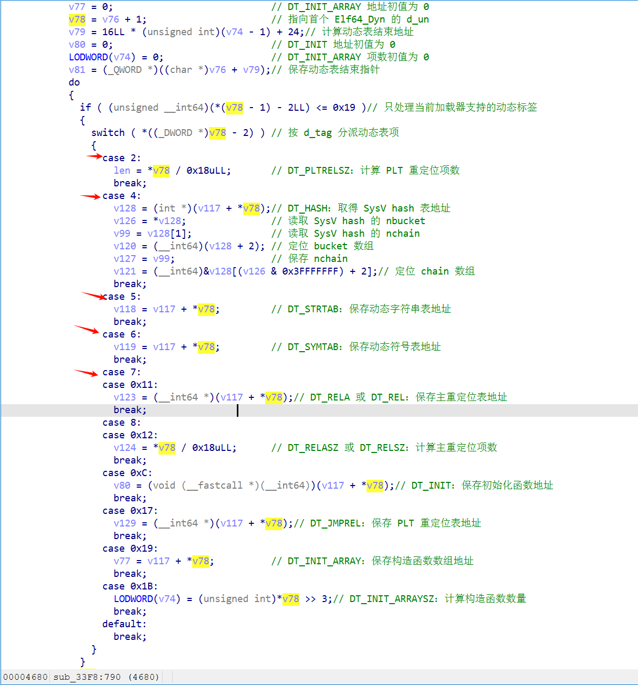
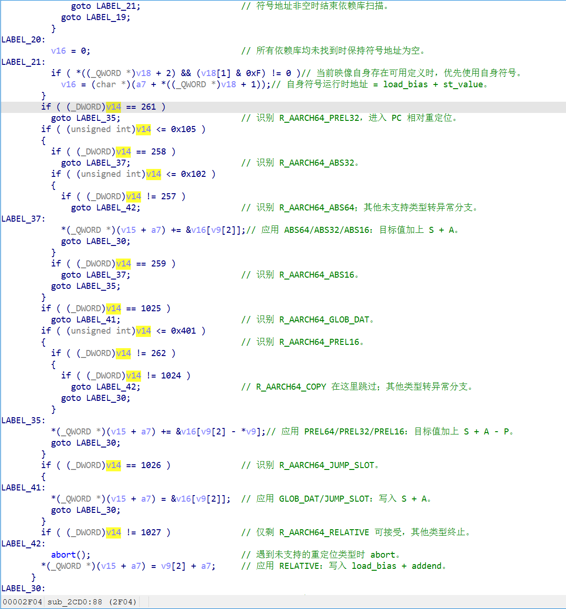
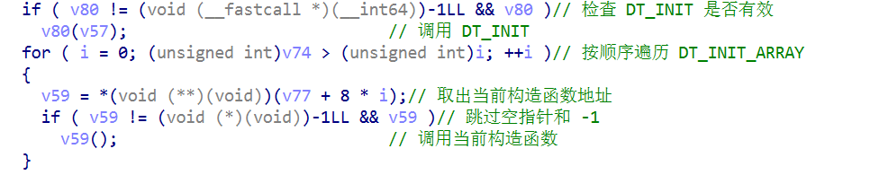
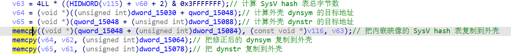

## 一、流程

```text
读取内嵌 ELF 的前64字节
        ↓
从解密后的 Elf64_Ehdr 读取
├─ e_phoff：+0x20
└─ e_phnum：+0x38
        ↓
映射程序头表
        ↓
遍历 Elf64_Phdr
├─ PT_LOAD：计算映像跨度并装载各段
└─ PT_DYNAMIC：记录动态表位置
        ↓
装载 PT_LOAD
        ↓
清零 BSS、设置 mprotect 权限
        ↓
解析 PT_DYNAMIC
├─ dynsym / dynstr / hash
├─ RELA / JMPREL
├─ DT_NEEDED
├─ DT_INIT
└─ DT_INIT_ARRAY
        ↓
dlopen 依赖库、解析符号、应用 AArch64 重定位
        ↓
手工调用 DT_INIT 和 DT_INIT_ARRAY
        ↓
查找 JNI_OnLoad
复制并修正 dynsym/dynstr/hash 到壳so预留区
        ↓
使 ART 通过壳so libDexHelper.so 句柄找到内层 JNI_OnLoad
```

> 系统 linker 只负责调用外层构造函数init。内嵌 ELF 的构造函数是 壳so 自己遍历并调用的。

---

## 二、识别自定义 linker 的明显结构

不要仅凭“读取 maps”或“调用 mmap”判断。最强特征是下面这条完整链条。

### 1. ELF 结构解析

常见硬编码偏移和步长：

| `0x464C457F` | ELF magic |
|---|:---:|
| `Elf64_Ehdr + 0x20` | `e_phoff` |
| `Elf64_Ehdr + 0x38` | `e_phnum` |
| `56 / 0x38` | `sizeof(Elf64_Phdr)` |
| `16 / 0x10` | `sizeof(Elf64_Dyn)` |
| `24 / 0x18` | `sizeof(Elf64_Rela)` |
| `24 / 0x18` | `sizeof(Elf64_Sym)` |

程序头类型判断：

```c
p_type == 1;    // PT_LOAD
p_type == 2;    // PT_DYNAMIC
```

### 2. 手工装载 PT_LOAD

典型结构：

```text
遍历 Phdr
→ 找最小 p_vaddr 和最大 p_vaddr+p_memsz
→ 页对齐
→ mmap 保留整块地址空间
→ 按 p_offset 读取段
→ 放到 load_bias+p_vaddr
→ filesz 到 memsz 之间清零
→ 按 p_flags 调用 mprotect
```

常见指纹：







### 3. 解析 PT_DYNAMIC

看到按16字节遍历 (d_tag, d_val)，并对这些值进行 switch，特征很强：

```text
1       DT_NEEDED
4       DT_HASH
5       DT_STRTAB
6       DT_SYMTAB
7       DT_RELA
8       DT_RELASZ
12      DT_INIT
23      DT_JMPREL
25      DT_INIT_ARRAY
27      DT_INIT_ARRAYSZ
```



### 4. 自己完成重定位

AArch64 常见类型：

```text
257～262       ABS/PREL
1024           COPY
1025           GLOB_DAT
1026           JUMP_SLOT
1027           RELATIVE
```



或出现 dlsym / 手工 hash 查符号

### 5. 手工执行构造函数

```c
if (DT_INIT)
    init();

for (i = 0; i < DT_INIT_ARRAYSZ / 8; i++)
    init_array[i]();
```



### 6. 复制dynsym、dynstr、hash


