# seesoSDK

### 目标：拿到  RGBTest APK  ，点击 INIT GAZE，提示key expire，密钥过期。过掉密钥验证。


###### 总结：

<font style="background-color:#D8DAD9;">nativeInitWrapper</font> -> <font style="background-color:#D8DAD9;">sub\_58529C</font> -> <font style="background-color:#D8DAD9;">getLicenseInformation</font> -> <font style="background-color:#D8DAD9;">getLicenseInformationInternal</font>

1、<font style="background-color:#D8DAD9;">nativeInitWrapper</font>调用<font style="background-color:#D8DAD9;">getDeviceInfo</font>，获取android-id、手机品牌，ro.build.version.realease，packageName，apk签名sha1，获取Tracker，<font style="background-color:#D8DAD9;">Tracker+8</font>位置为<font style="background-color:#D8DAD9;">LicenseManager</font>对象地址

2、<font style="background-color:#D8DAD9;">sub\_58529C</font>调用<font style="background-color:#D8DAD9;">getLicenseInformation</font> ，将<font style="background-color:#D8DAD9;">LicenseManager+24</font>地址传入，返回值存放在<font style="background-color:#D8DAD9;">LicenseManager+256</font>处

3、<font style="background-color:#D8DAD9;">getLicenseInformation</font>将请求域名存放在<font style="background-color:#D8DAD9;">LicenseManager+136</font>处，根据<font style="background-color:#D8DAD9;">LicenseManager+160</font>处值循环，该值为3，循环3次调用<font style="background-color:#D8DAD9;">getLicenseInformationInternal</font>，返回<font style="background-color:#D8DAD9;">getLicenseInformationInternal</font>的返回值

4、<font style="background-color:#D8DAD9;">getLicenseInformationInternal</font>将<font style="background-color:#D8DAD9;">getDeviceInfo</font>获取的值，与时间戳、key等拼接，然后aes\_cbc\_pkcs7\_128加密拼接字符串，aes\_key为【<font style="background-color:#D8DAD9;">LicenseManager+164</font>】，aes\_iv为【<font style="background-color:#D8DAD9;">LicenseManager+180</font>】，加密base64encode，并将<font style="background-color:#D8DAD9;">+</font> <font style="background-color:#D8DAD9;">/</font>替换为 <font style="background-color:#D8DAD9;">-</font> <font style="background-color:#D8DAD9;">\_</font>，然后发送requestGet请求。

判断请求结果以及响应码以及seeso-code，设置【<font style="background-color:#D8DAD9;">LicenseManager+112</font>】为cookie，response返回响应体，传入<font style="background-color:#D8DAD9;">setSecret</font>，调用<font style="background-color:#D8DAD9;">setSecret</font>，将response base64解码，aes\_cbc\_pkcs7\_128解密，aes\_key、aes\_iv为只读数据段数据，key拼接上响应体解密内容，再sha256，最后赋值给a1+196，a1+212，也就是【<font style="background-color:#D8DAD9;">LicenseManager+196</font>】、【<font style="background-color:#D8DAD9;">LicenseManager+212</font>】。

调用<font style="background-color:#D8DAD9;">sendAuthKeyInfo</font>发送请求，请求参数value仍是之前的deviceinfo等信息，使用aes\_cbc\_pkcs7\_128加密，aes\_key、aes\_iv为【<font style="background-color:#D8DAD9;">LicenseManager+196</font>】、【<font style="background-color:#D8DAD9;">LicenseManager+212</font>】处值，使用base64编码，设置cookie为【<font style="background-color:#D8DAD9;">LicenseManager+112</font>】，返回响应体response使用base64解码，aes\_cbc\_pkcs7\_128解密。结果为

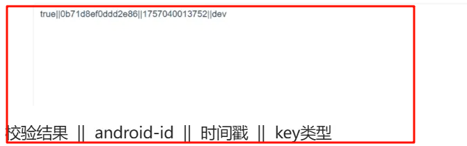

最后调用checkCondition，验证返回响应体，根据key类型设置【<font style="background-color:#D8DAD9;">LicenseManager+104</font>】处值，然后使用pthread\_create创建线程执行sendLog函数发送携带cookie的alive心跳包

5、关键流程

<font style="background-color:#D8DAD9;">nativeInitWrapper</font> -> <font style="background-color:#D8DAD9;">sub\_58529C</font> -> <font style="background-color:#D8DAD9;">getLicenseInformation</font> -> <font style="background-color:#D8DAD9;">getLicenseInformationInternal</font>

-> <font style="background-color:#D8DAD9;">request</font> -> <font style="background-color:#D8DAD9;">setSecret</font> -> <font style="background-color:#D8DAD9;">sendAuthKeyInfor</font> -> <font style="background-color:#D8DAD9;">request</font> -> <font style="background-color:#D8DAD9;">checkCondition</font> -> <font style="background-color:#D8DAD9;">sendlog</font>

###### 绕过：

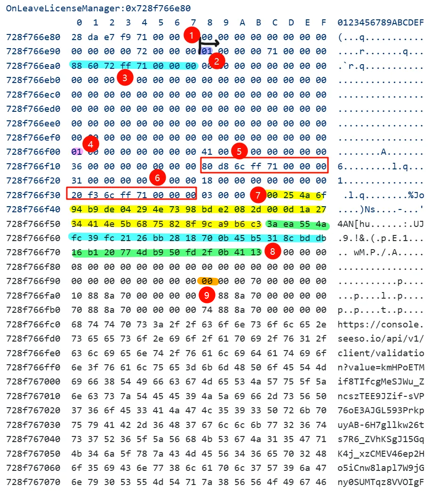

上图是LicenseManager内存布局，从①开始即是【LicenseManager+24】位置。②③是pthread\_create(sendLog)的标志位和pthread\_id，④是【LicenseManager+104】，存储校验通过的key的类型，⑤⑥是域名等，⑦⑧是aes的key、iv，⑨是保存<font style="background-color:#D8DAD9;">getLicenseInformationInternal</font>返回值

只要修改④的值为1，然后返回<font style="background-color:#D8DAD9;">getLicenseInformationInternal</font>返回为0即可，选择修改<font style="background-color:#D8DAD9;">getLicenseInformatio</font>替换掉<font style="background-color:#D8DAD9;">getLicenseInformationInternal</font>

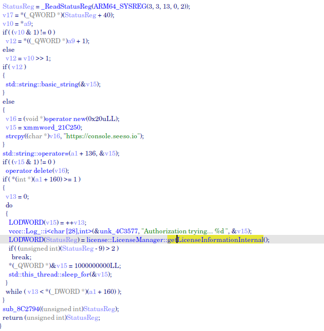

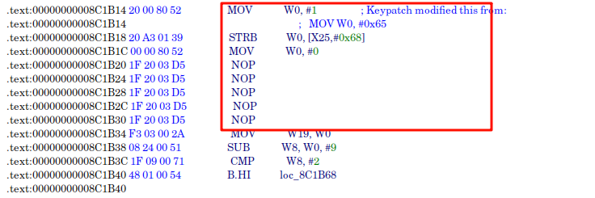

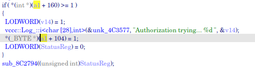

重打包后运行：无网正常运行

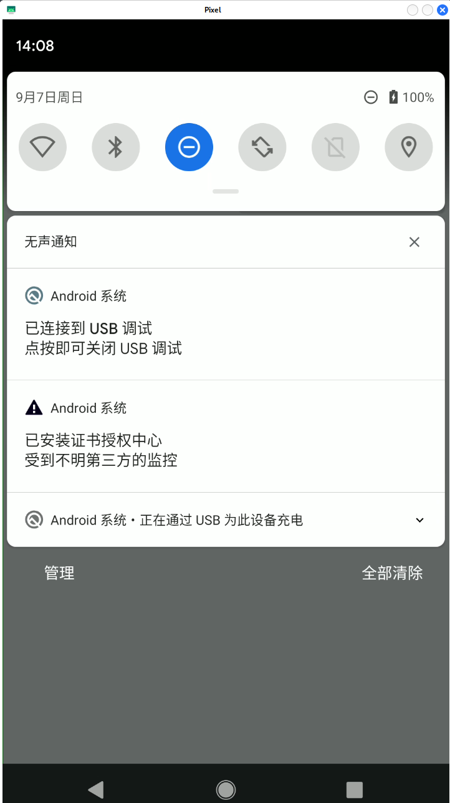

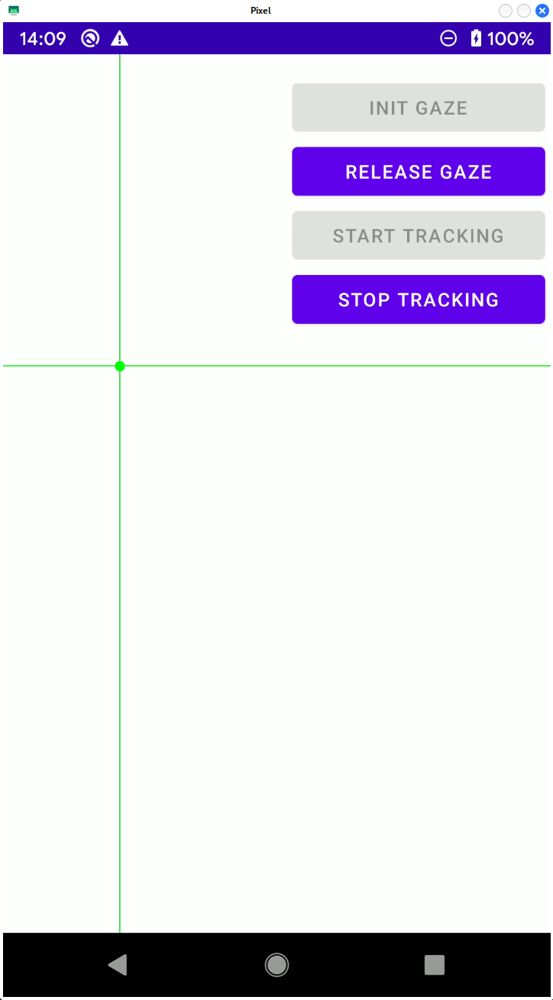

###### 以下是分析：

###### Java层分析点击按钮逻辑：

1、MainActivity.OnCreate，调用TrackerManager.makeInstance，调用getApplicationContext()初始化TrackerManager对象

2、点击INIT GAZE按钮，调用MainActivity.initGaze()，初始化UserStatusOption

3、调用trackerManager.initGazeTracker

4、将context，key，callback，UserStatusOption作为参数调用GazeTracker.initGazeTracker

`GazeTracker.initGazeTracker(this.mContext.get(), "dev_q6dq6jm1m3m264okzba1afycuzryq113iizim56g", this.initializationCallback, userStatusOption);`

6、初始化GazeTracker对象，初始化其父类对象

`new GazeTracker(context, str, 3, false, initializationCallback, userStatusOption);`

7、`GazeTrackerCore.this.initGaze(str, i, userStatusOption);`

8、`Gaze.initGaze(this.context, initCamera, this.calibrationHelper, this.ILibGazeInitializationCallback, this.libGazeCallbackV2, this.libCalibrationCallbackV2, this.libFaceCallback, this.libUserStatusCallback, str, libUserStatusOption, i);`

9、`int a2 = gaze.a(str, cameraConfig, libUserStatusOption, new RectF(modifyScreen2Camera.x, modifyScreen2Camera.y, modifyScreen2Camera2.x, modifyScreen2Camera2.y), i2);`

10、`this.c = new NativeWrapper(this.f1a, str, libUserStatusOption, rectF, i, false, this.b);`

11、` this.f7a = nativeInitWrapper(context, str, iArr, i, z, jNICallbackDispatcher);`

12、这里进入native层

`private native long nativeInitWrapper(Context context, String str, int[] iArr, int i, boolean z, JNICallbackDispatcher jNICallbackDispatcher);`

13、`r0tracer` hook下`NativeWrapper`类，点击按钮，调用为：

<details>
<summary>tracer日志</summary>
<div style="max-height: 400px; overflow-y: auto; padding: 0 10px;">

```bash
*** entered camp.visual.libgaze.jni.NativeWrapper.nativeInitWrapper                                                                            
arg[0]: android.app.Application@5a6a04e => "<instance: android.content.Context, $className: android.app.Application>"                          
arg[1]: dev_q6dq6jm1m3m264okzba1afycuzryq113iizim56g => "dev_q6dq6jm1m3m264okzba1afycuzryq113iizim56g"                                         
arg[2]: 1,2,3 => [1,2,3]                                                                                                                       
arg[3]: 3 => 3                                                                                                                                 
arg[4]: false => false                                                                                                                         
arg[5]: camp.visual.libgaze.callbacks.JNICallbackDispatcher@71e356f => "<instance: camp.visual.libgaze.callbacks.JNICallbackDispatcher>"       
java.lang.Throwable                                                                                                                            
        at camp.visual.libgaze.jni.NativeWrapper.nativeInitWrapper(Native Method)                                                              
        at camp.visual.libgaze.jni.NativeWrapper.<init>(Unknown Source:115)                                                                    
        at camp.visual.libgaze.jni.NativeWrapper.<init>(Native Method)                                                                         
        at camp.visual.libgaze.Gaze.a(Unknown Source:12)                                                                                       
        at camp.visual.libgaze.Gaze.initGaze(Unknown Source:83)                                                                                
        at camp.visual.gazetracker.GazeTrackerCore.initGaze(GazeTrackerCore.java:402)                                                          
        at camp.visual.gazetracker.GazeTrackerCore.access$1900(GazeTrackerCore.java:59)                                                        
        at camp.visual.gazetracker.GazeTrackerCore$7.run(GazeTrackerCore.java:353)                                                             
        at android.os.Handler.handleCallback(Handler.java:883)                                                                                 
        at android.os.Handler.dispatchMessage(Handler.java:100)                                                                                
        at android.os.Looper.loop(Looper.java:214)                                                                                             
        at android.os.HandlerThread.run(HandlerThread.java:67)                                                                                 
                                                                                                                                               
retval: 1 => "1"    


*** entered camp.visual.libgaze.jni.NativeWrapper.nativeIsTrackerInitialized                                                                   
arg[0]: 1 => "1"                                                                                                                               
java.lang.Throwable                                                                                                                            
        at camp.visual.libgaze.jni.NativeWrapper.nativeIsTrackerInitialized(Native Method)                                                     
        at camp.visual.libgaze.jni.NativeWrapper.e(Unknown Source:2)                                                                           
        at camp.visual.libgaze.jni.NativeWrapper.e(Native Method)                                                                              
        at camp.visual.libgaze.jni.NativeWrapper.<init>(Unknown Source:158)                                                                    
        at camp.visual.libgaze.jni.NativeWrapper.<init>(Native Method)                                                                         
        at camp.visual.libgaze.Gaze.a(Unknown Source:12)                                                                                       
        at camp.visual.libgaze.Gaze.initGaze(Unknown Source:83)                                                                                
        at camp.visual.gazetracker.GazeTrackerCore.initGaze(GazeTrackerCore.java:402)                                                          
        at camp.visual.gazetracker.GazeTrackerCore.access$1900(GazeTrackerCore.java:59)                                                        
        at camp.visual.gazetracker.GazeTrackerCore$7.run(GazeTrackerCore.java:353)                                                             
        at android.os.Handler.handleCallback(Handler.java:883)                                                                                 
        at android.os.Handler.dispatchMessage(Handler.java:100)                                                                                
        at android.os.Looper.loop(Looper.java:214)                                                                                             
        at android.os.HandlerThread.run(HandlerThread.java:67)                                                                                 
                                                                                                                                               
retval: false => false       

*** entered camp.visual.libgaze.jni.NativeWrapper.$init                                                                                        
arg[0]: android.app.Application@5a6a04e => "<instance: android.content.Context, $className: android.app.Application>"                          
arg[1]: dev_q6dq6jm1m3m264okzba1afycuzryq113iizim56g => "dev_q6dq6jm1m3m264okzba1afycuzryq113iizim56g"                                         
arg[2]: camp.visual.libgaze.constant.LibUserStatusOption@a616367 => "<instance: camp.visual.libgaze.constant.LibUserStatusOption>"             
arg[3]: RectF(-10.0, -10.0, 52.000088, -120.222374) => "<instance: android.graphics.RectF>"                                                    
arg[4]: 3 => 3                                                                                                                                 
arg[5]: false => false                                                                                                                         
arg[6]: camp.visual.libgaze.callbacks.JNICallbackDispatcher@71e356f => "<instance: camp.visual.libgaze.callbacks.JNICallbackDispatcher>"       
java.lang.Throwable                                                                                                                            
        at camp.visual.libgaze.jni.NativeWrapper.<init>(Native Method)                                                                         
        at camp.visual.libgaze.Gaze.a(Unknown Source:12)                                                                                       
        at camp.visual.libgaze.Gaze.initGaze(Unknown Source:83)                                                                                
        at camp.visual.gazetracker.GazeTrackerCore.initGaze(GazeTrackerCore.java:402)                                                          
        at camp.visual.gazetracker.GazeTrackerCore.access$1900(GazeTrackerCore.java:59)                                                        
        at camp.visual.gazetracker.GazeTrackerCore$7.run(GazeTrackerCore.java:353)                                                             
        at android.os.Handler.handleCallback(Handler.java:883)                                                                                 
        at android.os.Handler.dispatchMessage(Handler.java:100)                                                                                
        at android.os.Looper.loop(Looper.java:214)                                                                                             
        at android.os.HandlerThread.run(HandlerThread.java:67)                                                                                 
                                                                                                                                               
retval: undefined => undefined                

*** entered camp.visual.libgaze.jni.NativeWrapper.nativeGetAuthorizationResult                                                                 
arg[0]: 1 => "1"                                                                                                                               
java.lang.Throwable                                                                                                                            
        at camp.visual.libgaze.jni.NativeWrapper.nativeGetAuthorizationResult(Native Method)                                                   
        at camp.visual.libgaze.jni.NativeWrapper.c(Unknown Source:2)                                                                           
        at camp.visual.libgaze.jni.NativeWrapper.c(Native Method)                                                                              
        at camp.visual.libgaze.Gaze.a(Unknown Source:12)                                                                                       
        at camp.visual.libgaze.Gaze.a(Unknown Source:17)                                                                                       
        at camp.visual.libgaze.Gaze.initGaze(Unknown Source:83)                                                                                
        at camp.visual.gazetracker.GazeTrackerCore.initGaze(GazeTrackerCore.java:402)                                                          
        at camp.visual.gazetracker.GazeTrackerCore.access$1900(GazeTrackerCore.java:59)                                                        
        at camp.visual.gazetracker.GazeTrackerCore$7.run(GazeTrackerCore.java:353)                                                             
        at android.os.Handler.handleCallback(Handler.java:883)                                                                                 
        at android.os.Handler.dispatchMessage(Handler.java:100)                                                                                
        at android.os.Looper.loop(Looper.java:214)                                                                                             
        at android.os.HandlerThread.run(HandlerThread.java:67)                                                                                 
                                                                                                                                               
retval: 11 => 11                                                                                                                               


```
</div>
</details>

14、`nativeInitWrapper`传入key，应该是在这里进行的key校验

###### Native层分析：

1、hook java层的camp.visual.libgaze.jni.NativeWrapper.nativeInitWrapper 函数，将key替换为有效的key，使用reqable抓包。三次发包，且把key换成了有效的key能成功INIT GAZE，说明校验通过，校验函数为nativeInitWrapper

<details>
<summary>hook代码</summary>
<div style="max-height: 400px; overflow-y: auto; padding: 0 10px;">

```javascript
Java.perform(function () {
  function replace_key_java_nativewrapper() {
    let NativeWrapper = Java.use("camp.visual.libgaze.jni.NativeWrapper");
    NativeWrapper["nativeInitWrapper"].implementation = function (context, str, iArr, i, z, jNICallbackDispatcher) {
      let new_key = "dev_m1xw0grvvh2nu9c2i4vufkddzyty5iig719riprm";
      console.log('nativeInitWrapper is called' + ', ' + 'context: ' + context + ', ' + 'new_key: ' + new_key + ', ' + 'iArr: ' + iArr + ', ' + 'i: ' + i + ', ' + 'z: ' + z + ', ' + 'jNICallbackDispatcher: ' + jNICallbackDispatcher);
      let ret = this.nativeInitWrapper(context, new_key, iArr, i, z, jNICallbackDispatcher);
      console.log('nativeInitWrapper ret value is ' + ret);
      return ret;
    };
  }
  replace_key_java_nativewrapper();
})
```
</div>
</details>

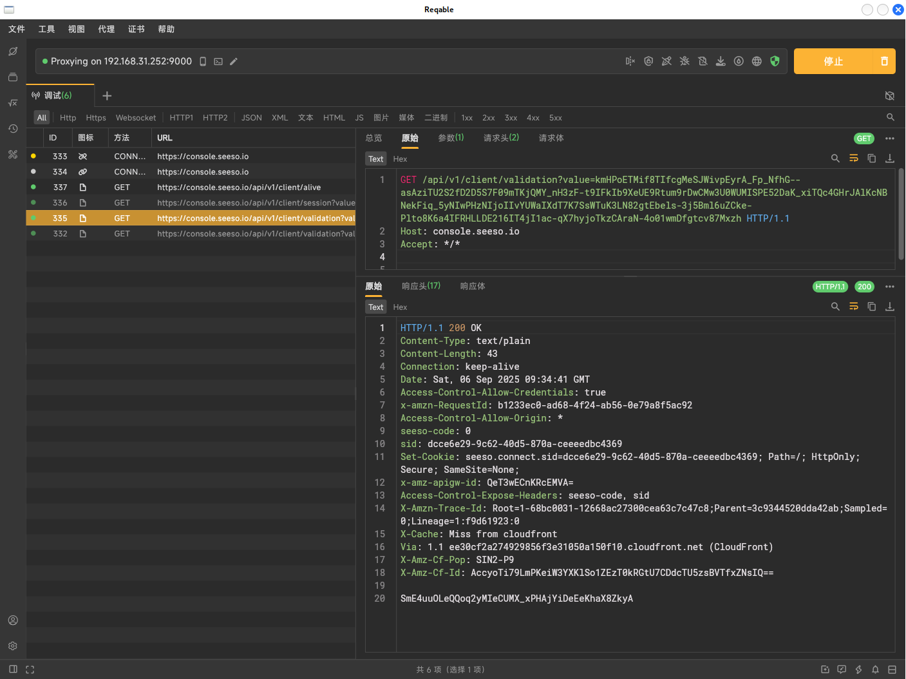

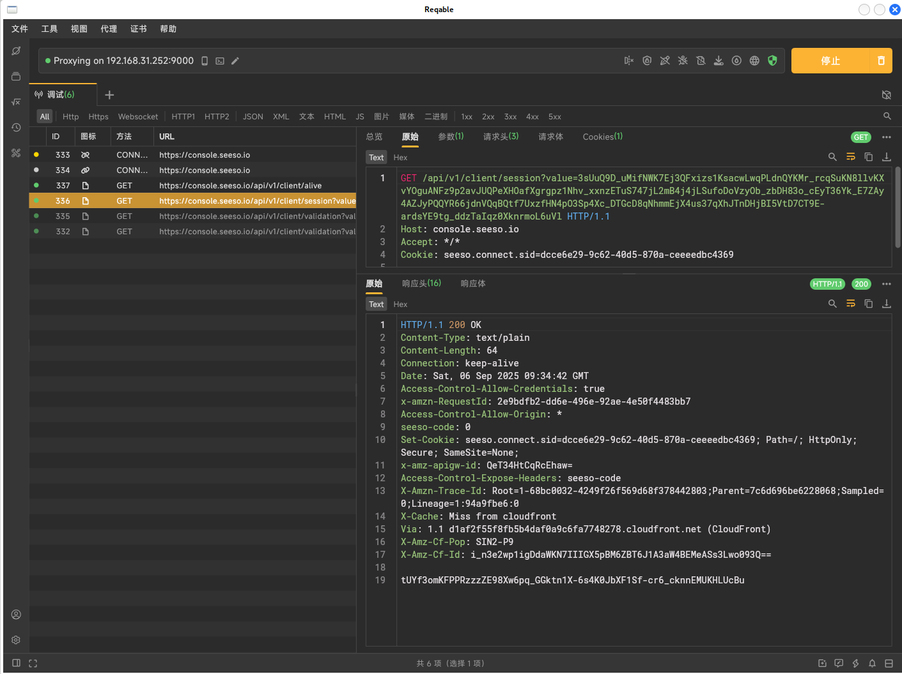

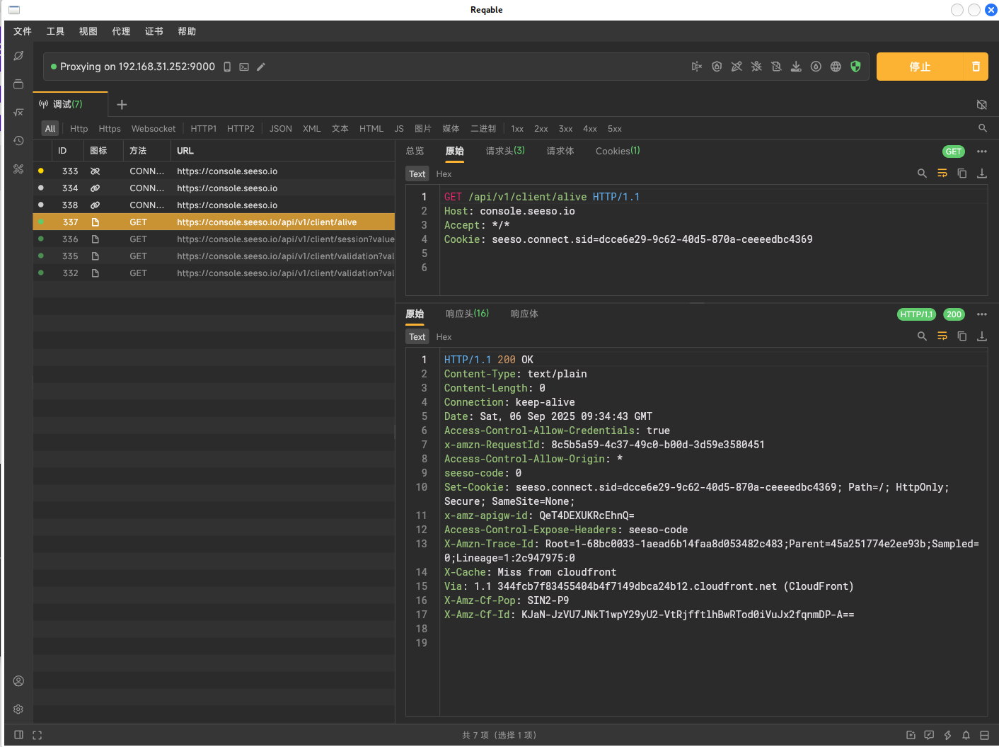

2、

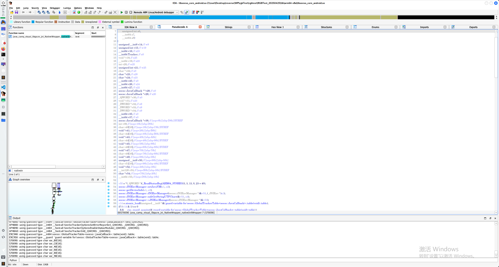

3、

两个思路：①跟踪key②抓包中关键字符串“api/v1/client/validation”，猜测需要拼接，那么可能用到memcpy，hook memcpy然后打印过滤src 字符串，并打印调用栈可以定位到关键函数

②

<details>
<summary>hook代码</summary>
<div style="max-height: 400px; overflow-y: auto; padding: 0 10px;">

```javascript
Java.perform(function () {
    function replace_key_java_nativewrapper() {
        let NativeWrapper = Java.use("camp.visual.libgaze.jni.NativeWrapper");
        NativeWrapper["nativeInitWrapper"].implementation = function (context, str, iArr, i, z, jNICallbackDispatcher) {
            let new_key = "dev_m1xw0grvvh2nu9c2i4vufkddzyty5iig719riprm";
            console.log('nativeInitWrapper is called' + ', ' + 'context: ' + context + ', ' + 'new_key: ' + new_key + ', ' + 'iArr: ' + iArr + ', ' + 'i: ' + i + ', ' + 'z: ' + z + ', ' + 'jNICallbackDispatcher: ' + jNICallbackDispatcher);
            let ret = this.nativeInitWrapper(context, new_key, iArr, i, z, jNICallbackDispatcher);
            console.log('nativeInitWrapper ret value is ' + ret);
            return ret;
        };
    }
    replace_key_java_nativewrapper();

    const seeso_module = Process.findModuleByName("libseeso_core_android.so");
    console.log("libseeso_core_android.so::base->"+seeso_module.base);

    var memcpy_addr = null;
    var symbols = Process.findModuleByName("libc.so").enumerateSymbols();
    for (var i = 0; i < symbols.length; i++) {
        if (symbols[i].name === "memcpy") {
            // console.log("symbols name is -> " + symbols[i].name);
            // console.log("symbols address is -> " + symbols[i].address);
            memcpy_addr = symbols[i].address;
        }
    }
    Interceptor.attach(memcpy_addr, {
        onEnter: function (args) {
            if (args[1].readCString().indexOf("client/validation") != -1) {
                console.log("args is ->" + args[0], args[1], args[2]);
                // 打印调用栈（Native 层）
                const backtrace = Thread.backtrace(this.context, Backtracer.ACCURATE)
                    .map(addr => DebugSymbol.fromAddress(addr))
                    .join("\n\t");
                console.log("Backtrace:\n\t" + backtrace);
            }
        },
        onLeave: function (retval) {
            // console.log(retval);
        }
    });

})
```
</div>
</details>

<details>
<summary>hook日志</summary>
<div style="max-height: 400px; overflow-y: auto; padding: 0 10px;">

```bash
Backtrace:
        0x78a86e2118 libseeso_core_android.so!0x5f9118
        0x78a86e2118 libseeso_core_android.so!0x5f9118
        0x78a86575cc libseeso_core_android.so!0x56e5cc
        0x78a89ab128 libseeso_core_android.so!_ZN7license14LicenseManager29getLicenseInformationInternalERKNSt6__ndk112basic_stringIcNS1_11char_traitsIcEENS1_9allocatorIcEEEES9_S9_S9_S9_bS9_+0x410
        0x78a89aab34 libseeso_core_android.so!_ZN7license14LicenseManager21getLicenseInformationERKNSt6__ndk112basic_stringIcNS1_11char_traitsIcEENS1_9allocatorIcEEEES9_S9_S9_S9_bS9_S9_+0x120
        0x78a866e200 libseeso_core_android.so!0x585200
        0x78a86591e0 libseeso_core_android.so!Java_camp_visual_libgaze_jni_NativeWrapper_nativeInitWrapper+0x150
        0x7901143354 libart.so!art_quick_generic_jni_trampoline+0x94
        0x790113a338 libart.so!art_quick_invoke_stub+0x228
        0x7901149068 libart.so!_ZN3art9ArtMethod6InvokeEPNS_6ThreadEPjjPNS_6JValueEPKc+0xf8
        0x79014b5c5c libart.so!_ZN3art12_GLOBAL__N_118InvokeWithArgArrayERKNS_33ScopedObjectAccessAlreadyRunnableEPNS_9ArtMethodEPNS0_8ArgArrayEPNS_6JValueEPKc+0x6c
        0x79014b586c libart.so!_ZN3art17InvokeWithVarArgsERKNS_33ScopedObjectAccessAlreadyRunnableEP8_jobjectP10_jmethodIDSt9__va_list+0x19c
        0x79013a64fc libart.so!_ZN3art3JNI25CallNonvirtualLongMethodVEP7_JNIEnvP8_jobjectP7_jclassP10_jmethodIDSt9__va_list+0x278
        0x7901370b84 libart.so!_ZN3art12_GLOBAL__N_18CheckJNI11CallMethodVEPKcP7_JNIEnvP8_jobjectP7_jclassP10_jmethodIDSt9__va_listNS_9Primitive4TypeENS_10InvokeTypeE+0x878
        0x790135f814 libart.so!_ZN3art12_GLOBAL__N_18CheckJNI24CallNonvirtualLongMethodEP7_JNIEnvP8_jobjectP7_jclassP10_jmethodIDz+0x90
        0x789ca40060
args is ->0x78f52c3b40 0x7893414180 0x38
Backtrace:
        0x78a86dea78 libseeso_core_android.so!0x5f5a78
        0x78a86dea78 libseeso_core_android.so!0x5f5a78
        0x78a86e20f0 libseeso_core_android.so!0x5f90f0
        0x78a89ab150 libseeso_core_android.so!_ZN7license14LicenseManager29getLicenseInformationInternalERKNSt6__ndk112basic_stringIcNS1_11char_traitsIcEENS1_9allocatorIcEEEES9_S9_S9_S9_bS9_+0x438
        0x78a89aab34 libseeso_core_android.so!_ZN7license14LicenseManager21getLicenseInformationERKNSt6__ndk112basic_stringIcNS1_11char_traitsIcEENS1_9allocatorIcEEEES9_S9_S9_S9_bS9_S9_+0x120
        0x78a866e200 libseeso_core_android.so!0x585200
        0x78a86591e0 libseeso_core_android.so!Java_camp_visual_libgaze_jni_NativeWrapper_nativeInitWrapper+0x150
        0x7901143354 libart.so!art_quick_generic_jni_trampoline+0x94
        0x790113a338 libart.so!art_quick_invoke_stub+0x228
        0x7901149068 libart.so!_ZN3art9ArtMethod6InvokeEPNS_6ThreadEPjjPNS_6JValueEPKc+0xf8
        0x79014b5c5c libart.so!_ZN3art12_GLOBAL__N_118InvokeWithArgArrayERKNS_33ScopedObjectAccessAlreadyRunnableEPNS_9ArtMethodEPNS0_8ArgArrayEPNS_6JValueEPKc+0x6c
        0x79014b586c libart.so!_ZN3art17InvokeWithVarArgsERKNS_33ScopedObjectAccessAlreadyRunnableEP8_jobjectP10_jmethodIDSt9__va_list+0x19c
        0x79013a64fc libart.so!_ZN3art3JNI25CallNonvirtualLongMethodVEP7_JNIEnvP8_jobjectP7_jclassP10_jmethodIDSt9__va_list+0x278
        0x7901370b84 libart.so!_ZN3art12_GLOBAL__N_18CheckJNI11CallMethodVEPKcP7_JNIEnvP8_jobjectP7_jclassP10_jmethodIDSt9__va_listNS_9Primitive4TypeENS_10InvokeTypeE+0x878
        0x790135f814 libart.so!_ZN3art12_GLOBAL__N_18CheckJNI24CallNonvirtualLongMethodEP7_JNIEnvP8_jobjectP7_jclassP10_jmethodIDz+0x90
        0x789ca40060

```
</div>
</details>

①

Java层得知参数为

<details>
<summary>日志</summary>
<div style="max-height: 400px; overflow-y: auto; padding: 0 10px;">

```bash
*** entered camp.visual.libgaze.jni.NativeWrapper.nativeInitWrapper                                                                            
arg[0]: android.app.Application@5a6a04e => "<instance: android.content.Context, $className: android.app.Application>"                          
arg[1]: dev_q6dq6jm1m3m264okzba1afycuzryq113iizim56g => "dev_q6dq6jm1m3m264okzba1afycuzryq113iizim56g"                                         
arg[2]: 1,2,3 => [1,2,3]                                                                                                                       
arg[3]: 3 => 3                                                                                                                                 
arg[4]: false => false                                                                                                                         
arg[5]: camp.visual.libgaze.callbacks.JNICallbackDispatcher@71e356f => "<instance: camp.visual.libgaze.callbacks.JNICallbackDispatcher>"       
```
</div>
</details>

跟踪a4（key）

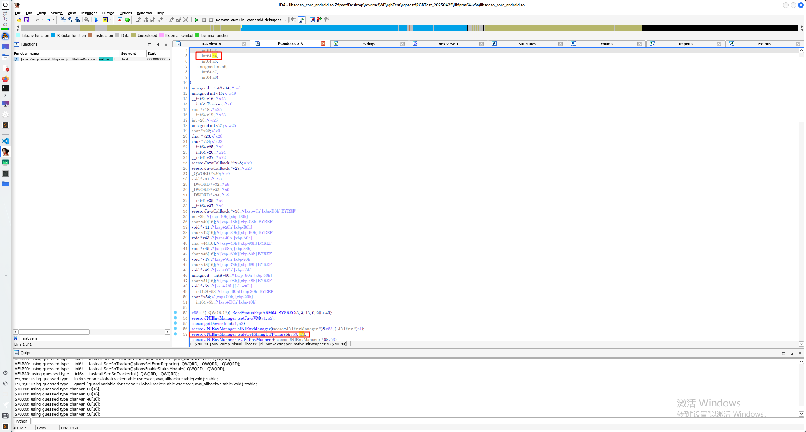

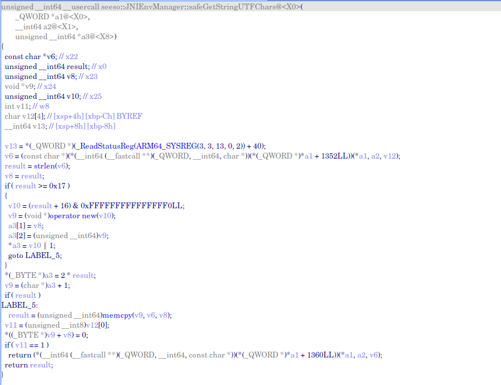

分析safeGetStringUTFChars

<details>
<summary>代码</summary>
<div style="max-height: 400px; overflow-y: auto; padding: 0 10px;">

```javascript
Java.perform(function () {
    function replace_key_java_nativewrapper() {
        let NativeWrapper = Java.use("camp.visual.libgaze.jni.NativeWrapper");
        NativeWrapper["nativeInitWrapper"].implementation = function (context, str, iArr, i, z, jNICallbackDispatcher) {
            let new_key = "dev_m1xw0grvvh2nu9c2i4vufkddzyty5iig719riprm";
            console.log('nativeInitWrapper is called' + ', ' + 'context: ' + context + ', ' + 'new_key: ' + new_key + ', ' + 'iArr: ' + iArr + ', ' + 'i: ' + i + ', ' + 'z: ' + z + ', ' + 'jNICallbackDispatcher: ' + jNICallbackDispatcher);
            let ret = this.nativeInitWrapper(context, new_key, iArr, i, z, jNICallbackDispatcher);
            console.log('nativeInitWrapper ret value is ' + ret);
            return ret;
        };
    }
    function print_arg(addr, hx_length = null, hx_ansi = null) {
        var hx_args = {};
        if (hx_length != null) {
            hx_args["length"] = hx_length;
        }
        if (hx_ansi != null) {
            hx_args["ansi"] = hx_ansi;
        }
        try {
            var module = Process.findRangeByAddress(addr);
            if (module != null) {
                return "\n" + hexdump(addr, hx_args) + "\n\n";
            }
            return ptr(addr) + "\n\n";
        } catch (e) {
            return addr + "\n\n";
        }
    }
    function hook_native_addr(funcPtr, registers, returnAddrs = null, logtag = null) {
        var module = Process.findModuleByAddress(funcPtr);
        Interceptor.attach(funcPtr, {
            onEnter: function (args) {
                this.logs = "";
                this.registers = {};
                this.trueReturnAddr = this.context["lr"].sub(module.base);
                this.returnCheck = false;
                if (returnAddrs) {
                    for (let i = 0; i < returnAddrs.length; i++) {
                        if (this.trueReturnAddr.compare(returnAddrs[i]) === 0) {
                            this.returnCheck = true;
                            break;
                        }
                    }
                } else {
                    this.returnCheck = true;
                }
                if (!this.returnCheck) {
                    return
                }
                registers.forEach(element => {
                    var regName = element;
                    var regValue = this.context[regName];
                    this.registers[regName] = regValue;
                });
                this.logs = this.logs.concat("So: " + module.name + ":" + module.base + "  methodOffset: " + ptr(funcPtr).sub(module.base) + "  trueReturnAddr:" + this.trueReturnAddr + "\n");
                if (logtag) {
                    this.logs = this.logs.concat(logtag + " trueReturnAddr:" + this.trueReturnAddr + " onEnter");
                    this.logs = this.logs.concat("==============================" + "\n");
                }
                for (let regName in this.registers) {
                    if (this.registers.hasOwnProperty(regName)) {
                        var regValue = this.registers[regName];
                        this.logs = this.logs.concat(regName + " onEnter: " + regValue + print_arg(regValue));
                    }
                }
            },
            onLeave: function (retval) {
                if (!this.returnCheck) {
                    return
                }
                if (logtag) {
                    this.logs = this.logs.concat(logtag + " trueReturnAddr:" + this.trueReturnAddr + " onLeave");
                    this.logs = this.logs.concat("==============================" + "\n");
                }
                for (let regName in this.registers) {
                    if (this.registers.hasOwnProperty(regName)) {
                        var regValue = this.registers[regName];
                        this.logs = this.logs.concat(regName + " onLeave: " + regValue + print_arg(regValue));
                        if (regName === "x8") {
                            this.logs = this.logs.concat(regName + " onLeave: +16" + regValue + print_arg(regValue.add(16).readPointer()));
                        }
                    }
                }
                this.logs = this.logs.concat("retval onLeave: " + retval + print_arg(retval));
                console.log(this.logs);
            }
        });
    }
    const registers = {
        0: "x0", 1: "x1", 2: "x2", 3: "x3", 4: "x4", 5: "x5",
        6: "x6", 7: "x7", 8: "x8", 9: "x9", 10: "x10", 11: "x11",
        12: "x12", 13: "x13", 14: "x14", 15: "x15", 16: "x16",
        17: "x17", 18: "x18", 19: "x19", 20: "x20", 21: "x21",
        22: "x22", 23: "x23", 24: "x24", 25: "x25", 26: "x26",
        27: "x27", 28: "x28",
        29: "fp",
        30: "lr",
        31: "sp",
    };

    replace_key_java_nativewrapper();

    hook_native_addr(
        Module.findBaseAddress("libseeso_core_android.so").add(0x56ff6c),
        [registers[0], registers[1], registers[8]],
        [ptr(0x570104)],
        "seeso::JNIEnvManager::safeGetStringUTFChars(&v53, a4, (unsigned __int64 *)v40);"
    );

})


function memcpy_hook() {
    var memcpy_addr = null;
    var symbols = Process.findModuleByName("libc.so").enumerateSymbols();
    for (var i = 0; i < symbols.length; i++) {
        if (symbols[i].name === "memcpy") {
            // console.log("symbols name is -> " + symbols[i].name);
            // console.log("symbols address is -> " + symbols[i].address);
            memcpy_addr = symbols[i].address;
        }
    }
    Interceptor.attach(memcpy_addr, {
        onEnter: function (args) {
            if (args[1].readCString().indexOf("client/validation") != -1) {
                console.log("args is ->" + args[0], args[1], args[2]);
                // 打印调用栈（Native 层）
                const backtrace = Thread.backtrace(this.context, Backtracer.ACCURATE)
                    .map(addr => DebugSymbol.fromAddress(addr))
                    .join("\n\t");
                console.log("Backtrace:\n\t" + backtrace);
            }
        },
        onLeave: function (retval) {
            // console.log(retval);
        }
    });
}
```
</div>
</details>

<details>
<summary>日志</summary>
<div style="max-height: 400px; overflow-y: auto; padding: 0 10px;">

```bash
[Pixel::RgbTest ]-> nativeInitWrapper is called, context: android.app.Application@bd541f3, new_key: dev_m1xw0grvvh2nu9c2i4vufkddzyty5iig719riprm, iArr: 1,2,3, i: 3, z: false, jNICallbackDispatcher: camp.visual.libgaze.callbacks.JNICallbackDispatcher@544f447
So: libseeso_core_android.so:0x745cad8000  methodOffset: 0x56ff6c  trueReturnAddr:0x570104
seeso::JNIEnvManager::safeGetStringUTFChars(&v53, a4, (unsigned __int64 *)v40); trueReturnAddr:0x570104 onEnter==============================
x0 onEnter: 0x74b18aa280
             0  1  2  3  4  5  6  7  8  9  A  B  C  D  E  F  0123456789ABCDEF
74b18aa280  80 c1 79 b3 74 00 00 00 00 00 00 00 80 ff ff ff  ..y.t...........
74b18aa290  80 c1 79 b3 74 00 00 00 34 a3 8a b1 74 00 00 00  ..y.t...4...t...
74b18aa2a0  13 d7 b9 e5 e7 31 56 52 3c a3 8a b1 74 00 00 00  .....1VR<...t...
74b18aa2b0  40 a3 8a b1 74 00 00 00 54 53 36 c3 74 00 00 00  @...t...TS6.t...
74b18aa2c0  40 a3 8a b1 74 00 00 00 e8 02 d9 12 00 00 00 00  @...t...........
74b18aa2d0  b0 88 72 48 75 00 00 00 20 10 8b b1 74 00 00 00  ..rHu... ...t...
74b18aa2e0  1c 00 00 00 00 00 00 00 93 bb 61 58 74 00 00 00  ..........aXt...
74b18aa2f0  70 a6 8a b1 74 00 00 00 00 88 72 48 75 00 00 00  p...t.....rHu...
74b18aa300  00 00 00 00 00 00 00 00 00 88 72 48 75 00 00 00  ..........rHu...
74b18aa310  08 25 24 13 00 00 00 00 d0 57 d9 12 01 00 00 00  .%$......W......
74b18aa320  18 4a 22 b6 74 00 00 00 68 ed 8a b1 74 00 00 00  .J".t...h...t...
74b18aa330  05 00 00 00 f0 17 d9 12 08 25 24 13 d0 57 d9 12  .........%$..W..
74b18aa340  50 18 d9 12 e8 02 d9 12 d8 a0 65 68 74 00 00 00  P.........eht...
74b18aa350  61 ed 8a b1 74 00 00 00 80 ad 8a b1 74 00 00 00  a...t.......t...
74b18aa360  0a 00 00 00 00 00 00 00 ff ff ff ff ff ff ff ff  ................
74b18aa370  28 06 e8 b1 74 00 00 00 03 00 00 00 02 00 00 00  (...t...........

x1 onEnter: 0x74b18aa33c
             0  1  2  3  4  5  6  7  8  9  A  B  C  D  E  F  0123456789ABCDEF
74b18aa33c  d0 57 d9 12 50 18 d9 12 e8 02 d9 12 d8 a0 65 68  .W..P.........eh
74b18aa34c  74 00 00 00 61 ed 8a b1 74 00 00 00 80 ad 8a b1  t...a...t.......
74b18aa35c  74 00 00 00 0a 00 00 00 00 00 00 00 ff ff ff ff  t...............
74b18aa36c  ff ff ff ff 28 06 e8 b1 74 00 00 00 03 00 00 00  ....(...t.......
74b18aa37c  02 00 00 00 ff ff ff ff ff ff ff ff ff ff ff ff  ................
74b18aa38c  ff ff ff ff f0 17 d9 12 00 00 00 00 08 25 24 13  .............%$.
74b18aa39c  00 00 00 00 d0 57 d9 12 00 00 00 00 50 18 d9 12  .....W......P...
74b18aa3ac  00 00 00 00 03 00 00 00 00 00 00 00 00 00 00 00  ................
74b18aa3bc  00 00 00 00 e8 02 d9 12 00 00 00 00 00 00 00 00  ................
74b18aa3cc  00 00 00 00 00 88 72 48 75 00 00 00 70 a6 8a b1  ......rHu...p...
74b18aa3dc  74 00 00 00 93 bb 61 58 74 00 00 00 1c 00 00 00  t.....aXt.......
74b18aa3ec  00 00 00 00 20 10 8b b1 74 00 00 00 b0 88 72 48  .... ...t.....rH
74b18aa3fc  75 00 00 00 e8 02 d9 12 00 00 00 00 d0 57 26 13  u............W&.
74b18aa40c  00 00 00 00 50 a4 8a b1 74 00 00 00 38 c3 35 c3  ....P...t...8.5.
74b18aa41c  74 00 00 00 00 00 00 00 00 00 00 00 f0 17 d9 12  t...............
74b18aa42c  08 25 24 13 d0 57 d9 12 50 18 d9 12 03 00 00 00  .%$..W..P.......

x8 onEnter: 0x74b18aa1e8
             0  1  2  3  4  5  6  7  8  9  A  B  C  D  E  F  0123456789ABCDEF
74b18aa1e8  48 00 00 00 00 00 00 00 18 4a 22 b6 74 00 00 00  H........J".t...
74b18aa1f8  00 88 72 48 75 00 00 00 20 30 62 37 31 64 38 65  ..rHu... 0b71d8e
74b18aa208  66 30 64 64 64 32 65 38 36 00 d9 12 00 00 00 00  f0ddd2e86.......
74b18aa218  18 47 6f 6f 67 6c 65 2d 50 69 78 65 6c 00 00 00  .Google-Pixel...
74b18aa228  c5 00 00 00 00 00 00 00 14 61 6e 64 72 6f 69 64  .........android
74b18aa238  2d 31 30 00 00 00 00 00 00 00 00 00 00 00 00 00  -10.............
74b18aa248  2c 63 6f 6d 2e 69 6e 76 65 6e 73 75 6e 2e 72 67  ,com.invensun.rg
74b18aa258  62 72 65 61 64 65 72 00 01 a4 8a b1 74 00 00 00  breader.....t...
74b18aa268  21 00 00 00 00 00 00 00 1d 00 00 00 00 00 00 00  !...............
74b18aa278  80 a3 69 55 74 00 00 00 80 c1 79 b3 74 00 00 00  ..iUt.....y.t...
74b18aa288  00 00 00 00 80 ff ff ff 80 c1 79 b3 74 00 00 00  ..........y.t...
74b18aa298  34 a3 8a b1 74 00 00 00 13 d7 b9 e5 e7 31 56 52  4...t........1VR
74b18aa2a8  3c a3 8a b1 74 00 00 00 40 a3 8a b1 74 00 00 00  <...t...@...t...
74b18aa2b8  54 53 36 c3 74 00 00 00 40 a3 8a b1 74 00 00 00  TS6.t...@...t...
74b18aa2c8  e8 02 d9 12 00 00 00 00 b0 88 72 48 75 00 00 00  ..........rHu...
74b18aa2d8  20 10 8b b1 74 00 00 00 1c 00 00 00 00 00 00 00   ...t...........

seeso::JNIEnvManager::safeGetStringUTFChars(&v53, a4, (unsigned __int64 *)v40); trueReturnAddr:0x570104 onLeave==============================
x0 onLeave: 0x74b18aa280
             0  1  2  3  4  5  6  7  8  9  A  B  C  D  E  F  0123456789ABCDEF
74b18aa280  80 c1 79 b3 74 00 00 00 00 00 00 00 80 ff ff ff  ..y.t...........
74b18aa290  80 c1 79 b3 74 00 00 00 34 a3 8a b1 74 00 00 00  ..y.t...4...t...
74b18aa2a0  13 d7 b9 e5 e7 31 56 52 3c a3 8a b1 74 00 00 00  .....1VR<...t...
74b18aa2b0  40 a3 8a b1 74 00 00 00 54 53 36 c3 74 00 00 00  @...t...TS6.t...
74b18aa2c0  40 a3 8a b1 74 00 00 00 e8 02 d9 12 00 00 00 00  @...t...........
74b18aa2d0  b0 88 72 48 75 00 00 00 20 10 8b b1 74 00 00 00  ..rHu... ...t...
74b18aa2e0  1c 00 00 00 00 00 00 00 93 bb 61 58 74 00 00 00  ..........aXt...
74b18aa2f0  70 a6 8a b1 74 00 00 00 00 88 72 48 75 00 00 00  p...t.....rHu...
74b18aa300  00 00 00 00 00 00 00 00 00 88 72 48 75 00 00 00  ..........rHu...
74b18aa310  08 25 24 13 00 00 00 00 d0 57 d9 12 01 00 00 00  .%$......W......
74b18aa320  18 4a 22 b6 74 00 00 00 68 ed 8a b1 74 00 00 00  .J".t...h...t...
74b18aa330  05 00 00 00 f0 17 d9 12 08 25 24 13 d0 57 d9 12  .........%$..W..
74b18aa340  50 18 d9 12 e8 02 d9 12 d8 a0 65 68 74 00 00 00  P.........eht...
74b18aa350  61 ed 8a b1 74 00 00 00 80 ad 8a b1 74 00 00 00  a...t.......t...
74b18aa360  0a 00 00 00 00 00 00 00 ff ff ff ff ff ff ff ff  ................
74b18aa370  28 06 e8 b1 74 00 00 00 03 00 00 00 02 00 00 00  (...t...........

x1 onLeave: 0x74b18aa33c
             0  1  2  3  4  5  6  7  8  9  A  B  C  D  E  F  0123456789ABCDEF
74b18aa33c  d0 57 d9 12 50 18 d9 12 e8 02 d9 12 d8 a0 65 68  .W..P.........eh
74b18aa34c  74 00 00 00 61 ed 8a b1 74 00 00 00 80 ad 8a b1  t...a...t.......
74b18aa35c  74 00 00 00 0a 00 00 00 00 00 00 00 ff ff ff ff  t...............
74b18aa36c  ff ff ff ff 28 06 e8 b1 74 00 00 00 03 00 00 00  ....(...t.......
74b18aa37c  02 00 00 00 ff ff ff ff ff ff ff ff ff ff ff ff  ................
74b18aa38c  ff ff ff ff f0 17 d9 12 00 00 00 00 08 25 24 13  .............%$.
74b18aa39c  00 00 00 00 d0 57 d9 12 00 00 00 00 50 18 d9 12  .....W......P...
74b18aa3ac  00 00 00 00 03 00 00 00 00 00 00 00 00 00 00 00  ................
74b18aa3bc  00 00 00 00 e8 02 d9 12 00 00 00 00 00 00 00 00  ................
74b18aa3cc  00 00 00 00 00 88 72 48 75 00 00 00 70 a6 8a b1  ......rHu...p...
74b18aa3dc  74 00 00 00 93 bb 61 58 74 00 00 00 1c 00 00 00  t.....aXt.......
74b18aa3ec  00 00 00 00 20 10 8b b1 74 00 00 00 b0 88 72 48  .... ...t.....rH
74b18aa3fc  75 00 00 00 e8 02 d9 12 00 00 00 00 d0 57 26 13  u............W&.
74b18aa40c  00 00 00 00 50 a4 8a b1 74 00 00 00 38 c3 35 c3  ....P...t...8.5.
74b18aa41c  74 00 00 00 00 00 00 00 00 00 00 00 f0 17 d9 12  t...............
74b18aa42c  08 25 24 13 d0 57 d9 12 50 18 d9 12 03 00 00 00  .%$..W..P.......

x8 onLeave: 0x74b18aa1e8
             0  1  2  3  4  5  6  7  8  9  A  B  C  D  E  F  0123456789ABCDEF
74b18aa1e8  31 00 00 00 00 00 00 00 2c 00 00 00 00 00 00 00  1.......,.......
74b18aa1f8  e0 2d e0 b5 74 00 00 00 20 30 62 37 31 64 38 65  .-..t... 0b71d8e
74b18aa208  66 30 64 64 64 32 65 38 36 00 d9 12 00 00 00 00  f0ddd2e86.......
74b18aa218  18 47 6f 6f 67 6c 65 2d 50 69 78 65 6c 00 00 00  .Google-Pixel...
74b18aa228  c5 00 00 00 00 00 00 00 14 61 6e 64 72 6f 69 64  .........android
74b18aa238  2d 31 30 00 00 00 00 00 00 00 00 00 00 00 00 00  -10.............
74b18aa248  2c 63 6f 6d 2e 69 6e 76 65 6e 73 75 6e 2e 72 67  ,com.invensun.rg
74b18aa258  62 72 65 61 64 65 72 00 01 a4 8a b1 74 00 00 00  breader.....t...
74b18aa268  21 00 00 00 00 00 00 00 1d 00 00 00 00 00 00 00  !...............
74b18aa278  80 a3 69 55 74 00 00 00 80 c1 79 b3 74 00 00 00  ..iUt.....y.t...
74b18aa288  00 00 00 00 80 ff ff ff 80 c1 79 b3 74 00 00 00  ..........y.t...
74b18aa298  34 a3 8a b1 74 00 00 00 13 d7 b9 e5 e7 31 56 52  4...t........1VR
74b18aa2a8  3c a3 8a b1 74 00 00 00 40 a3 8a b1 74 00 00 00  <...t...@...t...
74b18aa2b8  54 53 36 c3 74 00 00 00 40 a3 8a b1 74 00 00 00  TS6.t...@...t...
74b18aa2c8  e8 02 d9 12 00 00 00 00 b0 88 72 48 75 00 00 00  ..........rHu...
74b18aa2d8  20 10 8b b1 74 00 00 00 1c 00 00 00 00 00 00 00   ...t...........

x8 onLeave: +160x74b18aa1e8
             0  1  2  3  4  5  6  7  8  9  A  B  C  D  E  F  0123456789ABCDEF
74b5e02de0  64 65 76 5f 6d 31 78 77 30 67 72 76 76 68 32 6e  dev_m1xw0grvvh2n
74b5e02df0  75 39 63 32 69 34 76 75 66 6b 64 64 7a 79 74 79  u9c2i4vufkddzyty
74b5e02e00  35 69 69 67 37 31 39 72 69 70 72 6d 00 00 00 00  5iig719riprm....
74b5e02e10  00 00 00 00 00 00 00 00 00 00 00 00 00 00 00 00  ................
74b5e02e20  00 00 00 00 00 00 00 00 00 00 00 00 00 00 00 00  ................
74b5e02e30  00 00 00 00 00 00 00 00 10 d4 21 b6 74 00 00 00  ..........!.t...
74b5e02e40  90 29 e0 b5 74 00 00 00 d0 2e e0 b5 74 00 00 00  .)..t.......t...
74b5e02e50  60 2f e0 b5 74 00 00 00 01 00 00 00 00 00 00 00  `/..t...........
74b5e02e60  00 ce f0 9b 00 00 00 00 b8 b4 f7 6f 00 00 00 00  ...........o....
74b5e02e70  00 00 00 00 00 00 00 00 00 00 00 00 00 00 00 00  ................
74b5e02e80  c0 2c e0 b5 74 00 00 00 01 00 00 00 00 00 00 00  .,..t...........
74b5e02e90  f0 88 f1 9b 00 00 00 00 a0 73 3b b6 74 00 00 00  .........s;.t...
74b5e02ea0  00 00 00 00 00 00 00 00 00 00 00 00 00 00 00 00  ................
74b5e02eb0  d0 2b e0 b5 74 00 00 00 01 00 00 00 00 00 00 00  .+..t...........
74b5e02ec0  f0 35 f2 9b 00 00 00 00 d0 c6 6f 70 00 00 00 00  .5........op....
74b5e02ed0  00 00 00 00 00 00 00 00 00 00 00 00 00 00 00 00  ................

retval onLeave: 0x10x1


nativeInitWrapper ret value is 3

```
</div>
</details>

x8存储结果，即key

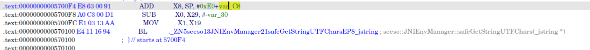

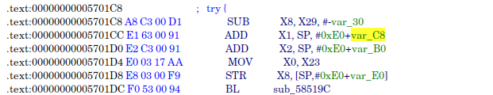

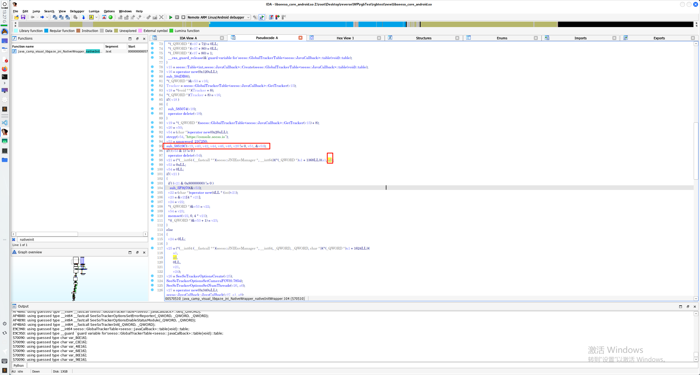

查看汇编，key只在sub\_58529C中被使用，且sub\_58529C之后开始使用a5即userStatusOption，所以sub\_58529C是校验关键函数，跟踪X1寄存器

跟踪完最后整体流程是：

nativeInitWrapper -> sub\_58529C -> getLicenseInformation -> getLicenseInformationInternal

###### Native层关键函数分析：

<font style="background-color:#FBDE28;">· getDeviceInfo</font>

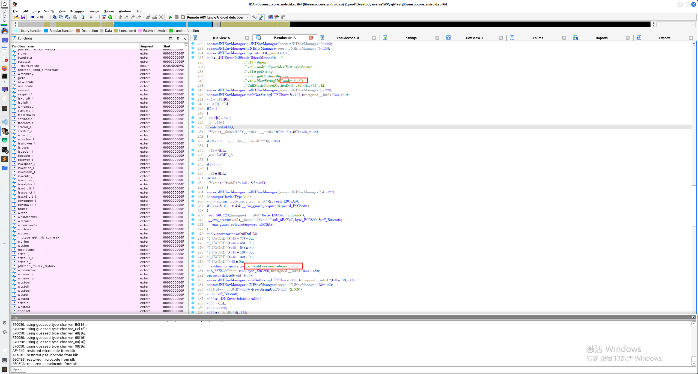

获取android\_id、device\_type、packagename等信息

<font style="background-color:#FBDE28;">· safeGetStringUTFChars</font>

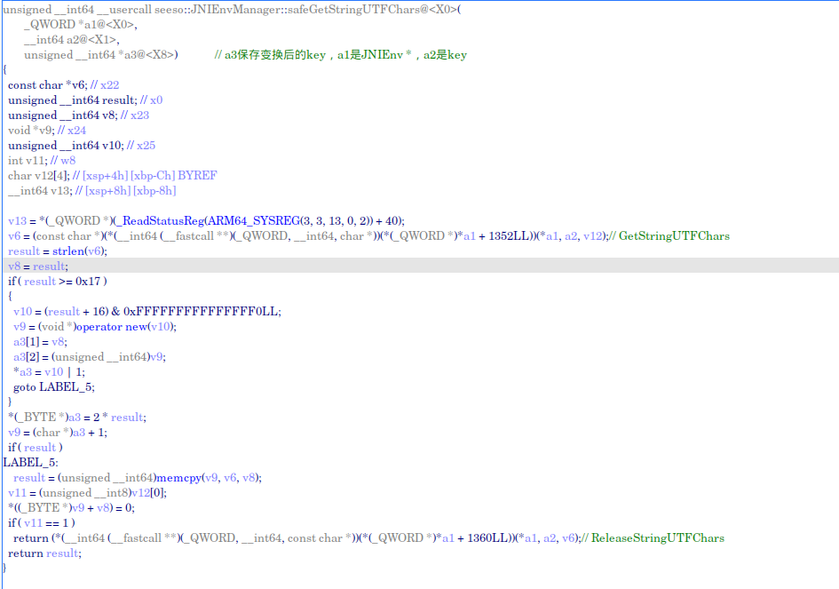

在这个so中字符串2种存储方式：

①长度小于0x17，第1个字节存储length的2倍数，接下来存储字符串

②长度大于0x17，第2个8字节存储length，第3个字节存储字符串的地址

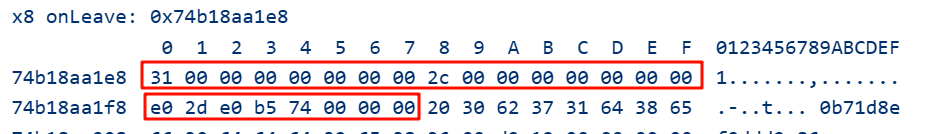

<font style="background-color:#FBDE28;">· sub\_58519C</font>

<details>
<summary>hook代码</summary>
<div style="max-height: 400px; overflow-y: auto; padding: 0 10px;">

```javascript
Java.perform(function () {
    function replace_key_java_nativewrapper() {
        let NativeWrapper = Java.use("camp.visual.libgaze.jni.NativeWrapper");
        NativeWrapper["nativeInitWrapper"].implementation = function (context, str, iArr, i, z, jNICallbackDispatcher) {
            let new_key = "dev_m1xw0grvvh2nu9c2i4vufkddzyty5iig719riprm";
            console.log('nativeInitWrapper is called' + ', ' + 'context: ' + context + ', ' + 'new_key: ' + new_key + ', ' + 'iArr: ' + iArr + ', ' + 'i: ' + i + ', ' + 'z: ' + z + ', ' + 'jNICallbackDispatcher: ' + jNICallbackDispatcher);
            let ret = this.nativeInitWrapper(context, new_key, iArr, i, z, jNICallbackDispatcher);
            console.log('nativeInitWrapper ret value is ' + ret);
            return ret;
        };
    }
    function print_arg(addr, hx_length = null, hx_ansi = null) {
        var hx_args = {};
        if (hx_length != null) {
            hx_args["length"] = hx_length;
        }
        if (hx_ansi != null) {
            hx_args["ansi"] = hx_ansi;
        }
        try {
            var module = Process.findRangeByAddress(addr);
            if (module != null) {
                return "\n" + hexdump(addr, hx_args) + "\n\n";
            }
            return ptr(addr) + "\n\n";
        } catch (e) {
            return addr + "\n\n";
        }
    }
    function hook_native_addr(funcPtr, registers, returnAddrs = null, logtag = null) {
        var module = Process.findModuleByAddress(funcPtr);
        Interceptor.attach(funcPtr, {
            onEnter: function (args) {
                this.logs = "";
                this.registers = {};
                this.trueReturnAddr = this.context["lr"].sub(module.base);
                this.returnCheck = false;
                if (returnAddrs) {
                    for (let i = 0; i < returnAddrs.length; i++) {
                        if (this.trueReturnAddr.compare(returnAddrs[i]) === 0) {
                            this.returnCheck = true;
                            break;
                        }
                    }
                } else {
                    this.returnCheck = true;
                }
                if (!this.returnCheck) {
                    return
                }
                registers.forEach(element => {
                    var regName = element;
                    var regValue = this.context[regName];
                    this.registers[regName] = regValue;
                });
                this.logs = this.logs.concat("So: " + module.name + ":" + module.base + "  methodOffset: " + ptr(funcPtr).sub(module.base) + "  trueReturnAddr:" + this.trueReturnAddr + "\n");
                if (logtag) {
                    this.logs = this.logs.concat(logtag + " trueReturnAddr:" + this.trueReturnAddr + " onEnter");
                    this.logs = this.logs.concat("==============================" + "\n");
                }
                for (let regName in this.registers) {
                    if (this.registers.hasOwnProperty(regName)) {
                        var regValue = this.registers[regName];
                        this.logs = this.logs.concat(regName + " onEnter: " + regValue + print_arg(regValue));
                        if (["x1", "x7", "x8"].includes(regName)) {
                            this.logs = this.logs.concat(regName + " onEnter: +16" + regValue + print_arg(regValue.add(16).readPointer()));
                        }
                    }
                }
            },
            onLeave: function (retval) {
                if (!this.returnCheck) {
                    return
                }
                if (logtag) {
                    this.logs = this.logs.concat(logtag + " trueReturnAddr:" + this.trueReturnAddr + " onLeave");
                    this.logs = this.logs.concat("==============================" + "\n");
                }
                for (let regName in this.registers) {
                    if (this.registers.hasOwnProperty(regName)) {
                        var regValue = this.registers[regName];
                        this.logs = this.logs.concat(regName + " onLeave: " + regValue + print_arg(regValue));
                        // if (regName === "x8") {
                        //     this.logs = this.logs.concat(regName + " onLeave: +16" + regValue + print_arg(regValue.add(16).readPointer()));
                        // }
                    }
                }
                this.logs = this.logs.concat("retval onLeave: " + retval + print_arg(retval));
                console.log(this.logs);
            }
        });
    }
    const registers = {
        0: "x0", 1: "x1", 2: "x2", 3: "x3", 4: "x4", 5: "x5",
        6: "x6", 7: "x7", 8: "x8", 9: "x9", 10: "x10", 11: "x11",
        12: "x12", 13: "x13", 14: "x14", 15: "x15", 16: "x16",
        17: "x17", 18: "x18", 19: "x19", 20: "x20", 21: "x21",
        22: "x22", 23: "x23", 24: "x24", 25: "x25", 26: "x26",
        27: "x27", 28: "x28",
        29: "fp",
        30: "lr",
        31: "sp",
    };

    replace_key_java_nativewrapper();

    hook_native_addr(
        Module.findBaseAddress("libseeso_core_android.so").add(0x56ff6c),
        [registers[0], registers[1], registers[8]],
        [ptr(0x570104)],
        "seeso::JNIEnvManager::safeGetStringUTFChars(&v53, a4, (unsigned __int64 *)v40);"
    );

    hook_native_addr(
        Module.findBaseAddress("libseeso_core_android.so").add(0x58519C),
        [registers[0], registers[1], registers[2], registers[3], registers[4], registers[5], registers[6], registers[7], registers[8]],
        [ptr(0x5701e0)],
        "sub_58519C(v19, v40, v42, v44, v46, v48, v20, v51, &v53);"
    );

})


function memcpy_hook() {
    var memcpy_addr = null;
    var symbols = Process.findModuleByName("libc.so").enumerateSymbols();
    for (var i = 0; i < symbols.length; i++) {
        if (symbols[i].name === "memcpy") {
            // console.log("symbols name is -> " + symbols[i].name);
            // console.log("symbols address is -> " + symbols[i].address);
            memcpy_addr = symbols[i].address;
        }
    }
    Interceptor.attach(memcpy_addr, {
        onEnter: function (args) {
            if (args[1].readCString().indexOf("client/validation") != -1) {
                console.log("args is ->" + args[0], args[1], args[2]);
                // 打印调用栈（Native 层）
                const backtrace = Thread.backtrace(this.context, Backtracer.ACCURATE)
                    .map(addr => DebugSymbol.fromAddress(addr))
                    .join("\n\t");
                console.log("Backtrace:\n\t" + backtrace);
            }
        },
        onLeave: function (retval) {
            // console.log(retval);
        }
    });
}
```
</div>
</details>

<details>
<summary>hook日志</summary>
<div style="max-height: 400px; overflow-y: auto; padding: 0 10px;">

```bash
[Pixel::RgbTest ]-> nativeInitWrapper is called, context: android.app.Application@6ca6f28, new_key: dev_m1xw0grvvh2nu9c2i4vufkddzyty5iig719riprm, iArr: 1,2,3, i: 3, z: false, jNICallbackDispatcher: camp.visual.libgaze.callbacks.JNICallbackDispatcher@f3d0b3b
So: libseeso_core_android.so:0x71adc1c000  methodOffset: 0x56ff6c  trueReturnAddr:0x570104
seeso::JNIEnvManager::safeGetStringUTFChars(&v53, a4, (unsigned __int64 *)v40); trueReturnAddr:0x570104 onEnter==============================
x0 onEnter: 0x71fbd6b280
             0  1  2  3  4  5  6  7  8  9  A  B  C  D  E  F  0123456789ABCDEF
71fbd6b280  40 72 76 8f 72 00 00 00 00 00 00 00 80 ff ff ff  @rv.r...........
71fbd6b290  40 72 76 8f 72 00 00 00 34 b3 d6 fb 71 00 00 00  @rv.r...4...q...
71fbd6b2a0  37 f4 4a b4 74 be 92 76 3c b3 d6 fb 71 00 00 00  7.J.t..v<...q...
71fbd6b2b0  40 b3 d6 fb 71 00 00 00 54 b3 34 0a 72 00 00 00  @...q...T.4.r...
71fbd6b2c0  40 b3 d6 fb 71 00 00 00 e8 02 e1 12 00 00 00 00  @...q...........
71fbd6b2d0  b0 14 6b 8f 72 00 00 00 20 20 d7 fb 71 00 00 00  ..k.r...  ..q...
71fbd6b2e0  1c 00 00 00 00 00 00 00 93 ab 65 9f 71 00 00 00  ..........e.q...
71fbd6b2f0  70 b6 d6 fb 71 00 00 00 00 14 6b 8f 72 00 00 00  p...q.....k.r...
71fbd6b300  00 00 00 00 00 00 00 00 00 14 6b 8f 72 00 00 00  ..........k.r...
71fbd6b310  68 25 ec 12 00 00 00 00 d0 57 e1 12 01 00 00 00  h%.......W......
71fbd6b320  a0 0b 04 f6 71 00 00 00 68 fd d6 fb 71 00 00 00  ....q...h...q...
71fbd6b330  05 00 00 00 f0 17 e1 12 68 25 ec 12 d0 57 e1 12  ........h%...W..
71fbd6b340  50 18 e1 12 e8 02 e1 12 d8 40 7a af 71 00 00 00  P........@z.q...
71fbd6b350  61 fd d6 fb 71 00 00 00 80 bd d6 fb 71 00 00 00  a...q.......q...
71fbd6b360  0a 00 00 00 00 00 00 00 ff ff ff ff ff ff ff ff  ................
71fbd6b370  a8 6a 8f 02 72 00 00 00 03 00 00 00 02 00 00 00  .j..r...........

x1 onEnter: 0x71fbd6b33c
             0  1  2  3  4  5  6  7  8  9  A  B  C  D  E  F  0123456789ABCDEF
71fbd6b33c  d0 57 e1 12 50 18 e1 12 e8 02 e1 12 d8 40 7a af  .W..P........@z.
71fbd6b34c  71 00 00 00 61 fd d6 fb 71 00 00 00 80 bd d6 fb  q...a...q.......
71fbd6b35c  71 00 00 00 0a 00 00 00 00 00 00 00 ff ff ff ff  q...............
71fbd6b36c  ff ff ff ff a8 6a 8f 02 72 00 00 00 03 00 00 00  .....j..r.......
71fbd6b37c  02 00 00 00 01 00 00 00 fb de 9e 7b 03 00 00 00  ...........{....
71fbd6b38c  00 00 00 00 f0 17 e1 12 00 00 00 00 68 25 ec 12  ............h%..
71fbd6b39c  00 00 00 00 d0 57 e1 12 00 00 00 00 50 18 e1 12  .....W......P...
71fbd6b3ac  00 00 00 00 03 00 00 00 00 00 00 00 00 00 00 00  ................
71fbd6b3bc  00 00 00 00 e8 02 e1 12 00 00 00 00 00 00 00 00  ................
71fbd6b3cc  00 00 00 00 00 14 6b 8f 72 00 00 00 70 b6 d6 fb  ......k.r...p...
71fbd6b3dc  71 00 00 00 93 ab 65 9f 71 00 00 00 1c 00 00 00  q.....e.q.......
71fbd6b3ec  00 00 00 00 20 20 d7 fb 71 00 00 00 b0 14 6b 8f  ....  ..q.....k.
71fbd6b3fc  72 00 00 00 e8 02 e1 12 00 00 00 00 40 55 ee 12  r...........@U..
71fbd6b40c  00 00 00 00 50 b4 d6 fb 71 00 00 00 38 23 34 0a  ....P...q...8#4.
71fbd6b41c  72 00 00 00 00 00 00 00 00 00 00 00 f0 17 e1 12  r...............
71fbd6b42c  68 25 ec 12 d0 57 e1 12 50 18 e1 12 03 00 00 00  h%...W..P.......

x1 onEnter: +160x71fbd6b33c0xfbd6fd6100000071

x8 onEnter: 0x71fbd6b1e8
             0  1  2  3  4  5  6  7  8  9  A  B  C  D  E  F  0123456789ABCDEF
71fbd6b1e8  48 00 00 00 00 00 00 00 a0 0b 04 f6 71 00 00 00  H...........q...
71fbd6b1f8  00 14 6b 8f 72 00 00 00 20 30 62 37 31 64 38 65  ..k.r... 0b71d8e
71fbd6b208  66 30 64 64 64 32 65 38 36 00 e1 12 00 00 00 00  f0ddd2e86.......
71fbd6b218  18 47 6f 6f 67 6c 65 2d 50 69 78 65 6c 00 00 00  .Google-Pixel...
71fbd6b228  c5 00 00 00 00 00 00 00 14 61 6e 64 72 6f 69 64  .........android
71fbd6b238  2d 31 30 00 00 00 00 00 00 00 00 00 00 00 00 00  -10.............
71fbd6b248  2c 63 6f 6d 2e 69 6e 76 65 6e 73 75 6e 2e 72 67  ,com.invensun.rg
71fbd6b258  62 72 65 61 64 65 72 00 01 b4 d6 fb 71 00 00 00  breader.....q...
71fbd6b268  21 00 00 00 00 00 00 00 1d 00 00 00 00 00 00 00  !...............
71fbd6b278  80 54 13 9f 71 00 00 00 40 72 76 8f 72 00 00 00  .T..q...@rv.r...
71fbd6b288  00 00 00 00 80 ff ff ff 40 72 76 8f 72 00 00 00  ........@rv.r...
71fbd6b298  34 b3 d6 fb 71 00 00 00 37 f4 4a b4 74 be 92 76  4...q...7.J.t..v
71fbd6b2a8  3c b3 d6 fb 71 00 00 00 40 b3 d6 fb 71 00 00 00  <...q...@...q...
71fbd6b2b8  54 b3 34 0a 72 00 00 00 40 b3 d6 fb 71 00 00 00  T.4.r...@...q...
71fbd6b2c8  e8 02 e1 12 00 00 00 00 b0 14 6b 8f 72 00 00 00  ..........k.r...
71fbd6b2d8  20 20 d7 fb 71 00 00 00 1c 00 00 00 00 00 00 00    ..q...........

x8 onEnter: +160x71fbd6b1e8
             0  1  2  3  4  5  6  7  8  9  A  B  C  D  E  F  0123456789ABCDEF
728f6b1400  00 00 5c 00 00 00 00 00 00 00 00 00 05 00 00 00  ..\.............
728f6b1410  f9 72 00 00 00 00 00 00 00 00 00 00 00 00 00 00  .r..............
728f6b1420  00 00 00 00 00 00 00 00 00 00 00 00 00 00 00 00  ................
728f6b1430  00 00 00 00 00 00 00 00 00 00 00 00 01 00 00 00  ................
728f6b1440  01 00 00 00 00 00 00 00 00 00 00 00 00 00 00 00  ................
728f6b1450  01 00 00 00 00 00 00 00 00 00 00 00 00 00 00 00  ................
728f6b1460  00 00 00 00 00 00 00 00 00 00 00 00 00 00 00 00  ................
728f6b1470  00 00 00 00 00 00 00 00 00 00 00 00 00 00 00 00  ................
728f6b1480  00 00 00 00 00 00 00 00 00 00 00 00 00 00 00 00  ................
728f6b1490  00 00 00 00 00 00 00 00 70 70 35 06 72 00 00 00  ........pp5.r...
728f6b14a0  00 00 00 00 00 00 00 00 00 10 c7 fb 71 00 00 00  ............q...
728f6b14b0  21 b3 d6 fb 71 00 00 00 a0 b4 d6 fb 71 00 00 00  !...q.......q...
728f6b14c0  00 00 00 00 00 00 00 00 c8 14 6b 8f 72 00 00 00  ..........k.r...
728f6b14d0  40 72 76 8f 72 00 00 00 00 00 00 00 00 00 00 00  @rv.r...........
728f6b14e0  00 00 00 00 00 00 00 00 88 7d c4 12 00 00 00 00  .........}......
728f6b14f0  00 00 00 00 00 00 00 00 00 f0 c6 fb 71 00 00 00  ............q...

seeso::JNIEnvManager::safeGetStringUTFChars(&v53, a4, (unsigned __int64 *)v40); trueReturnAddr:0x570104 onLeave==============================
x0 onLeave: 0x71fbd6b280
             0  1  2  3  4  5  6  7  8  9  A  B  C  D  E  F  0123456789ABCDEF
71fbd6b280  40 72 76 8f 72 00 00 00 00 00 00 00 80 ff ff ff  @rv.r...........
71fbd6b290  40 72 76 8f 72 00 00 00 34 b3 d6 fb 71 00 00 00  @rv.r...4...q...
71fbd6b2a0  37 f4 4a b4 74 be 92 76 3c b3 d6 fb 71 00 00 00  7.J.t..v<...q...
71fbd6b2b0  40 b3 d6 fb 71 00 00 00 54 b3 34 0a 72 00 00 00  @...q...T.4.r...
71fbd6b2c0  40 b3 d6 fb 71 00 00 00 e8 02 e1 12 00 00 00 00  @...q...........
71fbd6b2d0  b0 14 6b 8f 72 00 00 00 20 20 d7 fb 71 00 00 00  ..k.r...  ..q...
71fbd6b2e0  1c 00 00 00 00 00 00 00 93 ab 65 9f 71 00 00 00  ..........e.q...
71fbd6b2f0  70 b6 d6 fb 71 00 00 00 00 14 6b 8f 72 00 00 00  p...q.....k.r...
71fbd6b300  00 00 00 00 00 00 00 00 00 14 6b 8f 72 00 00 00  ..........k.r...
71fbd6b310  68 25 ec 12 00 00 00 00 d0 57 e1 12 01 00 00 00  h%.......W......
71fbd6b320  a0 0b 04 f6 71 00 00 00 68 fd d6 fb 71 00 00 00  ....q...h...q...
71fbd6b330  05 00 00 00 f0 17 e1 12 68 25 ec 12 d0 57 e1 12  ........h%...W..
71fbd6b340  50 18 e1 12 e8 02 e1 12 d8 40 7a af 71 00 00 00  P........@z.q...
71fbd6b350  61 fd d6 fb 71 00 00 00 80 bd d6 fb 71 00 00 00  a...q.......q...
71fbd6b360  0a 00 00 00 00 00 00 00 ff ff ff ff ff ff ff ff  ................
71fbd6b370  a8 6a 8f 02 72 00 00 00 03 00 00 00 02 00 00 00  .j..r...........

x1 onLeave: 0x71fbd6b33c
             0  1  2  3  4  5  6  7  8  9  A  B  C  D  E  F  0123456789ABCDEF
71fbd6b33c  d0 57 e1 12 50 18 e1 12 e8 02 e1 12 d8 40 7a af  .W..P........@z.
71fbd6b34c  71 00 00 00 61 fd d6 fb 71 00 00 00 80 bd d6 fb  q...a...q.......
71fbd6b35c  71 00 00 00 0a 00 00 00 00 00 00 00 ff ff ff ff  q...............
71fbd6b36c  ff ff ff ff a8 6a 8f 02 72 00 00 00 03 00 00 00  .....j..r.......
71fbd6b37c  02 00 00 00 01 00 00 00 fb de 9e 7b 03 00 00 00  ...........{....
71fbd6b38c  00 00 00 00 f0 17 e1 12 00 00 00 00 68 25 ec 12  ............h%..
71fbd6b39c  00 00 00 00 d0 57 e1 12 00 00 00 00 50 18 e1 12  .....W......P...
71fbd6b3ac  00 00 00 00 03 00 00 00 00 00 00 00 00 00 00 00  ................
71fbd6b3bc  00 00 00 00 e8 02 e1 12 00 00 00 00 00 00 00 00  ................
71fbd6b3cc  00 00 00 00 00 14 6b 8f 72 00 00 00 70 b6 d6 fb  ......k.r...p...
71fbd6b3dc  71 00 00 00 93 ab 65 9f 71 00 00 00 1c 00 00 00  q.....e.q.......
71fbd6b3ec  00 00 00 00 20 20 d7 fb 71 00 00 00 b0 14 6b 8f  ....  ..q.....k.
71fbd6b3fc  72 00 00 00 e8 02 e1 12 00 00 00 00 40 55 ee 12  r...........@U..
71fbd6b40c  00 00 00 00 50 b4 d6 fb 71 00 00 00 38 23 34 0a  ....P...q...8#4.
71fbd6b41c  72 00 00 00 00 00 00 00 00 00 00 00 f0 17 e1 12  r...............
71fbd6b42c  68 25 ec 12 d0 57 e1 12 50 18 e1 12 03 00 00 00  h%...W..P.......

x8 onLeave: 0x71fbd6b1e8
             0  1  2  3  4  5  6  7  8  9  A  B  C  D  E  F  0123456789ABCDEF
71fbd6b1e8  31 00 00 00 00 00 00 00 2c 00 00 00 00 00 00 00  1.......,.......
71fbd6b1f8  50 ed f8 f9 71 00 00 00 20 30 62 37 31 64 38 65  P...q... 0b71d8e
71fbd6b208  66 30 64 64 64 32 65 38 36 00 e1 12 00 00 00 00  f0ddd2e86.......
71fbd6b218  18 47 6f 6f 67 6c 65 2d 50 69 78 65 6c 00 00 00  .Google-Pixel...
71fbd6b228  c5 00 00 00 00 00 00 00 14 61 6e 64 72 6f 69 64  .........android
71fbd6b238  2d 31 30 00 00 00 00 00 00 00 00 00 00 00 00 00  -10.............
71fbd6b248  2c 63 6f 6d 2e 69 6e 76 65 6e 73 75 6e 2e 72 67  ,com.invensun.rg
71fbd6b258  62 72 65 61 64 65 72 00 01 b4 d6 fb 71 00 00 00  breader.....q...
71fbd6b268  21 00 00 00 00 00 00 00 1d 00 00 00 00 00 00 00  !...............
71fbd6b278  80 54 13 9f 71 00 00 00 40 72 76 8f 72 00 00 00  .T..q...@rv.r...
71fbd6b288  00 00 00 00 80 ff ff ff 40 72 76 8f 72 00 00 00  ........@rv.r...
71fbd6b298  34 b3 d6 fb 71 00 00 00 37 f4 4a b4 74 be 92 76  4...q...7.J.t..v
71fbd6b2a8  3c b3 d6 fb 71 00 00 00 40 b3 d6 fb 71 00 00 00  <...q...@...q...
71fbd6b2b8  54 b3 34 0a 72 00 00 00 40 b3 d6 fb 71 00 00 00  T.4.r...@...q...
71fbd6b2c8  e8 02 e1 12 00 00 00 00 b0 14 6b 8f 72 00 00 00  ..........k.r...
71fbd6b2d8  20 20 d7 fb 71 00 00 00 1c 00 00 00 00 00 00 00    ..q...........

retval onLeave: 0x10x1


So: libseeso_core_android.so:0x71adc1c000  methodOffset: 0x58519c  trueReturnAddr:0x5701e0
sub_58519C(v19, v40, v42, v44, v46, v48, v20, v51, &v53); trueReturnAddr:0x5701e0 onEnter==============================
x0 onEnter: 0x71f9fe3440
             0  1  2  3  4  5  6  7  8  9  A  B  C  D  E  F  0123456789ABCDEF
71f9fe3440  d8 d9 e7 f9 71 00 00 00 00 00 00 00 00 00 00 00  ....q...........
71f9fe3450  00 00 00 00 00 00 00 00 00 00 00 00 00 00 00 00  ................
71f9fe3460  00 00 00 00 00 00 00 00 00 00 00 00 00 00 00 00  ................
71f9fe3470  00 00 00 00 00 00 00 00 00 00 00 00 00 00 00 00  ................
71f9fe3480  00 00 00 00 00 00 00 00 00 00 00 00 00 00 00 00  ................
71f9fe3490  00 00 00 00 00 00 00 00 00 00 00 00 00 00 00 00  ................
71f9fe34a0  00 00 00 00 00 00 00 00 00 00 00 00 00 00 00 00  ................
71f9fe34b0  00 00 00 00 00 00 00 00 00 00 00 00 00 00 00 00  ................
71f9fe34c0  00 00 00 00 00 00 00 00 00 00 00 00 00 00 00 00  ................
71f9fe34d0  00 00 00 00 00 00 00 00 00 00 00 00 00 00 00 00  ................
71f9fe34e0  00 00 00 00 00 00 00 00 00 00 00 00 00 00 00 00  ................
71f9fe34f0  00 00 00 00 00 00 00 00 03 00 00 00 00 25 4a 6f  .............%Jo
71f9fe3500  94 b9 de 04 29 4e 73 98 bd e2 08 2d 00 0d 1a 27  ....)Ns....-...'
71f9fe3510  34 41 4e 5b 68 75 82 8f 9c a9 b6 c3 00 00 00 00  4AN[hu..........
71f9fe3520  00 00 00 00 00 00 00 00 00 00 00 00 00 00 00 00  ................
71f9fe3530  00 00 00 00 00 00 00 00 00 00 00 00 00 00 00 00  ................

x1 onEnter: 0x71fbd6b1e8
             0  1  2  3  4  5  6  7  8  9  A  B  C  D  E  F  0123456789ABCDEF
71fbd6b1e8  31 00 00 00 00 00 00 00 2c 00 00 00 00 00 00 00  1.......,.......
71fbd6b1f8  50 ed f8 f9 71 00 00 00 20 30 62 37 31 64 38 65  P...q... 0b71d8e
71fbd6b208  66 30 64 64 64 32 65 38 36 00 e1 12 00 00 00 00  f0ddd2e86.......
71fbd6b218  18 47 6f 6f 67 6c 65 2d 50 69 78 65 6c 00 00 00  .Google-Pixel...
71fbd6b228  c5 00 00 00 00 00 00 00 14 61 6e 64 72 6f 69 64  .........android
71fbd6b238  2d 31 30 00 00 00 00 00 00 00 00 00 00 00 00 00  -10.............
71fbd6b248  2c 63 6f 6d 2e 69 6e 76 65 6e 73 75 6e 2e 72 67  ,com.invensun.rg
71fbd6b258  62 72 65 61 64 65 72 00 01 b4 d6 fb 71 00 00 00  breader.....q...
71fbd6b268  21 00 00 00 00 00 00 00 1d 00 00 00 00 00 00 00  !...............
71fbd6b278  80 54 13 9f 71 00 00 00 21 00 00 00 00 00 00 00  .T..q...!.......
71fbd6b288  18 00 00 00 00 00 00 00 60 54 13 9f 71 00 00 00  ........`T..q...
71fbd6b298  34 b3 d6 fb 71 00 00 00 37 f4 4a b4 74 be 92 76  4...q...7.J.t..v
71fbd6b2a8  3c b3 d6 fb 71 00 00 00 40 b3 d6 fb 71 00 00 00  <...q...@...q...
71fbd6b2b8  54 b3 34 0a 72 00 00 00 40 b3 d6 fb 71 00 00 00  T.4.r...@...q...
71fbd6b2c8  e8 02 e1 12 00 00 00 00 b0 14 6b 8f 72 00 00 00  ..........k.r...
71fbd6b2d8  20 20 d7 fb 71 00 00 00 1c 00 00 00 00 00 00 00    ..q...........

x1 onEnter: +160x71fbd6b1e8
             0  1  2  3  4  5  6  7  8  9  A  B  C  D  E  F  0123456789ABCDEF
71f9f8ed50  64 65 76 5f 6d 31 78 77 30 67 72 76 76 68 32 6e  dev_m1xw0grvvh2n
71f9f8ed60  75 39 63 32 69 34 76 75 66 6b 64 64 7a 79 74 79  u9c2i4vufkddzyty
71f9f8ed70  35 69 69 67 37 31 39 72 69 70 72 6d 00 00 00 00  5iig719riprm....
71f9f8ed80  53 65 65 53 6f 20 56 65 72 73 69 6f 6e 3a 20 33  SeeSo Version: 3
71f9f8ed90  2e 31 2e 33 20 28 33 30 31 30 30 30 30 33 29 00  .1.3 (30100003).
71f9f8eda0  00 00 00 00 00 00 00 00 00 00 00 00 00 00 00 00  ................
71f9f8edb0  28 00 00 00 00 00 00 00 00 00 00 00 00 00 00 00  (...............
71f9f8edc0  00 00 00 00 00 00 00 00 00 00 00 00 03 00 00 00  ................
71f9f8edd0  b8 97 f8 f9 71 00 00 00 09 00 00 00 00 00 00 00  ....q...........
71f9f8ede0  28 00 00 00 00 00 00 00 00 00 00 00 00 00 00 00  (...............
71f9f8edf0  00 00 00 00 00 00 00 00 00 00 00 00 03 00 00 00  ................
71f9f8ee00  68 9a f8 f9 71 00 00 00 09 00 00 00 00 00 00 00  h...q...........
71f9f8ee10  02 00 00 00 67 6c 65 2e 13 00 00 00 00 00 00 00  ....gle.........
71f9f8ee20  2e 46 69 65 6c 64 4f 70 6f 70 61 71 75 65 5f 72  .FieldOpopaque_r
71f9f8ee30  61 77 5f 73 74 72 69 64 65 73 00 00 00 00 00 00  aw_strides......
71f9f8ee40  02 00 00 00 67 6c 65 2e 12 00 00 00 00 00 00 00  ....gle.........

x2 onEnter: 0x71fbd6b200
             0  1  2  3  4  5  6  7  8  9  A  B  C  D  E  F  0123456789ABCDEF
71fbd6b200  20 30 62 37 31 64 38 65 66 30 64 64 64 32 65 38   0b71d8ef0ddd2e8
71fbd6b210  36 00 e1 12 00 00 00 00 18 47 6f 6f 67 6c 65 2d  6........Google-
71fbd6b220  50 69 78 65 6c 00 00 00 c5 00 00 00 00 00 00 00  Pixel...........
71fbd6b230  14 61 6e 64 72 6f 69 64 2d 31 30 00 00 00 00 00  .android-10.....
71fbd6b240  00 00 00 00 00 00 00 00 2c 63 6f 6d 2e 69 6e 76  ........,com.inv
71fbd6b250  65 6e 73 75 6e 2e 72 67 62 72 65 61 64 65 72 00  ensun.rgbreader.
71fbd6b260  01 b4 d6 fb 71 00 00 00 21 00 00 00 00 00 00 00  ....q...!.......
71fbd6b270  1d 00 00 00 00 00 00 00 80 54 13 9f 71 00 00 00  .........T..q...
71fbd6b280  21 00 00 00 00 00 00 00 18 00 00 00 00 00 00 00  !...............
71fbd6b290  60 54 13 9f 71 00 00 00 34 b3 d6 fb 71 00 00 00  `T..q...4...q...
71fbd6b2a0  37 f4 4a b4 74 be 92 76 3c b3 d6 fb 71 00 00 00  7.J.t..v<...q...
71fbd6b2b0  40 b3 d6 fb 71 00 00 00 54 b3 34 0a 72 00 00 00  @...q...T.4.r...
71fbd6b2c0  40 b3 d6 fb 71 00 00 00 e8 02 e1 12 00 00 00 00  @...q...........
71fbd6b2d0  b0 14 6b 8f 72 00 00 00 20 20 d7 fb 71 00 00 00  ..k.r...  ..q...
71fbd6b2e0  1c 00 00 00 00 00 00 00 93 ab 65 9f 71 00 00 00  ..........e.q...
71fbd6b2f0  70 b6 d6 fb 71 00 00 00 00 14 6b 8f 72 00 00 00  p...q.....k.r...

x3 onEnter: 0x71fbd6b218
             0  1  2  3  4  5  6  7  8  9  A  B  C  D  E  F  0123456789ABCDEF
71fbd6b218  18 47 6f 6f 67 6c 65 2d 50 69 78 65 6c 00 00 00  .Google-Pixel...
71fbd6b228  c5 00 00 00 00 00 00 00 14 61 6e 64 72 6f 69 64  .........android
71fbd6b238  2d 31 30 00 00 00 00 00 00 00 00 00 00 00 00 00  -10.............
71fbd6b248  2c 63 6f 6d 2e 69 6e 76 65 6e 73 75 6e 2e 72 67  ,com.invensun.rg
71fbd6b258  62 72 65 61 64 65 72 00 01 b4 d6 fb 71 00 00 00  breader.....q...
71fbd6b268  21 00 00 00 00 00 00 00 1d 00 00 00 00 00 00 00  !...............
71fbd6b278  80 54 13 9f 71 00 00 00 21 00 00 00 00 00 00 00  .T..q...!.......
71fbd6b288  18 00 00 00 00 00 00 00 60 54 13 9f 71 00 00 00  ........`T..q...
71fbd6b298  34 b3 d6 fb 71 00 00 00 37 f4 4a b4 74 be 92 76  4...q...7.J.t..v
71fbd6b2a8  3c b3 d6 fb 71 00 00 00 40 b3 d6 fb 71 00 00 00  <...q...@...q...
71fbd6b2b8  54 b3 34 0a 72 00 00 00 40 b3 d6 fb 71 00 00 00  T.4.r...@...q...
71fbd6b2c8  e8 02 e1 12 00 00 00 00 b0 14 6b 8f 72 00 00 00  ..........k.r...
71fbd6b2d8  20 20 d7 fb 71 00 00 00 1c 00 00 00 00 00 00 00    ..q...........
71fbd6b2e8  93 ab 65 9f 71 00 00 00 70 b6 d6 fb 71 00 00 00  ..e.q...p...q...
71fbd6b2f8  00 14 6b 8f 72 00 00 00 00 00 00 00 00 00 00 00  ..k.r...........
71fbd6b308  00 14 6b 8f 72 00 00 00 68 25 ec 12 00 00 00 00  ..k.r...h%......

x4 onEnter: 0x71fbd6b230
             0  1  2  3  4  5  6  7  8  9  A  B  C  D  E  F  0123456789ABCDEF
71fbd6b230  14 61 6e 64 72 6f 69 64 2d 31 30 00 00 00 00 00  .android-10.....
71fbd6b240  00 00 00 00 00 00 00 00 2c 63 6f 6d 2e 69 6e 76  ........,com.inv
71fbd6b250  65 6e 73 75 6e 2e 72 67 62 72 65 61 64 65 72 00  ensun.rgbreader.
71fbd6b260  01 b4 d6 fb 71 00 00 00 21 00 00 00 00 00 00 00  ....q...!.......
71fbd6b270  1d 00 00 00 00 00 00 00 80 54 13 9f 71 00 00 00  .........T..q...
71fbd6b280  21 00 00 00 00 00 00 00 18 00 00 00 00 00 00 00  !...............
71fbd6b290  60 54 13 9f 71 00 00 00 34 b3 d6 fb 71 00 00 00  `T..q...4...q...
71fbd6b2a0  37 f4 4a b4 74 be 92 76 3c b3 d6 fb 71 00 00 00  7.J.t..v<...q...
71fbd6b2b0  40 b3 d6 fb 71 00 00 00 54 b3 34 0a 72 00 00 00  @...q...T.4.r...
71fbd6b2c0  40 b3 d6 fb 71 00 00 00 e8 02 e1 12 00 00 00 00  @...q...........
71fbd6b2d0  b0 14 6b 8f 72 00 00 00 20 20 d7 fb 71 00 00 00  ..k.r...  ..q...
71fbd6b2e0  1c 00 00 00 00 00 00 00 93 ab 65 9f 71 00 00 00  ..........e.q...
71fbd6b2f0  70 b6 d6 fb 71 00 00 00 00 14 6b 8f 72 00 00 00  p...q.....k.r...
71fbd6b300  00 00 00 00 00 00 00 00 00 14 6b 8f 72 00 00 00  ..........k.r...
71fbd6b310  68 25 ec 12 00 00 00 00 d0 57 e1 12 01 00 00 00  h%.......W......
71fbd6b320  a0 0b 04 f6 71 00 00 00 68 fd d6 fb 71 00 00 00  ....q...h...q...

x5 onEnter: 0x71fbd6b248
             0  1  2  3  4  5  6  7  8  9  A  B  C  D  E  F  0123456789ABCDEF
71fbd6b248  2c 63 6f 6d 2e 69 6e 76 65 6e 73 75 6e 2e 72 67  ,com.invensun.rg
71fbd6b258  62 72 65 61 64 65 72 00 01 b4 d6 fb 71 00 00 00  breader.....q...
71fbd6b268  21 00 00 00 00 00 00 00 1d 00 00 00 00 00 00 00  !...............
71fbd6b278  80 54 13 9f 71 00 00 00 21 00 00 00 00 00 00 00  .T..q...!.......
71fbd6b288  18 00 00 00 00 00 00 00 60 54 13 9f 71 00 00 00  ........`T..q...
71fbd6b298  34 b3 d6 fb 71 00 00 00 37 f4 4a b4 74 be 92 76  4...q...7.J.t..v
71fbd6b2a8  3c b3 d6 fb 71 00 00 00 40 b3 d6 fb 71 00 00 00  <...q...@...q...
71fbd6b2b8  54 b3 34 0a 72 00 00 00 40 b3 d6 fb 71 00 00 00  T.4.r...@...q...
71fbd6b2c8  e8 02 e1 12 00 00 00 00 b0 14 6b 8f 72 00 00 00  ..........k.r...
71fbd6b2d8  20 20 d7 fb 71 00 00 00 1c 00 00 00 00 00 00 00    ..q...........
71fbd6b2e8  93 ab 65 9f 71 00 00 00 70 b6 d6 fb 71 00 00 00  ..e.q...p...q...
71fbd6b2f8  00 14 6b 8f 72 00 00 00 00 00 00 00 00 00 00 00  ..k.r...........
71fbd6b308  00 14 6b 8f 72 00 00 00 68 25 ec 12 00 00 00 00  ..k.r...h%......
71fbd6b318  d0 57 e1 12 01 00 00 00 a0 0b 04 f6 71 00 00 00  .W..........q...
71fbd6b328  68 fd d6 fb 71 00 00 00 05 00 00 00 f0 17 e1 12  h...q...........
71fbd6b338  68 25 ec 12 d0 57 e1 12 50 18 e1 12 e8 02 e1 12  h%...W..P.......

x6 onEnter: 0x10x1

x7 onEnter: 0x71fbd6b268
             0  1  2  3  4  5  6  7  8  9  A  B  C  D  E  F  0123456789ABCDEF
71fbd6b268  21 00 00 00 00 00 00 00 1d 00 00 00 00 00 00 00  !...............
71fbd6b278  80 54 13 9f 71 00 00 00 21 00 00 00 00 00 00 00  .T..q...!.......
71fbd6b288  18 00 00 00 00 00 00 00 60 54 13 9f 71 00 00 00  ........`T..q...
71fbd6b298  34 b3 d6 fb 71 00 00 00 37 f4 4a b4 74 be 92 76  4...q...7.J.t..v
71fbd6b2a8  3c b3 d6 fb 71 00 00 00 40 b3 d6 fb 71 00 00 00  <...q...@...q...
71fbd6b2b8  54 b3 34 0a 72 00 00 00 40 b3 d6 fb 71 00 00 00  T.4.r...@...q...
71fbd6b2c8  e8 02 e1 12 00 00 00 00 b0 14 6b 8f 72 00 00 00  ..........k.r...
71fbd6b2d8  20 20 d7 fb 71 00 00 00 1c 00 00 00 00 00 00 00    ..q...........
71fbd6b2e8  93 ab 65 9f 71 00 00 00 70 b6 d6 fb 71 00 00 00  ..e.q...p...q...
71fbd6b2f8  00 14 6b 8f 72 00 00 00 00 00 00 00 00 00 00 00  ..k.r...........
71fbd6b308  00 14 6b 8f 72 00 00 00 68 25 ec 12 00 00 00 00  ..k.r...h%......
71fbd6b318  d0 57 e1 12 01 00 00 00 a0 0b 04 f6 71 00 00 00  .W..........q...
71fbd6b328  68 fd d6 fb 71 00 00 00 05 00 00 00 f0 17 e1 12  h...q...........
71fbd6b338  68 25 ec 12 d0 57 e1 12 50 18 e1 12 e8 02 e1 12  h%...W..P.......
71fbd6b348  d8 40 7a af 71 00 00 00 61 fd d6 fb 71 00 00 00  .@z.q...a...q...
71fbd6b358  80 bd d6 fb 71 00 00 00 0a 00 00 00 00 00 00 00  ....q...........

x7 onEnter: +160x71fbd6b268
             0  1  2  3  4  5  6  7  8  9  A  B  C  D  E  F  0123456789ABCDEF
719f135480  65 49 4d 4a 6a 70 58 49 56 32 6f 67 4d 55 59 4c  eIMJjpXIV2ogMUYL
719f135490  73 5a 34 73 54 35 43 50 41 73 30 3d 0a 00 00 00  sZ4sT5CPAs0=....
719f1354a0  53 65 65 53 6f 20 56 65 72 73 69 6f 6e 3a 20 33  SeeSo Version: 3
719f1354b0  2e 31 2e 33 20 28 33 30 31 30 30 30 30 33 29 00  .1.3 (30100003).
719f1354c0  09 00 00 00 00 00 00 00 2a 86 48 86 f7 0d 01 01  ........*.H.....
719f1354d0  05 00 00 00 00 00 00 00 00 00 00 00 00 00 00 00  ................
719f1354e0  10 00 00 00 00 00 00 00 05 00 00 00 00 00 00 00  ................
719f1354f0  00 00 00 00 00 00 00 00 00 00 00 00 00 00 00 00  ................
719f135500  09 00 00 00 00 00 00 00 2a 86 48 86 f7 0d 01 01  ........*.H.....
719f135510  01 00 00 00 00 00 00 00 00 00 00 00 00 00 00 00  ................
719f135520  10 00 00 00 00 00 00 00 05 00 00 00 00 00 00 00  ................
719f135530  00 00 00 00 00 00 00 00 00 00 00 00 00 00 00 00  ................
719f135540  04 00 00 00 01 00 00 00 40 00 00 00 40 00 00 00  ........@...@...
719f135550  1c 00 00 00 00 00 00 00 00 00 00 00 00 00 00 00  ................
719f135560  04 00 00 00 01 00 00 00 03 00 00 00 03 00 00 00  ................
719f135570  1c 00 00 00 00 00 00 00 00 00 00 00 00 00 00 00  ................

x8 onEnter: 0x71fbd6b280
             0  1  2  3  4  5  6  7  8  9  A  B  C  D  E  F  0123456789ABCDEF
71fbd6b280  21 00 00 00 00 00 00 00 18 00 00 00 00 00 00 00  !...............
71fbd6b290  60 54 13 9f 71 00 00 00 34 b3 d6 fb 71 00 00 00  `T..q...4...q...
71fbd6b2a0  37 f4 4a b4 74 be 92 76 3c b3 d6 fb 71 00 00 00  7.J.t..v<...q...
71fbd6b2b0  40 b3 d6 fb 71 00 00 00 54 b3 34 0a 72 00 00 00  @...q...T.4.r...
71fbd6b2c0  40 b3 d6 fb 71 00 00 00 e8 02 e1 12 00 00 00 00  @...q...........
71fbd6b2d0  b0 14 6b 8f 72 00 00 00 20 20 d7 fb 71 00 00 00  ..k.r...  ..q...
71fbd6b2e0  1c 00 00 00 00 00 00 00 93 ab 65 9f 71 00 00 00  ..........e.q...
71fbd6b2f0  70 b6 d6 fb 71 00 00 00 00 14 6b 8f 72 00 00 00  p...q.....k.r...
71fbd6b300  00 00 00 00 00 00 00 00 00 14 6b 8f 72 00 00 00  ..........k.r...
71fbd6b310  68 25 ec 12 00 00 00 00 d0 57 e1 12 01 00 00 00  h%.......W......
71fbd6b320  a0 0b 04 f6 71 00 00 00 68 fd d6 fb 71 00 00 00  ....q...h...q...
71fbd6b330  05 00 00 00 f0 17 e1 12 68 25 ec 12 d0 57 e1 12  ........h%...W..
71fbd6b340  50 18 e1 12 e8 02 e1 12 d8 40 7a af 71 00 00 00  P........@z.q...
71fbd6b350  61 fd d6 fb 71 00 00 00 80 bd d6 fb 71 00 00 00  a...q.......q...
71fbd6b360  0a 00 00 00 00 00 00 00 ff ff ff ff ff ff ff ff  ................
71fbd6b370  a8 6a 8f 02 72 00 00 00 03 00 00 00 02 00 00 00  .j..r...........

x8 onEnter: +160x71fbd6b280
             0  1  2  3  4  5  6  7  8  9  A  B  C  D  E  F  0123456789ABCDEF
719f135460  68 74 74 70 73 3a 2f 2f 63 6f 6e 73 6f 6c 65 2e  https://console.
719f135470  73 65 65 73 6f 2e 69 6f 00 30 30 30 30 33 29 00  seeso.io.00003).
719f135480  65 49 4d 4a 6a 70 58 49 56 32 6f 67 4d 55 59 4c  eIMJjpXIV2ogMUYL
719f135490  73 5a 34 73 54 35 43 50 41 73 30 3d 0a 00 00 00  sZ4sT5CPAs0=....
719f1354a0  53 65 65 53 6f 20 56 65 72 73 69 6f 6e 3a 20 33  SeeSo Version: 3
719f1354b0  2e 31 2e 33 20 28 33 30 31 30 30 30 30 33 29 00  .1.3 (30100003).
719f1354c0  09 00 00 00 00 00 00 00 2a 86 48 86 f7 0d 01 01  ........*.H.....
719f1354d0  05 00 00 00 00 00 00 00 00 00 00 00 00 00 00 00  ................
719f1354e0  10 00 00 00 00 00 00 00 05 00 00 00 00 00 00 00  ................
719f1354f0  00 00 00 00 00 00 00 00 00 00 00 00 00 00 00 00  ................
719f135500  09 00 00 00 00 00 00 00 2a 86 48 86 f7 0d 01 01  ........*.H.....
719f135510  01 00 00 00 00 00 00 00 00 00 00 00 00 00 00 00  ................
719f135520  10 00 00 00 00 00 00 00 05 00 00 00 00 00 00 00  ................
719f135530  00 00 00 00 00 00 00 00 00 00 00 00 00 00 00 00  ................
719f135540  04 00 00 00 01 00 00 00 40 00 00 00 40 00 00 00  ........@...@...
719f135550  1c 00 00 00 00 00 00 00 00 00 00 00 00 00 00 00  ................

sub_58519C(v19, v40, v42, v44, v46, v48, v20, v51, &v53); trueReturnAddr:0x5701e0 onLeave==============================
x0 onLeave: 0x71f9fe3440
             0  1  2  3  4  5  6  7  8  9  A  B  C  D  E  F  0123456789ABCDEF
71f9fe3440  d8 d9 e7 f9 71 00 00 00 00 00 00 00 00 00 00 00  ....q...........
71f9fe3450  00 00 00 00 00 00 00 00 01 00 00 00 00 00 00 00  ................
71f9fe3460  18 e1 23 9f 71 00 00 00 00 00 00 00 00 00 00 00  ..#.q...........
71f9fe3470  00 00 00 00 00 00 00 00 00 00 00 00 00 00 00 00  ................
71f9fe3480  00 00 00 00 00 00 00 00 00 00 00 00 00 00 00 00  ................
71f9fe3490  00 00 00 00 00 00 00 00 00 00 00 00 00 00 00 00  ................
71f9fe34a0  00 00 00 00 00 00 00 00 00 00 00 00 00 00 00 00  ................
71f9fe34b0  00 00 00 00 00 00 00 00 00 00 00 00 00 00 00 00  ................
71f9fe34c0  01 00 00 00 00 00 00 00 41 00 00 00 00 00 00 00  ........A.......
71f9fe34d0  36 00 00 00 00 00 00 00 c0 af 14 9f 71 00 00 00  6...........q...
71f9fe34e0  31 00 00 00 00 00 00 00 18 00 00 00 00 00 00 00  1...............
71f9fe34f0  80 ed f8 f9 71 00 00 00 03 00 00 00 00 25 4a 6f  ....q........%Jo
71f9fe3500  94 b9 de 04 29 4e 73 98 bd e2 08 2d 00 0d 1a 27  ....)Ns....-...'
71f9fe3510  34 41 4e 5b 68 75 82 8f 9c a9 b6 c3 bc 75 bd 1d  4AN[hu.......u..
71f9fe3520  ae c7 80 10 bd 93 a5 a3 c0 2d 27 84 34 a8 e8 d6  .........-'.4...
71f9fe3530  49 56 a9 b3 c5 a4 ef c7 5b 72 c6 29 00 00 00 00  IV......[r.)....

x1 onLeave: 0x71fbd6b1e8
             0  1  2  3  4  5  6  7  8  9  A  B  C  D  E  F  0123456789ABCDEF
71fbd6b1e8  31 00 00 00 00 00 00 00 2c 00 00 00 00 00 00 00  1.......,.......
71fbd6b1f8  50 ed f8 f9 71 00 00 00 20 30 62 37 31 64 38 65  P...q... 0b71d8e
71fbd6b208  66 30 64 64 64 32 65 38 36 00 e1 12 00 00 00 00  f0ddd2e86.......
71fbd6b218  18 47 6f 6f 67 6c 65 2d 50 69 78 65 6c 00 00 00  .Google-Pixel...
71fbd6b228  c5 00 00 00 00 00 00 00 14 61 6e 64 72 6f 69 64  .........android
71fbd6b238  2d 31 30 00 00 00 00 00 00 00 00 00 00 00 00 00  -10.............
71fbd6b248  2c 63 6f 6d 2e 69 6e 76 65 6e 73 75 6e 2e 72 67  ,com.invensun.rg
71fbd6b258  62 72 65 61 64 65 72 00 01 b4 d6 fb 71 00 00 00  breader.....q...
71fbd6b268  21 00 00 00 00 00 00 00 1d 00 00 00 00 00 00 00  !...............
71fbd6b278  80 54 13 9f 71 00 00 00 21 00 00 00 00 00 00 00  .T..q...!.......
71fbd6b288  18 00 00 00 00 00 00 00 60 54 13 9f 71 00 00 00  ........`T..q...
71fbd6b298  34 b3 d6 fb 71 00 00 00 37 f4 4a b4 74 be 92 76  4...q...7.J.t..v
71fbd6b2a8  3c b3 d6 fb 71 00 00 00 40 b3 d6 fb 71 00 00 00  <...q...@...q...
71fbd6b2b8  54 b3 34 0a 72 00 00 00 40 b3 d6 fb 71 00 00 00  T.4.r...@...q...
71fbd6b2c8  e8 02 e1 12 00 00 00 00 b0 14 6b 8f 72 00 00 00  ..........k.r...
71fbd6b2d8  20 20 d7 fb 71 00 00 00 1c 00 00 00 00 00 00 00    ..q...........

x2 onLeave: 0x71fbd6b200
             0  1  2  3  4  5  6  7  8  9  A  B  C  D  E  F  0123456789ABCDEF
71fbd6b200  20 30 62 37 31 64 38 65 66 30 64 64 64 32 65 38   0b71d8ef0ddd2e8
71fbd6b210  36 00 e1 12 00 00 00 00 18 47 6f 6f 67 6c 65 2d  6........Google-
71fbd6b220  50 69 78 65 6c 00 00 00 c5 00 00 00 00 00 00 00  Pixel...........
71fbd6b230  14 61 6e 64 72 6f 69 64 2d 31 30 00 00 00 00 00  .android-10.....
71fbd6b240  00 00 00 00 00 00 00 00 2c 63 6f 6d 2e 69 6e 76  ........,com.inv
71fbd6b250  65 6e 73 75 6e 2e 72 67 62 72 65 61 64 65 72 00  ensun.rgbreader.
71fbd6b260  01 b4 d6 fb 71 00 00 00 21 00 00 00 00 00 00 00  ....q...!.......
71fbd6b270  1d 00 00 00 00 00 00 00 80 54 13 9f 71 00 00 00  .........T..q...
71fbd6b280  21 00 00 00 00 00 00 00 18 00 00 00 00 00 00 00  !...............
71fbd6b290  60 54 13 9f 71 00 00 00 34 b3 d6 fb 71 00 00 00  `T..q...4...q...
71fbd6b2a0  37 f4 4a b4 74 be 92 76 3c b3 d6 fb 71 00 00 00  7.J.t..v<...q...
71fbd6b2b0  40 b3 d6 fb 71 00 00 00 54 b3 34 0a 72 00 00 00  @...q...T.4.r...
71fbd6b2c0  40 b3 d6 fb 71 00 00 00 e8 02 e1 12 00 00 00 00  @...q...........
71fbd6b2d0  b0 14 6b 8f 72 00 00 00 20 20 d7 fb 71 00 00 00  ..k.r...  ..q...
71fbd6b2e0  1c 00 00 00 00 00 00 00 93 ab 65 9f 71 00 00 00  ..........e.q...
71fbd6b2f0  70 b6 d6 fb 71 00 00 00 00 14 6b 8f 72 00 00 00  p...q.....k.r...

x3 onLeave: 0x71fbd6b218
             0  1  2  3  4  5  6  7  8  9  A  B  C  D  E  F  0123456789ABCDEF
71fbd6b218  18 47 6f 6f 67 6c 65 2d 50 69 78 65 6c 00 00 00  .Google-Pixel...
71fbd6b228  c5 00 00 00 00 00 00 00 14 61 6e 64 72 6f 69 64  .........android
71fbd6b238  2d 31 30 00 00 00 00 00 00 00 00 00 00 00 00 00  -10.............
71fbd6b248  2c 63 6f 6d 2e 69 6e 76 65 6e 73 75 6e 2e 72 67  ,com.invensun.rg
71fbd6b258  62 72 65 61 64 65 72 00 01 b4 d6 fb 71 00 00 00  breader.....q...
71fbd6b268  21 00 00 00 00 00 00 00 1d 00 00 00 00 00 00 00  !...............
71fbd6b278  80 54 13 9f 71 00 00 00 21 00 00 00 00 00 00 00  .T..q...!.......
71fbd6b288  18 00 00 00 00 00 00 00 60 54 13 9f 71 00 00 00  ........`T..q...
71fbd6b298  34 b3 d6 fb 71 00 00 00 37 f4 4a b4 74 be 92 76  4...q...7.J.t..v
71fbd6b2a8  3c b3 d6 fb 71 00 00 00 40 b3 d6 fb 71 00 00 00  <...q...@...q...
71fbd6b2b8  54 b3 34 0a 72 00 00 00 40 b3 d6 fb 71 00 00 00  T.4.r...@...q...
71fbd6b2c8  e8 02 e1 12 00 00 00 00 b0 14 6b 8f 72 00 00 00  ..........k.r...
71fbd6b2d8  20 20 d7 fb 71 00 00 00 1c 00 00 00 00 00 00 00    ..q...........
71fbd6b2e8  93 ab 65 9f 71 00 00 00 70 b6 d6 fb 71 00 00 00  ..e.q...p...q...
71fbd6b2f8  00 14 6b 8f 72 00 00 00 00 00 00 00 00 00 00 00  ..k.r...........
71fbd6b308  00 14 6b 8f 72 00 00 00 68 25 ec 12 00 00 00 00  ..k.r...h%......

x4 onLeave: 0x71fbd6b230
             0  1  2  3  4  5  6  7  8  9  A  B  C  D  E  F  0123456789ABCDEF
71fbd6b230  14 61 6e 64 72 6f 69 64 2d 31 30 00 00 00 00 00  .android-10.....
71fbd6b240  00 00 00 00 00 00 00 00 2c 63 6f 6d 2e 69 6e 76  ........,com.inv
71fbd6b250  65 6e 73 75 6e 2e 72 67 62 72 65 61 64 65 72 00  ensun.rgbreader.
71fbd6b260  01 b4 d6 fb 71 00 00 00 21 00 00 00 00 00 00 00  ....q...!.......
71fbd6b270  1d 00 00 00 00 00 00 00 80 54 13 9f 71 00 00 00  .........T..q...
71fbd6b280  21 00 00 00 00 00 00 00 18 00 00 00 00 00 00 00  !...............
71fbd6b290  60 54 13 9f 71 00 00 00 34 b3 d6 fb 71 00 00 00  `T..q...4...q...
71fbd6b2a0  37 f4 4a b4 74 be 92 76 3c b3 d6 fb 71 00 00 00  7.J.t..v<...q...
71fbd6b2b0  40 b3 d6 fb 71 00 00 00 54 b3 34 0a 72 00 00 00  @...q...T.4.r...
71fbd6b2c0  40 b3 d6 fb 71 00 00 00 e8 02 e1 12 00 00 00 00  @...q...........
71fbd6b2d0  b0 14 6b 8f 72 00 00 00 20 20 d7 fb 71 00 00 00  ..k.r...  ..q...
71fbd6b2e0  1c 00 00 00 00 00 00 00 93 ab 65 9f 71 00 00 00  ..........e.q...
71fbd6b2f0  70 b6 d6 fb 71 00 00 00 00 14 6b 8f 72 00 00 00  p...q.....k.r...
71fbd6b300  00 00 00 00 00 00 00 00 00 14 6b 8f 72 00 00 00  ..........k.r...
71fbd6b310  68 25 ec 12 00 00 00 00 d0 57 e1 12 01 00 00 00  h%.......W......
71fbd6b320  a0 0b 04 f6 71 00 00 00 68 fd d6 fb 71 00 00 00  ....q...h...q...

x5 onLeave: 0x71fbd6b248
             0  1  2  3  4  5  6  7  8  9  A  B  C  D  E  F  0123456789ABCDEF
71fbd6b248  2c 63 6f 6d 2e 69 6e 76 65 6e 73 75 6e 2e 72 67  ,com.invensun.rg
71fbd6b258  62 72 65 61 64 65 72 00 01 b4 d6 fb 71 00 00 00  breader.....q...
71fbd6b268  21 00 00 00 00 00 00 00 1d 00 00 00 00 00 00 00  !...............
71fbd6b278  80 54 13 9f 71 00 00 00 21 00 00 00 00 00 00 00  .T..q...!.......
71fbd6b288  18 00 00 00 00 00 00 00 60 54 13 9f 71 00 00 00  ........`T..q...
71fbd6b298  34 b3 d6 fb 71 00 00 00 37 f4 4a b4 74 be 92 76  4...q...7.J.t..v
71fbd6b2a8  3c b3 d6 fb 71 00 00 00 40 b3 d6 fb 71 00 00 00  <...q...@...q...
71fbd6b2b8  54 b3 34 0a 72 00 00 00 40 b3 d6 fb 71 00 00 00  T.4.r...@...q...
71fbd6b2c8  e8 02 e1 12 00 00 00 00 b0 14 6b 8f 72 00 00 00  ..........k.r...
71fbd6b2d8  20 20 d7 fb 71 00 00 00 1c 00 00 00 00 00 00 00    ..q...........
71fbd6b2e8  93 ab 65 9f 71 00 00 00 70 b6 d6 fb 71 00 00 00  ..e.q...p...q...
71fbd6b2f8  00 14 6b 8f 72 00 00 00 00 00 00 00 00 00 00 00  ..k.r...........
71fbd6b308  00 14 6b 8f 72 00 00 00 68 25 ec 12 00 00 00 00  ..k.r...h%......
71fbd6b318  d0 57 e1 12 01 00 00 00 a0 0b 04 f6 71 00 00 00  .W..........q...
71fbd6b328  68 fd d6 fb 71 00 00 00 05 00 00 00 f0 17 e1 12  h...q...........
71fbd6b338  68 25 ec 12 d0 57 e1 12 50 18 e1 12 e8 02 e1 12  h%...W..P.......

x6 onLeave: 0x10x1

x7 onLeave: 0x71fbd6b268
             0  1  2  3  4  5  6  7  8  9  A  B  C  D  E  F  0123456789ABCDEF
71fbd6b268  21 00 00 00 00 00 00 00 1d 00 00 00 00 00 00 00  !...............
71fbd6b278  80 54 13 9f 71 00 00 00 21 00 00 00 00 00 00 00  .T..q...!.......
71fbd6b288  18 00 00 00 00 00 00 00 60 54 13 9f 71 00 00 00  ........`T..q...
71fbd6b298  34 b3 d6 fb 71 00 00 00 37 f4 4a b4 74 be 92 76  4...q...7.J.t..v
71fbd6b2a8  3c b3 d6 fb 71 00 00 00 40 b3 d6 fb 71 00 00 00  <...q...@...q...
71fbd6b2b8  54 b3 34 0a 72 00 00 00 40 b3 d6 fb 71 00 00 00  T.4.r...@...q...
71fbd6b2c8  e8 02 e1 12 00 00 00 00 b0 14 6b 8f 72 00 00 00  ..........k.r...
71fbd6b2d8  20 20 d7 fb 71 00 00 00 1c 00 00 00 00 00 00 00    ..q...........
71fbd6b2e8  93 ab 65 9f 71 00 00 00 70 b6 d6 fb 71 00 00 00  ..e.q...p...q...
71fbd6b2f8  00 14 6b 8f 72 00 00 00 00 00 00 00 00 00 00 00  ..k.r...........
71fbd6b308  00 14 6b 8f 72 00 00 00 68 25 ec 12 00 00 00 00  ..k.r...h%......
71fbd6b318  d0 57 e1 12 01 00 00 00 a0 0b 04 f6 71 00 00 00  .W..........q...
71fbd6b328  68 fd d6 fb 71 00 00 00 05 00 00 00 f0 17 e1 12  h...q...........
71fbd6b338  68 25 ec 12 d0 57 e1 12 50 18 e1 12 e8 02 e1 12  h%...W..P.......
71fbd6b348  d8 40 7a af 71 00 00 00 61 fd d6 fb 71 00 00 00  .@z.q...a...q...
71fbd6b358  80 bd d6 fb 71 00 00 00 0a 00 00 00 00 00 00 00  ....q...........

x8 onLeave: 0x71fbd6b280
             0  1  2  3  4  5  6  7  8  9  A  B  C  D  E  F  0123456789ABCDEF
71fbd6b280  21 00 00 00 00 00 00 00 18 00 00 00 00 00 00 00  !...............
71fbd6b290  60 54 13 9f 71 00 00 00 34 b3 d6 fb 71 00 00 00  `T..q...4...q...
71fbd6b2a0  37 f4 4a b4 74 be 92 76 3c b3 d6 fb 71 00 00 00  7.J.t..v<...q...
71fbd6b2b0  40 b3 d6 fb 71 00 00 00 54 b3 34 0a 72 00 00 00  @...q...T.4.r...
71fbd6b2c0  40 b3 d6 fb 71 00 00 00 e8 02 e1 12 00 00 00 00  @...q...........
71fbd6b2d0  b0 14 6b 8f 72 00 00 00 20 20 d7 fb 71 00 00 00  ..k.r...  ..q...
71fbd6b2e0  1c 00 00 00 00 00 00 00 93 ab 65 9f 71 00 00 00  ..........e.q...
71fbd6b2f0  70 b6 d6 fb 71 00 00 00 00 14 6b 8f 72 00 00 00  p...q.....k.r...
71fbd6b300  00 00 00 00 00 00 00 00 00 14 6b 8f 72 00 00 00  ..........k.r...
71fbd6b310  68 25 ec 12 00 00 00 00 d0 57 e1 12 01 00 00 00  h%.......W......
71fbd6b320  a0 0b 04 f6 71 00 00 00 68 fd d6 fb 71 00 00 00  ....q...h...q...
71fbd6b330  05 00 00 00 f0 17 e1 12 68 25 ec 12 d0 57 e1 12  ........h%...W..
71fbd6b340  50 18 e1 12 e8 02 e1 12 d8 40 7a af 71 00 00 00  P........@z.q...
71fbd6b350  61 fd d6 fb 71 00 00 00 80 bd d6 fb 71 00 00 00  a...q.......q...
71fbd6b360  0a 00 00 00 00 00 00 00 ff ff ff ff ff ff ff ff  ................
71fbd6b370  a8 6a 8f 02 72 00 00 00 03 00 00 00 02 00 00 00  .j..r...........

retval onLeave: 0x00x0

```
</div>
</details>

hook参数或者看汇编可知，<font style="background-color:#D8DAD9;">sub\_58519C</font>的X2、X3、X4、X5、X7都是从栈里连续区域来的，也就是在<font style="background-color:#D8DAD9;">getDeviceInfo</font>中通过X8传递的地址进行保存结果的

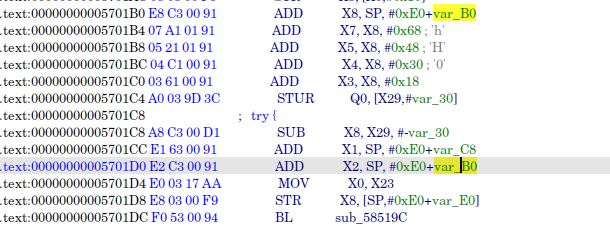

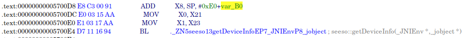

所以<font style="background-color:#D8DAD9;">sub\_58519C</font>的参数是：

X0：Tracker + 8，即是【LicenseManager】对象的地址

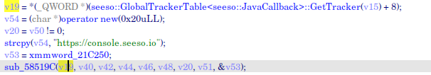

X1：key：dev\_m1xw0grvvh2nu9c2i4vufkddzyty5iig719riprm

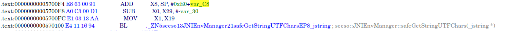

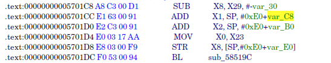

X2：android-id：0b71d8ef0ddd2e86

X3：手机品牌型号：Google-Pixel

X4：ro.build.version.release：android-10

X5：packagerName：com.invensun.rgbreader

X6：boolean类型，0或1

X7：apk签名的sha1摘要的base64编码：

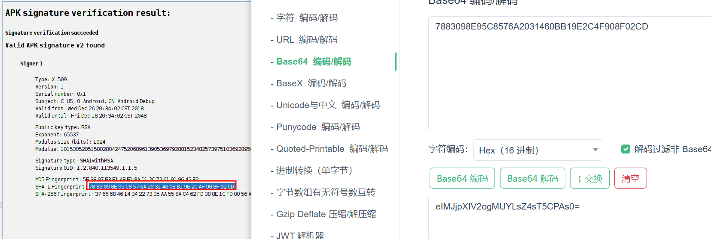

X8：域名：https://console.seeso.io

函数主体：

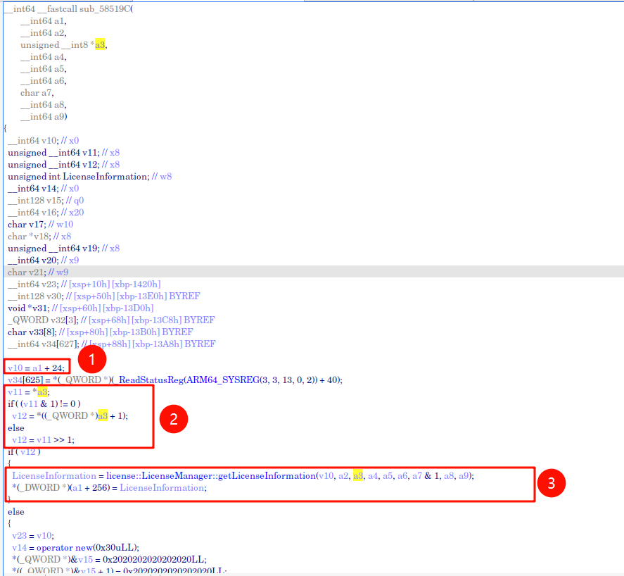

①v10 = a1+24，将【LicenseManager+24】的地址传入

②如前面所说字符串有2中存储方式，前面第1个字节存储length的2倍，或者第2个8字节存储length。这里即是判断。getDeviceInfo会有结果，所以总是走这个分支，下面不看了，貌似是随机生成设备信息

③调用getLicenseInformation，参数都不变，直接传进，返回值赋给a1+256处，即LicenseManager对象偏移256处

<font style="background-color:#FBDE28;">· getLicenseInformation</font>

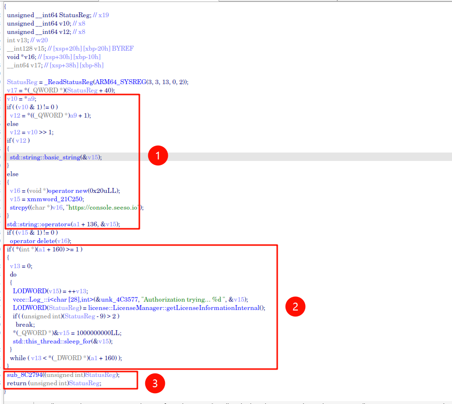

①<font style="background-color:#D8DAD9;">basic\_string</font>

有2个参数，LDRB W8,\[X1]对应的是v10=\*a9，所以可以知道X1是a9地址，即域名https://console.seeso.io的3个8字节的第1个8字节地址。后面使用都差不多，判断字符串是2种存储类型的哪一种，如果length大于22，就用3个8字节来存储。

最后将结果存储到a1+136，也就是【LicenseManager+136】处存储域名

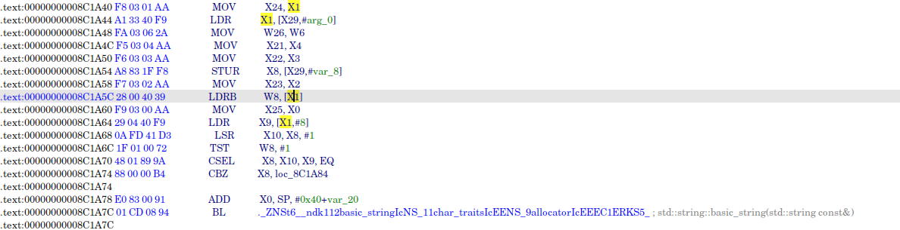

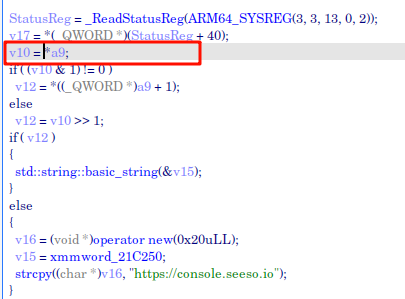

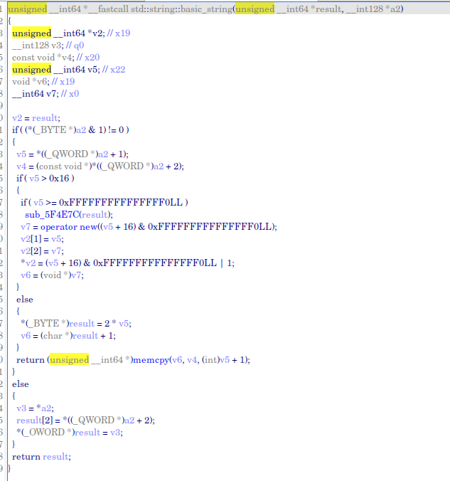

②【LicenseManager+160】处的值为0x3，最多调用3次getLicenseInformationInternal，返回值为StatusReg，如果大于11就break，且每次sleep一段时间

③将StatusReg返回，在之前打印日志，StatusReg如果为0，则为key校验通过返回值

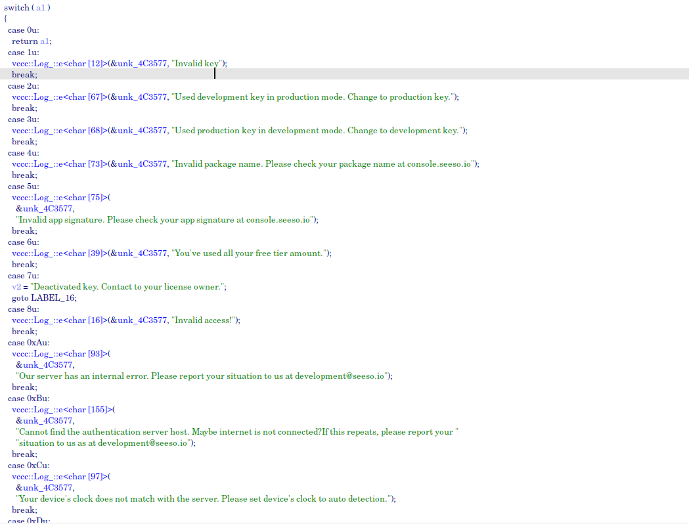

<font style="background-color:#FBDE28;">· getLicenseInformationInternal</font>

<font style="background-color:#D8DAD9;">sub\_56E530</font>、<font style="background-color:#D8DAD9;">sub\_5F9088</font>、<font style="background-color:#D8DAD9;">append</font>，做的都是判断字符串存储类型，拼接字符串的事

<font style="background-color:#D8DAD9;">krypt::aesEncrypt</font>：

X0：android-id、时间戳、设备品牌、ro.build.version.release、包名、boolean值、key、签名sha1拼接，用“#”填充至16字节对齐

X1：【LicenseManager+164】：aes\_key

X2：【LicenseManager+180】：aes\_iv

X8传入栈中地址存储结果以供后续使用

<details>
<summary>hook代码</summary>
<div style="max-height: 400px; overflow-y: auto; padding: 0 10px;">

```javascript
Java.perform(function () {
  function replace_key_java_nativewrapper() {
    let NativeWrapper = Java.use("camp.visual.libgaze.jni.NativeWrapper");
    NativeWrapper["nativeInitWrapper"].implementation = function (context, str, iArr, i, z, jNICallbackDispatcher) {
      let new_key = "dev_m1xw0grvvh2nu9c2i4vufkddzyty5iig719riprm";
      console.log('nativeInitWrapper is called' + ', ' + 'context: ' + context + ', ' + 'new_key: ' + new_key + ', ' + 'iArr: ' + iArr + ', ' + 'i: ' + i + ', ' + 'z: ' + z + ', ' + 'jNICallbackDispatcher: ' + jNICallbackDispatcher);
      let ret = this.nativeInitWrapper(context, new_key, iArr, i, z, jNICallbackDispatcher);
      console.log('nativeInitWrapper ret value is ' + ret);
      return ret;
    };
  }
  function print_arg(addr, hx_length = null, hx_ansi = null) {
    var hx_args = {};
    if (hx_length != null) {
      hx_args["length"] = hx_length;
    }
    if (hx_ansi != null) {
      hx_args["ansi"] = hx_ansi;
    }
    try {
      var module = Process.findRangeByAddress(addr);
      if (module != null) {
        return "\n" + hexdump(addr, hx_args) + "\n\n";
      }
      return ptr(addr) + "\n\n";
    } catch (e) {
      return addr + "\n\n";
    }
  }
  function hook_native_addr(funcPtr, registers, returnAddrs = null, logtag = null) {
    var module = Process.findModuleByAddress(funcPtr);
    Interceptor.attach(funcPtr, {
      onEnter: function (args) {
        this.logs = "";
        this.registers = {};
        this.trueReturnAddr = this.context["lr"].sub(module.base);
        this.returnCheck = false;
        if (returnAddrs) {
          for (let i = 0; i < returnAddrs.length; i++) {
            if (this.trueReturnAddr.compare(returnAddrs[i]) === 0) {
              this.returnCheck = true;
              break;
            }
          }
        } else {
          this.returnCheck = true;
        }
        if (!this.returnCheck) {
          return
        }
        registers.forEach(element => {
          var regName = element;
          var regValue = this.context[regName];
          this.registers[regName] = regValue;
        });
        this.logs = this.logs.concat("So: " + module.name + ":" + module.base + "  methodOffset: " + ptr(funcPtr).sub(module.base) + "  trueReturnAddr:" + this.trueReturnAddr + "\n");
        if (logtag) {
          this.logs = this.logs.concat(logtag + " trueReturnAddr:" + this.trueReturnAddr + " onEnter");
          this.logs = this.logs.concat("==============================" + "\n");
        }
        for (let regName in this.registers) {
          if (this.registers.hasOwnProperty(regName)) {
                        var regValue = this.registers[regName];
                        this.logs = this.logs.concat(regName + " onEnter: " + regValue + print_arg(regValue));
                        if(regName==="x0")
                        this.logs = this.logs.concat(regName + " onEnter: +16" + regValue + print_arg(regValue.add(16).readPointer()));
                    }
                }
            },
            onLeave: function (retval) {
                if (!this.returnCheck) {
                    return
                }
                if (logtag) {
                    this.logs = this.logs.concat(logtag + " trueReturnAddr:" + this.trueReturnAddr + " onLeave");
                    this.logs = this.logs.concat("==============================" + "\n");
                }
                for (let regName in this.registers) {
                    if (this.registers.hasOwnProperty(regName)) {
                        var regValue = this.registers[regName];
                        this.logs = this.logs.concat(regName + " onLeave: " + regValue + print_arg(regValue));
                        if(regName==="x8")
                        this.logs = this.logs.concat(regName + " onLeave: +16" + regValue + print_arg(regValue.add(16).readPointer()));
                    }
                }
                this.logs = this.logs.concat("retval onLeave: " + retval + print_arg(retval));
                console.log(this.logs);
            }
        });
    }
    const registers = {
        0: "x0", 1: "x1", 2: "x2", 3: "x3", 4: "x4", 5: "x5",
        6: "x6", 7: "x7", 8: "x8", 9: "x9", 10: "x10", 11: "x11",
        12: "x12", 13: "x13", 14: "x14", 15: "x15", 16: "x16",
        17: "x17", 18: "x18", 19: "x19", 20: "x20", 21: "x21",
        22: "x22", 23: "x23", 24: "x24", 25: "x25", 26: "x26",
        27: "x27", 28: "x28",
        29: "fp",
        30: "lr",
        31: "sp",
    };

    replace_key_java_nativewrapper();

    // hook_native_addr(
    //     Module.findBaseAddress("libseeso_core_android.so").add(0x56ff6c),
    //     [registers[0], registers[1], registers[8]],
    //     [ptr(0x570104)],
    //     "seeso::JNIEnvManager::safeGetStringUTFChars(&v53, a4, (unsigned __int64 *)v40);"
    // );

    // hook_native_addr(
    //     Module.findBaseAddress("libseeso_core_android.so").add(0x58519C),
    //     [registers[0], registers[1], registers[2], registers[3], registers[4], registers[5], registers[6], registers[7], registers[8]],
    //     [ptr(0x5701e0)],
    //     "sub_58519C(v19, v40, v42, v44, v46, v48, v20, v51, &v53);"
    // );

    hook_native_addr(
        Module.findBaseAddress("libseeso_core_android.so").add(0x8c79a0),
        [registers[0], registers[1], registers[2], registers[8]],
        [ptr(0x8c20ec)],
        "krypt::aesEncrypt(&v92, (char *)a1 + 164, (char *)a1 + 180);"
    );

    hook_native_addr(
        Module.findBaseAddress("libseeso_core_android.so").add(0x8c8578),
        [registers[0], registers[1], registers[2], registers[8]],
        [ptr(0x8c2114)],
        "krypt::base64_encode(v74, v75, 0LL, v73);"
    );

})


function memcpy_hook() {
    var memcpy_addr = null;
    var symbols = Process.findModuleByName("libc.so").enumerateSymbols();
    for (var i = 0; i < symbols.length; i++) {
        if (symbols[i].name === "memcpy") {
            // console.log("symbols name is -> " + symbols[i].name);
            // console.log("symbols address is -> " + symbols[i].address);
            memcpy_addr = symbols[i].address;
        }
    }
    Interceptor.attach(memcpy_addr, {
        onEnter: function (args) {
            if (args[1].readCString().indexOf("client/validation") != -1) {
                console.log("args is ->" + args[0], args[1], args[2]);
                // 打印调用栈（Native 层）
                const backtrace = Thread.backtrace(this.context, Backtracer.ACCURATE)
                    .map(addr => DebugSymbol.fromAddress(addr))
                    .join("\n\t");
                console.log("Backtrace:\n\t" + backtrace);
            }
        },
        onLeave: function (retval) {
            // console.log(retval);
        }
    });
}
```
</div>
</details>

<details>
<summary>hook日志</summary>
<div style="max-height: 400px; overflow-y: auto; padding: 0 10px;">

```bash
[Pixel::RgbTest ]-> nativeInitWrapper is called, context: android.app.Application@6ca6f28, new_key: dev_m1xw0grvvh2nu9c2i4vufkddzyty5iig719riprm, iArr: 1,2,3, i: 3, z: false, jNICallbackDispatcher: camp.visual.libgaze.callbacks.JNICallbackDispatcher@7a482db
So: libseeso_core_android.so:0x71adc1c000  methodOffset: 0x8c79a0  trueReturnAddr:0x8c20ec
krypt::aesEncrypt(&v92, (char *)a1 + 164, (char *)a1 + 180); trueReturnAddr:0x8c20ec onEnter==============================
x0 onEnter: 0x719b93f680
             0  1  2  3  4  5  6  7  8  9  A  B  C  D  E  F  0123456789ABCDEF
719b93f680  c1 00 00 00 00 00 00 00 b0 00 00 00 00 00 00 00  ................
719b93f690  40 fe 62 fa 71 00 00 00 00 00 00 00 00 00 00 00  @.b.q...........
719b93f6a0  00 00 00 00 00 00 00 00 00 00 00 00 00 00 00 00  ................
719b93f6b0  00 00 00 00 00 00 00 00 00 00 00 00 00 00 00 00  ................
719b93f6c0  00 00 00 00 00 00 00 00 37 f4 4a b4 74 be 92 76  ........7.J.t..v
719b93f6d0  00 00 00 00 00 00 00 00 00 00 00 00 00 00 00 00  ................
719b93f6e0  00 00 00 00 00 00 00 00 20 0e 94 9b 71 00 00 00  ........ ...q...
719b93f6f0  00 00 00 00 00 00 00 00 00 00 00 00 00 00 00 00  ................
719b93f700  00 00 00 00 00 00 00 00 70 f7 93 9b 71 00 00 00  ........p...q...
719b93f710  00 00 00 00 00 00 00 00 00 00 00 00 00 00 00 00  ................
719b93f720  00 00 00 00 00 00 00 00 21 00 00 00 00 00 00 00  ........!.......
719b93f730  00 00 00 00 00 00 00 00 00 00 00 00 00 00 00 00  ................
719b93f740  00 00 00 00 00 00 00 00 60 bf b6 9c 71 00 00 00  ........`...q...
719b93f750  00 00 00 00 00 00 00 00 00 00 00 00 00 00 00 00  ................
719b93f760  00 00 00 00 00 00 00 00 c8 2b 72 ae 71 00 00 00  .........+r.q...
719b93f770  00 00 00 00 00 00 00 00 00 00 00 00 00 00 00 00  ................

x0 onEnter: +160x719b93f680
             0  1  2  3  4  5  6  7  8  9  A  B  C  D  E  F  0123456789ABCDEF
71fa62fe40  30 62 37 31 64 38 65 66 30 64 64 64 32 65 38 36  0b71d8ef0ddd2e86
71fa62fe50  7c 7c 31 37 35 37 32 31 35 33 39 31 39 39 37 7c  ||1757215391997|
71fa62fe60  7c 47 6f 6f 67 6c 65 2d 50 69 78 65 6c 7c 7c 61  |Google-Pixel||a
71fa62fe70  6e 64 72 6f 69 64 2d 31 30 7c 7c 63 6f 6d 2e 69  ndroid-10||com.i
71fa62fe80  6e 76 65 6e 73 75 6e 2e 72 67 62 72 65 61 64 65  nvensun.rgbreade
71fa62fe90  72 7c 7c 31 7c 7c 64 65 76 5f 6d 31 78 77 30 67  r||1||dev_m1xw0g
71fa62fea0  72 76 76 68 32 6e 75 39 63 32 69 34 76 75 66 6b  rvvh2nu9c2i4vufk
71fa62feb0  64 64 7a 79 74 79 35 69 69 67 37 31 39 72 69 70  ddzyty5iig719rip
71fa62fec0  72 6d 7c 7c 65 49 4d 4a 6a 70 58 49 56 32 6f 67  rm||eIMJjpXIV2og
71fa62fed0  4d 55 59 4c 73 5a 34 73 54 35 43 50 41 73 30 3d  MUYLsZ4sT5CPAs0=
71fa62fee0  0a 23 23 23 23 23 23 23 23 23 23 23 23 23 23 23  .###############
71fa62fef0  00 63 25 9f 71 00 00 00 80 00 00 00 00 4c 72 00  .c%.q........Lr.
71fa62ff00  80 e5 b3 9c 71 00 00 00 00 00 00 00 00 00 00 00  ....q...........
71fa62ff10  00 00 00 00 00 00 00 00 00 00 00 00 00 00 00 00  ................
71fa62ff20  00 00 00 00 00 00 00 00 20 e5 b3 9c 71 00 00 00  ........ ...q...
71fa62ff30  00 00 00 00 00 00 00 00 00 e5 b3 9c 71 00 00 00  ............q...

x1 onEnter: 0x719c72d73c
             0  1  2  3  4  5  6  7  8  9  A  B  C  D  E  F  0123456789ABCDEF
719c72d73c  00 25 4a 6f 94 b9 de 04 29 4e 73 98 bd e2 08 2d  .%Jo....)Ns....-
719c72d74c  00 0d 1a 27 34 41 4e 5b 68 75 82 8f 9c a9 b6 c3  ...'4AN[hu......
719c72d75c  00 00 00 00 00 00 00 00 00 00 00 00 00 00 00 00  ................
719c72d76c  00 00 00 00 00 00 00 00 00 00 00 00 00 00 00 00  ................
719c72d77c  00 00 00 00 08 00 00 00 00 00 00 00 00 00 00 00  ................
719c72d78c  00 00 00 00 00 00 00 00 00 00 00 00 00 00 00 71  ...............q
719c72d79c  76 50 73 78 78 6b 78 54 56 63 6c 47 4e 35 6b 4a  vPsxxkxTVclGN5kJ
719c72d7ac  67 55 6e 73 48 5f 38 73 68 53 4c 66 00 00 00 00  gUnsH_8shSLf....
719c72d7bc  00 00 00 00 00 00 00 00 00 00 00 00 00 00 00 00  ................
719c72d7cc  00 00 00 00 00 00 00 00 00 00 00 00 00 00 00 00  ................
719c72d7dc  00 00 00 00 00 00 00 00 00 00 00 00 00 00 00 00  ................
719c72d7ec  00 00 00 00 00 00 00 00 00 00 00 00 00 00 00 00  ................
719c72d7fc  00 00 00 00 00 00 00 00 00 00 00 00 00 00 00 00  ................
719c72d80c  00 00 00 00 00 00 00 00 00 00 00 00 00 00 00 00  ................
719c72d81c  00 00 00 00 00 00 00 00 00 00 00 00 00 00 00 00  ................
719c72d82c  00 00 00 00 00 00 00 00 00 00 00 00 00 00 00 00  ................

x2 onEnter: 0x719c72d74c
             0  1  2  3  4  5  6  7  8  9  A  B  C  D  E  F  0123456789ABCDEF
719c72d74c  00 0d 1a 27 34 41 4e 5b 68 75 82 8f 9c a9 b6 c3  ...'4AN[hu......
719c72d75c  00 00 00 00 00 00 00 00 00 00 00 00 00 00 00 00  ................
719c72d76c  00 00 00 00 00 00 00 00 00 00 00 00 00 00 00 00  ................
719c72d77c  00 00 00 00 08 00 00 00 00 00 00 00 00 00 00 00  ................
719c72d78c  00 00 00 00 00 00 00 00 00 00 00 00 00 00 00 71  ...............q
719c72d79c  76 50 73 78 78 6b 78 54 56 63 6c 47 4e 35 6b 4a  vPsxxkxTVclGN5kJ
719c72d7ac  67 55 6e 73 48 5f 38 73 68 53 4c 66 00 00 00 00  gUnsH_8shSLf....
719c72d7bc  00 00 00 00 00 00 00 00 00 00 00 00 00 00 00 00  ................
719c72d7cc  00 00 00 00 00 00 00 00 00 00 00 00 00 00 00 00  ................
719c72d7dc  00 00 00 00 00 00 00 00 00 00 00 00 00 00 00 00  ................
719c72d7ec  00 00 00 00 00 00 00 00 00 00 00 00 00 00 00 00  ................
719c72d7fc  00 00 00 00 00 00 00 00 00 00 00 00 00 00 00 00  ................
719c72d80c  00 00 00 00 00 00 00 00 00 00 00 00 00 00 00 00  ................
719c72d81c  00 00 00 00 00 00 00 00 00 00 00 00 00 00 00 00  ................
719c72d82c  00 00 00 00 00 00 00 00 00 00 00 00 00 00 00 00  ................
719c72d83c  00 00 00 00 00 00 00 00 00 00 00 00 00 00 00 00  ................

x8 onEnter: 0x719b93f810
             0  1  2  3  4  5  6  7  8  9  A  B  C  D  E  F  0123456789ABCDEF
719b93f810  00 00 00 00 00 00 00 00 00 00 00 00 00 00 00 00  ................
719b93f820  00 00 00 00 00 00 00 00 1a 31 37 35 37 32 31 35  .........1757215
719b93f830  33 39 31 39 39 37 00 00 00 00 00 00 00 00 00 00  391997..........
719b93f840  00 00 00 00 00 00 00 00 00 00 00 00 00 00 00 00  ................
719b93f850  37 f4 4a b4 74 be 92 76 00 00 00 00 00 00 00 00  7.J.t..v........
719b93f860  00 f9 93 9b 71 00 00 00 34 db 4d ae 71 00 00 00  ....q...4.M.q...
719b93f870  42 fe e2 ad 71 00 00 00 77 f5 0d ae 71 00 00 00  B...q...w...q...
719b93f880  01 00 00 00 00 00 00 00 98 d6 72 9c 71 00 00 00  ..........r.q...
719b93f890  08 0e 94 9b 71 00 00 00 20 0e 94 9b 71 00 00 00  ....q... ...q...
719b93f8a0  38 0e 94 9b 71 00 00 00 50 0e 94 9b 71 00 00 00  8...q...P...q...
719b93f8b0  01 00 00 00 00 00 00 00 20 80 94 9b 71 00 00 00  ........ ...q...
719b93f8c0  20 80 94 9b 71 00 00 00 20 80 94 9b 71 00 00 00   ...q... ...q...
719b93f8d0  68 0e 94 9b 71 00 00 00 88 0e 94 9b 71 00 00 00  h...q.......q...
719b93f8e0  01 00 00 00 00 00 00 00 18 00 00 00 00 00 00 00  ................
719b93f8f0  60 bf b6 9c 71 00 00 00 37 f4 4a b4 74 be 92 76  `...q...7.J.t..v
719b93f900  90 0d 94 9b 71 00 00 00 00 12 1a ae 71 00 00 00  ....q.......q...

krypt::aesEncrypt(&v92, (char *)a1 + 164, (char *)a1 + 180); trueReturnAddr:0x8c20ec onLeave==============================
x0 onLeave: 0x719b93f680
             0  1  2  3  4  5  6  7  8  9  A  B  C  D  E  F  0123456789ABCDEF
719b93f680  c1 00 00 00 00 00 00 00 b0 00 00 00 00 00 00 00  ................
719b93f690  40 fe 62 fa 71 00 00 00 00 00 00 00 00 00 00 00  @.b.q...........
719b93f6a0  00 00 00 00 00 00 00 00 00 00 00 00 00 00 00 00  ................
719b93f6b0  00 00 00 00 00 00 00 00 00 00 00 00 00 00 00 00  ................
719b93f6c0  00 00 00 00 00 00 00 00 37 f4 4a b4 74 be 92 76  ........7.J.t..v
719b93f6d0  00 00 00 00 00 00 00 00 00 00 00 00 00 00 00 00  ................
719b93f6e0  00 00 00 00 00 00 00 00 20 0e 94 9b 71 00 00 00  ........ ...q...
719b93f6f0  00 00 00 00 00 00 00 00 00 00 00 00 00 00 00 00  ................
719b93f700  00 00 00 00 00 00 00 00 70 f7 93 9b 71 00 00 00  ........p...q...
719b93f710  00 00 00 00 00 00 00 00 00 00 00 00 00 00 00 00  ................
719b93f720  00 00 00 00 00 00 00 00 21 00 00 00 00 00 00 00  ........!.......
719b93f730  00 00 00 00 00 00 00 00 00 00 00 00 00 00 00 00  ................
719b93f740  00 00 00 00 00 00 00 00 60 bf b6 9c 71 00 00 00  ........`...q...
719b93f750  00 00 00 00 00 00 00 00 00 00 00 00 00 00 00 00  ................
719b93f760  00 00 00 00 00 00 00 00 c8 2b 72 ae 71 00 00 00  .........+r.q...
719b93f770  00 00 00 00 00 00 00 00 00 00 00 00 00 00 00 00  ................

x1 onLeave: 0x719c72d73c
             0  1  2  3  4  5  6  7  8  9  A  B  C  D  E  F  0123456789ABCDEF
719c72d73c  00 25 4a 6f 94 b9 de 04 29 4e 73 98 bd e2 08 2d  .%Jo....)Ns....-
719c72d74c  00 0d 1a 27 34 41 4e 5b 68 75 82 8f 9c a9 b6 c3  ...'4AN[hu......
719c72d75c  00 00 00 00 00 00 00 00 00 00 00 00 00 00 00 00  ................
719c72d76c  00 00 00 00 00 00 00 00 00 00 00 00 00 00 00 00  ................
719c72d77c  00 00 00 00 08 00 00 00 00 00 00 00 00 00 00 00  ................
719c72d78c  00 00 00 00 00 00 00 00 00 00 00 00 00 00 00 71  ...............q
719c72d79c  76 50 73 78 78 6b 78 54 56 63 6c 47 4e 35 6b 4a  vPsxxkxTVclGN5kJ
719c72d7ac  67 55 6e 73 48 5f 38 73 68 53 4c 66 00 00 00 00  gUnsH_8shSLf....
719c72d7bc  00 00 00 00 00 00 00 00 00 00 00 00 00 00 00 00  ................
719c72d7cc  00 00 00 00 00 00 00 00 00 00 00 00 00 00 00 00  ................
719c72d7dc  00 00 00 00 00 00 00 00 00 00 00 00 00 00 00 00  ................
719c72d7ec  00 00 00 00 00 00 00 00 00 00 00 00 00 00 00 00  ................
719c72d7fc  00 00 00 00 00 00 00 00 00 00 00 00 00 00 00 00  ................
719c72d80c  00 00 00 00 00 00 00 00 00 00 00 00 00 00 00 00  ................
719c72d81c  00 00 00 00 00 00 00 00 00 00 00 00 00 00 00 00  ................
719c72d82c  00 00 00 00 00 00 00 00 00 00 00 00 00 00 00 00  ................

x2 onLeave: 0x719c72d74c
             0  1  2  3  4  5  6  7  8  9  A  B  C  D  E  F  0123456789ABCDEF
719c72d74c  00 0d 1a 27 34 41 4e 5b 68 75 82 8f 9c a9 b6 c3  ...'4AN[hu......
719c72d75c  00 00 00 00 00 00 00 00 00 00 00 00 00 00 00 00  ................
719c72d76c  00 00 00 00 00 00 00 00 00 00 00 00 00 00 00 00  ................
719c72d77c  00 00 00 00 08 00 00 00 00 00 00 00 00 00 00 00  ................
719c72d78c  00 00 00 00 00 00 00 00 00 00 00 00 00 00 00 71  ...............q
719c72d79c  76 50 73 78 78 6b 78 54 56 63 6c 47 4e 35 6b 4a  vPsxxkxTVclGN5kJ
719c72d7ac  67 55 6e 73 48 5f 38 73 68 53 4c 66 00 00 00 00  gUnsH_8shSLf....
719c72d7bc  00 00 00 00 00 00 00 00 00 00 00 00 00 00 00 00  ................
719c72d7cc  00 00 00 00 00 00 00 00 00 00 00 00 00 00 00 00  ................
719c72d7dc  00 00 00 00 00 00 00 00 00 00 00 00 00 00 00 00  ................
719c72d7ec  00 00 00 00 00 00 00 00 00 00 00 00 00 00 00 00  ................
719c72d7fc  00 00 00 00 00 00 00 00 00 00 00 00 00 00 00 00  ................
719c72d80c  00 00 00 00 00 00 00 00 00 00 00 00 00 00 00 00  ................
719c72d81c  00 00 00 00 00 00 00 00 00 00 00 00 00 00 00 00  ................
719c72d82c  00 00 00 00 00 00 00 00 00 00 00 00 00 00 00 00  ................
719c72d83c  00 00 00 00 00 00 00 00 00 00 00 00 00 00 00 00  ................

x8 onLeave: 0x719b93f810
             0  1  2  3  4  5  6  7  8  9  A  B  C  D  E  F  0123456789ABCDEF
719b93f810  d1 00 00 00 00 00 00 00 c0 00 00 00 00 00 00 00  ................
719b93f820  c0 0b 6e fa 71 00 00 00 1a 31 37 35 37 32 31 35  ..n.q....1757215
719b93f830  33 39 31 39 39 37 00 00 00 00 00 00 00 00 00 00  391997..........
719b93f840  00 00 00 00 00 00 00 00 00 00 00 00 00 00 00 00  ................
719b93f850  37 f4 4a b4 74 be 92 76 00 00 00 00 00 00 00 00  7.J.t..v........
719b93f860  00 f9 93 9b 71 00 00 00 34 db 4d ae 71 00 00 00  ....q...4.M.q...
719b93f870  42 fe e2 ad 71 00 00 00 77 f5 0d ae 71 00 00 00  B...q...w...q...
719b93f880  01 00 00 00 00 00 00 00 98 d6 72 9c 71 00 00 00  ..........r.q...
719b93f890  08 0e 94 9b 71 00 00 00 20 0e 94 9b 71 00 00 00  ....q... ...q...
719b93f8a0  38 0e 94 9b 71 00 00 00 50 0e 94 9b 71 00 00 00  8...q...P...q...
719b93f8b0  01 00 00 00 00 00 00 00 20 80 94 9b 71 00 00 00  ........ ...q...
719b93f8c0  20 80 94 9b 71 00 00 00 20 80 94 9b 71 00 00 00   ...q... ...q...
719b93f8d0  68 0e 94 9b 71 00 00 00 88 0e 94 9b 71 00 00 00  h...q.......q...
719b93f8e0  01 00 00 00 00 00 00 00 18 00 00 00 00 00 00 00  ................
719b93f8f0  60 bf b6 9c 71 00 00 00 37 f4 4a b4 74 be 92 76  `...q...7.J.t..v
719b93f900  90 0d 94 9b 71 00 00 00 00 12 1a ae 71 00 00 00  ....q.......q...

x8 onLeave: +160x719b93f810
             0  1  2  3  4  5  6  7  8  9  A  B  C  D  E  F  0123456789ABCDEF
71fa6e0bc0  92 61 cf a0 44 cc 89 ff 13 21 f7 20 31 e4 89 5a  .a..D....!. 1..Z
71fa6e0bd0  55 44 28 66 de 0e e1 01 a3 c5 ce 67 b6 9d d8 73  UD(f.......g...s
71fa6e0be0  ed 26 e3 fa 16 f2 39 31 e9 46 63 fb 28 18 5a f3  .&....91.Fc.(.Z.
71fa6e0bf0  a3 7f 49 8c 26 95 cf f8 54 79 bd 44 df 1e 49 80  ..I.&...Ty.D..I.
71fa6e0c00  7a 45 7c 38 fa 4e 17 6e 52 90 2f 39 18 ec 25 21  zE|8.N.nR./9..%!
71fa6e0c10  f0 93 91 3c c0 9b 74 e4 6a 38 17 87 b3 70 96 5d  ...<..t.j8...p.]
71fa6e0c20  6f 43 bd b8 e0 bc da 59 f1 77 e5 bd 33 09 9a 0c  oC.....Y.w..3...
71fa6e0c30  bd 80 8b ab dd 66 ae 40 f3 21 1f 2e be 58 3b 34  .....f.@.!...X;4
71fa6e0c40  a7 91 2d 84 78 9b a3 12 fa cc b1 1b ff c5 f1 0f  ..-.x...........
71fa6e0c50  ab 69 fa 65 95 d6 a9 86 94 81 8d c9 d3 6e 69 5a  .i.e.........niZ
71fa6e0c60  a5 0d e9 dc 87 66 3e d0 02 08 40 c7 63 4a d8 57  .....f>...@.cJ.W
71fa6e0c70  cb 92 a8 68 d6 80 ae e2 c2 e7 74 8d 0e b8 de df  ...h......t.....
71fa6e0c80  00 00 00 00 9a 99 99 be 33 33 33 3f 00 00 00 3f  ........333?...?
71fa6e0c90  00 00 00 00 00 00 00 00 00 00 80 3f 00 00 00 00  ...........?....
71fa6e0ca0  e0 42 72 ae 71 00 00 00 1f 00 00 00 00 00 00 00  .Br.q...........
71fa6e0cb0  00 40 7a c4 00 40 7a c4 00 00 00 00 00 00 00 00  .@z..@z.........

retval onLeave: 0x71fa1d3238
             0  1  2  3  4  5  6  7  8  9  A  B  C  D  E  F  0123456789ABCDEF
71fa1d3238  01 74 80 fa 71 00 0a 00 01 74 80 fa 71 00 0a 00  .t..q....t..q...
71fa1d3248  01 74 80 fa 71 00 0a 00 01 ec 80 fa 71 00 04 00  .t..q.......q...
71fa1d3258  81 ec 80 fa 71 00 15 00 81 ec 80 fa 71 00 15 00  ....q.......q...
71fa1d3268  81 ec 80 fa 71 00 15 00 81 ec 80 fa 71 00 15 00  ....q.......q...
71fa1d3278  81 ec 80 fa 71 00 15 00 01 ed 80 fa 71 00 15 00  ....q.......q...
71fa1d3288  01 ed 80 fa 71 00 15 00 01 ed 80 fa 71 00 15 00  ....q.......q...
71fa1d3298  01 ed 80 fa 71 00 15 00 01 ed 80 fa 71 00 15 00  ....q.......q...
71fa1d32a8  01 ee 80 fa 71 00 13 00 01 ee 80 fa 71 00 13 00  ....q.......q...
71fa1d32b8  01 ee 80 fa 71 00 13 00 01 ee 80 fa 71 00 13 00  ....q.......q...
71fa1d32c8  01 ee 80 fa 71 00 13 00 01 ee 80 fa 71 00 13 00  ....q.......q...
71fa1d32d8  01 ee 80 fa 71 00 13 00 81 ee 80 fa 71 00 10 00  ....q.......q...
71fa1d32e8  01 ef 80 fa 71 00 1c 00 81 74 80 fa 71 00 1f 00  ....q....t..q...
71fa1d32f8  81 74 80 fa 71 00 1f 00 81 74 80 fa 71 00 1f 00  .t..q....t..q...
71fa1d3308  81 74 80 fa 71 00 1f 00 81 74 80 fa 71 00 1f 00  .t..q....t..q...
71fa1d3318  81 74 80 fa 71 00 1f 00 81 74 80 fa 71 00 1f 00  .t..q....t..q...
71fa1d3328  01 75 80 fa 71 00 1f 00 01 75 80 fa 71 00 1f 00  .u..q....u..q...


So: libseeso_core_android.so:0x71adc1c000  methodOffset: 0x8c8578  trueReturnAddr:0x8c2114
krypt::base64_encode(v74, v75, 0LL, v73); trueReturnAddr:0x8c2114 onEnter==============================
x0 onEnter: 0x71fa6e0bc0
             0  1  2  3  4  5  6  7  8  9  A  B  C  D  E  F  0123456789ABCDEF
71fa6e0bc0  92 61 cf a0 44 cc 89 ff 13 21 f7 20 31 e4 89 5a  .a..D....!. 1..Z
71fa6e0bd0  55 44 28 66 de 0e e1 01 a3 c5 ce 67 b6 9d d8 73  UD(f.......g...s
71fa6e0be0  ed 26 e3 fa 16 f2 39 31 e9 46 63 fb 28 18 5a f3  .&....91.Fc.(.Z.
71fa6e0bf0  a3 7f 49 8c 26 95 cf f8 54 79 bd 44 df 1e 49 80  ..I.&...Ty.D..I.
71fa6e0c00  7a 45 7c 38 fa 4e 17 6e 52 90 2f 39 18 ec 25 21  zE|8.N.nR./9..%!
71fa6e0c10  f0 93 91 3c c0 9b 74 e4 6a 38 17 87 b3 70 96 5d  ...<..t.j8...p.]
71fa6e0c20  6f 43 bd b8 e0 bc da 59 f1 77 e5 bd 33 09 9a 0c  oC.....Y.w..3...
71fa6e0c30  bd 80 8b ab dd 66 ae 40 f3 21 1f 2e be 58 3b 34  .....f.@.!...X;4
71fa6e0c40  a7 91 2d 84 78 9b a3 12 fa cc b1 1b ff c5 f1 0f  ..-.x...........
71fa6e0c50  ab 69 fa 65 95 d6 a9 86 94 81 8d c9 d3 6e 69 5a  .i.e.........niZ
71fa6e0c60  a5 0d e9 dc 87 66 3e d0 02 08 40 c7 63 4a d8 57  .....f>...@.cJ.W
71fa6e0c70  cb 92 a8 68 d6 80 ae e2 c2 e7 74 8d 0e b8 de df  ...h......t.....
71fa6e0c80  00 00 00 00 9a 99 99 be 33 33 33 3f 00 00 00 3f  ........333?...?
71fa6e0c90  00 00 00 00 00 00 00 00 00 00 80 3f 00 00 00 00  ...........?....
71fa6e0ca0  e0 42 72 ae 71 00 00 00 1f 00 00 00 00 00 00 00  .Br.q...........
71fa6e0cb0  00 40 7a c4 00 40 7a c4 00 00 00 00 00 00 00 00  .@z..@z.........

x0 onEnter: +160x71fa6e0bc00x1e10ede66284455

x1 onEnter: 0xc00xc0

x2 onEnter: 0x00x0

x8 onEnter: 0x719b93f7f0
             0  1  2  3  4  5  6  7  8  9  A  B  C  D  E  F  0123456789ABCDEF
719b93f7f0  00 00 00 00 00 00 00 00 00 00 00 00 00 00 00 00  ................
719b93f800  00 00 00 00 00 00 00 00 e0 27 b6 ae 71 00 00 00  .........'..q...
719b93f810  d1 00 00 00 00 00 00 00 c0 00 00 00 00 00 00 00  ................
719b93f820  c0 0b 6e fa 71 00 00 00 1a 31 37 35 37 32 31 35  ..n.q....1757215
719b93f830  33 39 31 39 39 37 00 00 00 00 00 00 00 00 00 00  391997..........
719b93f840  00 00 00 00 00 00 00 00 00 00 00 00 00 00 00 00  ................
719b93f850  37 f4 4a b4 74 be 92 76 00 00 00 00 00 00 00 00  7.J.t..v........
719b93f860  00 f9 93 9b 71 00 00 00 34 db 4d ae 71 00 00 00  ....q...4.M.q...
719b93f870  42 fe e2 ad 71 00 00 00 77 f5 0d ae 71 00 00 00  B...q...w...q...
719b93f880  01 00 00 00 00 00 00 00 98 d6 72 9c 71 00 00 00  ..........r.q...
719b93f890  08 0e 94 9b 71 00 00 00 20 0e 94 9b 71 00 00 00  ....q... ...q...
719b93f8a0  38 0e 94 9b 71 00 00 00 50 0e 94 9b 71 00 00 00  8...q...P...q...
719b93f8b0  01 00 00 00 00 00 00 00 20 80 94 9b 71 00 00 00  ........ ...q...
719b93f8c0  20 80 94 9b 71 00 00 00 20 80 94 9b 71 00 00 00   ...q... ...q...
719b93f8d0  68 0e 94 9b 71 00 00 00 88 0e 94 9b 71 00 00 00  h...q.......q...
719b93f8e0  01 00 00 00 00 00 00 00 18 00 00 00 00 00 00 00  ................

krypt::base64_encode(v74, v75, 0LL, v73); trueReturnAddr:0x8c2114 onLeave==============================
x0 onLeave: 0x71fa6e0bc0
             0  1  2  3  4  5  6  7  8  9  A  B  C  D  E  F  0123456789ABCDEF
71fa6e0bc0  92 61 cf a0 44 cc 89 ff 13 21 f7 20 31 e4 89 5a  .a..D....!. 1..Z
71fa6e0bd0  55 44 28 66 de 0e e1 01 a3 c5 ce 67 b6 9d d8 73  UD(f.......g...s
71fa6e0be0  ed 26 e3 fa 16 f2 39 31 e9 46 63 fb 28 18 5a f3  .&....91.Fc.(.Z.
71fa6e0bf0  a3 7f 49 8c 26 95 cf f8 54 79 bd 44 df 1e 49 80  ..I.&...Ty.D..I.
71fa6e0c00  7a 45 7c 38 fa 4e 17 6e 52 90 2f 39 18 ec 25 21  zE|8.N.nR./9..%!
71fa6e0c10  f0 93 91 3c c0 9b 74 e4 6a 38 17 87 b3 70 96 5d  ...<..t.j8...p.]
71fa6e0c20  6f 43 bd b8 e0 bc da 59 f1 77 e5 bd 33 09 9a 0c  oC.....Y.w..3...
71fa6e0c30  bd 80 8b ab dd 66 ae 40 f3 21 1f 2e be 58 3b 34  .....f.@.!...X;4
71fa6e0c40  a7 91 2d 84 78 9b a3 12 fa cc b1 1b ff c5 f1 0f  ..-.x...........
71fa6e0c50  ab 69 fa 65 95 d6 a9 86 94 81 8d c9 d3 6e 69 5a  .i.e.........niZ
71fa6e0c60  a5 0d e9 dc 87 66 3e d0 02 08 40 c7 63 4a d8 57  .....f>...@.cJ.W
71fa6e0c70  cb 92 a8 68 d6 80 ae e2 c2 e7 74 8d 0e b8 de df  ...h......t.....
71fa6e0c80  00 00 00 00 9a 99 99 be 33 33 33 3f 00 00 00 3f  ........333?...?
71fa6e0c90  00 00 00 00 00 00 00 00 00 00 80 3f 00 00 00 00  ...........?....
71fa6e0ca0  e0 42 72 ae 71 00 00 00 1f 00 00 00 00 00 00 00  .Br.q...........
71fa6e0cb0  00 40 7a c4 00 40 7a c4 00 00 00 00 00 00 00 00  .@z..@z.........

x1 onLeave: 0xc00xc0

x2 onLeave: 0x00x0

x8 onLeave: 0x719b93f7f0
             0  1  2  3  4  5  6  7  8  9  A  B  C  D  E  F  0123456789ABCDEF
719b93f7f0  81 01 00 00 00 00 00 00 00 01 00 00 00 00 00 00  ................
719b93f800  80 45 5f 9c 71 00 00 00 e0 27 b6 ae 71 00 00 00  .E_.q....'..q...
719b93f810  d1 00 00 00 00 00 00 00 c0 00 00 00 00 00 00 00  ................
719b93f820  c0 0b 6e fa 71 00 00 00 1a 31 37 35 37 32 31 35  ..n.q....1757215
719b93f830  33 39 31 39 39 37 00 00 00 00 00 00 00 00 00 00  391997..........
719b93f840  00 00 00 00 00 00 00 00 00 00 00 00 00 00 00 00  ................
719b93f850  37 f4 4a b4 74 be 92 76 00 00 00 00 00 00 00 00  7.J.t..v........
719b93f860  00 f9 93 9b 71 00 00 00 34 db 4d ae 71 00 00 00  ....q...4.M.q...
719b93f870  42 fe e2 ad 71 00 00 00 77 f5 0d ae 71 00 00 00  B...q...w...q...
719b93f880  01 00 00 00 00 00 00 00 98 d6 72 9c 71 00 00 00  ..........r.q...
719b93f890  08 0e 94 9b 71 00 00 00 20 0e 94 9b 71 00 00 00  ....q... ...q...
719b93f8a0  38 0e 94 9b 71 00 00 00 50 0e 94 9b 71 00 00 00  8...q...P...q...
719b93f8b0  01 00 00 00 00 00 00 00 20 80 94 9b 71 00 00 00  ........ ...q...
719b93f8c0  20 80 94 9b 71 00 00 00 20 80 94 9b 71 00 00 00   ...q... ...q...
719b93f8d0  68 0e 94 9b 71 00 00 00 88 0e 94 9b 71 00 00 00  h...q.......q...
719b93f8e0  01 00 00 00 00 00 00 00 18 00 00 00 00 00 00 00  ................

x8 onLeave: +160x719b93f7f0
             0  1  2  3  4  5  6  7  8  9  A  B  C  D  E  F  0123456789ABCDEF
719c5f4580  6b 6d 48 50 6f 45 54 4d 69 66 38 54 49 66 63 67  kmHPoETMif8TIfcg
719c5f4590  4d 65 53 4a 57 6c 56 45 4b 47 62 65 44 75 45 42  MeSJWlVEKGbeDuEB
719c5f45a0  6f 38 58 4f 5a 37 61 64 32 48 50 74 4a 75 50 36  o8XOZ7ad2HPtJuP6
719c5f45b0  46 76 49 35 4d 65 6c 47 59 5f 73 6f 47 46 72 7a  FvI5MelGY_soGFrz
719c5f45c0  6f 33 39 4a 6a 43 61 56 7a 5f 68 55 65 62 31 45  o39JjCaVz_hUeb1E
719c5f45d0  33 78 35 4a 67 48 70 46 66 44 6a 36 54 68 64 75  3x5JgHpFfDj6Thdu
719c5f45e0  55 70 41 76 4f 52 6a 73 4a 53 48 77 6b 35 45 38  UpAvORjsJSHwk5E8
719c5f45f0  77 4a 74 30 35 47 6f 34 46 34 65 7a 63 4a 5a 64  wJt05Go4F4ezcJZd
719c5f4600  62 30 4f 39 75 4f 43 38 32 6c 6e 78 64 2d 57 39  b0O9uOC82lnxd-W9
719c5f4610  4d 77 6d 61 44 4c 32 41 69 36 76 64 5a 71 35 41  MwmaDL2Ai6vdZq5A
719c5f4620  38 79 45 66 4c 72 35 59 4f 7a 53 6e 6b 53 32 45  8yEfLr5YOzSnkS2E
719c5f4630  65 4a 75 6a 45 76 72 4d 73 52 76 5f 78 66 45 50  eJujEvrMsRv_xfEP
719c5f4640  71 32 6e 36 5a 5a 58 57 71 59 61 55 67 59 33 4a  q2n6ZZXWqYaUgY3J
719c5f4650  30 32 35 70 57 71 55 4e 36 64 79 48 5a 6a 37 51  025pWqUN6dyHZj7Q
719c5f4660  41 67 68 41 78 32 4e 4b 32 46 66 4c 6b 71 68 6f  AghAx2NK2FfLkqho
719c5f4670  31 6f 43 75 34 73 4c 6e 64 49 30 4f 75 4e 37 66  1oCu4sLndI0OuN7f

retval onLeave: 0x71fa1d3728
             0  1  2  3  4  5  6  7  8  9  A  B  C  D  E  F  0123456789ABCDEF
71fa1d3728  81 8a 80 fa 71 00 05 00 81 8a 80 fa 71 00 05 00  ....q.......q...
71fa1d3738  81 8a 80 fa 71 00 05 00 81 8a 80 fa 71 00 05 00  ....q.......q...
71fa1d3748  81 8a 80 fa 71 00 05 00 01 8b 80 fa 71 00 13 00  ....q.......q...
71fa1d3758  01 8b 80 fa 71 00 13 00 01 8b 80 fa 71 00 13 00  ....q.......q...
71fa1d3768  01 8b 80 fa 71 00 13 00 01 8b 80 fa 71 00 13 00  ....q.......q...
71fa1d3778  01 8b 80 fa 71 00 13 00 01 8b 80 fa 71 00 13 00  ....q.......q...
71fa1d3788  80 8b 80 fa 71 00 24 00 00 00 00 00 00 00 00 00  ....q.$.........
71fa1d3798  00 00 00 00 00 00 00 00 00 00 00 00 00 00 00 00  ................
71fa1d37a8  80 8b 80 fa 71 00 24 00 01 8c 80 fa 71 00 0b 00  ....q.$.....q...
71fa1d37b8  01 8c 80 fa 71 00 0b 00 01 8c 80 fa 71 00 0b 00  ....q.......q...
71fa1d37c8  01 8c 80 fa 71 00 0b 00 01 8c 80 fa 71 00 0b 00  ....q.......q...
71fa1d37d8  01 8c 80 fa 71 00 0b 00 01 8c 80 fa 71 00 0b 00  ....q.......q...
71fa1d37e8  80 8c 80 fa 71 00 24 00 00 00 00 00 00 00 00 00  ....q.$.........
71fa1d37f8  00 00 00 00 00 00 00 00 00 00 00 00 00 00 00 00  ................
71fa1d3808  80 8c 80 fa 71 00 24 00 01 8d 80 fa 71 00 19 00  ....q.$.....q...
71fa1d3818  01 8d 80 fa 71 00 19 00 01 8d 80 fa 71 00 19 00  ....q.......q...


nativeInitWrapper ret value is 10

```
</div>
</details>

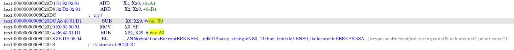

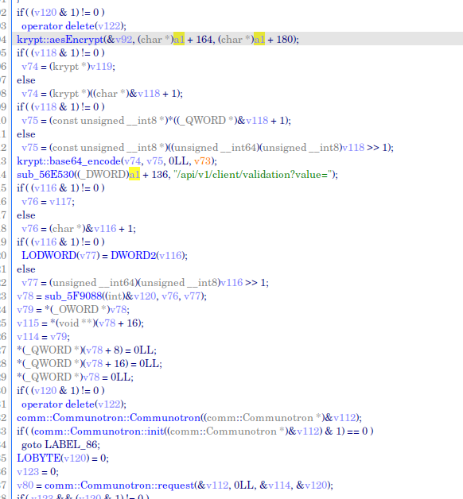

X0：0a查ascii码，实际是换行符

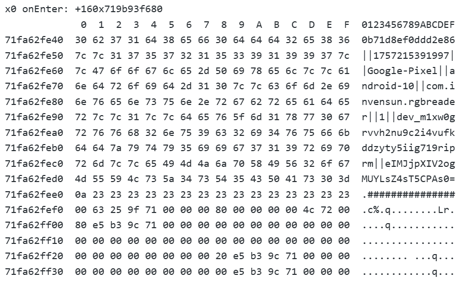

aes\_key、aes\_iv：

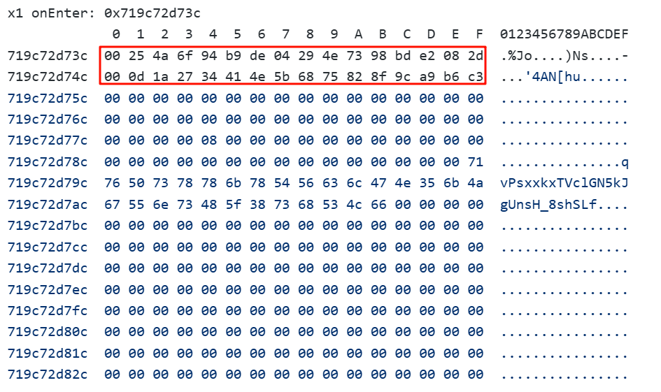

结果：

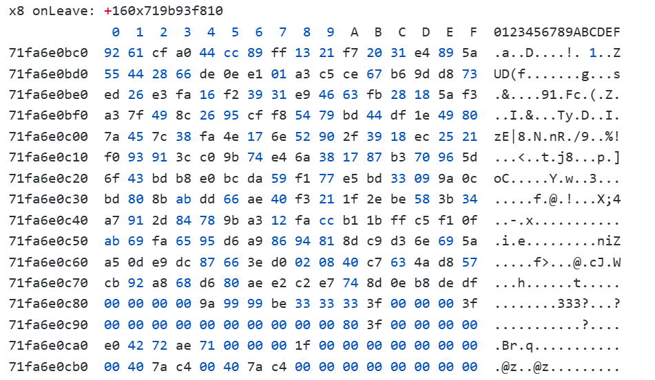

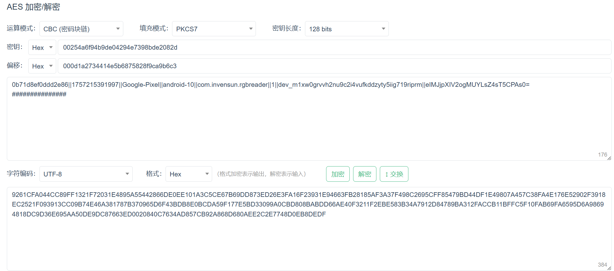

base64 encode后：与正常的base64 encode不同的是，正常base64的<font style="background-color:#D8DAD9;">+</font> <font style="background-color:#D8DAD9;">/</font> 分别被替换成 <font style="background-color:#D8DAD9;">-</font> <font style="background-color:#D8DAD9;">\_</font>

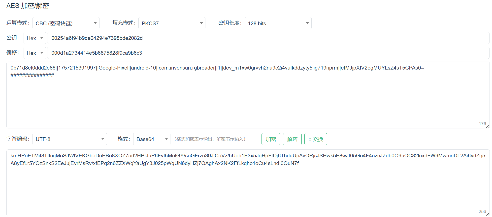

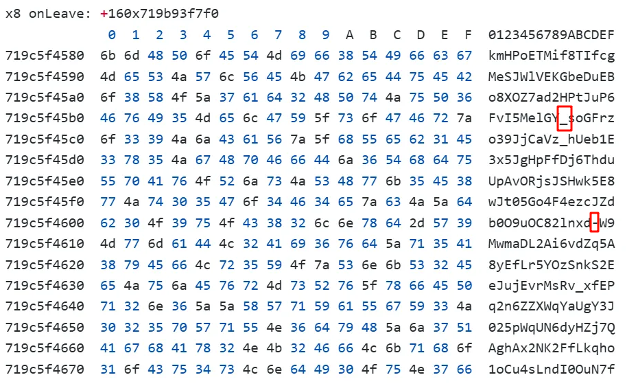

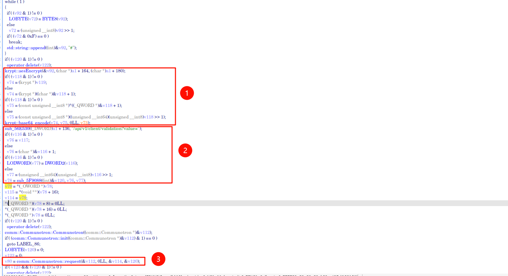

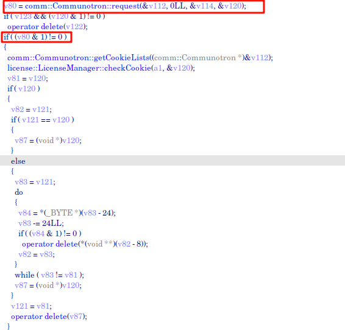

<font style="background-color:#D8DAD9;">comm::Communotron::init</font>：初始化curl设置

③request请求，get方法，v114为前面拼接的域名及参数value，v80结果，请求成功返回1，失败返回0。后面判断v80，失败会跳过后续处理，直接返回11，错误码：11

<font style="background-color:#D8DAD9;">checkCookie</font>：设置a1+112处为cookie，即【LicenseManager+112】为cookie，如

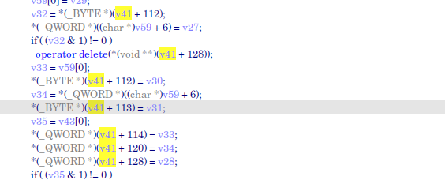

<font style="background-color:#D8DAD9;">operator delete</font>：清理空间的操作

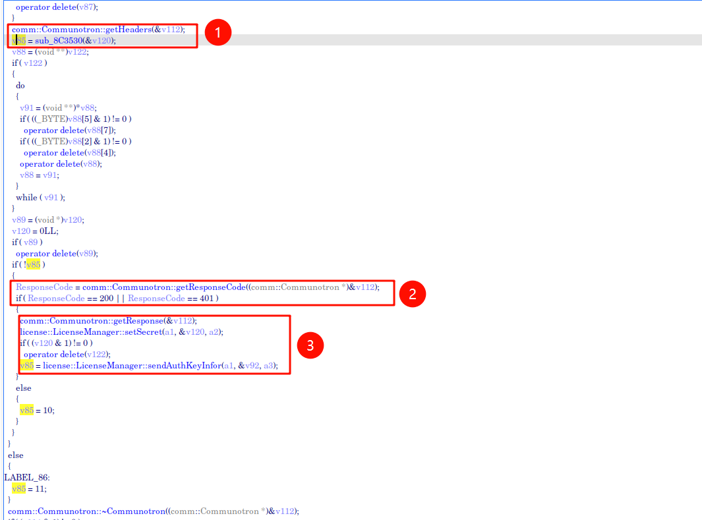

①从headers中取出seeso:code的值，如果为0才能执行后面操作

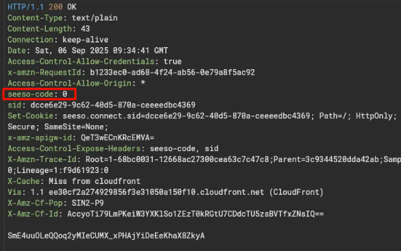

②获取响应码，如果不为200或401，返回错误码：10

③<font style="background-color:#D8DAD9;">setSecret</font>：X0是a1，LicensemManager，X1是getResponse通过X8传递的地址保存的结果，X2是a3，是getDeviceInfo通过X8传递的地址保存的结果

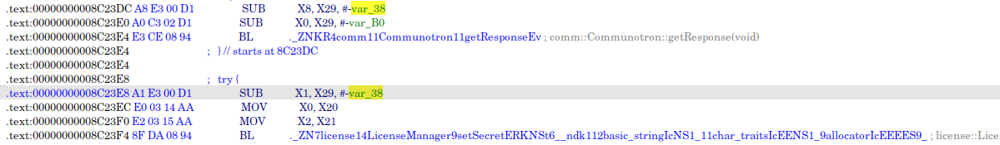


<details>
<summary>hook代码</summary>
<div style="max-height: 400px; overflow-y: auto; padding: 0 10px;">

```javascript
Java.perform(function () {
    function replace_key_java_nativewrapper() {
        let NativeWrapper = Java.use("camp.visual.libgaze.jni.NativeWrapper");
        NativeWrapper["nativeInitWrapper"].implementation = function (context, str, iArr, i, z, jNICallbackDispatcher) {
            let new_key = "dev_m1xw0grvvh2nu9c2i4vufkddzyty5iig719riprm";
            console.log('nativeInitWrapper is called' + ', ' + 'context: ' + context + ', ' + 'new_key: ' + new_key + ', ' + 'iArr: ' + iArr + ', ' + 'i: ' + i + ', ' + 'z: ' + z + ', ' + 'jNICallbackDispatcher: ' + jNICallbackDispatcher);
            let ret = this.nativeInitWrapper(context, new_key, iArr, i, z, jNICallbackDispatcher);
            console.log('nativeInitWrapper ret value is ' + ret);
            return ret;
        };
    }
    function print_arg(addr, hx_length = null, hx_ansi = null) {
        var hx_args = {};
        if (hx_length != null) {
            hx_args["length"] = hx_length;
        }
        if (hx_ansi != null) {
            hx_args["ansi"] = hx_ansi;
        }
        try {
            var module = Process.findRangeByAddress(addr);
            if (module != null) {
                return "\n" + hexdump(addr, hx_args) + "\n\n";
            }
            return ptr(addr) + "\n\n";
        } catch (e) {
            return addr + "\n\n";
        }
    }
    function hook_native_addr(funcPtr, registers, returnAddrs = null, logtag = null) {
        var module = Process.findModuleByAddress(funcPtr);
        Interceptor.attach(funcPtr, {
            onEnter: function (args) {
                this.logs = "";
                this.registers = {};
                this.trueReturnAddr = this.context["lr"].sub(module.base);
                this.returnCheck = false;
                if (returnAddrs) {
                    for (let i = 0; i < returnAddrs.length; i++) {
                        if (this.trueReturnAddr.compare(returnAddrs[i]) === 0) {
                            this.returnCheck = true;
                            break;
                        }
                    }
                } else {
                    this.returnCheck = true;
                }
                if (!this.returnCheck) {
                    return
                }
                registers.forEach(element => {
                    var regName = element;
                    var regValue = this.context[regName];
                    this.registers[regName] = regValue;
                });
                this.logs = this.logs.concat("So: " + module.name + ":" + module.base + "  methodOffset: " + ptr(funcPtr).sub(module.base) + "  trueReturnAddr:" + this.trueReturnAddr + "\n");
                if (logtag) {
                    this.logs = this.logs.concat(logtag + " trueReturnAddr:" + this.trueReturnAddr + " onEnter");
                    this.logs = this.logs.concat("==============================" + "\n");
                }
                for (let regName in this.registers) {
                    if (this.registers.hasOwnProperty(regName)) {
                        var regValue = this.registers[regName];
                        this.logs = this.logs.concat(regName + " onEnter: " + regValue + print_arg(regValue));
                        this.logs = this.logs.concat(regName + " onEnter: +16" + regValue + print_arg(regValue.add(16).readPointer()));
                    }
                }
            },
            onLeave: function (retval) {
                if (!this.returnCheck) {
                    return
                }
                if (logtag) {
                    this.logs = this.logs.concat(logtag + " trueReturnAddr:" + this.trueReturnAddr + " onLeave");
                    this.logs = this.logs.concat("==============================" + "\n");
                }
                for (let regName in this.registers) {
                    if (this.registers.hasOwnProperty(regName)) {
                        var regValue = this.registers[regName];
                        this.logs = this.logs.concat(regName + " onLeave: " + regValue + print_arg(regValue));
                        this.logs = this.logs.concat(regName + " onLeave: +16" + regValue + print_arg(regValue.add(16).readPointer()));
                    }
                }
                this.logs = this.logs.concat("retval onLeave: " + retval + print_arg(retval));
                console.log(this.logs);
            }
        });
    }
    const registers = {
        0: "x0", 1: "x1", 2: "x2", 3: "x3", 4: "x4", 5: "x5",
        6: "x6", 7: "x7", 8: "x8", 9: "x9", 10: "x10", 11: "x11",
        12: "x12", 13: "x13", 14: "x14", 15: "x15", 16: "x16",
        17: "x17", 18: "x18", 19: "x19", 20: "x20", 21: "x21",
        22: "x22", 23: "x23", 24: "x24", 25: "x25", 26: "x26",
        27: "x27", 28: "x28",
        29: "fp",
        30: "lr",
        31: "sp",
    };

    replace_key_java_nativewrapper();

    // hook_native_addr(
    //     Module.findBaseAddress("libseeso_core_android.so").add(0x56ff6c),
    //     [registers[0], registers[1], registers[8]],
    //     [ptr(0x570104)],
    //     "seeso::JNIEnvManager::safeGetStringUTFChars(&v53, a4, (unsigned __int64 *)v40);"
    // );

    // hook_native_addr(
    //     Module.findBaseAddress("libseeso_core_android.so").add(0x58519C),
    //     [registers[0], registers[1], registers[2], registers[3], registers[4], registers[5], registers[6], registers[7], registers[8]],
    //     [ptr(0x5701e0)],
    //     "sub_58519C(v19, v40, v42, v44, v46, v48, v20, v51, &v53);"
    // );

    // hook_native_addr(
    //     Module.findBaseAddress("libseeso_core_android.so").add(0x8c79a0),
    //     [registers[0], registers[1], registers[2], registers[8]],
    //     [ptr(0x8c20ec)],
    //     "krypt::aesEncrypt(&v92, (char *)a1 + 164, (char *)a1 + 180);"
    // );

    hook_native_addr(
        Module.findBaseAddress("libseeso_core_android.so").add(0x8cb6a0),
        [registers[0], registers[8]],
        [ptr(0x8c23e8)],
        "comm::Communotron::getResponse(&v112);"
    );

    hook_native_addr(
        Module.findBaseAddress("libseeso_core_android.so").add(0x8c36d0),
        [registers[0],registers[1], registers[2]],
        [ptr(0x8c23f8)],
        "license::LicenseManager::setSecret(a1, &v120, a2);"
    );

    hook_native_addr(
        Module.findBaseAddress("libseeso_core_android.so").add(0x8c7cf0),
        [registers[0],registers[1], registers[2] ,registers[8]],
        [ptr(0x8c3730)],
        "krypt::aesDecrypt(v83, &v82, &v81);"
    );

    hook_native_addr(
        Module.findBaseAddress("libseeso_core_android.so").add(0x8c8c2c),
        [registers[0], registers[8]],
        [ptr(0x8c3778)],
        "krypt::SHA256(&v75);"
    );

})


function memcpy_hook() {
    var memcpy_addr = null;
    var symbols = Process.findModuleByName("libc.so").enumerateSymbols();
    for (var i = 0; i < symbols.length; i++) {
        if (symbols[i].name === "memcpy") {
            // console.log("symbols name is -> " + symbols[i].name);
            // console.log("symbols address is -> " + symbols[i].address);
            memcpy_addr = symbols[i].address;
        }
    }
    Interceptor.attach(memcpy_addr, {
        onEnter: function (args) {
            if (args[1].readCString().indexOf("client/validation") != -1) {
                console.log("args is ->" + args[0], args[1], args[2]);
                // 打印调用栈（Native 层）
                const backtrace = Thread.backtrace(this.context, Backtracer.ACCURATE)
                    .map(addr => DebugSymbol.fromAddress(addr))
                    .join("\n\t");
                console.log("Backtrace:\n\t" + backtrace);
            }
        },
        onLeave: function (retval) {
            // console.log(retval);
        }
    });
}
```
</div>
</details>

<details>
<summary>hook日志</summary>
<div style="max-height: 400px; overflow-y: auto; padding: 0 10px;">

```bash
[Pixel::RgbTest ]-> nativeInitWrapper is called, context: android.app.Application@6ca6f28, new_key: dev_m1xw0grvvh2nu9c2i4vufkddzyty5iig719riprm, iArr: 1,2,3, i: 3, z: false, jNICallbackDispatcher: camp.visual.libgaze.callbacks.JNICallbackDispatcher@279ed68
So: libseeso_core_android.so:0x71adc1c000  methodOffset: 0x8cb6a0  trueReturnAddr:0x8c23e8
comm::Communotron::getResponse(&v112); trueReturnAddr:0x8c23e8 onEnter==============================
x0 onEnter: 0x7196ddd2e0
             0  1  2  3  4  5  6  7  8  9  A  B  C  D  E  F  0123456789ABCDEF
7196ddd2e0  80 11 6e 9c 71 00 00 00 00 00 00 00 00 00 00 00  ..n.q...........
7196ddd2f0  00 00 00 00 00 00 00 00 4a 94 70 9c 71 00 00 00  ........J.p.q...
7196ddd300  41 01 00 00 00 00 00 00 38 01 00 00 00 00 00 00  A.......8.......
7196ddd310  40 df 72 9c 71 00 00 00 06 00 00 00 00 00 00 00  @.r.q...........
7196ddd320  81 01 00 00 00 00 00 00 00 01 00 00 00 00 00 00  ................
7196ddd330  00 10 6e 9c 71 00 00 00 e0 27 b6 ae 71 00 00 00  ..n.q....'..q...
7196ddd340  d1 00 00 00 00 00 00 00 c0 00 00 00 00 00 00 00  ................
7196ddd350  c0 19 6e fa 71 00 00 00 00 00 00 00 00 00 00 00  ..n.q...........
7196ddd360  17 00 00 00 00 00 00 00 00 20 b4 9c 71 00 00 00  ......... ..q...
7196ddd370  11 00 00 00 00 00 00 00 00 00 80 3f 00 00 00 00  ...........?....
7196ddd380  37 f4 4a b4 74 be 92 76 00 00 00 00 00 00 00 00  7.J.t..v........
7196ddd390  30 d4 dd 96 71 00 00 00 34 db 4d ae 71 00 00 00  0...q...4.M.q...
7196ddd3a0  42 fe e2 ad 71 00 00 00 77 f5 0d ae 71 00 00 00  B...q...w...q...
7196ddd3b0  01 00 00 00 00 00 00 00 18 de 72 9c 71 00 00 00  ..........r.q...
7196ddd3c0  38 e9 dd 96 71 00 00 00 50 e9 dd 96 71 00 00 00  8...q...P...q...
7196ddd3d0  68 e9 dd 96 71 00 00 00 80 e9 dd 96 71 00 00 00  h...q.......q...

x0 onEnter: +160x7196ddd2e00x0

x8 onEnter: 0x7196ddd358
             0  1  2  3  4  5  6  7  8  9  A  B  C  D  E  F  0123456789ABCDEF
7196ddd358  00 00 00 00 00 00 00 00 17 00 00 00 00 00 00 00  ................
7196ddd368  00 20 b4 9c 71 00 00 00 11 00 00 00 00 00 00 00  . ..q...........
7196ddd378  00 00 80 3f 00 00 00 00 37 f4 4a b4 74 be 92 76  ...?....7.J.t..v
7196ddd388  00 00 00 00 00 00 00 00 30 d4 dd 96 71 00 00 00  ........0...q...
7196ddd398  34 db 4d ae 71 00 00 00 42 fe e2 ad 71 00 00 00  4.M.q...B...q...
7196ddd3a8  77 f5 0d ae 71 00 00 00 01 00 00 00 00 00 00 00  w...q...........
7196ddd3b8  18 de 72 9c 71 00 00 00 38 e9 dd 96 71 00 00 00  ..r.q...8...q...
7196ddd3c8  50 e9 dd 96 71 00 00 00 68 e9 dd 96 71 00 00 00  P...q...h...q...
7196ddd3d8  80 e9 dd 96 71 00 00 00 01 00 00 00 00 00 00 00  ....q...........
7196ddd3e8  20 60 de 96 71 00 00 00 20 60 de 96 71 00 00 00   `..q... `..q...
7196ddd3f8  20 60 de 96 71 00 00 00 98 e9 dd 96 71 00 00 00   `..q.......q...
7196ddd408  b8 e9 dd 96 71 00 00 00 01 00 00 00 00 00 00 00  ....q...........
7196ddd418  18 00 00 00 00 00 00 00 a0 36 6f fa 71 00 00 00  .........6o.q...
7196ddd428  37 f4 4a b4 74 be 92 76 c0 e8 dd 96 71 00 00 00  7.J.t..v....q...
7196ddd438  00 12 1a ae 71 00 00 00 90 ea dd 96 71 00 00 00  ....q.......q...
7196ddd448  20 60 de 96 71 00 00 00 b0 04 ff f9 71 00 00 00   `..q.......q...

x8 onEnter: +160x7196ddd358
             0  1  2  3  4  5  6  7  8  9  A  B  C  D  E  F  0123456789ABCDEF
719cb42000  40 f1 b6 9c 71 00 00 00 c6 06 a7 91 89 ea 12 32  @...q..........2
719cb42010  18 43 6f 6e 74 65 6e 74 2d 54 79 70 65 00 00 00  .Content-Type...
719cb42020  00 00 00 00 00 00 00 00 14 74 65 78 74 2f 70 6c  .........text/pl
719cb42030  61 69 6e 00 00 00 00 0d 0a 43 6f 6e 74 65 6e 74  ain......Content
719cb42040  00 40 a6 be 00 40 3c 3a 00 a0 5c 3d 00 c0 8e bd  .@...@<:..\=....
719cb42050  00 e0 1d be 00 20 11 3e 00 20 c7 3d 00 40 04 3d  ..... .>. .=.@.=
719cb42060  00 a0 1b 3c 00 40 ac bb 00 40 cb 3d 00 e0 3e bc  ...<.@...@.=..>.
719cb42070  00 80 89 bd 00 a0 f8 3c 00 60 6e 3d 00 a0 d3 bc  .......<.`n=....
719cb42080  00 00 52 bb 00 c0 45 3c 00 e0 5d 3d 00 60 a1 bd  ..R...E<..]=.`..
719cb42090  00 80 0f 3e 00 80 db bc 00 e0 1a 3e 00 80 70 3c  ...>.......>..p<
719cb420a0  00 00 bf 3c 00 a0 74 bb 00 40 73 bd 00 40 1b 3d  ...<..t..@s..@.=
719cb420b0  00 40 7e bd 00 60 a1 3d 00 60 20 3d 00 e0 27 3d  .@~..`.=.` =..'=
719cb420c0  00 80 f3 3c 00 40 5c 3c 00 00 93 3d 00 60 fe 3c  ...<.@\<...=.`.<
719cb420d0  00 00 da bc 00 60 05 bd 00 80 12 bd 00 00 5d bd  .....`........].
719cb420e0  00 20 28 3d 00 60 05 3c 00 c0 7f 3d 00 40 45 bc  . (=.`.<...=.@E.
719cb420f0  00 80 0a 3c 00 00 cc 3c 00 80 9d bb 00 80 56 bd  ...<...<......V.

comm::Communotron::getResponse(&v112); trueReturnAddr:0x8c23e8 onLeave==============================
x0 onLeave: 0x7196ddd2e0
             0  1  2  3  4  5  6  7  8  9  A  B  C  D  E  F  0123456789ABCDEF
7196ddd2e0  80 11 6e 9c 71 00 00 00 00 00 00 00 00 00 00 00  ..n.q...........
7196ddd2f0  00 00 00 00 00 00 00 00 4a 94 70 9c 71 00 00 00  ........J.p.q...
7196ddd300  41 01 00 00 00 00 00 00 38 01 00 00 00 00 00 00  A.......8.......
7196ddd310  40 df 72 9c 71 00 00 00 06 00 00 00 00 00 00 00  @.r.q...........
7196ddd320  81 01 00 00 00 00 00 00 00 01 00 00 00 00 00 00  ................
7196ddd330  00 10 6e 9c 71 00 00 00 e0 27 b6 ae 71 00 00 00  ..n.q....'..q...
7196ddd340  d1 00 00 00 00 00 00 00 c0 00 00 00 00 00 00 00  ................
7196ddd350  c0 19 6e fa 71 00 00 00 31 00 00 00 00 00 00 00  ..n.q...1.......
7196ddd360  2b 00 00 00 00 00 00 00 e0 74 fb 8c 71 00 00 00  +........t..q...
7196ddd370  11 00 00 00 00 00 00 00 00 00 80 3f 00 00 00 00  ...........?....
7196ddd380  37 f4 4a b4 74 be 92 76 00 00 00 00 00 00 00 00  7.J.t..v........
7196ddd390  30 d4 dd 96 71 00 00 00 34 db 4d ae 71 00 00 00  0...q...4.M.q...
7196ddd3a0  42 fe e2 ad 71 00 00 00 77 f5 0d ae 71 00 00 00  B...q...w...q...
7196ddd3b0  01 00 00 00 00 00 00 00 18 de 72 9c 71 00 00 00  ..........r.q...
7196ddd3c0  38 e9 dd 96 71 00 00 00 50 e9 dd 96 71 00 00 00  8...q...P...q...
7196ddd3d0  68 e9 dd 96 71 00 00 00 80 e9 dd 96 71 00 00 00  h...q.......q...

x0 onLeave: +160x7196ddd2e00x0

x8 onLeave: 0x7196ddd358
             0  1  2  3  4  5  6  7  8  9  A  B  C  D  E  F  0123456789ABCDEF
7196ddd358  31 00 00 00 00 00 00 00 2b 00 00 00 00 00 00 00  1.......+.......
7196ddd368  e0 74 fb 8c 71 00 00 00 11 00 00 00 00 00 00 00  .t..q...........
7196ddd378  00 00 80 3f 00 00 00 00 37 f4 4a b4 74 be 92 76  ...?....7.J.t..v
7196ddd388  00 00 00 00 00 00 00 00 30 d4 dd 96 71 00 00 00  ........0...q...
7196ddd398  34 db 4d ae 71 00 00 00 42 fe e2 ad 71 00 00 00  4.M.q...B...q...
7196ddd3a8  77 f5 0d ae 71 00 00 00 01 00 00 00 00 00 00 00  w...q...........
7196ddd3b8  18 de 72 9c 71 00 00 00 38 e9 dd 96 71 00 00 00  ..r.q...8...q...
7196ddd3c8  50 e9 dd 96 71 00 00 00 68 e9 dd 96 71 00 00 00  P...q...h...q...
7196ddd3d8  80 e9 dd 96 71 00 00 00 01 00 00 00 00 00 00 00  ....q...........
7196ddd3e8  20 60 de 96 71 00 00 00 20 60 de 96 71 00 00 00   `..q... `..q...
7196ddd3f8  20 60 de 96 71 00 00 00 98 e9 dd 96 71 00 00 00   `..q.......q...
7196ddd408  b8 e9 dd 96 71 00 00 00 01 00 00 00 00 00 00 00  ....q...........
7196ddd418  18 00 00 00 00 00 00 00 a0 36 6f fa 71 00 00 00  .........6o.q...
7196ddd428  37 f4 4a b4 74 be 92 76 c0 e8 dd 96 71 00 00 00  7.J.t..v....q...
7196ddd438  00 12 1a ae 71 00 00 00 90 ea dd 96 71 00 00 00  ....q.......q...
7196ddd448  20 60 de 96 71 00 00 00 b0 04 ff f9 71 00 00 00   `..q.......q...

x8 onLeave: +160x7196ddd358
             0  1  2  3  4  5  6  7  8  9  A  B  C  D  E  F  0123456789ABCDEF
718cfb74e0  6e 5f 66 68 4b 69 6e 49 38 76 37 62 59 2d 69 67  n_fhKinI8v7bY-ig
718cfb74f0  51 75 36 6a 4a 6b 4f 31 64 4c 53 65 63 4a 5a 47  Qu6jJkO1dLSecJZG
718cfb7500  66 30 33 50 77 49 4c 65 38 49 34 00 00 00 00 00  f03PwILe8I4.....
718cfb7510  80 74 fb 8c 71 00 00 00 a0 75 fb 8c 71 00 00 00  .t..q....u..q...
718cfb7520  f0 52 62 9c 71 00 00 00 01 36 fc 8c 71 00 00 00  .Rb.q....6..q...
718cfb7530  70 54 55 9c 00 00 00 00 18 9a de 70 00 00 00 00  pTU........p....
718cfb7540  00 00 00 00 00 00 00 00 90 76 fb 8c 71 00 00 00  .........v..q...
718cfb7550  80 62 62 9c 71 00 00 00 01 38 af 8c 71 00 00 00  .bb.q....8..q...
718cfb7560  10 c4 53 9c 00 00 00 00 40 ce f9 70 00 00 00 00  ..S.....@..p....
718cfb7570  f0 73 fb 8c 71 00 00 00 20 77 fb 8c 71 00 00 00  .s..q... w..q...
718cfb7580  d0 72 fb 8c 71 00 00 00 01 63 37 97 71 00 00 00  .r..q....c7.q...
718cfb7590  90 a3 56 9c 00 00 00 00 68 62 e8 70 00 00 00 00  ..V.....hb.p....
718cfb75a0  00 00 00 00 00 00 00 00 00 00 00 00 00 00 00 00  ................
718cfb75b0  10 75 fb 8c 71 00 00 00 01 00 00 00 00 00 00 00  .u..q...........
718cfb75c0  80 55 55 9c 00 00 00 00 18 e2 f4 70 00 00 00 00  .UU........p....
718cfb75d0  90 64 62 9c 71 00 00 00 b0 2a 60 fa 71 00 00 00  .db.q....*`.q...

retval onLeave: 0x718cfb74e0
             0  1  2  3  4  5  6  7  8  9  A  B  C  D  E  F  0123456789ABCDEF
718cfb74e0  6e 5f 66 68 4b 69 6e 49 38 76 37 62 59 2d 69 67  n_fhKinI8v7bY-ig
718cfb74f0  51 75 36 6a 4a 6b 4f 31 64 4c 53 65 63 4a 5a 47  Qu6jJkO1dLSecJZG
718cfb7500  66 30 33 50 77 49 4c 65 38 49 34 00 00 00 00 00  f03PwILe8I4.....
718cfb7510  80 74 fb 8c 71 00 00 00 a0 75 fb 8c 71 00 00 00  .t..q....u..q...
718cfb7520  f0 52 62 9c 71 00 00 00 01 36 fc 8c 71 00 00 00  .Rb.q....6..q...
718cfb7530  70 54 55 9c 00 00 00 00 18 9a de 70 00 00 00 00  pTU........p....
718cfb7540  00 00 00 00 00 00 00 00 90 76 fb 8c 71 00 00 00  .........v..q...
718cfb7550  80 62 62 9c 71 00 00 00 01 38 af 8c 71 00 00 00  .bb.q....8..q...
718cfb7560  10 c4 53 9c 00 00 00 00 40 ce f9 70 00 00 00 00  ..S.....@..p....
718cfb7570  f0 73 fb 8c 71 00 00 00 20 77 fb 8c 71 00 00 00  .s..q... w..q...
718cfb7580  d0 72 fb 8c 71 00 00 00 01 63 37 97 71 00 00 00  .r..q....c7.q...
718cfb7590  90 a3 56 9c 00 00 00 00 68 62 e8 70 00 00 00 00  ..V.....hb.p....
718cfb75a0  00 00 00 00 00 00 00 00 00 00 00 00 00 00 00 00  ................
718cfb75b0  10 75 fb 8c 71 00 00 00 01 00 00 00 00 00 00 00  .u..q...........
718cfb75c0  80 55 55 9c 00 00 00 00 18 e2 f4 70 00 00 00 00  .UU........p....
718cfb75d0  90 64 62 9c 71 00 00 00 b0 2a 60 fa 71 00 00 00  .db.q....*`.q...


So: libseeso_core_android.so:0x71adc1c000  methodOffset: 0x8c7cf0  trueReturnAddr:0x8c3730
krypt::aesDecrypt(v83, &v82, &v81); trueReturnAddr:0x8c3730 onEnter==============================
x0 onEnter: 0x7196ddd160
             0  1  2  3  4  5  6  7  8  9  A  B  C  D  E  F  0123456789ABCDEF
7196ddd160  31 00 00 00 00 00 00 00 20 00 00 00 00 00 00 00  1....... .......
7196ddd170  b0 77 fb 8c 71 00 00 00 37 f4 4a b4 74 be 92 76  .w..q...7.J.t..v
7196ddd180  90 d3 dd 96 71 00 00 00 0c 13 74 fc 71 00 00 00  ....q.....t.q...
7196ddd190  00 00 00 00 00 00 00 00 38 e9 dd 96 71 00 00 00  ........8...q...
7196ddd1a0  18 de 72 9c 71 00 00 00 50 e9 dd 96 71 00 00 00  ..r.q...P...q...
7196ddd1b0  c1 00 00 00 00 00 00 00 b0 00 00 00 00 00 00 00  ................
7196ddd1c0  40 fe 62 fa 71 00 00 00 00 00 00 00 00 00 00 00  @.b.q...........
7196ddd1d0  00 00 00 00 00 00 00 00 00 00 00 00 00 00 00 00  ................
7196ddd1e0  00 00 00 00 00 00 00 00 00 00 00 00 00 00 00 00  ................
7196ddd1f0  00 00 00 00 00 00 00 00 37 f4 4a b4 74 be 92 76  ........7.J.t..v
7196ddd200  00 00 00 00 00 00 00 00 00 00 00 00 00 00 00 00  ................
7196ddd210  00 00 00 00 00 00 00 00 50 e9 dd 96 71 00 00 00  ........P...q...
7196ddd220  00 00 00 00 00 00 00 00 00 00 00 00 00 00 00 00  ................
7196ddd230  00 00 00 00 00 00 00 00 a0 d2 dd 96 71 00 00 00  ............q...
7196ddd240  00 00 00 00 00 00 00 00 00 00 00 00 00 00 00 00  ................
7196ddd250  00 00 00 00 00 00 00 00 21 00 00 00 00 00 00 00  ........!.......

x0 onEnter: +160x7196ddd160
             0  1  2  3  4  5  6  7  8  9  A  B  C  D  E  F  0123456789ABCDEF
718cfb77b0  9f f7 e1 2a 29 c8 f2 fe db 63 e8 a0 42 ee a3 26  ...*)....c..B..&
718cfb77c0  43 b5 74 b4 9e 70 96 46 7f 4d cf c0 82 de f0 8e  C.t..p.F.M......
718cfb77d0  00 31 39 37 00 00 00 00 00 00 00 00 00 00 00 00  .197............
718cfb77e0  50 77 fb 8c 71 00 00 00 70 78 fb 8c 71 00 00 00  Pw..q...px..q...
718cfb77f0  00 79 fb 8c 71 00 00 00 01 60 00 00 00 00 00 00  .y..q....`......
718cfb7800  30 6a 55 9c 00 00 00 00 18 55 d2 70 00 00 00 00  0jU......U.p....
718cfb7810  6e 5f 66 68 4b 69 6e 49 38 76 37 62 59 2d 69 67  n_fhKinI8v7bY-ig
718cfb7820  51 75 36 6a 4a 6b 4f 31 64 4c 53 65 63 4a 5a 47  Qu6jJkO1dLSecJZG
718cfb7830  66 30 33 50 77 49 4c 65 38 49 34 00 00 00 00 00  f03PwILe8I4.....
718cfb7840  00 00 00 00 00 00 00 00 00 00 00 00 00 00 00 00  ................
718cfb7850  00 00 00 00 00 00 00 00 00 00 00 00 00 00 00 00  ................
718cfb7860  00 00 00 00 00 00 00 00 00 00 00 00 00 00 00 00  ................
718cfb7870  00 00 00 00 00 00 00 00 00 00 00 00 00 00 00 00  ................
718cfb7880  e0 77 fb 8c 71 00 00 00 01 ff ff ff 00 00 00 00  .w..q...........
718cfb7890  90 6a 55 9c 00 00 00 00 70 b0 ec 70 00 00 00 00  .jU.....p..p....
718cfb78a0  50 bb 74 ae 71 00 00 00 00 00 00 00 04 00 00 00  P.t.q...........

x1 onEnter: 0x7196ddd150
             0  1  2  3  4  5  6  7  8  9  A  B  C  D  E  F  0123456789ABCDEF
7196ddd150  0f 2c 49 66 83 a0 bd da f7 14 31 4e 6b 88 a5 c2  .,If......1Nk...
7196ddd160  31 00 00 00 00 00 00 00 20 00 00 00 00 00 00 00  1....... .......
7196ddd170  b0 77 fb 8c 71 00 00 00 37 f4 4a b4 74 be 92 76  .w..q...7.J.t..v
7196ddd180  90 d3 dd 96 71 00 00 00 0c 13 74 fc 71 00 00 00  ....q.....t.q...
7196ddd190  00 00 00 00 00 00 00 00 38 e9 dd 96 71 00 00 00  ........8...q...
7196ddd1a0  18 de 72 9c 71 00 00 00 50 e9 dd 96 71 00 00 00  ..r.q...P...q...
7196ddd1b0  c1 00 00 00 00 00 00 00 b0 00 00 00 00 00 00 00  ................
7196ddd1c0  40 fe 62 fa 71 00 00 00 00 00 00 00 00 00 00 00  @.b.q...........
7196ddd1d0  00 00 00 00 00 00 00 00 00 00 00 00 00 00 00 00  ................
7196ddd1e0  00 00 00 00 00 00 00 00 00 00 00 00 00 00 00 00  ................
7196ddd1f0  00 00 00 00 00 00 00 00 37 f4 4a b4 74 be 92 76  ........7.J.t..v
7196ddd200  00 00 00 00 00 00 00 00 00 00 00 00 00 00 00 00  ................
7196ddd210  00 00 00 00 00 00 00 00 50 e9 dd 96 71 00 00 00  ........P...q...
7196ddd220  00 00 00 00 00 00 00 00 00 00 00 00 00 00 00 00  ................
7196ddd230  00 00 00 00 00 00 00 00 a0 d2 dd 96 71 00 00 00  ............q...
7196ddd240  00 00 00 00 00 00 00 00 00 00 00 00 00 00 00 00  ................

x1 onEnter: +160x7196ddd1500x31

x2 onEnter: 0x7196ddd140
             0  1  2  3  4  5  6  7  8  9  A  B  C  D  E  F  0123456789ABCDEF
7196ddd140  11 18 1f 26 2d 34 3b 42 49 50 57 5e 65 6c 73 7a  ...&-4;BIPW^elsz
7196ddd150  0f 2c 49 66 83 a0 bd da f7 14 31 4e 6b 88 a5 c2  .,If......1Nk...
7196ddd160  31 00 00 00 00 00 00 00 20 00 00 00 00 00 00 00  1....... .......
7196ddd170  b0 77 fb 8c 71 00 00 00 37 f4 4a b4 74 be 92 76  .w..q...7.J.t..v
7196ddd180  90 d3 dd 96 71 00 00 00 0c 13 74 fc 71 00 00 00  ....q.....t.q...
7196ddd190  00 00 00 00 00 00 00 00 38 e9 dd 96 71 00 00 00  ........8...q...
7196ddd1a0  18 de 72 9c 71 00 00 00 50 e9 dd 96 71 00 00 00  ..r.q...P...q...
7196ddd1b0  c1 00 00 00 00 00 00 00 b0 00 00 00 00 00 00 00  ................
7196ddd1c0  40 fe 62 fa 71 00 00 00 00 00 00 00 00 00 00 00  @.b.q...........
7196ddd1d0  00 00 00 00 00 00 00 00 00 00 00 00 00 00 00 00  ................
7196ddd1e0  00 00 00 00 00 00 00 00 00 00 00 00 00 00 00 00  ................
7196ddd1f0  00 00 00 00 00 00 00 00 37 f4 4a b4 74 be 92 76  ........7.J.t..v
7196ddd200  00 00 00 00 00 00 00 00 00 00 00 00 00 00 00 00  ................
7196ddd210  00 00 00 00 00 00 00 00 50 e9 dd 96 71 00 00 00  ........P...q...
7196ddd220  00 00 00 00 00 00 00 00 00 00 00 00 00 00 00 00  ................
7196ddd230  00 00 00 00 00 00 00 00 a0 d2 dd 96 71 00 00 00  ............q...

x2 onEnter: +160x7196ddd1400xdabda08366492c0f

x8 onEnter: 0x7196ddd128
             0  1  2  3  4  5  6  7  8  9  A  B  C  D  E  F  0123456789ABCDEF
7196ddd128  28 42 e0 7c 69 05 58 7f f6 85 2f e4 36 91 12 99  (B.|i.X.../.6...
7196ddd138  30 28 60 1a 38 f8 fb 3a 11 18 1f 26 2d 34 3b 42  0(`.8..:...&-4;B
7196ddd148  49 50 57 5e 65 6c 73 7a 0f 2c 49 66 83 a0 bd da  IPW^elsz.,If....
7196ddd158  f7 14 31 4e 6b 88 a5 c2 31 00 00 00 00 00 00 00  ..1Nk...1.......
7196ddd168  20 00 00 00 00 00 00 00 b0 77 fb 8c 71 00 00 00   ........w..q...
7196ddd178  37 f4 4a b4 74 be 92 76 90 d3 dd 96 71 00 00 00  7.J.t..v....q...
7196ddd188  0c 13 74 fc 71 00 00 00 00 00 00 00 00 00 00 00  ..t.q...........
7196ddd198  38 e9 dd 96 71 00 00 00 18 de 72 9c 71 00 00 00  8...q.....r.q...
7196ddd1a8  50 e9 dd 96 71 00 00 00 c1 00 00 00 00 00 00 00  P...q...........
7196ddd1b8  b0 00 00 00 00 00 00 00 40 fe 62 fa 71 00 00 00  ........@.b.q...
7196ddd1c8  00 00 00 00 00 00 00 00 00 00 00 00 00 00 00 00  ................
7196ddd1d8  00 00 00 00 00 00 00 00 00 00 00 00 00 00 00 00  ................
7196ddd1e8  00 00 00 00 00 00 00 00 00 00 00 00 00 00 00 00  ................
7196ddd1f8  37 f4 4a b4 74 be 92 76 00 00 00 00 00 00 00 00  7.J.t..v........
7196ddd208  00 00 00 00 00 00 00 00 00 00 00 00 00 00 00 00  ................
7196ddd218  50 e9 dd 96 71 00 00 00 00 00 00 00 00 00 00 00  P...q...........

x8 onEnter: +160x7196ddd1280x3afbf8381a602830

krypt::aesDecrypt(v83, &v82, &v81); trueReturnAddr:0x8c3730 onLeave==============================
x0 onLeave: 0x7196ddd160
             0  1  2  3  4  5  6  7  8  9  A  B  C  D  E  F  0123456789ABCDEF
7196ddd160  31 00 00 00 00 00 00 00 20 00 00 00 00 00 00 00  1....... .......
7196ddd170  b0 77 fb 8c 71 00 00 00 37 f4 4a b4 74 be 92 76  .w..q...7.J.t..v
7196ddd180  90 d3 dd 96 71 00 00 00 0c 13 74 fc 71 00 00 00  ....q.....t.q...
7196ddd190  00 00 00 00 00 00 00 00 38 e9 dd 96 71 00 00 00  ........8...q...
7196ddd1a0  18 de 72 9c 71 00 00 00 50 e9 dd 96 71 00 00 00  ..r.q...P...q...
7196ddd1b0  c1 00 00 00 00 00 00 00 b0 00 00 00 00 00 00 00  ................
7196ddd1c0  40 fe 62 fa 71 00 00 00 00 00 00 00 00 00 00 00  @.b.q...........
7196ddd1d0  00 00 00 00 00 00 00 00 00 00 00 00 00 00 00 00  ................
7196ddd1e0  00 00 00 00 00 00 00 00 00 00 00 00 00 00 00 00  ................
7196ddd1f0  00 00 00 00 00 00 00 00 37 f4 4a b4 74 be 92 76  ........7.J.t..v
7196ddd200  00 00 00 00 00 00 00 00 00 00 00 00 00 00 00 00  ................
7196ddd210  00 00 00 00 00 00 00 00 50 e9 dd 96 71 00 00 00  ........P...q...
7196ddd220  00 00 00 00 00 00 00 00 00 00 00 00 00 00 00 00  ................
7196ddd230  00 00 00 00 00 00 00 00 a0 d2 dd 96 71 00 00 00  ............q...
7196ddd240  00 00 00 00 00 00 00 00 00 00 00 00 00 00 00 00  ................
7196ddd250  00 00 00 00 00 00 00 00 21 00 00 00 00 00 00 00  ........!.......

x0 onLeave: +160x7196ddd160
             0  1  2  3  4  5  6  7  8  9  A  B  C  D  E  F  0123456789ABCDEF
718cfb77b0  9f f7 e1 2a 29 c8 f2 fe db 63 e8 a0 42 ee a3 26  ...*)....c..B..&
718cfb77c0  43 b5 74 b4 9e 70 96 46 7f 4d cf c0 82 de f0 8e  C.t..p.F.M......
718cfb77d0  00 31 39 37 00 00 00 00 00 00 00 00 00 00 00 00  .197............
718cfb77e0  50 77 fb 8c 71 00 00 00 70 78 fb 8c 71 00 00 00  Pw..q...px..q...
718cfb77f0  00 79 fb 8c 71 00 00 00 01 60 00 00 00 00 00 00  .y..q....`......
718cfb7800  30 6a 55 9c 00 00 00 00 18 55 d2 70 00 00 00 00  0jU......U.p....
718cfb7810  6e 5f 66 68 4b 69 6e 49 38 76 37 62 59 2d 69 67  n_fhKinI8v7bY-ig
718cfb7820  51 75 36 6a 4a 6b 4f 31 64 4c 53 65 63 4a 5a 47  Qu6jJkO1dLSecJZG
718cfb7830  66 30 33 50 77 49 4c 65 38 49 34 00 00 00 00 00  f03PwILe8I4.....
718cfb7840  00 00 00 00 00 00 00 00 00 00 00 00 00 00 00 00  ................
718cfb7850  00 00 00 00 00 00 00 00 00 00 00 00 00 00 00 00  ................
718cfb7860  00 00 00 00 00 00 00 00 00 00 00 00 00 00 00 00  ................
718cfb7870  00 00 00 00 00 00 00 00 00 00 00 00 00 00 00 00  ................
718cfb7880  e0 77 fb 8c 71 00 00 00 01 ff ff ff 00 00 00 00  .w..q...........
718cfb7890  90 6a 55 9c 00 00 00 00 70 b0 ec 70 00 00 00 00  .jU.....p..p....
718cfb78a0  50 bb 74 ae 71 00 00 00 00 00 00 00 04 00 00 00  P.t.q...........

x1 onLeave: 0x7196ddd150
             0  1  2  3  4  5  6  7  8  9  A  B  C  D  E  F  0123456789ABCDEF
7196ddd150  0f 2c 49 66 83 a0 bd da f7 14 31 4e 6b 88 a5 c2  .,If......1Nk...
7196ddd160  31 00 00 00 00 00 00 00 20 00 00 00 00 00 00 00  1....... .......
7196ddd170  b0 77 fb 8c 71 00 00 00 37 f4 4a b4 74 be 92 76  .w..q...7.J.t..v
7196ddd180  90 d3 dd 96 71 00 00 00 0c 13 74 fc 71 00 00 00  ....q.....t.q...
7196ddd190  00 00 00 00 00 00 00 00 38 e9 dd 96 71 00 00 00  ........8...q...
7196ddd1a0  18 de 72 9c 71 00 00 00 50 e9 dd 96 71 00 00 00  ..r.q...P...q...
7196ddd1b0  c1 00 00 00 00 00 00 00 b0 00 00 00 00 00 00 00  ................
7196ddd1c0  40 fe 62 fa 71 00 00 00 00 00 00 00 00 00 00 00  @.b.q...........
7196ddd1d0  00 00 00 00 00 00 00 00 00 00 00 00 00 00 00 00  ................
7196ddd1e0  00 00 00 00 00 00 00 00 00 00 00 00 00 00 00 00  ................
7196ddd1f0  00 00 00 00 00 00 00 00 37 f4 4a b4 74 be 92 76  ........7.J.t..v
7196ddd200  00 00 00 00 00 00 00 00 00 00 00 00 00 00 00 00  ................
7196ddd210  00 00 00 00 00 00 00 00 50 e9 dd 96 71 00 00 00  ........P...q...
7196ddd220  00 00 00 00 00 00 00 00 00 00 00 00 00 00 00 00  ................
7196ddd230  00 00 00 00 00 00 00 00 a0 d2 dd 96 71 00 00 00  ............q...
7196ddd240  00 00 00 00 00 00 00 00 00 00 00 00 00 00 00 00  ................

x1 onLeave: +160x7196ddd1500x31

x2 onLeave: 0x7196ddd140
             0  1  2  3  4  5  6  7  8  9  A  B  C  D  E  F  0123456789ABCDEF
7196ddd140  11 18 1f 26 2d 34 3b 42 49 50 57 5e 65 6c 73 7a  ...&-4;BIPW^elsz
7196ddd150  0f 2c 49 66 83 a0 bd da f7 14 31 4e 6b 88 a5 c2  .,If......1Nk...
7196ddd160  31 00 00 00 00 00 00 00 20 00 00 00 00 00 00 00  1....... .......
7196ddd170  b0 77 fb 8c 71 00 00 00 37 f4 4a b4 74 be 92 76  .w..q...7.J.t..v
7196ddd180  90 d3 dd 96 71 00 00 00 0c 13 74 fc 71 00 00 00  ....q.....t.q...
7196ddd190  00 00 00 00 00 00 00 00 38 e9 dd 96 71 00 00 00  ........8...q...
7196ddd1a0  18 de 72 9c 71 00 00 00 50 e9 dd 96 71 00 00 00  ..r.q...P...q...
7196ddd1b0  c1 00 00 00 00 00 00 00 b0 00 00 00 00 00 00 00  ................
7196ddd1c0  40 fe 62 fa 71 00 00 00 00 00 00 00 00 00 00 00  @.b.q...........
7196ddd1d0  00 00 00 00 00 00 00 00 00 00 00 00 00 00 00 00  ................
7196ddd1e0  00 00 00 00 00 00 00 00 00 00 00 00 00 00 00 00  ................
7196ddd1f0  00 00 00 00 00 00 00 00 37 f4 4a b4 74 be 92 76  ........7.J.t..v
7196ddd200  00 00 00 00 00 00 00 00 00 00 00 00 00 00 00 00  ................
7196ddd210  00 00 00 00 00 00 00 00 50 e9 dd 96 71 00 00 00  ........P...q...
7196ddd220  00 00 00 00 00 00 00 00 00 00 00 00 00 00 00 00  ................
7196ddd230  00 00 00 00 00 00 00 00 a0 d2 dd 96 71 00 00 00  ............q...

x2 onLeave: +160x7196ddd1400xdabda08366492c0f

x8 onLeave: 0x7196ddd128
             0  1  2  3  4  5  6  7  8  9  A  B  C  D  E  F  0123456789ABCDEF
7196ddd128  21 00 00 00 00 00 00 00 1e 00 00 00 00 00 00 00  !...............
7196ddd138  c0 26 b1 9c 71 00 00 00 11 18 1f 26 2d 34 3b 42  .&..q......&-4;B
7196ddd148  49 50 57 5e 65 6c 73 7a 0f 2c 49 66 83 a0 bd da  IPW^elsz.,If....
7196ddd158  f7 14 31 4e 6b 88 a5 c2 31 00 00 00 00 00 00 00  ..1Nk...1.......
7196ddd168  20 00 00 00 00 00 00 00 b0 77 fb 8c 71 00 00 00   ........w..q...
7196ddd178  37 f4 4a b4 74 be 92 76 90 d3 dd 96 71 00 00 00  7.J.t..v....q...
7196ddd188  0c 13 74 fc 71 00 00 00 00 00 00 00 00 00 00 00  ..t.q...........
7196ddd198  38 e9 dd 96 71 00 00 00 18 de 72 9c 71 00 00 00  8...q.....r.q...
7196ddd1a8  50 e9 dd 96 71 00 00 00 c1 00 00 00 00 00 00 00  P...q...........
7196ddd1b8  b0 00 00 00 00 00 00 00 40 fe 62 fa 71 00 00 00  ........@.b.q...
7196ddd1c8  00 00 00 00 00 00 00 00 00 00 00 00 00 00 00 00  ................
7196ddd1d8  00 00 00 00 00 00 00 00 00 00 00 00 00 00 00 00  ................
7196ddd1e8  00 00 00 00 00 00 00 00 00 00 00 00 00 00 00 00  ................
7196ddd1f8  37 f4 4a b4 74 be 92 76 00 00 00 00 00 00 00 00  7.J.t..v........
7196ddd208  00 00 00 00 00 00 00 00 00 00 00 00 00 00 00 00  ................
7196ddd218  50 e9 dd 96 71 00 00 00 00 00 00 00 00 00 00 00  P...q...........

x8 onLeave: +160x7196ddd128
             0  1  2  3  4  5  6  7  8  9  A  B  C  D  E  F  0123456789ABCDEF
719cb126c0  35 6f 67 77 79 62 30 6d 61 76 37 32 7a 37 37 67  5ogwyb0mav72z77g
719cb126d0  35 6f 33 61 34 62 35 79 33 30 79 31 6f 36 00 00  5o3a4b5y30y1o6..
719cb126e0  4d 69 73 73 20 66 72 6f 6d 20 63 6c 6f 75 64 66  Miss from cloudf
719cb126f0  72 6f 6e 74 00 00 00 00 00 00 00 00 00 00 00 00  ront............
719cb12700  41 63 63 65 73 73 2d 43 6f 6e 74 72 6f 6c 2d 41  Access-Control-A
719cb12710  6c 6c 6f 77 2d 4f 72 69 67 69 6e 00 00 00 00 00  llow-Origin.....
719cb12720  04 00 00 00 10 00 00 00 03 00 00 00 03 00 00 00  ................
719cb12730  03 00 00 00 01 00 00 00 00 00 00 00 00 00 00 00  ................
719cb12740  04 00 00 00 01 00 00 00 60 00 00 00 60 00 00 00  ........`...`...
719cb12750  1b 00 00 00 00 00 00 00 00 00 00 00 00 00 00 00  ................
719cb12760  04 00 00 00 01 00 00 00 60 00 00 00 60 00 00 00  ........`...`...
719cb12770  10 00 00 00 00 00 00 00 00 00 00 00 00 00 00 00  ................
719cb12780  04 00 00 00 01 00 00 00 03 00 00 00 03 00 00 00  ................
719cb12790  10 00 00 00 00 00 00 00 00 00 00 00 00 00 00 00  ................
719cb127a0  20 2f b1 9c 71 00 00 00 04 00 00 00 00 00 00 00   /..q...........
719cb127b0  04 00 00 00 71 00 00 00 00 00 00 00 00 00 00 00  ....q...........

retval onLeave: 0x71fa1d3240
             0  1  2  3  4  5  6  7  8  9  A  B  C  D  E  F  0123456789ABCDEF
71fa1d3240  01 74 80 fa 71 00 0a 00 01 74 80 fa 71 00 0a 00  .t..q....t..q...
71fa1d3250  01 ec 80 fa 71 00 04 00 81 ec 80 fa 71 00 15 00  ....q.......q...
71fa1d3260  81 ec 80 fa 71 00 15 00 81 ec 80 fa 71 00 15 00  ....q.......q...
71fa1d3270  81 ec 80 fa 71 00 15 00 81 ec 80 fa 71 00 15 00  ....q.......q...
71fa1d3280  01 ed 80 fa 71 00 15 00 01 ed 80 fa 71 00 15 00  ....q.......q...
71fa1d3290  01 ed 80 fa 71 00 15 00 01 ed 80 fa 71 00 15 00  ....q.......q...
71fa1d32a0  01 ed 80 fa 71 00 15 00 01 ee 80 fa 71 00 13 00  ....q.......q...
71fa1d32b0  01 ee 80 fa 71 00 13 00 01 ee 80 fa 71 00 13 00  ....q.......q...
71fa1d32c0  01 ee 80 fa 71 00 13 00 01 ee 80 fa 71 00 13 00  ....q.......q...
71fa1d32d0  01 ee 80 fa 71 00 13 00 01 ee 80 fa 71 00 13 00  ....q.......q...
71fa1d32e0  81 ee 80 fa 71 00 10 00 01 ef 80 fa 71 00 1c 00  ....q.......q...
71fa1d32f0  81 74 80 fa 71 00 1f 00 81 74 80 fa 71 00 1f 00  .t..q....t..q...
71fa1d3300  81 74 80 fa 71 00 1f 00 81 74 80 fa 71 00 1f 00  .t..q....t..q...
71fa1d3310  81 74 80 fa 71 00 1f 00 81 74 80 fa 71 00 1f 00  .t..q....t..q...
71fa1d3320  81 74 80 fa 71 00 1f 00 01 75 80 fa 71 00 1f 00  .t..q....u..q...
71fa1d3330  01 75 80 fa 71 00 1f 00 01 75 80 fa 71 00 1f 00  .u..q....u..q...


So: libseeso_core_android.so:0x71adc1c000  methodOffset: 0x8c8c2c  trueReturnAddr:0x8c3778
krypt::SHA256(&v75); trueReturnAddr:0x8c3778 onEnter==============================
x0 onEnter: 0x7196ddd110
             0  1  2  3  4  5  6  7  8  9  A  B  C  D  E  F  0123456789ABCDEF
7196ddd110  51 00 00 00 00 00 00 00 4a 00 00 00 00 00 00 00  Q.......J.......
7196ddd120  70 e2 6c fa 71 00 00 00 21 00 00 00 00 00 00 00  p.l.q...!.......
7196ddd130  1e 00 00 00 00 00 00 00 c0 26 b1 9c 71 00 00 00  .........&..q...
7196ddd140  11 18 1f 26 2d 34 3b 42 49 50 57 5e 65 6c 73 7a  ...&-4;BIPW^elsz
7196ddd150  0f 2c 49 66 83 a0 bd da f7 14 31 4e 6b 88 a5 c2  .,If......1Nk...
7196ddd160  31 00 00 00 00 00 00 00 20 00 00 00 00 00 00 00  1....... .......
7196ddd170  b0 77 fb 8c 71 00 00 00 37 f4 4a b4 74 be 92 76  .w..q...7.J.t..v
7196ddd180  90 d3 dd 96 71 00 00 00 0c 13 74 fc 71 00 00 00  ....q.....t.q...
7196ddd190  00 00 00 00 00 00 00 00 38 e9 dd 96 71 00 00 00  ........8...q...
7196ddd1a0  18 de 72 9c 71 00 00 00 50 e9 dd 96 71 00 00 00  ..r.q...P...q...
7196ddd1b0  c1 00 00 00 00 00 00 00 b0 00 00 00 00 00 00 00  ................
7196ddd1c0  40 fe 62 fa 71 00 00 00 00 00 00 00 00 00 00 00  @.b.q...........
7196ddd1d0  00 00 00 00 00 00 00 00 00 00 00 00 00 00 00 00  ................
7196ddd1e0  00 00 00 00 00 00 00 00 00 00 00 00 00 00 00 00  ................
7196ddd1f0  00 00 00 00 00 00 00 00 37 f4 4a b4 74 be 92 76  ........7.J.t..v
7196ddd200  00 00 00 00 00 00 00 00 00 00 00 00 00 00 00 00  ................

x0 onEnter: +160x7196ddd110
             0  1  2  3  4  5  6  7  8  9  A  B  C  D  E  F  0123456789ABCDEF
71fa6ce270  64 65 76 5f 6d 31 78 77 30 67 72 76 76 68 32 6e  dev_m1xw0grvvh2n
71fa6ce280  75 39 63 32 69 34 76 75 66 6b 64 64 7a 79 74 79  u9c2i4vufkddzyty
71fa6ce290  35 69 69 67 37 31 39 72 69 70 72 6d 35 6f 67 77  5iig719riprm5ogw
71fa6ce2a0  79 62 30 6d 61 76 37 32 7a 37 37 67 35 6f 33 61  yb0mav72z77g5o3a
71fa6ce2b0  34 62 35 79 33 30 79 31 6f 36 00 00 00 00 00 00  4b5y30y1o6......
71fa6ce2c0  31 2e 31 20 38 62 62 33 66 30 36 38 63 62 38 34  1.1 8bb3f068cb84
71fa6ce2d0  64 39 64 31 36 38 32 33 39 30 61 38 39 37 65 62  d9d1682390a897eb
71fa6ce2e0  32 61 36 65 2e 63 6c 6f 75 64 66 72 6f 6e 74 2e  2a6e.cloudfront.
71fa6ce2f0  6e 65 74 20 28 43 6c 6f 75 64 46 72 6f 6e 74 29  net (CloudFront)
71fa6ce300  00 00 00 00 71 00 00 00 00 00 00 00 00 00 00 00  ....q...........
71fa6ce310  c8 c6 74 ae 71 00 00 00 00 00 00 00 00 00 00 00  ..t.q...........
71fa6ce320  c0 e2 6c fa 71 00 00 00 00 00 00 00 00 00 00 00  ..l.q...........
71fa6ce330  40 00 00 00 00 00 00 00 00 00 00 00 00 00 00 00  @...............
71fa6ce340  00 00 00 00 00 00 00 00 00 00 00 00 00 00 00 00  ................
71fa6ce350  74 e3 6c fa 71 00 00 00 00 00 00 00 00 00 00 00  t.l.q...........
71fa6ce360  00 08 00 00 00 00 00 00 00 00 00 00 00 00 00 00  ................

x8 onEnter: 0x7196ddd0f8
             0  1  2  3  4  5  6  7  8  9  A  B  C  D  E  F  0123456789ABCDEF
7196ddd0f8  2e 9d 07 f7 3c fe f1 64 a7 11 2c 10 90 6d ab 81  ....<..d..,..m..
7196ddd108  89 8c 2b e7 ac 93 5a e5 51 00 00 00 00 00 00 00  ..+...Z.Q.......
7196ddd118  4a 00 00 00 00 00 00 00 70 e2 6c fa 71 00 00 00  J.......p.l.q...
7196ddd128  21 00 00 00 00 00 00 00 1e 00 00 00 00 00 00 00  !...............
7196ddd138  c0 26 b1 9c 71 00 00 00 11 18 1f 26 2d 34 3b 42  .&..q......&-4;B
7196ddd148  49 50 57 5e 65 6c 73 7a 0f 2c 49 66 83 a0 bd da  IPW^elsz.,If....
7196ddd158  f7 14 31 4e 6b 88 a5 c2 31 00 00 00 00 00 00 00  ..1Nk...1.......
7196ddd168  20 00 00 00 00 00 00 00 b0 77 fb 8c 71 00 00 00   ........w..q...
7196ddd178  37 f4 4a b4 74 be 92 76 90 d3 dd 96 71 00 00 00  7.J.t..v....q...
7196ddd188  0c 13 74 fc 71 00 00 00 00 00 00 00 00 00 00 00  ..t.q...........
7196ddd198  38 e9 dd 96 71 00 00 00 18 de 72 9c 71 00 00 00  8...q.....r.q...
7196ddd1a8  50 e9 dd 96 71 00 00 00 c1 00 00 00 00 00 00 00  P...q...........
7196ddd1b8  b0 00 00 00 00 00 00 00 40 fe 62 fa 71 00 00 00  ........@.b.q...
7196ddd1c8  00 00 00 00 00 00 00 00 00 00 00 00 00 00 00 00  ................
7196ddd1d8  00 00 00 00 00 00 00 00 00 00 00 00 00 00 00 00  ................
7196ddd1e8  00 00 00 00 00 00 00 00 00 00 00 00 00 00 00 00  ................

x8 onEnter: +160x7196ddd0f80xe55a93ace72b8c89

krypt::SHA256(&v75); trueReturnAddr:0x8c3778 onLeave==============================
x0 onLeave: 0x7196ddd110
             0  1  2  3  4  5  6  7  8  9  A  B  C  D  E  F  0123456789ABCDEF
7196ddd110  51 00 00 00 00 00 00 00 4a 00 00 00 00 00 00 00  Q.......J.......
7196ddd120  70 e2 6c fa 71 00 00 00 21 00 00 00 00 00 00 00  p.l.q...!.......
7196ddd130  1e 00 00 00 00 00 00 00 c0 26 b1 9c 71 00 00 00  .........&..q...
7196ddd140  11 18 1f 26 2d 34 3b 42 49 50 57 5e 65 6c 73 7a  ...&-4;BIPW^elsz
7196ddd150  0f 2c 49 66 83 a0 bd da f7 14 31 4e 6b 88 a5 c2  .,If......1Nk...
7196ddd160  31 00 00 00 00 00 00 00 20 00 00 00 00 00 00 00  1....... .......
7196ddd170  b0 77 fb 8c 71 00 00 00 37 f4 4a b4 74 be 92 76  .w..q...7.J.t..v
7196ddd180  90 d3 dd 96 71 00 00 00 0c 13 74 fc 71 00 00 00  ....q.....t.q...
7196ddd190  00 00 00 00 00 00 00 00 38 e9 dd 96 71 00 00 00  ........8...q...
7196ddd1a0  18 de 72 9c 71 00 00 00 50 e9 dd 96 71 00 00 00  ..r.q...P...q...
7196ddd1b0  c1 00 00 00 00 00 00 00 b0 00 00 00 00 00 00 00  ................
7196ddd1c0  40 fe 62 fa 71 00 00 00 00 00 00 00 00 00 00 00  @.b.q...........
7196ddd1d0  00 00 00 00 00 00 00 00 00 00 00 00 00 00 00 00  ................
7196ddd1e0  00 00 00 00 00 00 00 00 00 00 00 00 00 00 00 00  ................
7196ddd1f0  00 00 00 00 00 00 00 00 37 f4 4a b4 74 be 92 76  ........7.J.t..v
7196ddd200  00 00 00 00 00 00 00 00 00 00 00 00 00 00 00 00  ................

x0 onLeave: +160x7196ddd110
             0  1  2  3  4  5  6  7  8  9  A  B  C  D  E  F  0123456789ABCDEF
71fa6ce270  64 65 76 5f 6d 31 78 77 30 67 72 76 76 68 32 6e  dev_m1xw0grvvh2n
71fa6ce280  75 39 63 32 69 34 76 75 66 6b 64 64 7a 79 74 79  u9c2i4vufkddzyty
71fa6ce290  35 69 69 67 37 31 39 72 69 70 72 6d 35 6f 67 77  5iig719riprm5ogw
71fa6ce2a0  79 62 30 6d 61 76 37 32 7a 37 37 67 35 6f 33 61  yb0mav72z77g5o3a
71fa6ce2b0  34 62 35 79 33 30 79 31 6f 36 00 00 00 00 00 00  4b5y30y1o6......
71fa6ce2c0  31 2e 31 20 38 62 62 33 66 30 36 38 63 62 38 34  1.1 8bb3f068cb84
71fa6ce2d0  64 39 64 31 36 38 32 33 39 30 61 38 39 37 65 62  d9d1682390a897eb
71fa6ce2e0  32 61 36 65 2e 63 6c 6f 75 64 66 72 6f 6e 74 2e  2a6e.cloudfront.
71fa6ce2f0  6e 65 74 20 28 43 6c 6f 75 64 46 72 6f 6e 74 29  net (CloudFront)
71fa6ce300  00 00 00 00 71 00 00 00 00 00 00 00 00 00 00 00  ....q...........
71fa6ce310  c8 c6 74 ae 71 00 00 00 00 00 00 00 00 00 00 00  ..t.q...........
71fa6ce320  c0 e2 6c fa 71 00 00 00 00 00 00 00 00 00 00 00  ..l.q...........
71fa6ce330  40 00 00 00 00 00 00 00 00 00 00 00 00 00 00 00  @...............
71fa6ce340  00 00 00 00 00 00 00 00 00 00 00 00 00 00 00 00  ................
71fa6ce350  74 e3 6c fa 71 00 00 00 00 00 00 00 00 00 00 00  t.l.q...........
71fa6ce360  00 08 00 00 00 00 00 00 00 00 00 00 00 00 00 00  ................

x8 onLeave: 0x7196ddd0f8
             0  1  2  3  4  5  6  7  8  9  A  B  C  D  E  F  0123456789ABCDEF
7196ddd0f8  31 00 00 00 00 00 00 00 20 00 00 00 00 00 00 00  1....... .......
7196ddd108  90 9a 70 9c 71 00 00 00 51 00 00 00 00 00 00 00  ..p.q...Q.......
7196ddd118  4a 00 00 00 00 00 00 00 70 e2 6c fa 71 00 00 00  J.......p.l.q...
7196ddd128  21 00 00 00 00 00 00 00 1e 00 00 00 00 00 00 00  !...............
7196ddd138  c0 26 b1 9c 71 00 00 00 11 18 1f 26 2d 34 3b 42  .&..q......&-4;B
7196ddd148  49 50 57 5e 65 6c 73 7a 0f 2c 49 66 83 a0 bd da  IPW^elsz.,If....
7196ddd158  f7 14 31 4e 6b 88 a5 c2 31 00 00 00 00 00 00 00  ..1Nk...1.......
7196ddd168  20 00 00 00 00 00 00 00 b0 77 fb 8c 71 00 00 00   ........w..q...
7196ddd178  37 f4 4a b4 74 be 92 76 90 d3 dd 96 71 00 00 00  7.J.t..v....q...
7196ddd188  0c 13 74 fc 71 00 00 00 00 00 00 00 00 00 00 00  ..t.q...........
7196ddd198  38 e9 dd 96 71 00 00 00 18 de 72 9c 71 00 00 00  8...q.....r.q...
7196ddd1a8  50 e9 dd 96 71 00 00 00 c1 00 00 00 00 00 00 00  P...q...........
7196ddd1b8  b0 00 00 00 00 00 00 00 40 fe 62 fa 71 00 00 00  ........@.b.q...
7196ddd1c8  00 00 00 00 00 00 00 00 00 00 00 00 00 00 00 00  ................
7196ddd1d8  00 00 00 00 00 00 00 00 00 00 00 00 00 00 00 00  ................
7196ddd1e8  00 00 00 00 00 00 00 00 00 00 00 00 00 00 00 00  ................

x8 onLeave: +160x7196ddd0f8
             0  1  2  3  4  5  6  7  8  9  A  B  C  D  E  F  0123456789ABCDEF
719c709a90  33 fd ed 7d 79 0e f4 e7 14 82 57 d6 b7 e8 20 14  3..}y.....W... .
719c709aa0  03 30 d6 a8 f3 92 18 e3 e7 6e e2 c2 6f 2c f1 7b  .0.......n..o,.{
719c709ab0  00 34 66 61 00 00 00 00 c0 9a 70 9c 71 00 00 00  .4fa......p.q...
719c709ac0  40 44 75 ae 71 00 00 00 ff ff ff ff 00 00 00 00  @Du.q...........
719c709ad0  69 00 00 00 04 00 00 00 90 29 67 fa 71 00 00 00  i........)g.q...
719c709ae0  80 00 00 00 00 00 00 00 20 9b 70 9c 71 00 00 00  ........ .p.q...
719c709af0  00 00 00 00 00 00 00 00 00 00 00 00 00 00 00 00  ................
719c709b00  80 9b 70 9c 71 00 00 00 01 00 00 00 00 00 00 00  ..p.q...........
719c709b10  00 d2 56 9c 00 00 00 00 10 10 fc 70 00 00 00 00  ..V........p....
719c709b20  48 3c 75 ae 71 00 00 00 ff ff ff ff 00 00 00 00  H<u.q...........
719c709b30  16 00 00 00 04 00 00 00 80 06 b1 9c 71 00 00 00  ............q...
719c709b40  80 00 00 00 00 00 00 00 72 6c 00 00 00 00 00 00  ........rl......
719c709b50  b0 38 75 ae 71 00 00 00 ff ff ff ff 00 00 00 00  .8u.q...........
719c709b60  34 00 00 00 04 00 00 00 40 e5 61 fa 71 00 00 00  4.......@.a.q...
719c709b70  80 00 00 00 00 00 00 00 20 9b 70 9c 71 00 00 00  ........ .p.q...
719c709b80  f0 9a 70 9c 71 00 00 00 10 9c 70 9c 71 00 00 00  ..p.q.....p.q...

retval onLeave: 0x00x0


So: libseeso_core_android.so:0x71adc1c000  methodOffset: 0x8c36d0  trueReturnAddr:0x8c23f8
license::LicenseManager::setSecret(a1, &v120, a2); trueReturnAddr:0x8c23f8 onEnter==============================
x0 onEnter: 0x719c72de18
             0  1  2  3  4  5  6  7  8  9  A  B  C  D  E  F  0123456789ABCDEF
719c72de18  00 00 00 00 00 00 00 00 00 00 00 00 00 00 00 00  ................
719c72de28  00 00 00 00 00 00 00 00 00 00 00 00 00 00 00 00  ................
719c72de38  00 00 00 00 00 00 00 00 00 00 00 00 00 00 00 00  ................
719c72de48  00 00 00 00 00 00 00 00 00 00 00 00 00 00 00 00  ................
719c72de58  00 00 00 00 00 00 00 00 00 00 00 00 00 00 00 00  ................
719c72de68  00 00 00 00 00 00 00 00 00 00 00 00 00 00 00 00  ................
719c72de78  00 00 00 00 00 00 00 00 00 00 00 00 00 00 00 00  ................
719c72de88  41 00 00 00 00 00 00 00 36 00 00 00 00 00 00 00  A.......6.......
719c72de98  40 ec 61 fa 71 00 00 00 31 00 00 00 00 00 00 00  @.a.q...1.......
719c72dea8  18 00 00 00 00 00 00 00 50 92 70 9c 71 00 00 00  ........P.p.q...
719c72deb8  03 00 00 00 00 25 4a 6f 94 b9 de 04 29 4e 73 98  .....%Jo....)Ns.
719c72dec8  bd e2 08 2d 00 0d 1a 27 34 41 4e 5b 68 75 82 8f  ...-...'4AN[hu..
719c72ded8  9c a9 b6 c3 00 00 00 00 00 00 00 00 00 00 00 00  ................
719c72dee8  00 00 00 00 00 00 00 00 00 00 00 00 00 00 00 00  ................
719c72def8  00 00 00 00 00 00 00 00 08 00 00 00 00 00 00 00  ................
719c72df08  00 00 00 00 00 00 00 00 00 00 00 00 00 00 00 00  ................

x0 onEnter: +160x719c72de180x0

x1 onEnter: 0x7196ddd358
             0  1  2  3  4  5  6  7  8  9  A  B  C  D  E  F  0123456789ABCDEF
7196ddd358  31 00 00 00 00 00 00 00 2b 00 00 00 00 00 00 00  1.......+.......
7196ddd368  e0 74 fb 8c 71 00 00 00 11 00 00 00 00 00 00 00  .t..q...........
7196ddd378  00 00 80 3f 00 00 00 00 37 f4 4a b4 74 be 92 76  ...?....7.J.t..v
7196ddd388  00 00 00 00 00 00 00 00 30 d4 dd 96 71 00 00 00  ........0...q...
7196ddd398  34 db 4d ae 71 00 00 00 42 fe e2 ad 71 00 00 00  4.M.q...B...q...
7196ddd3a8  77 f5 0d ae 71 00 00 00 01 00 00 00 00 00 00 00  w...q...........
7196ddd3b8  18 de 72 9c 71 00 00 00 38 e9 dd 96 71 00 00 00  ..r.q...8...q...
7196ddd3c8  50 e9 dd 96 71 00 00 00 68 e9 dd 96 71 00 00 00  P...q...h...q...
7196ddd3d8  80 e9 dd 96 71 00 00 00 01 00 00 00 00 00 00 00  ....q...........
7196ddd3e8  20 60 de 96 71 00 00 00 20 60 de 96 71 00 00 00   `..q... `..q...
7196ddd3f8  20 60 de 96 71 00 00 00 98 e9 dd 96 71 00 00 00   `..q.......q...
7196ddd408  b8 e9 dd 96 71 00 00 00 01 00 00 00 00 00 00 00  ....q...........
7196ddd418  18 00 00 00 00 00 00 00 a0 36 6f fa 71 00 00 00  .........6o.q...
7196ddd428  37 f4 4a b4 74 be 92 76 c0 e8 dd 96 71 00 00 00  7.J.t..v....q...
7196ddd438  00 12 1a ae 71 00 00 00 90 ea dd 96 71 00 00 00  ....q.......q...
7196ddd448  20 60 de 96 71 00 00 00 b0 04 ff f9 71 00 00 00   `..q.......q...

x1 onEnter: +160x7196ddd358
             0  1  2  3  4  5  6  7  8  9  A  B  C  D  E  F  0123456789ABCDEF
718cfb74e0  6e 5f 66 68 4b 69 6e 49 38 76 37 62 59 2d 69 67  n_fhKinI8v7bY-ig
718cfb74f0  51 75 36 6a 4a 6b 4f 31 64 4c 53 65 63 4a 5a 47  Qu6jJkO1dLSecJZG
718cfb7500  66 30 33 50 77 49 4c 65 38 49 34 00 00 00 00 00  f03PwILe8I4.....
718cfb7510  80 74 fb 8c 71 00 00 00 a0 75 fb 8c 71 00 00 00  .t..q....u..q...
718cfb7520  f0 52 62 9c 71 00 00 00 01 36 fc 8c 71 00 00 00  .Rb.q....6..q...
718cfb7530  70 54 55 9c 00 00 00 00 18 9a de 70 00 00 00 00  pTU........p....
718cfb7540  00 00 00 00 00 00 00 00 90 76 fb 8c 71 00 00 00  .........v..q...
718cfb7550  80 62 62 9c 71 00 00 00 01 38 af 8c 71 00 00 00  .bb.q....8..q...
718cfb7560  10 c4 53 9c 00 00 00 00 40 ce f9 70 00 00 00 00  ..S.....@..p....
718cfb7570  f0 73 fb 8c 71 00 00 00 20 77 fb 8c 71 00 00 00  .s..q... w..q...
718cfb7580  d0 72 fb 8c 71 00 00 00 01 63 37 97 71 00 00 00  .r..q....c7.q...
718cfb7590  90 a3 56 9c 00 00 00 00 68 62 e8 70 00 00 00 00  ..V.....hb.p....
718cfb75a0  00 00 00 00 00 00 00 00 00 00 00 00 00 00 00 00  ................
718cfb75b0  10 75 fb 8c 71 00 00 00 01 00 00 00 00 00 00 00  .u..q...........
718cfb75c0  80 55 55 9c 00 00 00 00 18 e2 f4 70 00 00 00 00  .UU........p....
718cfb75d0  90 64 62 9c 71 00 00 00 b0 2a 60 fa 71 00 00 00  .db.q....*`.q...

x2 onEnter: 0x7196dde938
             0  1  2  3  4  5  6  7  8  9  A  B  C  D  E  F  0123456789ABCDEF
7196dde938  31 00 00 00 00 00 00 00 2c 00 00 00 00 00 00 00  1.......,.......
7196dde948  20 92 70 9c 71 00 00 00 20 30 62 37 31 64 38 65   .p.q... 0b71d8e
7196dde958  66 30 64 64 64 32 65 38 36 00 71 13 00 00 00 00  f0ddd2e86.q.....
7196dde968  18 47 6f 6f 67 6c 65 2d 50 69 78 65 6c 00 00 00  .Google-Pixel...
7196dde978  c5 00 00 00 00 00 00 00 14 61 6e 64 72 6f 69 64  .........android
7196dde988  2d 31 30 00 00 00 00 00 00 00 00 00 00 00 00 00  -10.............
7196dde998  2c 63 6f 6d 2e 69 6e 76 65 6e 73 75 6e 2e 72 67  ,com.invensun.rg
7196dde9a8  62 72 65 61 64 65 72 00 01 eb dd 96 71 00 00 00  breader.....q...
7196dde9b8  21 00 00 00 00 00 00 00 1d 00 00 00 00 00 00 00  !...............
7196dde9c8  40 32 6f fa 71 00 00 00 21 00 00 00 00 00 00 00  @2o.q...!.......
7196dde9d8  18 00 00 00 00 00 00 00 00 32 6f fa 71 00 00 00  .........2o.q...
7196dde9e8  84 ea dd 96 71 00 00 00 37 f4 4a b4 74 be 92 76  ....q...7.J.t..v
7196dde9f8  8c ea dd 96 71 00 00 00 90 ea dd 96 71 00 00 00  ....q.......q...
7196ddea08  54 b3 34 0a 72 00 00 00 90 ea dd 96 71 00 00 00  T.4.r.......q...
7196ddea18  e8 02 71 13 00 00 00 00 b0 04 ff f9 71 00 00 00  ..q.........q...
7196ddea28  20 60 de 96 71 00 00 00 1c 00 00 00 00 00 00 00   `..q...........

x2 onEnter: +160x7196dde938
             0  1  2  3  4  5  6  7  8  9  A  B  C  D  E  F  0123456789ABCDEF
719c709220  64 65 76 5f 6d 31 78 77 30 67 72 76 76 68 32 6e  dev_m1xw0grvvh2n
719c709230  75 39 63 32 69 34 76 75 66 6b 64 64 7a 79 74 79  u9c2i4vufkddzyty
719c709240  35 69 69 67 37 31 39 72 69 70 72 6d 00 00 00 00  5iig719riprm....
719c709250  68 74 74 70 73 3a 2f 2f 63 6f 6e 73 6f 6c 65 2e  https://console.
719c709260  73 65 65 73 6f 2e 69 6f 00 30 30 30 30 33 29 00  seeso.io.00003).
719c709270  00 00 00 00 00 00 00 00 00 00 00 00 00 00 00 00  ................
719c709280  db 0f 49 3f 03 00 00 00 34 c8 18 ae 71 00 00 00  ..I?....4...q...
719c709290  80 2a 6d fa 71 00 00 00 01 00 00 00 01 00 00 00  .*m.q...........
719c7092a0  01 00 00 00 00 00 00 00 6b 6a 51 00 00 00 00 00  ........kjQ.....
719c7092b0  00 85 fb 8c 71 00 00 00 60 85 fb 8c 71 00 00 00  ....q...`...q...
719c7092c0  00 08 64 fa 71 00 00 00 08 03 00 00 00 00 00 00  ..d.q...........
719c7092d0  8a b6 5b b1 3b 12 00 00 a0 93 70 9c 71 00 00 00  ..[.;.....p.q...
719c7092e0  28 00 00 00 00 00 00 00 00 00 00 00 00 00 00 00  (...............
719c7092f0  00 00 00 00 00 00 00 00 00 00 00 00 03 00 00 00  ................
719c709300  c8 26 62 fa 71 00 00 00 09 00 00 00 00 00 00 00  .&b.q...........
719c709310  28 00 00 00 00 00 00 00 00 00 00 00 00 00 00 00  (...............

license::LicenseManager::setSecret(a1, &v120, a2); trueReturnAddr:0x8c23f8 onLeave==============================
x0 onLeave: 0x719c72de18
             0  1  2  3  4  5  6  7  8  9  A  B  C  D  E  F  0123456789ABCDEF
719c72de18  00 00 00 00 00 00 00 00 00 00 00 00 00 00 00 00  ................
719c72de28  00 00 00 00 00 00 00 00 00 00 00 00 00 00 00 00  ................
719c72de38  00 00 00 00 00 00 00 00 00 00 00 00 00 00 00 00  ................
719c72de48  00 00 00 00 00 00 00 00 00 00 00 00 00 00 00 00  ................
719c72de58  00 00 00 00 00 00 00 00 00 00 00 00 00 00 00 00  ................
719c72de68  00 00 00 00 00 00 00 00 00 00 00 00 00 00 00 00  ................
719c72de78  00 00 00 00 00 00 00 00 00 00 00 00 00 00 00 00  ................
719c72de88  41 00 00 00 00 00 00 00 36 00 00 00 00 00 00 00  A.......6.......
719c72de98  40 ec 61 fa 71 00 00 00 31 00 00 00 00 00 00 00  @.a.q...1.......
719c72dea8  18 00 00 00 00 00 00 00 50 92 70 9c 71 00 00 00  ........P.p.q...
719c72deb8  03 00 00 00 00 25 4a 6f 94 b9 de 04 29 4e 73 98  .....%Jo....)Ns.
719c72dec8  bd e2 08 2d 00 0d 1a 27 34 41 4e 5b 68 75 82 8f  ...-...'4AN[hu..
719c72ded8  9c a9 b6 c3 33 fd ed 7d 79 0e f4 e7 14 82 57 d6  ....3..}y.....W.
719c72dee8  b7 e8 20 14 03 30 d6 a8 f3 92 18 e3 e7 6e e2 c2  .. ..0.......n..
719c72def8  6f 2c f1 7b 00 00 00 00 08 00 00 00 00 00 00 00  o,.{............
719c72df08  00 00 00 00 00 00 00 00 00 00 00 00 00 00 00 00  ................

x0 onLeave: +160x719c72de180x0

x1 onLeave: 0x7196ddd358
             0  1  2  3  4  5  6  7  8  9  A  B  C  D  E  F  0123456789ABCDEF
7196ddd358  31 00 00 00 00 00 00 00 2b 00 00 00 00 00 00 00  1.......+.......
7196ddd368  e0 74 fb 8c 71 00 00 00 11 00 00 00 00 00 00 00  .t..q...........
7196ddd378  00 00 80 3f 00 00 00 00 37 f4 4a b4 74 be 92 76  ...?....7.J.t..v
7196ddd388  00 00 00 00 00 00 00 00 30 d4 dd 96 71 00 00 00  ........0...q...
7196ddd398  34 db 4d ae 71 00 00 00 42 fe e2 ad 71 00 00 00  4.M.q...B...q...
7196ddd3a8  77 f5 0d ae 71 00 00 00 01 00 00 00 00 00 00 00  w...q...........
7196ddd3b8  18 de 72 9c 71 00 00 00 38 e9 dd 96 71 00 00 00  ..r.q...8...q...
7196ddd3c8  50 e9 dd 96 71 00 00 00 68 e9 dd 96 71 00 00 00  P...q...h...q...
7196ddd3d8  80 e9 dd 96 71 00 00 00 01 00 00 00 00 00 00 00  ....q...........
7196ddd3e8  20 60 de 96 71 00 00 00 20 60 de 96 71 00 00 00   `..q... `..q...
7196ddd3f8  20 60 de 96 71 00 00 00 98 e9 dd 96 71 00 00 00   `..q.......q...
7196ddd408  b8 e9 dd 96 71 00 00 00 01 00 00 00 00 00 00 00  ....q...........
7196ddd418  18 00 00 00 00 00 00 00 a0 36 6f fa 71 00 00 00  .........6o.q...
7196ddd428  37 f4 4a b4 74 be 92 76 c0 e8 dd 96 71 00 00 00  7.J.t..v....q...
7196ddd438  00 12 1a ae 71 00 00 00 90 ea dd 96 71 00 00 00  ....q.......q...
7196ddd448  20 60 de 96 71 00 00 00 b0 04 ff f9 71 00 00 00   `..q.......q...

x1 onLeave: +160x7196ddd358
             0  1  2  3  4  5  6  7  8  9  A  B  C  D  E  F  0123456789ABCDEF
718cfb74e0  6e 5f 66 68 4b 69 6e 49 38 76 37 62 59 2d 69 67  n_fhKinI8v7bY-ig
718cfb74f0  51 75 36 6a 4a 6b 4f 31 64 4c 53 65 63 4a 5a 47  Qu6jJkO1dLSecJZG
718cfb7500  66 30 33 50 77 49 4c 65 38 49 34 00 00 00 00 00  f03PwILe8I4.....
718cfb7510  80 74 fb 8c 71 00 00 00 a0 75 fb 8c 71 00 00 00  .t..q....u..q...
718cfb7520  f0 52 62 9c 71 00 00 00 01 36 fc 8c 71 00 00 00  .Rb.q....6..q...
718cfb7530  70 54 55 9c 00 00 00 00 18 9a de 70 00 00 00 00  pTU........p....
718cfb7540  00 00 00 00 00 00 00 00 90 76 fb 8c 71 00 00 00  .........v..q...
718cfb7550  80 62 62 9c 71 00 00 00 01 38 af 8c 71 00 00 00  .bb.q....8..q...
718cfb7560  10 c4 53 9c 00 00 00 00 40 ce f9 70 00 00 00 00  ..S.....@..p....
718cfb7570  f0 73 fb 8c 71 00 00 00 20 77 fb 8c 71 00 00 00  .s..q... w..q...
718cfb7580  d0 72 fb 8c 71 00 00 00 01 63 37 97 71 00 00 00  .r..q....c7.q...
718cfb7590  90 a3 56 9c 00 00 00 00 68 62 e8 70 00 00 00 00  ..V.....hb.p....
718cfb75a0  00 00 00 00 00 00 00 00 00 00 00 00 00 00 00 00  ................
718cfb75b0  10 75 fb 8c 71 00 00 00 01 00 00 00 00 00 00 00  .u..q...........
718cfb75c0  80 55 55 9c 00 00 00 00 18 e2 f4 70 00 00 00 00  .UU........p....
718cfb75d0  90 64 62 9c 71 00 00 00 b0 2a 60 fa 71 00 00 00  .db.q....*`.q...

x2 onLeave: 0x7196dde938
             0  1  2  3  4  5  6  7  8  9  A  B  C  D  E  F  0123456789ABCDEF
7196dde938  31 00 00 00 00 00 00 00 2c 00 00 00 00 00 00 00  1.......,.......
7196dde948  20 92 70 9c 71 00 00 00 20 30 62 37 31 64 38 65   .p.q... 0b71d8e
7196dde958  66 30 64 64 64 32 65 38 36 00 71 13 00 00 00 00  f0ddd2e86.q.....
7196dde968  18 47 6f 6f 67 6c 65 2d 50 69 78 65 6c 00 00 00  .Google-Pixel...
7196dde978  c5 00 00 00 00 00 00 00 14 61 6e 64 72 6f 69 64  .........android
7196dde988  2d 31 30 00 00 00 00 00 00 00 00 00 00 00 00 00  -10.............
7196dde998  2c 63 6f 6d 2e 69 6e 76 65 6e 73 75 6e 2e 72 67  ,com.invensun.rg
7196dde9a8  62 72 65 61 64 65 72 00 01 eb dd 96 71 00 00 00  breader.....q...
7196dde9b8  21 00 00 00 00 00 00 00 1d 00 00 00 00 00 00 00  !...............
7196dde9c8  40 32 6f fa 71 00 00 00 21 00 00 00 00 00 00 00  @2o.q...!.......
7196dde9d8  18 00 00 00 00 00 00 00 00 32 6f fa 71 00 00 00  .........2o.q...
7196dde9e8  84 ea dd 96 71 00 00 00 37 f4 4a b4 74 be 92 76  ....q...7.J.t..v
7196dde9f8  8c ea dd 96 71 00 00 00 90 ea dd 96 71 00 00 00  ....q.......q...
7196ddea08  54 b3 34 0a 72 00 00 00 90 ea dd 96 71 00 00 00  T.4.r.......q...
7196ddea18  e8 02 71 13 00 00 00 00 b0 04 ff f9 71 00 00 00  ..q.........q...
7196ddea28  20 60 de 96 71 00 00 00 1c 00 00 00 00 00 00 00   `..q...........

x2 onLeave: +160x7196dde938
             0  1  2  3  4  5  6  7  8  9  A  B  C  D  E  F  0123456789ABCDEF
719c709220  64 65 76 5f 6d 31 78 77 30 67 72 76 76 68 32 6e  dev_m1xw0grvvh2n
719c709230  75 39 63 32 69 34 76 75 66 6b 64 64 7a 79 74 79  u9c2i4vufkddzyty
719c709240  35 69 69 67 37 31 39 72 69 70 72 6d 00 00 00 00  5iig719riprm....
719c709250  68 74 74 70 73 3a 2f 2f 63 6f 6e 73 6f 6c 65 2e  https://console.
719c709260  73 65 65 73 6f 2e 69 6f 00 30 30 30 30 33 29 00  seeso.io.00003).
719c709270  00 00 00 00 00 00 00 00 00 00 00 00 00 00 00 00  ................
719c709280  db 0f 49 3f 03 00 00 00 34 c8 18 ae 71 00 00 00  ..I?....4...q...
719c709290  80 2a 6d fa 71 00 00 00 01 00 00 00 01 00 00 00  .*m.q...........
719c7092a0  01 00 00 00 00 00 00 00 6b 6a 51 00 00 00 00 00  ........kjQ.....
719c7092b0  00 85 fb 8c 71 00 00 00 60 85 fb 8c 71 00 00 00  ....q...`...q...
719c7092c0  00 08 64 fa 71 00 00 00 08 03 00 00 00 00 00 00  ..d.q...........
719c7092d0  8a b6 5b b1 3b 12 00 00 a0 93 70 9c 71 00 00 00  ..[.;.....p.q...
719c7092e0  28 00 00 00 00 00 00 00 00 00 00 00 00 00 00 00  (...............
719c7092f0  00 00 00 00 00 00 00 00 00 00 00 00 03 00 00 00  ................
719c709300  c8 26 62 fa 71 00 00 00 09 00 00 00 00 00 00 00  .&b.q...........
719c709310  28 00 00 00 00 00 00 00 00 00 00 00 00 00 00 00  (...............

retval onLeave: 0x10x1


nativeInitWrapper ret value is 18

```
</div>
</details>

key拼接上<font style="background-color:#D8DAD9;">getResponse</font>结果aes解密，再sha256，最后赋值给a1+196，a1+212，也就是【LicenseManager+196】、【LicenseManager+212】，后面再sendAuthKeyInfo中用到，就是下一次request参数value中，aes加密的aes\_key、aes\_iv

<font style="background-color:#D8DAD9;">getResponse</font>：

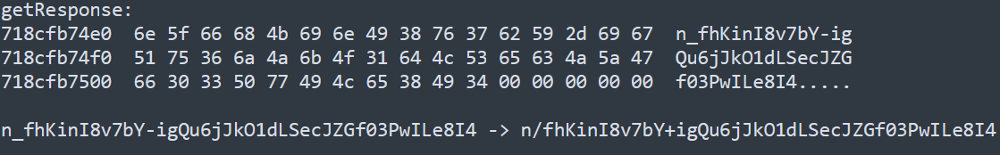

`n/fhKinI8v7bY+igQu6jJkO1dLSecJZGf03PwILe8I4`

<font style="background-color:#D8DAD9;">base64 decode</font>：

`9FF7E12A29C8F2FEDB63E8A042EEA32643B574B49E7096467F4DCFC082DEF08E`

<font style="background-color:#D8DAD9;">aes\_decrypt</font>：

aes\_key：只读数据：`0F2C496683A0BDDAF714314E6B88A5C2`

aes\_iv：只读数据：`11181F262D343B424950575E656C737A`

结果：`356F67777962306D617637327A373767356F336134623579333079316F36`

<font style="background-color:#D8DAD9;">key</font>：

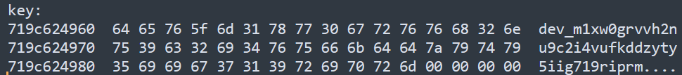

`6465765f6d317877306772767668326e7539633269347675666b64647a79747935696967373139726970726d`

<font style="background-color:#D8DAD9;">sub\_56e530</font>：

拼接后结果：`6465765f6d317877306772767668326e7539633269347675666b64647a79747935696967373139726970726d356F67777962306D617637327A373767356F336134623579333079316F36`

<font style="background-color:#D8DAD9;">sha256</font>：

`33FDED7D790EF4E7148257D6B7E820140330D6A8F39218E3E76EE2C26F2CF17B`

结果：

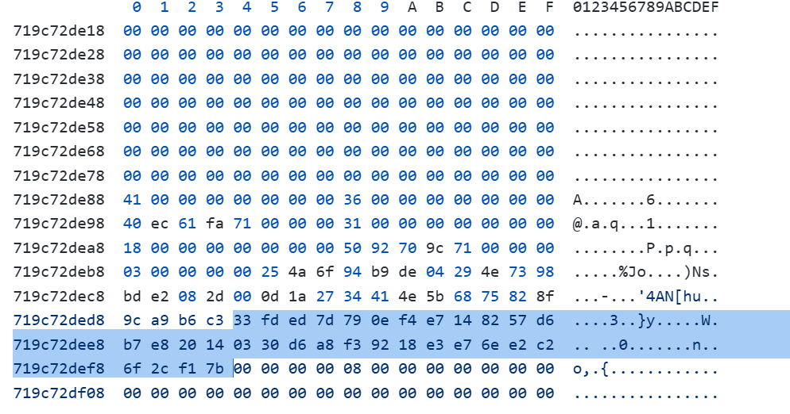

<font style="background-color:#D8DAD9;">sendAuthKeyInfo</font>：

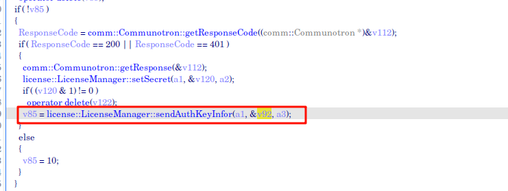

v92就是之前采集的设备信息，a1为【LicenseManager】，a3为<font style="background-color:#D8DAD9;">getDeviceInfo</font>保存的结果

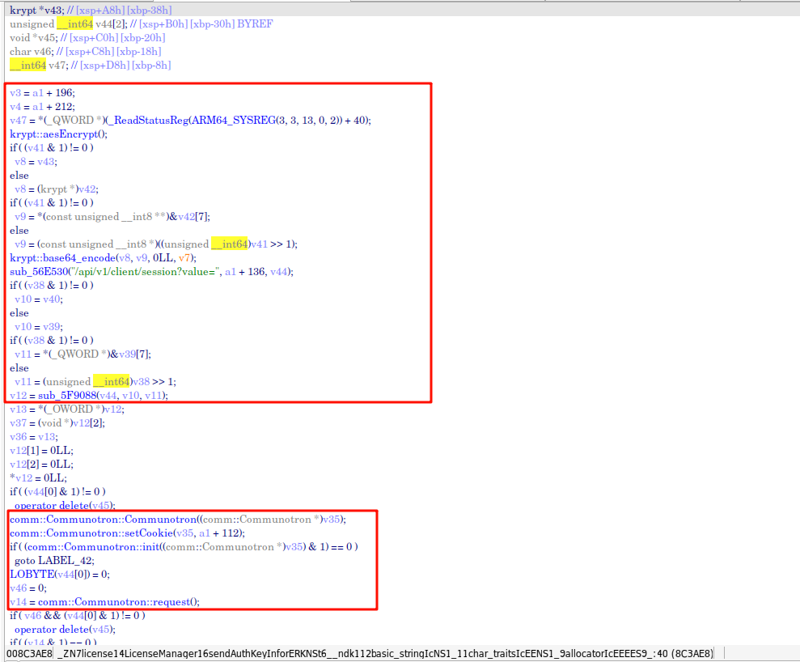

差不多的操作，拼接域名参数，设置cookie，请求request


请求request失败错误码：11，或者响应码不为200，401，错误码：10，或者seeso-code不为0，错误码即为seeso-code的值


接下来获取响应response，aes解密都一样的操作，aes\_key、aes\_iv即之前setSecret设置的

响应response解密后是这样：


校验结果  ||  android-id  ||  时间戳  ||  key类型


<font style="background-color:#D8DAD9;">checkCondition</font>参数：a1为【LicenseManager】、v30为响应体解密结果，a3为<font style="background-color:#D8DAD9;">getDeviceInfo</font>保存


<font style="background-color:#D8DAD9;">sub\_8C4614</font>传入响应体字符串，取出“||”前的第一个子字符串，功能大致这样，类似python的split

checkCondition就是取得响应体字符串各种校验


如果是true校验通过，否则返回错误码：8，invalid access


如果android-id相同，校验通过，否则返回错误码：8


校验时间戳，大于6天，返回错误码：12，系统时钟错误

<font style="background-color:#D8DAD9;">setLicenseTier</font>校验最后一个值key类型，然后赋值v4+104即【LicenseManager+104】,dev应该赋值为1


最后一个函数：


对【LicenseManager+64】值加锁，设置【LicenseManager】处值为1


<font style="background-color:#D8DAD9;">sub\_8C42D4</font>参数X0：v28地址，v28\[0]sendLog函数地址，X1：【LicenseManager】，X8：v28地址


<font style="background-color:#D8DAD9;">pthread\_create</font>

参数loc\_8C7558是start\_routine，待执行的函数

参数v7是函数的参数

<details>
<summary>hook代码</summary>
<div style="max-height: 400px; overflow-y: auto; padding: 0 10px;">

```javascript
Java.perform(function () {
    const pthread_create_addr = Module.findExportByName('libc.so', 'pthread_create');
    Interceptor.attach(pthread_create_addr, {
        onEnter: function (args) {
            // 参数：pthread_t *thread, const pthread_attr_t *attr, void *(*start_routine)(void*), void *arg
            var thread_ptr = args[0];
            var attr_ptr = args[1];
            var start_routine = args[2];
            var arg_ptr = args[3];
            // 获取调用者地址（LR寄存器）
            var caller_addr = this.context.lr;
            // 根据函数地址进行过滤
            var start_module = Process.findModuleByAddress(start_routine);
            var caller_module = Process.findModuleByAddress(caller_addr);
            var shouldHook = filterByAddress(start_routine, caller_addr);
            var a1 = null;

            if (shouldHook) {
                this.shouldLog = true;
                console.log("\n=== pthread_create called ===");
                console.log("Thread ptr: " + thread_ptr);
                console.log("Attr ptr: " + attr_ptr);
                console.log("Start routine: " + start_routine.sub(start_module.base));
                console.log("Arg ptr: " + arg_ptr + hexdump(arg_ptr));
                console.log("Caller address: " + caller_addr.sub(caller_module.base));
                Interceptor.attach(start_routine, {
                    onEnter: function (args) {
                        console.log(args[0]);
                        a1 = args[0].add(24).readPointer().sub(24);
                        console.log("start_routineonEnter:"+hexdump(a1, { length: 512 }))

                        const f0x8c49c4 = ptr(0x8c49c4).add(start_module.base);
                        Interceptor.attach(f0x8c49c4, {
                            onEnter: function (args) {
                                console.log("f0x8c49c4onEnter:"+hexdump(a1, { length: 512 }))
                            },
                            onLeave: function (retval) {
                                console.log("f0x8c49c4onLeave:"+hexdump(a1, { length: 512 }))
                            }
                        });

                    },
                    onLeave: function (retval) {
                        console.log(retval);
                        if (a1) {
                            console.log("start_routineonLeave:"+hexdump(a1, { length: 512 }))
                        }
                    }
                });

                

                // 打印调用栈
                // printBacktrace(caller_addr);
            } else {
                this.shouldLog = false;
            }
        },
        onLeave: function (retval) {
            if (this.shouldLog) {
                console.log("pthread_create returns: " + retval);
                console.log("=============================\n");
            }
        }
    });

    // 地址过滤函数
    function filterByAddress(start_routine, caller_addr) {
        // 方法1：过滤特定模块的线程创建
        var start_module = Process.findModuleByAddress(start_routine);
        var caller_module = Process.findModuleByAddress(caller_addr);
        // 示例：只hook来自特定模块的线程创建
        if (caller_module && caller_module.name.includes('libseeso_core_android.so')) {
            // return true;
        }
        // 示例：只hook执行特定模块代码的线程
        if (start_module && start_module.name.includes('libseeso_core_android.so')) {
            // return true;
        }

        // 方法2：过滤特定地址范围的线程
        // var target_start_min = ptr(0x1000);
        // var target_start_max = ptr(0x2000);
        // if (start_routine.compare(target_start_min) >= 0 && 
        //     start_routine.compare(target_start_max) <= 0) {
        //     return true;
        // }

        // 方法3：过滤调用者地址
        var caller_min = ptr(0x8C74DC).add(caller_module.base);
        var caller_max = ptr(0x8C74E4).add(caller_module.base);
        if (caller_addr.compare(caller_min) >= 0 &&
            caller_addr.compare(caller_max) <= 0) {
            return true;
        }

        // 默认不hook
        return false;
    }

    // 打印调用栈
    function printBacktrace(caller_addr) {
        try {
            console.log("Backtrace:");
            var backtrace = Thread.backtrace(this.context, 10);
            for (var i = 0; i < backtrace.length; i++) {
                var address = backtrace[i];
                var module = Process.findModuleByAddress(address);
                if (module) {
                    console.log(i + ": " + module.name + "+" + ptr(address).sub(module.base));
                } else {
                    console.log(i + ": " + address);
                }
            }
        } catch (e) {
            console.log("Error printing backtrace: " + e);
        }
    }
});
```
</div>
</details>

<details>
<summary>hook日志</summary>
<div style="max-height: 400px; overflow-y: auto; padding: 0 10px;">

```javascript
[Pixel::RgbTest ]->
=== pthread_create called ===
Thread ptr: 0x71fa6015f0
Attr ptr: 0x0
Start routine: 0x8c7558
Arg ptr: 0x719cb12840             0  1  2  3  4  5  6  7  8  9  A  B  C  D  E  F  0123456789ABCDEF
719cb12840  c8 15 60 fa 71 00 00 00 30 03 4e ae 71 00 00 00  ..`.q...0.N.q...
719cb12850  00 00 00 00 00 00 00 00 18 d4 72 9c 71 00 00 00  ..........r.q...
719cb12860  a0 2a 75 ae 71 00 00 00 80 28 b1 9c 71 00 00 00  .*u.q....(..q...
719cb12870  04 00 00 00 00 00 00 00 7f 80 00 00 00 00 00 00  ................
719cb12880  32 00 00 00 13 00 00 00 80 51 70 fa 71 00 00 00  2........Qp.q...
719cb12890  40 00 00 00 00 00 00 00 00 00 00 00 00 00 00 00  @...............
719cb128a0  c8 2a 75 ae 71 00 00 00 a0 27 b1 9c 71 00 00 00  .*u.q....'..q...
719cb128b0  00 00 00 00 00 00 00 00 00 00 00 00 00 00 00 00  ................
719cb128c0  10 00 00 00 13 00 00 00 e0 28 b1 9c 71 00 00 00  .........(..q...
719cb128d0  40 00 00 00 00 00 00 00 00 00 00 00 00 00 00 00  @...............
719cb128e0  41 6d 61 7a 6f 6e 20 52 6f 6f 74 20 43 41 20 31  Amazon Root CA 1
719cb128f0  00 00 00 00 00 00 00 00 60 2a b1 9c 71 00 00 00  ........`*..q...
719cb12900  63 6f 6e 73 6f 6c 65 2e 73 65 65 73 6f 2e 69 6f  console.seeso.io
719cb12910  00 00 00 00 00 00 00 00 00 00 00 00 00 00 00 00  ................
719cb12920  a0 28 b1 9c 71 00 00 00 00 26 b1 9c 71 00 00 00  .(..q....&..q...
719cb12930  00 27 b1 9c 71 00 00 00 00 00 00 00 00 00 00 00  .'..q...........
Caller address: 0x8c74e4
pthread_create returns: 0x0
=============================

0x719cb12840
start_routineonEnter:             0  1  2  3  4  5  6  7  8  9  A  B  C  D  E  F  0123456789ABCDEF
719c72d400  d8 d9 e7 f9 71 00 00 00 00 00 00 00 00 00 00 00  ....q...........
719c72d410  00 00 00 00 00 00 00 00 01 00 00 00 00 00 01 00  ................
719c72d420  f0 15 60 fa 71 00 00 00 00 00 00 00 00 00 00 00  ..`.q...........
719c72d430  00 00 00 00 00 00 00 00 00 00 00 00 00 00 00 00  ................
719c72d440  00 00 00 00 00 00 00 00 00 00 00 00 00 00 00 00  ................
719c72d450  00 00 00 00 00 00 00 00 00 00 00 00 00 00 00 00  ................
719c72d460  00 00 00 00 00 00 00 00 00 00 00 00 00 00 00 00  ................
719c72d470  00 00 00 00 00 00 00 00 00 00 00 00 00 00 00 00  ................
719c72d480  01 00 00 00 00 00 00 00 41 00 00 00 00 00 00 00  ........A.......
719c72d490  36 00 00 00 00 00 00 00 80 ec 61 fa 71 00 00 00  6.........a.q...
719c72d4a0  31 00 00 00 00 00 00 00 18 00 00 00 00 00 00 00  1...............
719c72d4b0  40 93 70 9c 71 00 00 00 03 00 00 00 00 25 4a 6f  @.p.q........%Jo
719c72d4c0  94 b9 de 04 29 4e 73 98 bd e2 08 2d 00 0d 1a 27  ....)Ns....-...'
719c72d4d0  34 41 4e 5b 68 75 82 8f 9c a9 b6 c3 48 e6 67 dd  4AN[hu......H.g.
719c72d4e0  be f3 2d b3 2e 71 7d d5 d6 9a bf ac d8 0a 28 a4  ..-..q}.......(.
719c72d4f0  50 d9 27 47 e1 fd 50 6e dc ae cc 72 00 00 00 00  P.'G..Pn...r....
719c72d500  08 00 00 00 00 00 00 00 00 00 00 00 00 00 00 00  ................
719c72d510  00 00 00 00 00 00 00 00 00 00 00 00 00 00 00 00  ................
719c72d520  60 43 a3 f2 71 00 00 00 00 00 00 00 00 00 00 00  `C..q...........
719c72d530  03 00 00 00 00 00 00 00 00 00 00 00 00 00 00 00  ................
719c72d540  80 65 a3 f2 71 00 00 00 00 00 00 00 1c 08 01 00  .e..q...........
719c72d550  03 00 00 00 01 00 00 00 00 00 00 00 00 10 00 00  ................
719c72d560  00 40 00 00 00 00 00 00 00 40 00 00 00 00 00 00  .@.......@......
719c72d570  01 00 00 00 00 00 00 00 00 a0 bc ff 07 00 00 00  ................
719c72d580  00 a0 bc ff 07 00 00 00 00 40 00 00 00 00 00 00  .........@......
719c72d590  00 10 0c 10 00 00 00 00 10 c5 b6 9c 71 00 00 00  ............q...
719c72d5a0  00 10 0c 00 00 00 00 00 08 00 00 00 00 00 00 00  ................
719c72d5b0  c0 d4 7d fa 71 00 00 00 01 00 00 00 2d 65 00 00  ..}.q.......-e..
719c72d5c0  00 00 00 00 00 00 00 00 00 00 00 00 00 00 00 00  ................
719c72d5d0  00 00 00 00 00 00 00 00 00 00 00 00 00 00 00 00  ................
719c72d5e0  00 00 00 00 00 00 00 00 00 00 00 00 00 00 00 00  ................
719c72d5f0  00 00 00 00 00 00 00 00 00 00 00 00 00 00 00 00  ................
f0x8c49c4onEnter:             0  1  2  3  4  5  6  7  8  9  A  B  C  D  E  F  0123456789ABCDEF
719c72d400  00 33 6f fa 71 00 00 00 00 78 61 fa 71 00 00 00  .3o.q....xa.q...
719c72d410  00 00 00 00 00 00 00 00 01 01 00 00 00 00 01 00  ................
719c72d420  f0 15 60 fa 71 00 00 00 00 00 00 00 00 00 00 00  ..`.q...........
719c72d430  00 00 00 00 00 00 00 00 00 00 00 00 00 00 00 00  ................
719c72d440  00 00 00 00 00 00 00 00 00 00 00 00 00 00 00 00  ................
719c72d450  00 00 00 00 00 00 00 00 00 00 00 00 00 00 00 00  ................
719c72d460  00 00 00 00 00 00 00 00 00 00 00 00 00 00 00 00  ................
719c72d470  00 00 00 00 00 00 00 00 00 00 00 00 00 00 00 00  ................
719c72d480  01 00 00 00 00 00 00 00 41 00 00 00 00 00 00 00  ........A.......
719c72d490  36 00 00 00 00 00 00 00 80 ec 61 fa 71 00 00 00  6.........a.q...
719c72d4a0  31 00 00 00 00 00 00 00 18 00 00 00 00 00 00 00  1...............
719c72d4b0  40 93 70 9c 71 00 00 00 03 00 00 00 00 25 4a 6f  @.p.q........%Jo
719c72d4c0  94 b9 de 04 29 4e 73 98 bd e2 08 2d 00 0d 1a 27  ....)Ns....-...'
719c72d4d0  34 41 4e 5b 68 75 82 8f 9c a9 b6 c3 48 e6 67 dd  4AN[hu......H.g.
719c72d4e0  be f3 2d b3 2e 71 7d d5 d6 9a bf ac d8 0a 28 a4  ..-..q}.......(.
719c72d4f0  50 d9 27 47 e1 fd 50 6e dc ae cc 72 00 00 00 00  P.'G..Pn...r....
719c72d500  00 00 00 00 00 00 00 00 00 00 00 00 00 00 00 00  ................
719c72d510  00 00 00 00 00 00 00 00 01 01 01 00 00 00 00 00  ................
719c72d520  60 43 a3 f2 71 00 00 00 00 00 00 00 00 00 00 00  `C..q...........
719c72d530  03 00 00 00 00 00 00 00 00 00 00 00 00 00 00 00  ................
719c72d540  80 65 a3 f2 71 00 00 00 00 00 00 00 1c 08 01 00  .e..q...........
719c72d550  03 00 00 00 01 00 00 00 00 00 00 00 00 10 00 00  ................
719c72d560  00 40 00 00 00 00 00 00 00 40 00 00 00 00 00 00  .@.......@......
719c72d570  01 00 00 00 00 00 00 00 00 a0 bc ff 07 00 00 00  ................
719c72d580  00 a0 bc ff 07 00 00 00 00 40 00 00 00 00 00 00  .........@......
719c72d590  00 10 0c 10 00 00 00 00 10 c5 b6 9c 71 00 00 00  ............q...
719c72d5a0  00 10 0c 00 00 00 00 00 08 00 00 00 00 00 00 00  ................
719c72d5b0  c0 d4 7d fa 71 00 00 00 01 00 00 00 2e 65 00 00  ..}.q........e..
719c72d5c0  00 00 00 00 00 00 00 00 00 00 00 00 00 00 00 00  ................
719c72d5d0  00 00 00 00 00 00 00 00 00 00 00 00 00 00 00 00  ................
719c72d5e0  00 00 00 00 00 00 00 00 00 00 00 00 00 00 00 00  ................
719c72d5f0  00 00 00 00 00 00 00 00 00 00 00 00 00 00 00 00  ................
f0x8c49c4onLeave:             0  1  2  3  4  5  6  7  8  9  A  B  C  D  E  F  0123456789ABCDEF
719c72d400  00 33 6f fa 71 00 00 00 00 78 61 fa 71 00 00 00  .3o.q....xa.q...
719c72d410  0e 01 00 00 00 00 00 00 01 01 00 00 00 00 01 00  ................
719c72d420  f0 15 60 fa 71 00 00 00 00 00 00 00 00 00 00 00  ..`.q...........
719c72d430  00 00 00 00 00 00 00 00 00 00 00 00 00 00 00 00  ................
719c72d440  00 00 00 00 00 00 00 00 00 00 00 00 00 00 00 00  ................
719c72d450  00 00 00 00 00 00 00 00 00 00 00 00 00 00 00 00  ................
719c72d460  00 00 00 00 00 00 00 00 00 00 00 00 00 00 00 00  ................
719c72d470  00 00 00 00 00 00 00 00 00 00 00 00 00 00 00 00  ................
719c72d480  01 00 00 00 00 00 00 00 41 00 00 00 00 00 00 00  ........A.......
719c72d490  36 00 00 00 00 00 00 00 80 ec 61 fa 71 00 00 00  6.........a.q...
719c72d4a0  31 00 00 00 00 00 00 00 18 00 00 00 00 00 00 00  1...............
719c72d4b0  40 93 70 9c 71 00 00 00 03 00 00 00 00 25 4a 6f  @.p.q........%Jo
719c72d4c0  94 b9 de 04 29 4e 73 98 bd e2 08 2d 00 0d 1a 27  ....)Ns....-...'
719c72d4d0  34 41 4e 5b 68 75 82 8f 9c a9 b6 c3 48 e6 67 dd  4AN[hu......H.g.
719c72d4e0  be f3 2d b3 2e 71 7d d5 d6 9a bf ac d8 0a 28 a4  ..-..q}.......(.
719c72d4f0  50 d9 27 47 e1 fd 50 6e dc ae cc 72 00 00 00 00  P.'G..Pn...r....
719c72d500  00 00 00 00 00 00 00 00 d8 35 7c fa 71 00 00 00  .........5|.q...
719c72d510  c0 35 7c fa 71 00 00 00 01 01 01 00 00 00 00 00  .5|.q...........
719c72d520  60 43 a3 f2 71 00 00 00 00 00 00 00 00 00 00 00  `C..q...........
719c72d530  03 00 00 00 00 00 00 00 00 00 00 00 00 00 00 00  ................
719c72d540  80 65 a3 f2 71 00 00 00 00 00 00 00 1c 08 01 00  .e..q...........
719c72d550  03 00 00 00 01 00 00 00 00 00 00 00 00 10 00 00  ................
719c72d560  00 40 00 00 00 00 00 00 00 40 00 00 00 00 00 00  .@.......@......
719c72d570  01 00 00 00 00 00 00 00 00 a0 bc ff 07 00 00 00  ................
719c72d580  00 a0 bc ff 07 00 00 00 00 40 00 00 00 00 00 00  .........@......
719c72d590  00 10 0c 10 00 00 00 00 10 c5 b6 9c 71 00 00 00  ............q...
719c72d5a0  00 10 0c 00 00 00 00 00 08 00 00 00 00 00 00 00  ................
719c72d5b0  c0 d4 7d fa 71 00 00 00 01 00 00 00 39 65 00 00  ..}.q.......9e..
719c72d5c0  00 00 00 00 00 00 00 00 00 00 00 00 00 00 00 00  ................
719c72d5d0  00 00 00 00 00 00 00 00 00 00 00 00 00 00 00 00  ................
719c72d5e0  00 00 00 00 00 00 00 00 00 00 00 00 00 00 00 00  ................
719c72d5f0  00 00 00 00 00 00 00 00 00 00 00 00 00 00 00 00  ................

```
</div>
</details>

在0x8C7554按e结束函数，直接识别出<font style="background-color:#D8DAD9;">sub\_8C7558</font>函数


关键在v5(v6)，即执行sendLog，参数为【LicenseManager】


<font style="background-color:#D8DAD9;">sub\_8C45D0</font>：a1+8即【LicenseManager+8】，存放线程id，pthread\_id


<font style="background-color:#D8DAD9;">sendLog</font>携带cookie，发送alive包


总体流程：

<details>
<summary>hook代码</summary>
<div style="max-height: 400px; overflow-y: auto; padding: 0 10px;">

```javascript
Java.perform(function () {
    function replace_key_java_nativewrapper() {
        let NativeWrapper = Java.use("camp.visual.libgaze.jni.NativeWrapper");
        NativeWrapper["nativeInitWrapper"].implementation = function (context, str, iArr, i, z, jNICallbackDispatcher) {
            let new_key = "dev_m1xw0grvvh2nu9c2i4vufkddzyty5iig719riprm";
            console.log('nativeInitWrapper is called' + ', ' + 'context: ' + context + ', ' + 'new_key: ' + new_key + ', ' + 'iArr: ' + iArr + ', ' + 'i: ' + i + ', ' + 'z: ' + z + ', ' + 'jNICallbackDispatcher: ' + jNICallbackDispatcher);
            let ret = this.nativeInitWrapper(context, new_key, iArr, i, z, jNICallbackDispatcher);
            console.log('nativeInitWrapper ret value is ' + ret);
            return ret;
        };
    }
    function print_arg(addr, hx_length = null, hx_ansi = null) {
        var hx_args = {};
        if (hx_length != null) {
            hx_args["length"] = hx_length;
        }
        if (hx_ansi != null) {
            hx_args["ansi"] = hx_ansi;
        }
        try {
            var module = Process.findRangeByAddress(addr);
            if (module != null) {
                return "\n" + hexdump(addr, hx_args) + "\n\n";
            }
            return ptr(addr) + "\n\n";
        } catch (e) {
            return addr + "\n\n";
        }
    }
    function get_license_manager_info() {
        return "LicenseManager:" + LicenseManager + print_arg(LicenseManager, 512, true);
    }
    function hook_native_addr(funcPtr, registers, returnAddrs = null, logtag = null) {
        var module = Process.findModuleByAddress(funcPtr);
        Interceptor.attach(funcPtr, {
            onEnter: function (args) {
                this.logs = "";
                this.registers = {};
                this.trueReturnAddr = this.context["lr"].sub(module.base);
                this.returnCheck = false;
                this.is8c3530 = ptr(funcPtr).sub(module.base).compare(ptr(0x8c3530)) === 0 ? true : false;
                if (returnAddrs) {
                    for (let i = 0; i < returnAddrs.length; i++) {
                        if (this.trueReturnAddr.compare(returnAddrs[i]) === 0) {
                            this.returnCheck = true;
                            break;
                        }
                    }
                } else {
                    this.returnCheck = true;
                }
                if (!this.returnCheck) {
                    return
                }
                registers.forEach(element => {
                    var regName = element;
                    var regValue = this.context[regName];
                    this.registers[regName] = regValue;
                });
                this.logs = this.logs.concat("So: " + module.name + ":" + module.base + "  methodOffset: " + ptr(funcPtr).sub(module.base) + "  trueReturnAddr:" + this.trueReturnAddr + "\n");
                if (logtag) {
                    this.logs = this.logs.concat(logtag + " trueReturnAddr:" + this.trueReturnAddr + " onEnter");
                    this.logs = this.logs.concat("==============================" + "\n");
                }
                for (let regName in this.registers) {
                    if (this.registers.hasOwnProperty(regName)) {
                        var regValue = this.registers[regName];
                        this.logs = this.logs.concat(regName + " onEnter: " + regValue + print_arg(regValue));
                        this.logs = this.logs.concat(regName + " onEnter: +16" + regValue + print_arg(regValue.add(16).readPointer()));
                        if (regName === "x0" && logtag.indexOf("getLicenseInformationInternal(a1, a2, a3, a4, a5, a6, v19, a8)") != -1) {
                            LicenseManager = regValue.sub(24);
                        }
                    }
                }
                if (LicenseManager) {
                    this.logs = this.logs.concat("OnEnter" + get_license_manager_info());
                }
            },
            onLeave: function (retval) {
                if (!this.returnCheck) {
                    return
                }
                if (logtag) {
                    this.logs = this.logs.concat(logtag + " trueReturnAddr:" + this.trueReturnAddr + " onLeave");
                    this.logs = this.logs.concat("==============================" + "\n");
                }
                for (let regName in this.registers) {
                    if (this.registers.hasOwnProperty(regName)) {
                        var regValue = this.registers[regName];
                        this.logs = this.logs.concat(regName + " onLeave: " + regValue + print_arg(regValue));
                        this.logs = this.logs.concat(regName + " onLeave: +16" + regValue + print_arg(regValue.add(16).readPointer()));
                    }
                }
                if (LicenseManager) {
                    this.logs = this.logs.concat("OnLeave" + get_license_manager_info());
                }
                this.logs = this.logs.concat("retval onLeave: " + retval + print_arg(retval));
                if (this.is8c3530) {
                    var newRetval = ptr(0);
                    Memory.protect(retval, Process.pointerSize, 'rw');
                    retval.replace(newRetval);
                    console.log("retval replace to newRetval 0");
                }
                console.log(this.logs);
            }
        });
    }

    var LicenseManager = null;
    const registers = {
        0: "x0", 1: "x1", 2: "x2", 3: "x3", 4: "x4", 5: "x5",
        6: "x6", 7: "x7", 8: "x8", 9: "x9", 10: "x10", 11: "x11",
        12: "x12", 13: "x13", 14: "x14", 15: "x15", 16: "x16",
        17: "x17", 18: "x18", 19: "x19", 20: "x20", 21: "x21",
        22: "x22", 23: "x23", 24: "x24", 25: "x25", 26: "x26",
        27: "x27", 28: "x28",
        29: "fp",
        30: "lr",
        31: "sp",
    };
    replace_key_java_nativewrapper();

    hook_native_addr(
        Module.findBaseAddress("libseeso_core_android.so").add(0x8c1d18),
        [registers[0], registers[1], registers[2]],
        [ptr(0x8c1b34)],
        "LODWORD(StatusReg) = license::LicenseManager::getLicenseInformationInternal(a1, a2, a3, a4, a5, a6, v19, a8);"
    );

    hook_native_addr(
        Module.findBaseAddress("libseeso_core_android.so").add(0x8cb6cc),
        [registers[2]],
        [ptr(0x8c21a8), ptr(0x8c3c04)],
        "v80 = comm::Communotron::request(&v112, 0LL, &v114, &v120);"
    );

    hook_native_addr(
        Module.findBaseAddress("libseeso_core_android.so").add(0x8c3530),
        [registers[0]],
        [ptr(0x8c23a4), ptr(0x8c3c50)],
        "v85 = sub_8C3530(&v120);"
    );

    hook_native_addr(
        Module.findBaseAddress("libseeso_core_android.so").add(0x8c36d0),
        [registers[1], registers[2]],
        [ptr(0x8c23f8)],
        "license::LicenseManager::setSecret(a1, &v120, a2);"
    );

    hook_native_addr(
        Module.findBaseAddress("libseeso_core_android.so").add(0x8c3ae8),
        [registers[1], registers[2]],
        [ptr(0x8c2418)],
        "v85 = license::LicenseManager::sendAuthKeyInfor(a1, &v92, a3);"
    );

    hook_native_addr(
        Module.findBaseAddress("libseeso_core_android.so").add(0x8cb6ac),
        [registers[0], registers[8]],
        [ptr(0x8c3c7c)],
        "comm::Communotron::getResponse(v35);"
    );

    hook_native_addr(
        Module.findBaseAddress("libseeso_core_android.so").add(0x8c7cf0),
        [registers[0], registers[1], registers[2], registers[8]],
        [ptr(0x8c3cb0)],
        "krypt::aesDecrypt(v44, v3, v4);"
    );

    hook_native_addr(
        Module.findBaseAddress("libseeso_core_android.so").add(0x8c3fd4),
        [registers[1], registers[2]],
        [ptr(0x8c3e20)],
        "v16 = license::LicenseManager::checkCondition(a1, v30, a3);"
    );

    // hook_native_addr(
    //     Module.findBaseAddress("libseeso_core_android.so").add(0x8c4614),
    //     [registers[0], registers[1], registers[8]],
    //     null,
    //     "sub_8C4614(&v33);"
    // );

    hook_native_addr(
        Module.findBaseAddress("libseeso_core_android.so").add(0x8c45d0),
        [registers[1]],
        [ptr(0x8c3e80)],
        "sub_8C45D0(a1 + 8, v29);"
    );
});   
```
</div>
</details>

<details>
<summary>hook日志</summary>
<div style="max-height: 400px; overflow-y: auto; padding: 0 10px;">

```bash
[Pixel::RgbTest ]-> nativeInitWrapper is called, context: android.app.Application@94fbba4, new_key: dev_m1xw0grvvh2nu9c2i4vufkddzyty5iig719riprm, iArr: 1,2,3, i: 3, z: false, jNICallbackDispatcher: camp.visual.libgaze.callbacks.JNICallbackDispatcher@6f70d0d
So: libseeso_core_android.so:0x71978a3000  methodOffset: 0x8cb6cc  trueReturnAddr:0x8c21a8
v80 = comm::Communotron::request(&v112, 0LL, &v114, &v120); trueReturnAddr:0x8c21a8 onEnter==============================
x2 onEnter: 0x71b1111f80
             0  1  2  3  4  5  6  7  8  9  A  B  C  D  E  F  0123456789ABCDEF
71b1111f80  41 01 00 00 00 00 00 00 38 01 00 00 00 00 00 00  A.......8.......
71b1111f90  c0 6f 76 8f 72 00 00 00 d6 c1 62 ca d6 c1 62 ca  .ov.r.....b...b.
71b1111fa0  81 01 00 00 00 00 00 00 00 01 00 00 00 00 00 00  ................
71b1111fb0  80 f7 6a ff 71 00 00 00 31 46 d4 be 7e 85 3d 6f  ..j.q...1F..~.=o
71b1111fc0  d1 00 00 00 00 00 00 00 c0 00 00 00 00 00 00 00  ................
71b1111fd0  60 ae eb f9 71 00 00 00 00 00 00 00 00 00 00 00  `...q...........
71b1111fe0  00 00 00 00 00 00 00 00 00 00 00 00 00 00 00 00  ................
71b1111ff0  00 03 00 00 00 00 00 00 94 06 00 00 00 00 00 00  ................
71b1112000  37 f4 4a b4 74 be 92 76 35 03 00 00 00 00 00 00  7.J.t..v5.......
71b1112010  b0 20 11 b1 71 00 00 00 0c f9 7f 02 72 00 00 00  . ..q.......r...
71b1112020  42 6e ab 97 71 00 00 00 77 65 d6 97 71 00 00 00  Bn..q...we..q...
71b1112030  01 00 00 00 00 00 00 00 98 6e 76 8f 72 00 00 00  .........nv.r...
71b1112040  b8 35 11 b1 71 00 00 00 d0 35 11 b1 71 00 00 00  .5..q....5..q...
71b1112050  e8 35 11 b1 71 00 00 00 00 36 11 b1 71 00 00 00  .5..q....6..q...
71b1112060  01 00 00 00 00 00 00 00 20 a0 11 b1 71 00 00 00  ........ ...q...
71b1112070  20 a0 11 b1 71 00 00 00 20 a0 11 b1 71 00 00 00   ...q... ...q...

x2 onEnter: +160x71b1111f80
             0  1  2  3  4  5  6  7  8  9  A  B  C  D  E  F  0123456789ABCDEF
728f766fc0  68 74 74 70 73 3a 2f 2f 63 6f 6e 73 6f 6c 65 2e  https://console.
728f766fd0  73 65 65 73 6f 2e 69 6f 2f 61 70 69 2f 76 31 2f  seeso.io/api/v1/
728f766fe0  63 6c 69 65 6e 74 2f 76 61 6c 69 64 61 74 69 6f  client/validatio
728f766ff0  6e 3f 76 61 6c 75 65 3d 6b 6d 48 50 6f 45 54 4d  n?value=kmHPoETM
728f767000  69 66 38 54 49 66 63 67 4d 65 53 4a 57 75 5f 5a  if8TIfcgMeSJWu_Z
728f767010  6e 63 73 7a 54 45 45 39 4a 5a 69 66 2d 73 56 50  ncszTEE9JZif-sVP
728f767020  37 36 6f 45 33 41 4a 47 4c 35 39 33 50 72 6b 70  76oE3AJGL593Prkp
728f767030  75 79 41 42 2d 36 48 37 67 6c 6c 6b 77 32 36 74  uyAB-6H7gllkw26t
728f767040  73 37 52 36 5f 5a 56 68 4b 53 67 4a 31 35 47 71  s7R6_ZVhKSgJ15Gq
728f767050  4b 34 6a 5f 78 7a 43 4d 45 56 34 36 65 70 32 48  K4j_xzCMEV46ep2H
728f767060  6f 35 69 43 6e 77 38 6c 61 70 6c 37 57 39 6a 47  o5iCnw8lapl7W9jG
728f767070  6e 79 30 53 55 4d 54 71 7a 38 56 56 4f 49 67 46  ny0SUMTqz8VVOIgF
728f767080  70 6c 36 52 41 74 67 50 76 6d 58 61 59 59 38 54  pl6RAtgPvmXaYY8T
728f767090  37 4b 61 39 43 44 57 36 6e 78 2d 43 67 55 79 46  7Ka9CDW6nx-CgUyF
728f7670a0  63 48 74 6d 69 5f 49 4f 5a 6c 59 47 70 65 77 36  cHtmi_IOZlYGpew6
728f7670b0  78 79 63 34 4a 59 34 61 65 6f 70 41 46 57 75 79  xyc4JY4aeopAFWuy

OnEnterLicenseManager:0x728f766e80
             0  1  2  3  4  5  6  7  8  9  A  B  C  D  E  F  0123456789ABCDEF
728f766e80  28 da e7 f9 71 00 00 00 00 00 00 00 00 00 00 00  (...q...........
728f766e90  00 00 00 00 72 00 00 00 00 00 00 00 71 00 00 00  ....r.......q...
728f766ea0  00 00 00 00 00 00 00 00 00 00 00 00 00 00 00 00  ................
728f766eb0  00 00 00 00 00 00 00 00 00 00 00 00 00 00 00 00  ................
728f766ec0  00 00 00 00 00 00 00 00 00 00 00 00 00 00 00 00  ................
728f766ed0  00 00 00 00 00 00 00 00 00 00 00 00 00 00 00 00  ................
728f766ee0  00 00 00 00 00 00 00 00 00 00 00 00 00 00 00 00  ................
728f766ef0  00 00 00 00 00 00 00 00 00 00 00 00 00 00 00 00  ................
728f766f00  00 00 00 00 00 00 00 00 00 00 00 00 00 00 00 00  ................
728f766f10  00 00 00 00 00 00 00 00 00 00 00 00 00 00 00 00  ................
728f766f20  31 00 00 00 00 00 00 00 18 00 00 00 00 00 00 00  1...............
728f766f30  20 f3 6c ff 71 00 00 00 03 00 00 00 00 25 4a 6f   .l.q........%Jo
728f766f40  94 b9 de 04 29 4e 73 98 bd e2 08 2d 00 0d 1a 27  ....)Ns....-...'
728f766f50  34 41 4e 5b 68 75 82 8f 9c a9 b6 c3 71 00 00 00  4AN[hu......q...
728f766f60  00 10 00 00 00 00 00 00 a0 56 7d 0a 72 00 00 00  .........V}.r...
728f766f70  00 00 00 00 00 00 00 00 00 00 00 00 00 00 00 00  ................
728f766f80  08 00 00 00 00 00 00 00 00 00 00 00 00 00 00 00  ................
728f766f90  00 00 00 00 00 00 00 00 00 00 00 70 00 00 00 00  ...........p....
728f766fa0  10 88 8a 70 00 00 00 00 6c 88 8a 70 00 00 00 00  ...p....l..p....
728f766fb0  70 88 8a 70 00 00 00 00 74 88 8a 70 00 00 00 00  p..p....t..p....
728f766fc0  68 74 74 70 73 3a 2f 2f 63 6f 6e 73 6f 6c 65 2e  https://console.
728f766fd0  73 65 65 73 6f 2e 69 6f 2f 61 70 69 2f 76 31 2f  seeso.io/api/v1/
728f766fe0  63 6c 69 65 6e 74 2f 76 61 6c 69 64 61 74 69 6f  client/validatio
728f766ff0  6e 3f 76 61 6c 75 65 3d 6b 6d 48 50 6f 45 54 4d  n?value=kmHPoETM
728f767000  69 66 38 54 49 66 63 67 4d 65 53 4a 57 75 5f 5a  if8TIfcgMeSJWu_Z
728f767010  6e 63 73 7a 54 45 45 39 4a 5a 69 66 2d 73 56 50  ncszTEE9JZif-sVP
728f767020  37 36 6f 45 33 41 4a 47 4c 35 39 33 50 72 6b 70  76oE3AJGL593Prkp
728f767030  75 79 41 42 2d 36 48 37 67 6c 6c 6b 77 32 36 74  uyAB-6H7gllkw26t
728f767040  73 37 52 36 5f 5a 56 68 4b 53 67 4a 31 35 47 71  s7R6_ZVhKSgJ15Gq
728f767050  4b 34 6a 5f 78 7a 43 4d 45 56 34 36 65 70 32 48  K4j_xzCMEV46ep2H
728f767060  6f 35 69 43 6e 77 38 6c 61 70 6c 37 57 39 6a 47  o5iCnw8lapl7W9jG
728f767070  6e 79 30 53 55 4d 54 71 7a 38 56 56 4f 49 67 46  ny0SUMTqz8VVOIgF

v80 = comm::Communotron::request(&v112, 0LL, &v114, &v120); trueReturnAddr:0x8c21a8 onLeave==============================
x2 onLeave: 0x71b1111f80
             0  1  2  3  4  5  6  7  8  9  A  B  C  D  E  F  0123456789ABCDEF
71b1111f80  41 01 00 00 00 00 00 00 38 01 00 00 00 00 00 00  A.......8.......
71b1111f90  c0 6f 76 8f 72 00 00 00 d6 c1 62 ca d6 c1 62 ca  .ov.r.....b...b.
71b1111fa0  81 01 00 00 00 00 00 00 00 01 00 00 00 00 00 00  ................
71b1111fb0  80 f7 6a ff 71 00 00 00 31 46 d4 be 7e 85 3d 6f  ..j.q...1F..~.=o
71b1111fc0  d1 00 00 00 00 00 00 00 c0 00 00 00 00 00 00 00  ................
71b1111fd0  60 ae eb f9 71 00 00 00 00 00 00 00 00 00 00 00  `...q...........
71b1111fe0  00 00 00 00 00 00 00 00 00 00 00 00 00 00 00 00  ................
71b1111ff0  00 03 00 00 00 00 00 00 94 06 00 00 00 00 00 00  ................
71b1112000  37 f4 4a b4 74 be 92 76 35 03 00 00 00 00 00 00  7.J.t..v5.......
71b1112010  b0 20 11 b1 71 00 00 00 0c f9 7f 02 72 00 00 00  . ..q.......r...
71b1112020  42 6e ab 97 71 00 00 00 77 65 d6 97 71 00 00 00  Bn..q...we..q...
71b1112030  01 00 00 00 00 00 00 00 98 6e 76 8f 72 00 00 00  .........nv.r...
71b1112040  b8 35 11 b1 71 00 00 00 d0 35 11 b1 71 00 00 00  .5..q....5..q...
71b1112050  e8 35 11 b1 71 00 00 00 00 36 11 b1 71 00 00 00  .5..q....6..q...
71b1112060  01 00 00 00 00 00 00 00 20 a0 11 b1 71 00 00 00  ........ ...q...
71b1112070  20 a0 11 b1 71 00 00 00 20 a0 11 b1 71 00 00 00   ...q... ...q...

x2 onLeave: +160x71b1111f80
             0  1  2  3  4  5  6  7  8  9  A  B  C  D  E  F  0123456789ABCDEF
728f766fc0  68 74 74 70 73 3a 2f 2f 63 6f 6e 73 6f 6c 65 2e  https://console.
728f766fd0  73 65 65 73 6f 2e 69 6f 2f 61 70 69 2f 76 31 2f  seeso.io/api/v1/
728f766fe0  63 6c 69 65 6e 74 2f 76 61 6c 69 64 61 74 69 6f  client/validatio
728f766ff0  6e 3f 76 61 6c 75 65 3d 6b 6d 48 50 6f 45 54 4d  n?value=kmHPoETM
728f767000  69 66 38 54 49 66 63 67 4d 65 53 4a 57 75 5f 5a  if8TIfcgMeSJWu_Z
728f767010  6e 63 73 7a 54 45 45 39 4a 5a 69 66 2d 73 56 50  ncszTEE9JZif-sVP
728f767020  37 36 6f 45 33 41 4a 47 4c 35 39 33 50 72 6b 70  76oE3AJGL593Prkp
728f767030  75 79 41 42 2d 36 48 37 67 6c 6c 6b 77 32 36 74  uyAB-6H7gllkw26t
728f767040  73 37 52 36 5f 5a 56 68 4b 53 67 4a 31 35 47 71  s7R6_ZVhKSgJ15Gq
728f767050  4b 34 6a 5f 78 7a 43 4d 45 56 34 36 65 70 32 48  K4j_xzCMEV46ep2H
728f767060  6f 35 69 43 6e 77 38 6c 61 70 6c 37 57 39 6a 47  o5iCnw8lapl7W9jG
728f767070  6e 79 30 53 55 4d 54 71 7a 38 56 56 4f 49 67 46  ny0SUMTqz8VVOIgF
728f767080  70 6c 36 52 41 74 67 50 76 6d 58 61 59 59 38 54  pl6RAtgPvmXaYY8T
728f767090  37 4b 61 39 43 44 57 36 6e 78 2d 43 67 55 79 46  7Ka9CDW6nx-CgUyF
728f7670a0  63 48 74 6d 69 5f 49 4f 5a 6c 59 47 70 65 77 36  cHtmi_IOZlYGpew6
728f7670b0  78 79 63 34 4a 59 34 61 65 6f 70 41 46 57 75 79  xyc4JY4aeopAFWuy

OnLeaveLicenseManager:0x728f766e80
             0  1  2  3  4  5  6  7  8  9  A  B  C  D  E  F  0123456789ABCDEF
728f766e80  28 da e7 f9 71 00 00 00 00 00 00 00 00 00 00 00  (...q...........
728f766e90  00 00 00 00 72 00 00 00 00 00 00 00 71 00 00 00  ....r.......q...
728f766ea0  00 00 00 00 00 00 00 00 00 00 00 00 00 00 00 00  ................
728f766eb0  00 00 00 00 00 00 00 00 00 00 00 00 00 00 00 00  ................
728f766ec0  00 00 00 00 00 00 00 00 00 00 00 00 00 00 00 00  ................
728f766ed0  00 00 00 00 00 00 00 00 00 00 00 00 00 00 00 00  ................
728f766ee0  00 00 00 00 00 00 00 00 00 00 00 00 00 00 00 00  ................
728f766ef0  00 00 00 00 00 00 00 00 00 00 00 00 00 00 00 00  ................
728f766f00  00 00 00 00 00 00 00 00 00 00 00 00 00 00 00 00  ................
728f766f10  00 00 00 00 00 00 00 00 00 00 00 00 00 00 00 00  ................
728f766f20  31 00 00 00 00 00 00 00 18 00 00 00 00 00 00 00  1...............
728f766f30  20 f3 6c ff 71 00 00 00 03 00 00 00 00 25 4a 6f   .l.q........%Jo
728f766f40  94 b9 de 04 29 4e 73 98 bd e2 08 2d 00 0d 1a 27  ....)Ns....-...'
728f766f50  34 41 4e 5b 68 75 82 8f 9c a9 b6 c3 71 00 00 00  4AN[hu......q...
728f766f60  00 10 00 00 00 00 00 00 a0 56 7d 0a 72 00 00 00  .........V}.r...
728f766f70  00 00 00 00 00 00 00 00 00 00 00 00 00 00 00 00  ................
728f766f80  08 00 00 00 00 00 00 00 00 00 00 00 00 00 00 00  ................
728f766f90  00 00 00 00 00 00 00 00 00 00 00 70 00 00 00 00  ...........p....
728f766fa0  10 88 8a 70 00 00 00 00 6c 88 8a 70 00 00 00 00  ...p....l..p....
728f766fb0  70 88 8a 70 00 00 00 00 74 88 8a 70 00 00 00 00  p..p....t..p....
728f766fc0  68 74 74 70 73 3a 2f 2f 63 6f 6e 73 6f 6c 65 2e  https://console.
728f766fd0  73 65 65 73 6f 2e 69 6f 2f 61 70 69 2f 76 31 2f  seeso.io/api/v1/
728f766fe0  63 6c 69 65 6e 74 2f 76 61 6c 69 64 61 74 69 6f  client/validatio
728f766ff0  6e 3f 76 61 6c 75 65 3d 6b 6d 48 50 6f 45 54 4d  n?value=kmHPoETM
728f767000  69 66 38 54 49 66 63 67 4d 65 53 4a 57 75 5f 5a  if8TIfcgMeSJWu_Z
728f767010  6e 63 73 7a 54 45 45 39 4a 5a 69 66 2d 73 56 50  ncszTEE9JZif-sVP
728f767020  37 36 6f 45 33 41 4a 47 4c 35 39 33 50 72 6b 70  76oE3AJGL593Prkp
728f767030  75 79 41 42 2d 36 48 37 67 6c 6c 6b 77 32 36 74  uyAB-6H7gllkw26t
728f767040  73 37 52 36 5f 5a 56 68 4b 53 67 4a 31 35 47 71  s7R6_ZVhKSgJ15Gq
728f767050  4b 34 6a 5f 78 7a 43 4d 45 56 34 36 65 70 32 48  K4j_xzCMEV46ep2H
728f767060  6f 35 69 43 6e 77 38 6c 61 70 6c 37 57 39 6a 47  o5iCnw8lapl7W9jG
728f767070  6e 79 30 53 55 4d 54 71 7a 38 56 56 4f 49 67 46  ny0SUMTqz8VVOIgF

retval onLeave: 0x10x1


retval replace to newRetval 0
So: libseeso_core_android.so:0x71978a3000  methodOffset: 0x8c3530  trueReturnAddr:0x8c23a4
v85 = sub_8C3530(&v120); trueReturnAddr:0x8c23a4 onEnter==============================
x0 onEnter: 0x71b1111fd8
             0  1  2  3  4  5  6  7  8  9  A  B  C  D  E  F  0123456789ABCDEF
71b1111fd8  c0 91 5b ff 71 00 00 00 17 00 00 00 00 00 00 00  ..[.q...........
71b1111fe8  00 dd 6c ff 71 00 00 00 11 00 00 00 00 00 00 00  ..l.q...........
71b1111ff8  00 00 80 3f 00 00 00 00 37 f4 4a b4 74 be 92 76  ...?....7.J.t..v
71b1112008  35 03 00 00 00 00 00 00 b0 20 11 b1 71 00 00 00  5........ ..q...
71b1112018  0c f9 7f 02 72 00 00 00 42 6e ab 97 71 00 00 00  ....r...Bn..q...
71b1112028  77 65 d6 97 71 00 00 00 01 00 00 00 00 00 00 00  we..q...........
71b1112038  98 6e 76 8f 72 00 00 00 b8 35 11 b1 71 00 00 00  .nv.r....5..q...
71b1112048  d0 35 11 b1 71 00 00 00 e8 35 11 b1 71 00 00 00  .5..q....5..q...
71b1112058  00 36 11 b1 71 00 00 00 01 00 00 00 00 00 00 00  .6..q...........
71b1112068  20 a0 11 b1 71 00 00 00 20 a0 11 b1 71 00 00 00   ...q... ...q...
71b1112078  20 a0 11 b1 71 00 00 00 18 36 11 b1 71 00 00 00   ...q....6..q...
71b1112088  38 36 11 b1 71 00 00 00 01 00 00 00 00 00 00 00  86..q...........
71b1112098  18 00 00 00 00 00 00 00 00 79 75 ff 71 00 00 00  .........yu.q...
71b11120a8  37 f4 4a b4 74 be 92 76 40 35 11 b1 71 00 00 00  7.J.t..v@5..q...
71b11120b8  00 82 e2 97 71 00 00 00 10 37 11 b1 71 00 00 00  ....q....7..q...
71b11120c8  20 a0 11 b1 71 00 00 00 b0 28 5d ff 71 00 00 00   ...q....(].q...

x0 onEnter: +160x71b1111fd8
             0  1  2  3  4  5  6  7  8  9  A  B  C  D  E  F  0123456789ABCDEF
71ff6cdd00  c0 dc 6c ff 71 00 00 00 c6 06 a7 91 89 ea 12 32  ..l.q..........2
71ff6cdd10  18 43 6f 6e 74 65 6e 74 2d 54 79 70 65 00 00 00  .Content-Type...
71ff6cdd20  00 00 00 00 00 00 00 00 14 74 65 78 74 2f 70 6c  .........text/pl
71ff6cdd30  61 69 6e 00 00 00 00 0d 0a 43 6f 6e 74 65 6e 74  ain......Content
71ff6cdd40  30 34 30 32 a0 30 a0 2e 86 2c 68 74 74 70 3a 2f  0402.0...,http:/
71ff6cdd50  2f 63 72 6c 2e 72 6f 6f 74 67 32 2e 61 6d 61 7a  /crl.rootg2.amaz
71ff6cdd60  6f 6e 74 72 75 73 74 2e 63 6f 6d 2f 72 6f 6f 74  ontrust.com/root
71ff6cdd70  67 32 2e 63 72 6c 00 00 00 00 00 00 00 00 00 00  g2.crl..........
71ff6cdd80  00 de 6c ff 71 00 00 00 a1 2a e1 da 11 39 14 2d  ..l.q....*...9.-
71ff6cdd90  14 43 6f 6e 6e 65 63 74 69 6f 6e 00 00 00 00 00  .Connection.....
71ff6cdda0  00 00 00 00 00 00 00 00 14 6b 65 65 70 2d 61 6c  .........keep-al
71ff6cddb0  69 76 65 00 00 00 00 00 00 00 00 00 00 00 00 00  ive.............
71ff6cddc0  4a 61 76 61 5f 63 61 6d 70 5f 76 69 73 75 61 6c  Java_camp_visual
71ff6cddd0  5f 6c 69 62 67 61 7a 65 5f 69 6d 61 67 65 5f 6a  _libgaze_image_j
71ff6cdde0  6e 69 5f 4e 61 74 69 76 65 49 6d 61 67 65 43 6f  ni_NativeImageCo
71ff6cddf0  6e 76 65 72 74 65 72 5f 00 f5 6c ff 71 00 00 00  nverter_..l.q...

OnEnterLicenseManager:0x728f766e80
             0  1  2  3  4  5  6  7  8  9  A  B  C  D  E  F  0123456789ABCDEF
728f766e80  28 da e7 f9 71 00 00 00 00 00 00 00 00 00 00 00  (...q...........
728f766e90  00 00 00 00 72 00 00 00 00 00 00 00 71 00 00 00  ....r.......q...
728f766ea0  00 00 00 00 00 00 00 00 00 00 00 00 00 00 00 00  ................
728f766eb0  00 00 00 00 00 00 00 00 00 00 00 00 00 00 00 00  ................
728f766ec0  00 00 00 00 00 00 00 00 00 00 00 00 00 00 00 00  ................
728f766ed0  00 00 00 00 00 00 00 00 00 00 00 00 00 00 00 00  ................
728f766ee0  00 00 00 00 00 00 00 00 00 00 00 00 00 00 00 00  ................
728f766ef0  00 00 00 00 00 00 00 00 00 00 00 00 00 00 00 00  ................
728f766f00  00 00 00 00 00 00 00 00 41 00 00 00 00 00 00 00  ........A.......
728f766f10  36 00 00 00 00 00 00 00 80 d8 6c ff 71 00 00 00  6.........l.q...
728f766f20  31 00 00 00 00 00 00 00 18 00 00 00 00 00 00 00  1...............
728f766f30  20 f3 6c ff 71 00 00 00 03 00 00 00 00 25 4a 6f   .l.q........%Jo
728f766f40  94 b9 de 04 29 4e 73 98 bd e2 08 2d 00 0d 1a 27  ....)Ns....-...'
728f766f50  34 41 4e 5b 68 75 82 8f 9c a9 b6 c3 71 00 00 00  4AN[hu......q...
728f766f60  00 10 00 00 00 00 00 00 a0 56 7d 0a 72 00 00 00  .........V}.r...
728f766f70  00 00 00 00 00 00 00 00 00 00 00 00 00 00 00 00  ................
728f766f80  08 00 00 00 00 00 00 00 00 00 00 00 00 00 00 00  ................
728f766f90  00 00 00 00 00 00 00 00 00 00 00 70 00 00 00 00  ...........p....
728f766fa0  10 88 8a 70 00 00 00 00 6c 88 8a 70 00 00 00 00  ...p....l..p....
728f766fb0  70 88 8a 70 00 00 00 00 74 88 8a 70 00 00 00 00  p..p....t..p....
728f766fc0  68 74 74 70 73 3a 2f 2f 63 6f 6e 73 6f 6c 65 2e  https://console.
728f766fd0  73 65 65 73 6f 2e 69 6f 2f 61 70 69 2f 76 31 2f  seeso.io/api/v1/
728f766fe0  63 6c 69 65 6e 74 2f 76 61 6c 69 64 61 74 69 6f  client/validatio
728f766ff0  6e 3f 76 61 6c 75 65 3d 6b 6d 48 50 6f 45 54 4d  n?value=kmHPoETM
728f767000  69 66 38 54 49 66 63 67 4d 65 53 4a 57 75 5f 5a  if8TIfcgMeSJWu_Z
728f767010  6e 63 73 7a 54 45 45 39 4a 5a 69 66 2d 73 56 50  ncszTEE9JZif-sVP
728f767020  37 36 6f 45 33 41 4a 47 4c 35 39 33 50 72 6b 70  76oE3AJGL593Prkp
728f767030  75 79 41 42 2d 36 48 37 67 6c 6c 6b 77 32 36 74  uyAB-6H7gllkw26t
728f767040  73 37 52 36 5f 5a 56 68 4b 53 67 4a 31 35 47 71  s7R6_ZVhKSgJ15Gq
728f767050  4b 34 6a 5f 78 7a 43 4d 45 56 34 36 65 70 32 48  K4j_xzCMEV46ep2H
728f767060  6f 35 69 43 6e 77 38 6c 61 70 6c 37 57 39 6a 47  o5iCnw8lapl7W9jG
728f767070  6e 79 30 53 55 4d 54 71 7a 38 56 56 4f 49 67 46  ny0SUMTqz8VVOIgF

v85 = sub_8C3530(&v120); trueReturnAddr:0x8c23a4 onLeave==============================
x0 onLeave: 0x71b1111fd8
             0  1  2  3  4  5  6  7  8  9  A  B  C  D  E  F  0123456789ABCDEF
71b1111fd8  c0 91 5b ff 71 00 00 00 17 00 00 00 00 00 00 00  ..[.q...........
71b1111fe8  00 dd 6c ff 71 00 00 00 11 00 00 00 00 00 00 00  ..l.q...........
71b1111ff8  00 00 80 3f 00 00 00 00 37 f4 4a b4 74 be 92 76  ...?....7.J.t..v
71b1112008  35 03 00 00 00 00 00 00 b0 20 11 b1 71 00 00 00  5........ ..q...
71b1112018  0c f9 7f 02 72 00 00 00 42 6e ab 97 71 00 00 00  ....r...Bn..q...
71b1112028  77 65 d6 97 71 00 00 00 01 00 00 00 00 00 00 00  we..q...........
71b1112038  98 6e 76 8f 72 00 00 00 b8 35 11 b1 71 00 00 00  .nv.r....5..q...
71b1112048  d0 35 11 b1 71 00 00 00 e8 35 11 b1 71 00 00 00  .5..q....5..q...
71b1112058  00 36 11 b1 71 00 00 00 01 00 00 00 00 00 00 00  .6..q...........
71b1112068  20 a0 11 b1 71 00 00 00 20 a0 11 b1 71 00 00 00   ...q... ...q...
71b1112078  20 a0 11 b1 71 00 00 00 18 36 11 b1 71 00 00 00   ...q....6..q...
71b1112088  38 36 11 b1 71 00 00 00 01 00 00 00 00 00 00 00  86..q...........
71b1112098  18 00 00 00 00 00 00 00 00 79 75 ff 71 00 00 00  .........yu.q...
71b11120a8  37 f4 4a b4 74 be 92 76 40 35 11 b1 71 00 00 00  7.J.t..v@5..q...
71b11120b8  00 82 e2 97 71 00 00 00 10 37 11 b1 71 00 00 00  ....q....7..q...
71b11120c8  20 a0 11 b1 71 00 00 00 b0 28 5d ff 71 00 00 00   ...q....(].q...

x0 onLeave: +160x71b1111fd8
             0  1  2  3  4  5  6  7  8  9  A  B  C  D  E  F  0123456789ABCDEF
71ff6cdd00  c0 dc 6c ff 71 00 00 00 c6 06 a7 91 89 ea 12 32  ..l.q..........2
71ff6cdd10  18 43 6f 6e 74 65 6e 74 2d 54 79 70 65 00 00 00  .Content-Type...
71ff6cdd20  00 00 00 00 00 00 00 00 14 74 65 78 74 2f 70 6c  .........text/pl
71ff6cdd30  61 69 6e 00 00 00 00 0d 0a 43 6f 6e 74 65 6e 74  ain......Content
71ff6cdd40  30 34 30 32 a0 30 a0 2e 86 2c 68 74 74 70 3a 2f  0402.0...,http:/
71ff6cdd50  2f 63 72 6c 2e 72 6f 6f 74 67 32 2e 61 6d 61 7a  /crl.rootg2.amaz
71ff6cdd60  6f 6e 74 72 75 73 74 2e 63 6f 6d 2f 72 6f 6f 74  ontrust.com/root
71ff6cdd70  67 32 2e 63 72 6c 00 00 00 00 00 00 00 00 00 00  g2.crl..........
71ff6cdd80  00 de 6c ff 71 00 00 00 a1 2a e1 da 11 39 14 2d  ..l.q....*...9.-
71ff6cdd90  14 43 6f 6e 6e 65 63 74 69 6f 6e 00 00 00 00 00  .Connection.....
71ff6cdda0  00 00 00 00 00 00 00 00 14 6b 65 65 70 2d 61 6c  .........keep-al
71ff6cddb0  69 76 65 00 00 00 00 00 00 00 00 00 00 00 00 00  ive.............
71ff6cddc0  4a 61 76 61 5f 63 61 6d 70 5f 76 69 73 75 61 6c  Java_camp_visual
71ff6cddd0  5f 6c 69 62 67 61 7a 65 5f 69 6d 61 67 65 5f 6a  _libgaze_image_j
71ff6cdde0  6e 69 5f 4e 61 74 69 76 65 49 6d 61 67 65 43 6f  ni_NativeImageCo
71ff6cddf0  6e 76 65 72 74 65 72 5f 00 f5 6c ff 71 00 00 00  nverter_..l.q...

OnLeaveLicenseManager:0x728f766e80
             0  1  2  3  4  5  6  7  8  9  A  B  C  D  E  F  0123456789ABCDEF
728f766e80  28 da e7 f9 71 00 00 00 00 00 00 00 00 00 00 00  (...q...........
728f766e90  00 00 00 00 72 00 00 00 00 00 00 00 71 00 00 00  ....r.......q...
728f766ea0  00 00 00 00 00 00 00 00 00 00 00 00 00 00 00 00  ................
728f766eb0  00 00 00 00 00 00 00 00 00 00 00 00 00 00 00 00  ................
728f766ec0  00 00 00 00 00 00 00 00 00 00 00 00 00 00 00 00  ................
728f766ed0  00 00 00 00 00 00 00 00 00 00 00 00 00 00 00 00  ................
728f766ee0  00 00 00 00 00 00 00 00 00 00 00 00 00 00 00 00  ................
728f766ef0  00 00 00 00 00 00 00 00 00 00 00 00 00 00 00 00  ................
728f766f00  00 00 00 00 00 00 00 00 41 00 00 00 00 00 00 00  ........A.......
728f766f10  36 00 00 00 00 00 00 00 80 d8 6c ff 71 00 00 00  6.........l.q...
728f766f20  31 00 00 00 00 00 00 00 18 00 00 00 00 00 00 00  1...............
728f766f30  20 f3 6c ff 71 00 00 00 03 00 00 00 00 25 4a 6f   .l.q........%Jo
728f766f40  94 b9 de 04 29 4e 73 98 bd e2 08 2d 00 0d 1a 27  ....)Ns....-...'
728f766f50  34 41 4e 5b 68 75 82 8f 9c a9 b6 c3 71 00 00 00  4AN[hu......q...
728f766f60  00 10 00 00 00 00 00 00 a0 56 7d 0a 72 00 00 00  .........V}.r...
728f766f70  00 00 00 00 00 00 00 00 00 00 00 00 00 00 00 00  ................
728f766f80  08 00 00 00 00 00 00 00 00 00 00 00 00 00 00 00  ................
728f766f90  00 00 00 00 00 00 00 00 00 00 00 70 00 00 00 00  ...........p....
728f766fa0  10 88 8a 70 00 00 00 00 6c 88 8a 70 00 00 00 00  ...p....l..p....
728f766fb0  70 88 8a 70 00 00 00 00 74 88 8a 70 00 00 00 00  p..p....t..p....
728f766fc0  68 74 74 70 73 3a 2f 2f 63 6f 6e 73 6f 6c 65 2e  https://console.
728f766fd0  73 65 65 73 6f 2e 69 6f 2f 61 70 69 2f 76 31 2f  seeso.io/api/v1/
728f766fe0  63 6c 69 65 6e 74 2f 76 61 6c 69 64 61 74 69 6f  client/validatio
728f766ff0  6e 3f 76 61 6c 75 65 3d 6b 6d 48 50 6f 45 54 4d  n?value=kmHPoETM
728f767000  69 66 38 54 49 66 63 67 4d 65 53 4a 57 75 5f 5a  if8TIfcgMeSJWu_Z
728f767010  6e 63 73 7a 54 45 45 39 4a 5a 69 66 2d 73 56 50  ncszTEE9JZif-sVP
728f767020  37 36 6f 45 33 41 4a 47 4c 35 39 33 50 72 6b 70  76oE3AJGL593Prkp
728f767030  75 79 41 42 2d 36 48 37 67 6c 6c 6b 77 32 36 74  uyAB-6H7gllkw26t
728f767040  73 37 52 36 5f 5a 56 68 4b 53 67 4a 31 35 47 71  s7R6_ZVhKSgJ15Gq
728f767050  4b 34 6a 5f 78 7a 43 4d 45 56 34 36 65 70 32 48  K4j_xzCMEV46ep2H
728f767060  6f 35 69 43 6e 77 38 6c 61 70 6c 37 57 39 6a 47  o5iCnw8lapl7W9jG
728f767070  6e 79 30 53 55 4d 54 71 7a 38 56 56 4f 49 67 46  ny0SUMTqz8VVOIgF

retval onLeave: 0x00x0


So: libseeso_core_android.so:0x71978a3000  methodOffset: 0x8c36d0  trueReturnAddr:0x8c23f8
license::LicenseManager::setSecret(a1, &v120, a2); trueReturnAddr:0x8c23f8 onEnter==============================
x1 onEnter: 0x71b1111fd8
             0  1  2  3  4  5  6  7  8  9  A  B  C  D  E  F  0123456789ABCDEF
71b1111fd8  31 00 00 00 00 00 00 00 2b 00 00 00 00 00 00 00  1.......+.......
71b1111fe8  b0 ff 6c ff 71 00 00 00 11 00 00 00 00 00 00 00  ..l.q...........
71b1111ff8  00 00 80 3f 00 00 00 00 37 f4 4a b4 74 be 92 76  ...?....7.J.t..v
71b1112008  35 03 00 00 00 00 00 00 b0 20 11 b1 71 00 00 00  5........ ..q...
71b1112018  0c f9 7f 02 72 00 00 00 42 6e ab 97 71 00 00 00  ....r...Bn..q...
71b1112028  77 65 d6 97 71 00 00 00 01 00 00 00 00 00 00 00  we..q...........
71b1112038  98 6e 76 8f 72 00 00 00 b8 35 11 b1 71 00 00 00  .nv.r....5..q...
71b1112048  d0 35 11 b1 71 00 00 00 e8 35 11 b1 71 00 00 00  .5..q....5..q...
71b1112058  00 36 11 b1 71 00 00 00 01 00 00 00 00 00 00 00  .6..q...........
71b1112068  20 a0 11 b1 71 00 00 00 20 a0 11 b1 71 00 00 00   ...q... ...q...
71b1112078  20 a0 11 b1 71 00 00 00 18 36 11 b1 71 00 00 00   ...q....6..q...
71b1112088  38 36 11 b1 71 00 00 00 01 00 00 00 00 00 00 00  86..q...........
71b1112098  18 00 00 00 00 00 00 00 00 79 75 ff 71 00 00 00  .........yu.q...
71b11120a8  37 f4 4a b4 74 be 92 76 40 35 11 b1 71 00 00 00  7.J.t..v@5..q...
71b11120b8  00 82 e2 97 71 00 00 00 10 37 11 b1 71 00 00 00  ....q....7..q...
71b11120c8  20 a0 11 b1 71 00 00 00 b0 28 5d ff 71 00 00 00   ...q....(].q...

x1 onEnter: +160x71b1111fd8
             0  1  2  3  4  5  6  7  8  9  A  B  C  D  E  F  0123456789ABCDEF
71ff6cffb0  59 47 44 54 66 6d 70 51 69 79 48 6c 42 43 58 5a  YGDTfmpQiyHlBCXZ
71ff6cffc0  66 71 77 33 61 6b 34 72 69 71 69 72 56 45 71 44  fqw3ak4riqirVEqD
71ff6cffd0  66 73 6d 6b 32 50 36 35 58 2d 63 00 00 00 00 00  fsmk2P65X-c.....
71ff6cffe0  38 66 64 35 31 34 63 65 2d 35 37 31 66 2d 34 64  8fd514ce-571f-4d
71ff6cfff0  39 32 2d 38 35 32 33 2d 36 30 33 38 38 34 35 39  92-8523-60388459
71ff6d0000  39 35 38 61 00 00 00 00 00 00 00 00 00 00 00 00  958a............
71ff6d0010  31 65 30 64 64 61 63 64 2d 61 61 32 61 2d 34 61  1e0ddacd-aa2a-4a
71ff6d0020  64 34 2d 62 62 64 62 2d 31 63 38 66 35 34 38 64  d4-bbdb-1c8f548d
71ff6d0030  32 33 66 65 00 00 00 00 00 00 00 00 00 00 00 00  23fe............
71ff6d0040  41 63 63 65 73 73 2d 43 6f 6e 74 72 6f 6c 2d 41  Access-Control-A
71ff6d0050  6c 6c 6f 77 2d 43 72 65 64 65 6e 74 69 61 6c 73  llow-Credentials
71ff6d0060  00 35 38 61 00 00 00 00 00 00 00 00 00 00 00 00  .58a............
71ff6d0070  59 47 44 54 66 6d 70 51 69 79 48 6c 42 43 58 5a  YGDTfmpQiyHlBCXZ
71ff6d0080  66 71 77 33 61 6b 34 72 69 71 69 72 56 45 71 44  fqw3ak4riqirVEqD
71ff6d0090  66 73 6d 6b 32 50 36 35 58 2d 63 00 00 00 00 00  fsmk2P65X-c.....
71ff6d00a0  31 65 30 64 64 61 63 64 2d 61 61 32 61 2d 34 61  1e0ddacd-aa2a-4a

x2 onEnter: 0x71b11135b8
             0  1  2  3  4  5  6  7  8  9  A  B  C  D  E  F  0123456789ABCDEF
71b11135b8  31 00 00 00 00 00 00 00 2c 00 00 00 00 00 00 00  1.......,.......
71b11135c8  f0 f2 6c ff 71 00 00 00 20 30 62 37 31 64 38 65  ..l.q... 0b71d8e
71b11135d8  66 30 64 64 64 32 65 38 36 00 ed 12 00 00 00 00  f0ddd2e86.......
71b11135e8  18 47 6f 6f 67 6c 65 2d 50 69 78 65 6c 00 00 00  .Google-Pixel...
71b11135f8  c5 00 00 00 00 00 00 00 14 61 6e 64 72 6f 69 64  .........android
71b1113608  2d 31 30 00 00 00 00 00 00 00 00 00 00 00 00 00  -10.............
71b1113618  2c 63 6f 6d 2e 69 6e 76 65 6e 73 75 6e 2e 72 67  ,com.invensun.rg
71b1113628  62 72 65 61 64 65 72 00 01 38 11 b1 71 00 00 00  breader..8..q...
71b1113638  21 00 00 00 00 00 00 00 1d 00 00 00 00 00 00 00  !...............
71b1113648  e0 78 75 ff 71 00 00 00 21 00 00 00 00 00 00 00  .xu.q...!.......
71b1113658  18 00 00 00 00 00 00 00 c0 78 75 ff 71 00 00 00  .........xu.q...
71b1113668  04 37 11 b1 71 00 00 00 37 f4 4a b4 74 be 92 76  .7..q...7.J.t..v
71b1113678  0c 37 11 b1 71 00 00 00 10 37 11 b1 71 00 00 00  .7..q....7..q...
71b1113688  54 b3 34 0a 72 00 00 00 10 37 11 b1 71 00 00 00  T.4.r....7..q...
71b1113698  e8 02 ed 12 00 00 00 00 b0 28 5d ff 71 00 00 00  .........(].q...
71b11136a8  20 a0 11 b1 71 00 00 00 1c 00 00 00 00 00 00 00   ...q...........

x2 onEnter: +160x71b11135b8
             0  1  2  3  4  5  6  7  8  9  A  B  C  D  E  F  0123456789ABCDEF
71ff6cf2f0  64 65 76 5f 6d 31 78 77 30 67 72 76 76 68 32 6e  dev_m1xw0grvvh2n
71ff6cf300  75 39 63 32 69 34 76 75 66 6b 64 64 7a 79 74 79  u9c2i4vufkddzyty
71ff6cf310  35 69 69 67 37 31 39 72 69 70 72 6d 00 00 00 00  5iig719riprm....
71ff6cf320  68 74 74 70 73 3a 2f 2f 63 6f 6e 73 6f 6c 65 2e  https://console.
71ff6cf330  73 65 65 73 6f 2e 69 6f 00 30 30 30 30 33 29 00  seeso.io.00003).
71ff6cf340  00 00 00 00 00 00 00 00 00 00 00 00 00 00 00 00  ................
71ff6cf350  28 00 00 00 00 00 00 00 00 00 00 00 00 00 00 00  (...............
71ff6cf360  00 00 00 00 00 00 00 00 00 00 00 00 03 00 00 00  ................
71ff6cf370  58 39 ee f9 71 00 00 00 09 00 00 00 00 00 00 00  X9..q...........
71ff6cf380  28 00 00 00 00 00 00 00 00 00 00 00 00 00 00 00  (...............
71ff6cf390  00 00 00 00 00 00 00 00 00 00 00 00 03 00 00 00  ................
71ff6cf3a0  d8 39 ee f9 71 00 00 00 09 00 00 00 00 00 00 00  .9..q...........
71ff6cf3b0  28 00 00 00 00 00 00 00 00 00 00 00 00 00 00 00  (...............
71ff6cf3c0  00 00 00 00 00 00 00 00 00 00 00 00 03 00 00 00  ................
71ff6cf3d0  e8 39 ee f9 71 00 00 00 09 00 00 00 00 00 00 00  .9..q...........
71ff6cf3e0  28 00 00 00 00 00 00 00 00 00 00 00 00 00 00 00  (...............

OnEnterLicenseManager:0x728f766e80
             0  1  2  3  4  5  6  7  8  9  A  B  C  D  E  F  0123456789ABCDEF
728f766e80  28 da e7 f9 71 00 00 00 00 00 00 00 00 00 00 00  (...q...........
728f766e90  00 00 00 00 72 00 00 00 00 00 00 00 71 00 00 00  ....r.......q...
728f766ea0  00 00 00 00 00 00 00 00 00 00 00 00 00 00 00 00  ................
728f766eb0  00 00 00 00 00 00 00 00 00 00 00 00 00 00 00 00  ................
728f766ec0  00 00 00 00 00 00 00 00 00 00 00 00 00 00 00 00  ................
728f766ed0  00 00 00 00 00 00 00 00 00 00 00 00 00 00 00 00  ................
728f766ee0  00 00 00 00 00 00 00 00 00 00 00 00 00 00 00 00  ................
728f766ef0  00 00 00 00 00 00 00 00 00 00 00 00 00 00 00 00  ................
728f766f00  00 00 00 00 00 00 00 00 41 00 00 00 00 00 00 00  ........A.......
728f766f10  36 00 00 00 00 00 00 00 80 d8 6c ff 71 00 00 00  6.........l.q...
728f766f20  31 00 00 00 00 00 00 00 18 00 00 00 00 00 00 00  1...............
728f766f30  20 f3 6c ff 71 00 00 00 03 00 00 00 00 25 4a 6f   .l.q........%Jo
728f766f40  94 b9 de 04 29 4e 73 98 bd e2 08 2d 00 0d 1a 27  ....)Ns....-...'
728f766f50  34 41 4e 5b 68 75 82 8f 9c a9 b6 c3 71 00 00 00  4AN[hu......q...
728f766f60  00 10 00 00 00 00 00 00 a0 56 7d 0a 72 00 00 00  .........V}.r...
728f766f70  00 00 00 00 00 00 00 00 00 00 00 00 00 00 00 00  ................
728f766f80  08 00 00 00 00 00 00 00 00 00 00 00 00 00 00 00  ................
728f766f90  00 00 00 00 00 00 00 00 00 00 00 70 00 00 00 00  ...........p....
728f766fa0  10 88 8a 70 00 00 00 00 6c 88 8a 70 00 00 00 00  ...p....l..p....
728f766fb0  70 88 8a 70 00 00 00 00 74 88 8a 70 00 00 00 00  p..p....t..p....
728f766fc0  68 74 74 70 73 3a 2f 2f 63 6f 6e 73 6f 6c 65 2e  https://console.
728f766fd0  73 65 65 73 6f 2e 69 6f 2f 61 70 69 2f 76 31 2f  seeso.io/api/v1/
728f766fe0  63 6c 69 65 6e 74 2f 76 61 6c 69 64 61 74 69 6f  client/validatio
728f766ff0  6e 3f 76 61 6c 75 65 3d 6b 6d 48 50 6f 45 54 4d  n?value=kmHPoETM
728f767000  69 66 38 54 49 66 63 67 4d 65 53 4a 57 75 5f 5a  if8TIfcgMeSJWu_Z
728f767010  6e 63 73 7a 54 45 45 39 4a 5a 69 66 2d 73 56 50  ncszTEE9JZif-sVP
728f767020  37 36 6f 45 33 41 4a 47 4c 35 39 33 50 72 6b 70  76oE3AJGL593Prkp
728f767030  75 79 41 42 2d 36 48 37 67 6c 6c 6b 77 32 36 74  uyAB-6H7gllkw26t
728f767040  73 37 52 36 5f 5a 56 68 4b 53 67 4a 31 35 47 71  s7R6_ZVhKSgJ15Gq
728f767050  4b 34 6a 5f 78 7a 43 4d 45 56 34 36 65 70 32 48  K4j_xzCMEV46ep2H
728f767060  6f 35 69 43 6e 77 38 6c 61 70 6c 37 57 39 6a 47  o5iCnw8lapl7W9jG
728f767070  6e 79 30 53 55 4d 54 71 7a 38 56 56 4f 49 67 46  ny0SUMTqz8VVOIgF

license::LicenseManager::setSecret(a1, &v120, a2); trueReturnAddr:0x8c23f8 onLeave==============================
x1 onLeave: 0x71b1111fd8
             0  1  2  3  4  5  6  7  8  9  A  B  C  D  E  F  0123456789ABCDEF
71b1111fd8  31 00 00 00 00 00 00 00 2b 00 00 00 00 00 00 00  1.......+.......
71b1111fe8  b0 ff 6c ff 71 00 00 00 11 00 00 00 00 00 00 00  ..l.q...........
71b1111ff8  00 00 80 3f 00 00 00 00 37 f4 4a b4 74 be 92 76  ...?....7.J.t..v
71b1112008  35 03 00 00 00 00 00 00 b0 20 11 b1 71 00 00 00  5........ ..q...
71b1112018  0c f9 7f 02 72 00 00 00 42 6e ab 97 71 00 00 00  ....r...Bn..q...
71b1112028  77 65 d6 97 71 00 00 00 01 00 00 00 00 00 00 00  we..q...........
71b1112038  98 6e 76 8f 72 00 00 00 b8 35 11 b1 71 00 00 00  .nv.r....5..q...
71b1112048  d0 35 11 b1 71 00 00 00 e8 35 11 b1 71 00 00 00  .5..q....5..q...
71b1112058  00 36 11 b1 71 00 00 00 01 00 00 00 00 00 00 00  .6..q...........
71b1112068  20 a0 11 b1 71 00 00 00 20 a0 11 b1 71 00 00 00   ...q... ...q...
71b1112078  20 a0 11 b1 71 00 00 00 18 36 11 b1 71 00 00 00   ...q....6..q...
71b1112088  38 36 11 b1 71 00 00 00 01 00 00 00 00 00 00 00  86..q...........
71b1112098  18 00 00 00 00 00 00 00 00 79 75 ff 71 00 00 00  .........yu.q...
71b11120a8  37 f4 4a b4 74 be 92 76 40 35 11 b1 71 00 00 00  7.J.t..v@5..q...
71b11120b8  00 82 e2 97 71 00 00 00 10 37 11 b1 71 00 00 00  ....q....7..q...
71b11120c8  20 a0 11 b1 71 00 00 00 b0 28 5d ff 71 00 00 00   ...q....(].q...

x1 onLeave: +160x71b1111fd8
             0  1  2  3  4  5  6  7  8  9  A  B  C  D  E  F  0123456789ABCDEF
71ff6cffb0  59 47 44 54 66 6d 70 51 69 79 48 6c 42 43 58 5a  YGDTfmpQiyHlBCXZ
71ff6cffc0  66 71 77 33 61 6b 34 72 69 71 69 72 56 45 71 44  fqw3ak4riqirVEqD
71ff6cffd0  66 73 6d 6b 32 50 36 35 58 2d 63 00 00 00 00 00  fsmk2P65X-c.....
71ff6cffe0  38 66 64 35 31 34 63 65 2d 35 37 31 66 2d 34 64  8fd514ce-571f-4d
71ff6cfff0  39 32 2d 38 35 32 33 2d 36 30 33 38 38 34 35 39  92-8523-60388459
71ff6d0000  39 35 38 61 00 00 00 00 00 00 00 00 00 00 00 00  958a............
71ff6d0010  31 65 30 64 64 61 63 64 2d 61 61 32 61 2d 34 61  1e0ddacd-aa2a-4a
71ff6d0020  64 34 2d 62 62 64 62 2d 31 63 38 66 35 34 38 64  d4-bbdb-1c8f548d
71ff6d0030  32 33 66 65 00 00 00 00 00 00 00 00 00 00 00 00  23fe............
71ff6d0040  60 60 d3 7e 6a 50 8b 21 e5 04 25 d9 7e ac 37 6a  ``.~jP.!..%.~.7j
71ff6d0050  4e 2b 8a a8 ab 54 4a 83 7e c9 a4 d8 fe b9 5f e7  N+...TJ.~....._.
71ff6d0060  00 35 38 61 00 00 00 00 00 00 00 00 00 00 00 00  .58a............
71ff6d0070  59 47 44 54 66 6d 70 51 69 79 48 6c 42 43 58 5a  YGDTfmpQiyHlBCXZ
71ff6d0080  66 71 77 33 61 6b 34 72 69 71 69 72 56 45 71 44  fqw3ak4riqirVEqD
71ff6d0090  66 73 6d 6b 32 50 36 35 58 2d 63 00 00 00 00 00  fsmk2P65X-c.....
71ff6d00a0  3a ea 55 4a fc 39 fc 21 26 bb 28 18 70 0b 45 b5  :.UJ.9.!&.(.p.E.

x2 onLeave: 0x71b11135b8
             0  1  2  3  4  5  6  7  8  9  A  B  C  D  E  F  0123456789ABCDEF
71b11135b8  31 00 00 00 00 00 00 00 2c 00 00 00 00 00 00 00  1.......,.......
71b11135c8  f0 f2 6c ff 71 00 00 00 20 30 62 37 31 64 38 65  ..l.q... 0b71d8e
71b11135d8  66 30 64 64 64 32 65 38 36 00 ed 12 00 00 00 00  f0ddd2e86.......
71b11135e8  18 47 6f 6f 67 6c 65 2d 50 69 78 65 6c 00 00 00  .Google-Pixel...
71b11135f8  c5 00 00 00 00 00 00 00 14 61 6e 64 72 6f 69 64  .........android
71b1113608  2d 31 30 00 00 00 00 00 00 00 00 00 00 00 00 00  -10.............
71b1113618  2c 63 6f 6d 2e 69 6e 76 65 6e 73 75 6e 2e 72 67  ,com.invensun.rg
71b1113628  62 72 65 61 64 65 72 00 01 38 11 b1 71 00 00 00  breader..8..q...
71b1113638  21 00 00 00 00 00 00 00 1d 00 00 00 00 00 00 00  !...............
71b1113648  e0 78 75 ff 71 00 00 00 21 00 00 00 00 00 00 00  .xu.q...!.......
71b1113658  18 00 00 00 00 00 00 00 c0 78 75 ff 71 00 00 00  .........xu.q...
71b1113668  04 37 11 b1 71 00 00 00 37 f4 4a b4 74 be 92 76  .7..q...7.J.t..v
71b1113678  0c 37 11 b1 71 00 00 00 10 37 11 b1 71 00 00 00  .7..q....7..q...
71b1113688  54 b3 34 0a 72 00 00 00 10 37 11 b1 71 00 00 00  T.4.r....7..q...
71b1113698  e8 02 ed 12 00 00 00 00 b0 28 5d ff 71 00 00 00  .........(].q...
71b11136a8  20 a0 11 b1 71 00 00 00 1c 00 00 00 00 00 00 00   ...q...........

x2 onLeave: +160x71b11135b8
             0  1  2  3  4  5  6  7  8  9  A  B  C  D  E  F  0123456789ABCDEF
71ff6cf2f0  64 65 76 5f 6d 31 78 77 30 67 72 76 76 68 32 6e  dev_m1xw0grvvh2n
71ff6cf300  75 39 63 32 69 34 76 75 66 6b 64 64 7a 79 74 79  u9c2i4vufkddzyty
71ff6cf310  35 69 69 67 37 31 39 72 69 70 72 6d 00 00 00 00  5iig719riprm....
71ff6cf320  68 74 74 70 73 3a 2f 2f 63 6f 6e 73 6f 6c 65 2e  https://console.
71ff6cf330  73 65 65 73 6f 2e 69 6f 00 30 30 30 30 33 29 00  seeso.io.00003).
71ff6cf340  00 00 00 00 00 00 00 00 00 00 00 00 00 00 00 00  ................
71ff6cf350  28 00 00 00 00 00 00 00 00 00 00 00 00 00 00 00  (...............
71ff6cf360  00 00 00 00 00 00 00 00 00 00 00 00 03 00 00 00  ................
71ff6cf370  58 39 ee f9 71 00 00 00 09 00 00 00 00 00 00 00  X9..q...........
71ff6cf380  28 00 00 00 00 00 00 00 00 00 00 00 00 00 00 00  (...............
71ff6cf390  00 00 00 00 00 00 00 00 00 00 00 00 03 00 00 00  ................
71ff6cf3a0  d8 39 ee f9 71 00 00 00 09 00 00 00 00 00 00 00  .9..q...........
71ff6cf3b0  28 00 00 00 00 00 00 00 00 00 00 00 00 00 00 00  (...............
71ff6cf3c0  00 00 00 00 00 00 00 00 00 00 00 00 03 00 00 00  ................
71ff6cf3d0  e8 39 ee f9 71 00 00 00 09 00 00 00 00 00 00 00  .9..q...........
71ff6cf3e0  28 00 00 00 00 00 00 00 00 00 00 00 00 00 00 00  (...............

OnLeaveLicenseManager:0x728f766e80
             0  1  2  3  4  5  6  7  8  9  A  B  C  D  E  F  0123456789ABCDEF
728f766e80  28 da e7 f9 71 00 00 00 00 00 00 00 00 00 00 00  (...q...........
728f766e90  00 00 00 00 72 00 00 00 00 00 00 00 71 00 00 00  ....r.......q...
728f766ea0  00 00 00 00 00 00 00 00 00 00 00 00 00 00 00 00  ................
728f766eb0  00 00 00 00 00 00 00 00 00 00 00 00 00 00 00 00  ................
728f766ec0  00 00 00 00 00 00 00 00 00 00 00 00 00 00 00 00  ................
728f766ed0  00 00 00 00 00 00 00 00 00 00 00 00 00 00 00 00  ................
728f766ee0  00 00 00 00 00 00 00 00 00 00 00 00 00 00 00 00  ................
728f766ef0  00 00 00 00 00 00 00 00 00 00 00 00 00 00 00 00  ................
728f766f00  00 00 00 00 00 00 00 00 41 00 00 00 00 00 00 00  ........A.......
728f766f10  36 00 00 00 00 00 00 00 80 d8 6c ff 71 00 00 00  6.........l.q...
728f766f20  31 00 00 00 00 00 00 00 18 00 00 00 00 00 00 00  1...............
728f766f30  20 f3 6c ff 71 00 00 00 03 00 00 00 00 25 4a 6f   .l.q........%Jo
728f766f40  94 b9 de 04 29 4e 73 98 bd e2 08 2d 00 0d 1a 27  ....)Ns....-...'
728f766f50  34 41 4e 5b 68 75 82 8f 9c a9 b6 c3 3a ea 55 4a  4AN[hu......:.UJ
728f766f60  fc 39 fc 21 26 bb 28 18 70 0b 45 b5 31 8c bd db  .9.!&.(.p.E.1...
728f766f70  16 b1 20 77 4d b9 50 fd 2f 0b 41 13 00 00 00 00  .. wM.P./.A.....
728f766f80  08 00 00 00 00 00 00 00 00 00 00 00 00 00 00 00  ................
728f766f90  00 00 00 00 00 00 00 00 00 00 00 70 00 00 00 00  ...........p....
728f766fa0  10 88 8a 70 00 00 00 00 6c 88 8a 70 00 00 00 00  ...p....l..p....
728f766fb0  70 88 8a 70 00 00 00 00 74 88 8a 70 00 00 00 00  p..p....t..p....
728f766fc0  68 74 74 70 73 3a 2f 2f 63 6f 6e 73 6f 6c 65 2e  https://console.
728f766fd0  73 65 65 73 6f 2e 69 6f 2f 61 70 69 2f 76 31 2f  seeso.io/api/v1/
728f766fe0  63 6c 69 65 6e 74 2f 76 61 6c 69 64 61 74 69 6f  client/validatio
728f766ff0  6e 3f 76 61 6c 75 65 3d 6b 6d 48 50 6f 45 54 4d  n?value=kmHPoETM
728f767000  69 66 38 54 49 66 63 67 4d 65 53 4a 57 75 5f 5a  if8TIfcgMeSJWu_Z
728f767010  6e 63 73 7a 54 45 45 39 4a 5a 69 66 2d 73 56 50  ncszTEE9JZif-sVP
728f767020  37 36 6f 45 33 41 4a 47 4c 35 39 33 50 72 6b 70  76oE3AJGL593Prkp
728f767030  75 79 41 42 2d 36 48 37 67 6c 6c 6b 77 32 36 74  uyAB-6H7gllkw26t
728f767040  73 37 52 36 5f 5a 56 68 4b 53 67 4a 31 35 47 71  s7R6_ZVhKSgJ15Gq
728f767050  4b 34 6a 5f 78 7a 43 4d 45 56 34 36 65 70 32 48  K4j_xzCMEV46ep2H
728f767060  6f 35 69 43 6e 77 38 6c 61 70 6c 37 57 39 6a 47  o5iCnw8lapl7W9jG
728f767070  6e 79 30 53 55 4d 54 71 7a 38 56 56 4f 49 67 46  ny0SUMTqz8VVOIgF

retval onLeave: 0x10x1


So: libseeso_core_android.so:0x71978a3000  methodOffset: 0x8cb6cc  trueReturnAddr:0x8c3c04
v80 = comm::Communotron::request(&v112, 0LL, &v114, &v120); trueReturnAddr:0x8c3c04 onEnter==============================
x2 onEnter: 0x71b1111d50
             0  1  2  3  4  5  6  7  8  9  A  B  C  D  E  F  0123456789ABCDEF
71b1111d50  41 01 00 00 00 00 00 00 35 01 00 00 00 00 00 00  A.......5.......
71b1111d60  40 a3 4a ff 71 00 00 00 74 00 91 f4 a1 02 e2 f2  @.J.q...t.......
71b1111d70  81 01 00 00 00 00 00 00 00 01 00 00 00 00 00 00  ................
71b1111d80  80 03 6b ff 71 00 00 00 d1 00 00 00 00 00 00 00  ..k.q...........
71b1111d90  c0 00 00 00 00 00 00 00 00 b1 eb f9 71 00 00 00  ............q...
71b1111da0  00 00 00 00 00 00 00 00 00 00 00 00 00 00 00 00  ................
71b1111db0  00 00 00 00 00 00 00 00 00 2f 0f c8 a5 ac c3 7e  ........./.....~
71b1111dc0  b2 35 08 b6 7d c2 09 d6 37 f4 4a b4 74 be 92 76  .5..}...7.J.t..v
71b1111dd0  10 20 11 b1 71 00 00 00 0c ff 7f 02 72 00 00 00  . ..q.......r...
71b1111de0  d8 1f 11 b1 71 00 00 00 b2 e0 0e 4e 59 df fc a5  ....q......NY...
71b1111df0  e8 35 11 b1 71 00 00 00 00 36 11 b1 71 00 00 00  .5..q....6..q...
71b1111e00  00 00 00 00 00 00 00 00 00 00 00 00 00 00 00 00  ................
71b1111e10  00 00 00 00 00 00 00 00 b8 35 11 b1 71 00 00 00  .........5..q...
71b1111e20  98 6e 76 8f 72 00 00 00 d0 35 11 b1 71 00 00 00  .nv.r....5..q...
71b1111e30  c1 00 00 00 00 00 00 00 b0 00 00 00 00 00 00 00  ................
71b1111e40  40 75 5b ff 71 00 00 00 00 00 00 00 00 00 00 00  @u[.q...........

x2 onEnter: +160x71b1111d50
             0  1  2  3  4  5  6  7  8  9  A  B  C  D  E  F  0123456789ABCDEF
71ff4aa340  68 74 74 70 73 3a 2f 2f 63 6f 6e 73 6f 6c 65 2e  https://console.
71ff4aa350  73 65 65 73 6f 2e 69 6f 2f 61 70 69 2f 76 31 2f  seeso.io/api/v1/
71ff4aa360  63 6c 69 65 6e 74 2f 73 65 73 73 69 6f 6e 3f 76  client/session?v
71ff4aa370  61 6c 75 65 3d 70 6a 59 73 52 69 65 57 6a 75 63  alue=pjYsRieWjuc
71ff4aa380  61 7a 34 66 55 71 43 43 4b 56 35 4f 5a 70 38 56  az4fUqCCKV5OZp8V
71ff4aa390  4b 67 33 68 78 67 48 41 6b 71 72 2d 72 2d 37 4f  Kg3hxgHAkqr-r-7O
71ff4aa3a0  30 46 45 50 4b 49 33 64 47 42 71 47 39 6d 43 7a  0FEPKI3dGBqG9mCz
71ff4aa3b0  33 41 36 45 59 34 49 4d 65 71 46 5a 42 73 49 4e  3A6EY4IMeqFZBsIN
71ff4aa3c0  44 70 62 54 6d 48 66 6b 4d 32 54 39 31 4f 49 30  DpbTmHfkM2T91OI0
71ff4aa3d0  72 79 36 56 39 35 49 34 66 34 62 58 68 79 65 35  ry6V95I4f4bXhye5
71ff4aa3e0  4e 75 5f 62 63 4b 31 32 6d 39 54 34 59 66 38 34  Nu_bcK12m9T4Yf84
71ff4aa3f0  6f 48 32 48 6c 50 72 6e 79 6b 53 4e 73 72 35 30  oH2HlPrnykSNsr50
71ff4aa400  4f 68 66 52 4e 4c 42 5a 58 32 55 6c 78 32 44 5f  OhfRNLBZX2Ulx2D_
71ff4aa410  6c 69 2d 2d 79 77 57 45 57 35 4c 62 4b 73 5f 75  li--ywWEW5LbKs_u
71ff4aa420  5a 66 42 51 78 4c 58 6a 6a 64 79 42 67 62 78 37  ZfBQxLXjjdyBgbx7
71ff4aa430  6e 2d 42 44 51 42 69 78 30 6d 76 72 6d 59 48 4e  n-BDQBix0mvrmYHN

OnEnterLicenseManager:0x728f766e80
             0  1  2  3  4  5  6  7  8  9  A  B  C  D  E  F  0123456789ABCDEF
728f766e80  28 da e7 f9 71 00 00 00 00 00 00 00 00 00 00 00  (...q...........
728f766e90  00 00 00 00 72 00 00 00 00 00 00 00 71 00 00 00  ....r.......q...
728f766ea0  00 00 00 00 00 00 00 00 00 00 00 00 00 00 00 00  ................
728f766eb0  00 00 00 00 00 00 00 00 00 00 00 00 00 00 00 00  ................
728f766ec0  00 00 00 00 00 00 00 00 00 00 00 00 00 00 00 00  ................
728f766ed0  00 00 00 00 00 00 00 00 00 00 00 00 00 00 00 00  ................
728f766ee0  00 00 00 00 00 00 00 00 00 00 00 00 00 00 00 00  ................
728f766ef0  00 00 00 00 00 00 00 00 00 00 00 00 00 00 00 00  ................
728f766f00  00 00 00 00 00 00 00 00 41 00 00 00 00 00 00 00  ........A.......
728f766f10  36 00 00 00 00 00 00 00 80 d8 6c ff 71 00 00 00  6.........l.q...
728f766f20  31 00 00 00 00 00 00 00 18 00 00 00 00 00 00 00  1...............
728f766f30  20 f3 6c ff 71 00 00 00 03 00 00 00 00 25 4a 6f   .l.q........%Jo
728f766f40  94 b9 de 04 29 4e 73 98 bd e2 08 2d 00 0d 1a 27  ....)Ns....-...'
728f766f50  34 41 4e 5b 68 75 82 8f 9c a9 b6 c3 3a ea 55 4a  4AN[hu......:.UJ
728f766f60  fc 39 fc 21 26 bb 28 18 70 0b 45 b5 31 8c bd db  .9.!&.(.p.E.1...
728f766f70  16 b1 20 77 4d b9 50 fd 2f 0b 41 13 00 00 00 00  .. wM.P./.A.....
728f766f80  08 00 00 00 00 00 00 00 00 00 00 00 00 00 00 00  ................
728f766f90  00 00 00 00 00 00 00 00 00 00 00 70 00 00 00 00  ...........p....
728f766fa0  10 88 8a 70 00 00 00 00 6c 88 8a 70 00 00 00 00  ...p....l..p....
728f766fb0  70 88 8a 70 00 00 00 00 74 88 8a 70 00 00 00 00  p..p....t..p....
728f766fc0  68 74 74 70 73 3a 2f 2f 63 6f 6e 73 6f 6c 65 2e  https://console.
728f766fd0  73 65 65 73 6f 2e 69 6f 2f 61 70 69 2f 76 31 2f  seeso.io/api/v1/
728f766fe0  63 6c 69 65 6e 74 2f 76 61 6c 69 64 61 74 69 6f  client/validatio
728f766ff0  6e 3f 76 61 6c 75 65 3d 6b 6d 48 50 6f 45 54 4d  n?value=kmHPoETM
728f767000  69 66 38 54 49 66 63 67 4d 65 53 4a 57 75 5f 5a  if8TIfcgMeSJWu_Z
728f767010  6e 63 73 7a 54 45 45 39 4a 5a 69 66 2d 73 56 50  ncszTEE9JZif-sVP
728f767020  37 36 6f 45 33 41 4a 47 4c 35 39 33 50 72 6b 70  76oE3AJGL593Prkp
728f767030  75 79 41 42 2d 36 48 37 67 6c 6c 6b 77 32 36 74  uyAB-6H7gllkw26t
728f767040  73 37 52 36 5f 5a 56 68 4b 53 67 4a 31 35 47 71  s7R6_ZVhKSgJ15Gq
728f767050  4b 34 6a 5f 78 7a 43 4d 45 56 34 36 65 70 32 48  K4j_xzCMEV46ep2H
728f767060  6f 35 69 43 6e 77 38 6c 61 70 6c 37 57 39 6a 47  o5iCnw8lapl7W9jG
728f767070  6e 79 30 53 55 4d 54 71 7a 38 56 56 4f 49 67 46  ny0SUMTqz8VVOIgF

v80 = comm::Communotron::request(&v112, 0LL, &v114, &v120); trueReturnAddr:0x8c3c04 onLeave==============================
x2 onLeave: 0x71b1111d50
             0  1  2  3  4  5  6  7  8  9  A  B  C  D  E  F  0123456789ABCDEF
71b1111d50  41 01 00 00 00 00 00 00 35 01 00 00 00 00 00 00  A.......5.......
71b1111d60  40 a3 4a ff 71 00 00 00 74 00 91 f4 a1 02 e2 f2  @.J.q...t.......
71b1111d70  81 01 00 00 00 00 00 00 00 01 00 00 00 00 00 00  ................
71b1111d80  80 03 6b ff 71 00 00 00 d1 00 00 00 00 00 00 00  ..k.q...........
71b1111d90  c0 00 00 00 00 00 00 00 00 b1 eb f9 71 00 00 00  ............q...
71b1111da0  00 00 00 00 00 00 00 00 00 00 00 00 00 00 00 00  ................
71b1111db0  00 00 00 00 00 00 00 00 00 2f 0f c8 a5 ac c3 7e  ........./.....~
71b1111dc0  b2 35 08 b6 7d c2 09 d6 37 f4 4a b4 74 be 92 76  .5..}...7.J.t..v
71b1111dd0  10 20 11 b1 71 00 00 00 0c ff 7f 02 72 00 00 00  . ..q.......r...
71b1111de0  d8 1f 11 b1 71 00 00 00 b2 e0 0e 4e 59 df fc a5  ....q......NY...
71b1111df0  e8 35 11 b1 71 00 00 00 00 36 11 b1 71 00 00 00  .5..q....6..q...
71b1111e00  00 00 00 00 00 00 00 00 00 00 00 00 00 00 00 00  ................
71b1111e10  00 00 00 00 00 00 00 00 b8 35 11 b1 71 00 00 00  .........5..q...
71b1111e20  98 6e 76 8f 72 00 00 00 d0 35 11 b1 71 00 00 00  .nv.r....5..q...
71b1111e30  c1 00 00 00 00 00 00 00 b0 00 00 00 00 00 00 00  ................
71b1111e40  40 75 5b ff 71 00 00 00 00 00 00 00 00 00 00 00  @u[.q...........

x2 onLeave: +160x71b1111d50
             0  1  2  3  4  5  6  7  8  9  A  B  C  D  E  F  0123456789ABCDEF
71ff4aa340  68 74 74 70 73 3a 2f 2f 63 6f 6e 73 6f 6c 65 2e  https://console.
71ff4aa350  73 65 65 73 6f 2e 69 6f 2f 61 70 69 2f 76 31 2f  seeso.io/api/v1/
71ff4aa360  63 6c 69 65 6e 74 2f 73 65 73 73 69 6f 6e 3f 76  client/session?v
71ff4aa370  61 6c 75 65 3d 70 6a 59 73 52 69 65 57 6a 75 63  alue=pjYsRieWjuc
71ff4aa380  61 7a 34 66 55 71 43 43 4b 56 35 4f 5a 70 38 56  az4fUqCCKV5OZp8V
71ff4aa390  4b 67 33 68 78 67 48 41 6b 71 72 2d 72 2d 37 4f  Kg3hxgHAkqr-r-7O
71ff4aa3a0  30 46 45 50 4b 49 33 64 47 42 71 47 39 6d 43 7a  0FEPKI3dGBqG9mCz
71ff4aa3b0  33 41 36 45 59 34 49 4d 65 71 46 5a 42 73 49 4e  3A6EY4IMeqFZBsIN
71ff4aa3c0  44 70 62 54 6d 48 66 6b 4d 32 54 39 31 4f 49 30  DpbTmHfkM2T91OI0
71ff4aa3d0  72 79 36 56 39 35 49 34 66 34 62 58 68 79 65 35  ry6V95I4f4bXhye5
71ff4aa3e0  4e 75 5f 62 63 4b 31 32 6d 39 54 34 59 66 38 34  Nu_bcK12m9T4Yf84
71ff4aa3f0  6f 48 32 48 6c 50 72 6e 79 6b 53 4e 73 72 35 30  oH2HlPrnykSNsr50
71ff4aa400  4f 68 66 52 4e 4c 42 5a 58 32 55 6c 78 32 44 5f  OhfRNLBZX2Ulx2D_
71ff4aa410  6c 69 2d 2d 79 77 57 45 57 35 4c 62 4b 73 5f 75  li--ywWEW5LbKs_u
71ff4aa420  5a 66 42 51 78 4c 58 6a 6a 64 79 42 67 62 78 37  ZfBQxLXjjdyBgbx7
71ff4aa430  6e 2d 42 44 51 42 69 78 30 6d 76 72 6d 59 48 4e  n-BDQBix0mvrmYHN

OnLeaveLicenseManager:0x728f766e80
             0  1  2  3  4  5  6  7  8  9  A  B  C  D  E  F  0123456789ABCDEF
728f766e80  28 da e7 f9 71 00 00 00 00 00 00 00 00 00 00 00  (...q...........
728f766e90  00 00 00 00 72 00 00 00 00 00 00 00 71 00 00 00  ....r.......q...
728f766ea0  00 00 00 00 00 00 00 00 00 00 00 00 00 00 00 00  ................
728f766eb0  00 00 00 00 00 00 00 00 00 00 00 00 00 00 00 00  ................
728f766ec0  00 00 00 00 00 00 00 00 00 00 00 00 00 00 00 00  ................
728f766ed0  00 00 00 00 00 00 00 00 00 00 00 00 00 00 00 00  ................
728f766ee0  00 00 00 00 00 00 00 00 00 00 00 00 00 00 00 00  ................
728f766ef0  00 00 00 00 00 00 00 00 00 00 00 00 00 00 00 00  ................
728f766f00  00 00 00 00 00 00 00 00 41 00 00 00 00 00 00 00  ........A.......
728f766f10  36 00 00 00 00 00 00 00 80 d8 6c ff 71 00 00 00  6.........l.q...
728f766f20  31 00 00 00 00 00 00 00 18 00 00 00 00 00 00 00  1...............
728f766f30  20 f3 6c ff 71 00 00 00 03 00 00 00 00 25 4a 6f   .l.q........%Jo
728f766f40  94 b9 de 04 29 4e 73 98 bd e2 08 2d 00 0d 1a 27  ....)Ns....-...'
728f766f50  34 41 4e 5b 68 75 82 8f 9c a9 b6 c3 3a ea 55 4a  4AN[hu......:.UJ
728f766f60  fc 39 fc 21 26 bb 28 18 70 0b 45 b5 31 8c bd db  .9.!&.(.p.E.1...
728f766f70  16 b1 20 77 4d b9 50 fd 2f 0b 41 13 00 00 00 00  .. wM.P./.A.....
728f766f80  08 00 00 00 00 00 00 00 00 00 00 00 00 00 00 00  ................
728f766f90  00 00 00 00 00 00 00 00 00 00 00 70 00 00 00 00  ...........p....
728f766fa0  10 88 8a 70 00 00 00 00 6c 88 8a 70 00 00 00 00  ...p....l..p....
728f766fb0  70 88 8a 70 00 00 00 00 74 88 8a 70 00 00 00 00  p..p....t..p....
728f766fc0  68 74 74 70 73 3a 2f 2f 63 6f 6e 73 6f 6c 65 2e  https://console.
728f766fd0  73 65 65 73 6f 2e 69 6f 2f 61 70 69 2f 76 31 2f  seeso.io/api/v1/
728f766fe0  63 6c 69 65 6e 74 2f 76 61 6c 69 64 61 74 69 6f  client/validatio
728f766ff0  6e 3f 76 61 6c 75 65 3d 6b 6d 48 50 6f 45 54 4d  n?value=kmHPoETM
728f767000  69 66 38 54 49 66 63 67 4d 65 53 4a 57 75 5f 5a  if8TIfcgMeSJWu_Z
728f767010  6e 63 73 7a 54 45 45 39 4a 5a 69 66 2d 73 56 50  ncszTEE9JZif-sVP
728f767020  37 36 6f 45 33 41 4a 47 4c 35 39 33 50 72 6b 70  76oE3AJGL593Prkp
728f767030  75 79 41 42 2d 36 48 37 67 6c 6c 6b 77 32 36 74  uyAB-6H7gllkw26t
728f767040  73 37 52 36 5f 5a 56 68 4b 53 67 4a 31 35 47 71  s7R6_ZVhKSgJ15Gq
728f767050  4b 34 6a 5f 78 7a 43 4d 45 56 34 36 65 70 32 48  K4j_xzCMEV46ep2H
728f767060  6f 35 69 43 6e 77 38 6c 61 70 6c 37 57 39 6a 47  o5iCnw8lapl7W9jG
728f767070  6e 79 30 53 55 4d 54 71 7a 38 56 56 4f 49 67 46  ny0SUMTqz8VVOIgF

retval onLeave: 0x10x1


retval replace to newRetval 0
So: libseeso_core_android.so:0x71978a3000  methodOffset: 0x8c3530  trueReturnAddr:0x8c3c50
v85 = sub_8C3530(&v120); trueReturnAddr:0x8c3c50 onEnter==============================
x0 onEnter: 0x71b1111da0
             0  1  2  3  4  5  6  7  8  9  A  B  C  D  E  F  0123456789ABCDEF
71b1111da0  80 9b 5b ff 71 00 00 00 17 00 00 00 00 00 00 00  ..[.q...........
71b1111db0  40 88 72 ff 71 00 00 00 10 00 00 00 00 00 00 00  @.r.q...........
71b1111dc0  00 00 80 3f 7d c2 09 d6 37 f4 4a b4 74 be 92 76  ...?}...7.J.t..v
71b1111dd0  10 20 11 b1 71 00 00 00 0c ff 7f 02 72 00 00 00  . ..q.......r...
71b1111de0  d8 1f 11 b1 71 00 00 00 b2 e0 0e 4e 59 df fc a5  ....q......NY...
71b1111df0  e8 35 11 b1 71 00 00 00 00 36 11 b1 71 00 00 00  .5..q....6..q...
71b1111e00  00 00 00 00 00 00 00 00 00 00 00 00 00 00 00 00  ................
71b1111e10  00 00 00 00 00 00 00 00 b8 35 11 b1 71 00 00 00  .........5..q...
71b1111e20  98 6e 76 8f 72 00 00 00 d0 35 11 b1 71 00 00 00  .nv.r....5..q...
71b1111e30  c1 00 00 00 00 00 00 00 b0 00 00 00 00 00 00 00  ................
71b1111e40  40 75 5b ff 71 00 00 00 00 00 00 00 00 00 00 00  @u[.q...........
71b1111e50  00 00 00 00 00 00 00 00 00 00 00 00 00 00 00 00  ................
71b1111e60  00 00 00 00 00 00 00 00 00 00 00 00 00 00 00 00  ................
71b1111e70  00 00 00 00 00 00 00 00 d8 ff ff ff 80 ff ff ff  ................
71b1111e80  00 00 00 00 00 00 00 00 00 00 00 00 00 00 00 00  ................
71b1111e90  00 00 00 00 00 00 00 00 00 00 00 00 00 00 00 00  ................

x0 onEnter: +160x71b1111da0
             0  1  2  3  4  5  6  7  8  9  A  B  C  D  E  F  0123456789ABCDEF
71ff728840  00 88 72 ff 71 00 00 00 c6 06 a7 91 89 ea 12 32  ..r.q..........2
71ff728850  18 43 6f 6e 74 65 6e 74 2d 54 79 70 65 00 00 00  .Content-Type...
71ff728860  00 00 00 00 00 00 00 00 14 74 65 78 74 2f 70 6c  .........text/pl
71ff728870  61 69 6e 00 00 00 00 0d 0a 43 6f 6e 74 65 6e 74  ain......Content
71ff728880  00 00 00 00 00 00 00 00 00 00 00 00 00 00 00 00  ................
71ff728890  00 00 00 00 00 00 00 00 00 00 00 00 00 00 00 00  ................
71ff7288a0  00 00 00 00 00 00 00 00 00 00 00 00 00 00 00 00  ................
71ff7288b0  00 00 00 00 00 00 00 00 00 00 00 00 00 00 00 00  ................
71ff7288c0  00 00 00 00 00 00 00 00 00 00 00 00 00 00 00 00  ................
71ff7288d0  00 00 00 00 00 00 00 00 00 00 00 00 00 00 00 00  ................
71ff7288e0  00 00 00 00 00 00 00 00 00 00 00 00 00 00 00 00  ................
71ff7288f0  00 00 00 00 00 00 00 00 00 00 00 00 00 00 00 00  ................
71ff728900  00 00 00 00 00 00 00 00 00 00 00 00 00 00 00 00  ................
71ff728910  00 00 00 00 00 00 00 00 00 00 00 00 00 00 00 00  ................
71ff728920  00 00 00 00 00 00 00 00 00 00 00 00 00 00 00 00  ................
71ff728930  00 00 00 00 00 00 00 00 00 00 00 00 00 00 00 00  ................

OnEnterLicenseManager:0x728f766e80
             0  1  2  3  4  5  6  7  8  9  A  B  C  D  E  F  0123456789ABCDEF
728f766e80  28 da e7 f9 71 00 00 00 00 00 00 00 00 00 00 00  (...q...........
728f766e90  00 00 00 00 72 00 00 00 00 00 00 00 71 00 00 00  ....r.......q...
728f766ea0  00 00 00 00 00 00 00 00 00 00 00 00 00 00 00 00  ................
728f766eb0  00 00 00 00 00 00 00 00 00 00 00 00 00 00 00 00  ................
728f766ec0  00 00 00 00 00 00 00 00 00 00 00 00 00 00 00 00  ................
728f766ed0  00 00 00 00 00 00 00 00 00 00 00 00 00 00 00 00  ................
728f766ee0  00 00 00 00 00 00 00 00 00 00 00 00 00 00 00 00  ................
728f766ef0  00 00 00 00 00 00 00 00 00 00 00 00 00 00 00 00  ................
728f766f00  00 00 00 00 00 00 00 00 41 00 00 00 00 00 00 00  ........A.......
728f766f10  36 00 00 00 00 00 00 00 80 d8 6c ff 71 00 00 00  6.........l.q...
728f766f20  31 00 00 00 00 00 00 00 18 00 00 00 00 00 00 00  1...............
728f766f30  20 f3 6c ff 71 00 00 00 03 00 00 00 00 25 4a 6f   .l.q........%Jo
728f766f40  94 b9 de 04 29 4e 73 98 bd e2 08 2d 00 0d 1a 27  ....)Ns....-...'
728f766f50  34 41 4e 5b 68 75 82 8f 9c a9 b6 c3 3a ea 55 4a  4AN[hu......:.UJ
728f766f60  fc 39 fc 21 26 bb 28 18 70 0b 45 b5 31 8c bd db  .9.!&.(.p.E.1...
728f766f70  16 b1 20 77 4d b9 50 fd 2f 0b 41 13 00 00 00 00  .. wM.P./.A.....
728f766f80  08 00 00 00 00 00 00 00 00 00 00 00 00 00 00 00  ................
728f766f90  00 00 00 00 00 00 00 00 00 00 00 70 00 00 00 00  ...........p....
728f766fa0  10 88 8a 70 00 00 00 00 6c 88 8a 70 00 00 00 00  ...p....l..p....
728f766fb0  70 88 8a 70 00 00 00 00 74 88 8a 70 00 00 00 00  p..p....t..p....
728f766fc0  68 74 74 70 73 3a 2f 2f 63 6f 6e 73 6f 6c 65 2e  https://console.
728f766fd0  73 65 65 73 6f 2e 69 6f 2f 61 70 69 2f 76 31 2f  seeso.io/api/v1/
728f766fe0  63 6c 69 65 6e 74 2f 76 61 6c 69 64 61 74 69 6f  client/validatio
728f766ff0  6e 3f 76 61 6c 75 65 3d 6b 6d 48 50 6f 45 54 4d  n?value=kmHPoETM
728f767000  69 66 38 54 49 66 63 67 4d 65 53 4a 57 75 5f 5a  if8TIfcgMeSJWu_Z
728f767010  6e 63 73 7a 54 45 45 39 4a 5a 69 66 2d 73 56 50  ncszTEE9JZif-sVP
728f767020  37 36 6f 45 33 41 4a 47 4c 35 39 33 50 72 6b 70  76oE3AJGL593Prkp
728f767030  75 79 41 42 2d 36 48 37 67 6c 6c 6b 77 32 36 74  uyAB-6H7gllkw26t
728f767040  73 37 52 36 5f 5a 56 68 4b 53 67 4a 31 35 47 71  s7R6_ZVhKSgJ15Gq
728f767050  4b 34 6a 5f 78 7a 43 4d 45 56 34 36 65 70 32 48  K4j_xzCMEV46ep2H
728f767060  6f 35 69 43 6e 77 38 6c 61 70 6c 37 57 39 6a 47  o5iCnw8lapl7W9jG
728f767070  6e 79 30 53 55 4d 54 71 7a 38 56 56 4f 49 67 46  ny0SUMTqz8VVOIgF

v85 = sub_8C3530(&v120); trueReturnAddr:0x8c3c50 onLeave==============================
x0 onLeave: 0x71b1111da0
             0  1  2  3  4  5  6  7  8  9  A  B  C  D  E  F  0123456789ABCDEF
71b1111da0  80 9b 5b ff 71 00 00 00 17 00 00 00 00 00 00 00  ..[.q...........
71b1111db0  40 88 72 ff 71 00 00 00 10 00 00 00 00 00 00 00  @.r.q...........
71b1111dc0  00 00 80 3f 7d c2 09 d6 37 f4 4a b4 74 be 92 76  ...?}...7.J.t..v
71b1111dd0  10 20 11 b1 71 00 00 00 0c ff 7f 02 72 00 00 00  . ..q.......r...
71b1111de0  d8 1f 11 b1 71 00 00 00 b2 e0 0e 4e 59 df fc a5  ....q......NY...
71b1111df0  e8 35 11 b1 71 00 00 00 00 36 11 b1 71 00 00 00  .5..q....6..q...
71b1111e00  00 00 00 00 00 00 00 00 00 00 00 00 00 00 00 00  ................
71b1111e10  00 00 00 00 00 00 00 00 b8 35 11 b1 71 00 00 00  .........5..q...
71b1111e20  98 6e 76 8f 72 00 00 00 d0 35 11 b1 71 00 00 00  .nv.r....5..q...
71b1111e30  c1 00 00 00 00 00 00 00 b0 00 00 00 00 00 00 00  ................
71b1111e40  40 75 5b ff 71 00 00 00 00 00 00 00 00 00 00 00  @u[.q...........
71b1111e50  00 00 00 00 00 00 00 00 00 00 00 00 00 00 00 00  ................
71b1111e60  00 00 00 00 00 00 00 00 00 00 00 00 00 00 00 00  ................
71b1111e70  00 00 00 00 00 00 00 00 d8 ff ff ff 80 ff ff ff  ................
71b1111e80  00 00 00 00 00 00 00 00 00 00 00 00 00 00 00 00  ................
71b1111e90  00 00 00 00 00 00 00 00 00 00 00 00 00 00 00 00  ................

x0 onLeave: +160x71b1111da0
             0  1  2  3  4  5  6  7  8  9  A  B  C  D  E  F  0123456789ABCDEF
71ff728840  00 88 72 ff 71 00 00 00 c6 06 a7 91 89 ea 12 32  ..r.q..........2
71ff728850  18 43 6f 6e 74 65 6e 74 2d 54 79 70 65 00 00 00  .Content-Type...
71ff728860  00 00 00 00 00 00 00 00 14 74 65 78 74 2f 70 6c  .........text/pl
71ff728870  61 69 6e 00 00 00 00 0d 0a 43 6f 6e 74 65 6e 74  ain......Content
71ff728880  00 00 00 00 00 00 00 00 00 00 00 00 00 00 00 00  ................
71ff728890  00 00 00 00 00 00 00 00 00 00 00 00 00 00 00 00  ................
71ff7288a0  00 00 00 00 00 00 00 00 00 00 00 00 00 00 00 00  ................
71ff7288b0  00 00 00 00 00 00 00 00 00 00 00 00 00 00 00 00  ................
71ff7288c0  00 00 00 00 00 00 00 00 00 00 00 00 00 00 00 00  ................
71ff7288d0  00 00 00 00 00 00 00 00 00 00 00 00 00 00 00 00  ................
71ff7288e0  00 00 00 00 00 00 00 00 00 00 00 00 00 00 00 00  ................
71ff7288f0  00 00 00 00 00 00 00 00 00 00 00 00 00 00 00 00  ................
71ff728900  00 00 00 00 00 00 00 00 00 00 00 00 00 00 00 00  ................
71ff728910  00 00 00 00 00 00 00 00 00 00 00 00 00 00 00 00  ................
71ff728920  00 00 00 00 00 00 00 00 00 00 00 00 00 00 00 00  ................
71ff728930  00 00 00 00 00 00 00 00 00 00 00 00 00 00 00 00  ................

OnLeaveLicenseManager:0x728f766e80
             0  1  2  3  4  5  6  7  8  9  A  B  C  D  E  F  0123456789ABCDEF
728f766e80  28 da e7 f9 71 00 00 00 00 00 00 00 00 00 00 00  (...q...........
728f766e90  00 00 00 00 72 00 00 00 00 00 00 00 71 00 00 00  ....r.......q...
728f766ea0  00 00 00 00 00 00 00 00 00 00 00 00 00 00 00 00  ................
728f766eb0  00 00 00 00 00 00 00 00 00 00 00 00 00 00 00 00  ................
728f766ec0  00 00 00 00 00 00 00 00 00 00 00 00 00 00 00 00  ................
728f766ed0  00 00 00 00 00 00 00 00 00 00 00 00 00 00 00 00  ................
728f766ee0  00 00 00 00 00 00 00 00 00 00 00 00 00 00 00 00  ................
728f766ef0  00 00 00 00 00 00 00 00 00 00 00 00 00 00 00 00  ................
728f766f00  00 00 00 00 00 00 00 00 41 00 00 00 00 00 00 00  ........A.......
728f766f10  36 00 00 00 00 00 00 00 80 d8 6c ff 71 00 00 00  6.........l.q...
728f766f20  31 00 00 00 00 00 00 00 18 00 00 00 00 00 00 00  1...............
728f766f30  20 f3 6c ff 71 00 00 00 03 00 00 00 00 25 4a 6f   .l.q........%Jo
728f766f40  94 b9 de 04 29 4e 73 98 bd e2 08 2d 00 0d 1a 27  ....)Ns....-...'
728f766f50  34 41 4e 5b 68 75 82 8f 9c a9 b6 c3 3a ea 55 4a  4AN[hu......:.UJ
728f766f60  fc 39 fc 21 26 bb 28 18 70 0b 45 b5 31 8c bd db  .9.!&.(.p.E.1...
728f766f70  16 b1 20 77 4d b9 50 fd 2f 0b 41 13 00 00 00 00  .. wM.P./.A.....
728f766f80  08 00 00 00 00 00 00 00 00 00 00 00 00 00 00 00  ................
728f766f90  00 00 00 00 00 00 00 00 00 00 00 70 00 00 00 00  ...........p....
728f766fa0  10 88 8a 70 00 00 00 00 6c 88 8a 70 00 00 00 00  ...p....l..p....
728f766fb0  70 88 8a 70 00 00 00 00 74 88 8a 70 00 00 00 00  p..p....t..p....
728f766fc0  68 74 74 70 73 3a 2f 2f 63 6f 6e 73 6f 6c 65 2e  https://console.
728f766fd0  73 65 65 73 6f 2e 69 6f 2f 61 70 69 2f 76 31 2f  seeso.io/api/v1/
728f766fe0  63 6c 69 65 6e 74 2f 76 61 6c 69 64 61 74 69 6f  client/validatio
728f766ff0  6e 3f 76 61 6c 75 65 3d 6b 6d 48 50 6f 45 54 4d  n?value=kmHPoETM
728f767000  69 66 38 54 49 66 63 67 4d 65 53 4a 57 75 5f 5a  if8TIfcgMeSJWu_Z
728f767010  6e 63 73 7a 54 45 45 39 4a 5a 69 66 2d 73 56 50  ncszTEE9JZif-sVP
728f767020  37 36 6f 45 33 41 4a 47 4c 35 39 33 50 72 6b 70  76oE3AJGL593Prkp
728f767030  75 79 41 42 2d 36 48 37 67 6c 6c 6b 77 32 36 74  uyAB-6H7gllkw26t
728f767040  73 37 52 36 5f 5a 56 68 4b 53 67 4a 31 35 47 71  s7R6_ZVhKSgJ15Gq
728f767050  4b 34 6a 5f 78 7a 43 4d 45 56 34 36 65 70 32 48  K4j_xzCMEV46ep2H
728f767060  6f 35 69 43 6e 77 38 6c 61 70 6c 37 57 39 6a 47  o5iCnw8lapl7W9jG
728f767070  6e 79 30 53 55 4d 54 71 7a 38 56 56 4f 49 67 46  ny0SUMTqz8VVOIgF

retval onLeave: 0x00x0


So: libseeso_core_android.so:0x71978a3000  methodOffset: 0x8cb6ac  trueReturnAddr:0x8c3c7c
comm::Communotron::getResponse(v35); trueReturnAddr:0x8c3c7c onEnter==============================
x0 onEnter: 0x71b1111d48
             0  1  2  3  4  5  6  7  8  9  A  B  C  D  E  F  0123456789ABCDEF
71b1111d48  00 05 6b ff 71 00 00 00 41 01 00 00 00 00 00 00  ..k.q...A.......
71b1111d58  35 01 00 00 00 00 00 00 40 a3 4a ff 71 00 00 00  5.......@.J.q...
71b1111d68  74 00 91 f4 a1 02 e2 f2 81 01 00 00 00 00 00 00  t...............
71b1111d78  00 01 00 00 00 00 00 00 80 03 6b ff 71 00 00 00  ..........k.q...
71b1111d88  d1 00 00 00 00 00 00 00 c0 00 00 00 00 00 00 00  ................
71b1111d98  00 b1 eb f9 71 00 00 00 00 00 00 00 00 00 00 00  ....q...........
71b1111da8  17 00 00 00 00 00 00 00 40 88 72 ff 71 00 00 00  ........@.r.q...
71b1111db8  10 00 00 00 00 00 00 00 00 00 80 3f 7d c2 09 d6  ...........?}...
71b1111dc8  37 f4 4a b4 74 be 92 76 10 20 11 b1 71 00 00 00  7.J.t..v. ..q...
71b1111dd8  0c ff 7f 02 72 00 00 00 d8 1f 11 b1 71 00 00 00  ....r.......q...
71b1111de8  b2 e0 0e 4e 59 df fc a5 e8 35 11 b1 71 00 00 00  ...NY....5..q...
71b1111df8  00 36 11 b1 71 00 00 00 00 00 00 00 00 00 00 00  .6..q...........
71b1111e08  00 00 00 00 00 00 00 00 00 00 00 00 00 00 00 00  ................
71b1111e18  b8 35 11 b1 71 00 00 00 98 6e 76 8f 72 00 00 00  .5..q....nv.r...
71b1111e28  d0 35 11 b1 71 00 00 00 c1 00 00 00 00 00 00 00  .5..q...........
71b1111e38  b0 00 00 00 00 00 00 00 40 75 5b ff 71 00 00 00  ........@u[.q...

x0 onEnter: +160x71b1111d480x135

x8 onEnter: 0x71b1111d30
             0  1  2  3  4  5  6  7  8  9  A  B  C  D  E  F  0123456789ABCDEF
71b1111d30  e5 18 2b ee 83 02 6c 45 e3 9f 54 ea d2 88 53 6b  ..+...lE..T...Sk
71b1111d40  ee e2 bf 5c cb e5 f0 fa 00 05 6b ff 71 00 00 00  ...\......k.q...
71b1111d50  41 01 00 00 00 00 00 00 35 01 00 00 00 00 00 00  A.......5.......
71b1111d60  40 a3 4a ff 71 00 00 00 74 00 91 f4 a1 02 e2 f2  @.J.q...t.......
71b1111d70  81 01 00 00 00 00 00 00 00 01 00 00 00 00 00 00  ................
71b1111d80  80 03 6b ff 71 00 00 00 d1 00 00 00 00 00 00 00  ..k.q...........
71b1111d90  c0 00 00 00 00 00 00 00 00 b1 eb f9 71 00 00 00  ............q...
71b1111da0  00 00 00 00 00 00 00 00 17 00 00 00 00 00 00 00  ................
71b1111db0  40 88 72 ff 71 00 00 00 10 00 00 00 00 00 00 00  @.r.q...........
71b1111dc0  00 00 80 3f 7d c2 09 d6 37 f4 4a b4 74 be 92 76  ...?}...7.J.t..v
71b1111dd0  10 20 11 b1 71 00 00 00 0c ff 7f 02 72 00 00 00  . ..q.......r...
71b1111de0  d8 1f 11 b1 71 00 00 00 b2 e0 0e 4e 59 df fc a5  ....q......NY...
71b1111df0  e8 35 11 b1 71 00 00 00 00 36 11 b1 71 00 00 00  .5..q....6..q...
71b1111e00  00 00 00 00 00 00 00 00 00 00 00 00 00 00 00 00  ................
71b1111e10  00 00 00 00 00 00 00 00 b8 35 11 b1 71 00 00 00  .........5..q...
71b1111e20  98 6e 76 8f 72 00 00 00 d0 35 11 b1 71 00 00 00  .nv.r....5..q...

x8 onEnter: +160x71b1111d300xfaf0e5cb5cbfe2ee

OnEnterLicenseManager:0x728f766e80
             0  1  2  3  4  5  6  7  8  9  A  B  C  D  E  F  0123456789ABCDEF
728f766e80  28 da e7 f9 71 00 00 00 00 00 00 00 00 00 00 00  (...q...........
728f766e90  00 00 00 00 72 00 00 00 00 00 00 00 71 00 00 00  ....r.......q...
728f766ea0  00 00 00 00 00 00 00 00 00 00 00 00 00 00 00 00  ................
728f766eb0  00 00 00 00 00 00 00 00 00 00 00 00 00 00 00 00  ................
728f766ec0  00 00 00 00 00 00 00 00 00 00 00 00 00 00 00 00  ................
728f766ed0  00 00 00 00 00 00 00 00 00 00 00 00 00 00 00 00  ................
728f766ee0  00 00 00 00 00 00 00 00 00 00 00 00 00 00 00 00  ................
728f766ef0  00 00 00 00 00 00 00 00 00 00 00 00 00 00 00 00  ................
728f766f00  00 00 00 00 00 00 00 00 41 00 00 00 00 00 00 00  ........A.......
728f766f10  36 00 00 00 00 00 00 00 80 d8 6c ff 71 00 00 00  6.........l.q...
728f766f20  31 00 00 00 00 00 00 00 18 00 00 00 00 00 00 00  1...............
728f766f30  20 f3 6c ff 71 00 00 00 03 00 00 00 00 25 4a 6f   .l.q........%Jo
728f766f40  94 b9 de 04 29 4e 73 98 bd e2 08 2d 00 0d 1a 27  ....)Ns....-...'
728f766f50  34 41 4e 5b 68 75 82 8f 9c a9 b6 c3 3a ea 55 4a  4AN[hu......:.UJ
728f766f60  fc 39 fc 21 26 bb 28 18 70 0b 45 b5 31 8c bd db  .9.!&.(.p.E.1...
728f766f70  16 b1 20 77 4d b9 50 fd 2f 0b 41 13 00 00 00 00  .. wM.P./.A.....
728f766f80  08 00 00 00 00 00 00 00 00 00 00 00 00 00 00 00  ................
728f766f90  00 00 00 00 00 00 00 00 00 00 00 70 00 00 00 00  ...........p....
728f766fa0  10 88 8a 70 00 00 00 00 6c 88 8a 70 00 00 00 00  ...p....l..p....
728f766fb0  70 88 8a 70 00 00 00 00 74 88 8a 70 00 00 00 00  p..p....t..p....
728f766fc0  68 74 74 70 73 3a 2f 2f 63 6f 6e 73 6f 6c 65 2e  https://console.
728f766fd0  73 65 65 73 6f 2e 69 6f 2f 61 70 69 2f 76 31 2f  seeso.io/api/v1/
728f766fe0  63 6c 69 65 6e 74 2f 76 61 6c 69 64 61 74 69 6f  client/validatio
728f766ff0  6e 3f 76 61 6c 75 65 3d 6b 6d 48 50 6f 45 54 4d  n?value=kmHPoETM
728f767000  69 66 38 54 49 66 63 67 4d 65 53 4a 57 75 5f 5a  if8TIfcgMeSJWu_Z
728f767010  6e 63 73 7a 54 45 45 39 4a 5a 69 66 2d 73 56 50  ncszTEE9JZif-sVP
728f767020  37 36 6f 45 33 41 4a 47 4c 35 39 33 50 72 6b 70  76oE3AJGL593Prkp
728f767030  75 79 41 42 2d 36 48 37 67 6c 6c 6b 77 32 36 74  uyAB-6H7gllkw26t
728f767040  73 37 52 36 5f 5a 56 68 4b 53 67 4a 31 35 47 71  s7R6_ZVhKSgJ15Gq
728f767050  4b 34 6a 5f 78 7a 43 4d 45 56 34 36 65 70 32 48  K4j_xzCMEV46ep2H
728f767060  6f 35 69 43 6e 77 38 6c 61 70 6c 37 57 39 6a 47  o5iCnw8lapl7W9jG
728f767070  6e 79 30 53 55 4d 54 71 7a 38 56 56 4f 49 67 46  ny0SUMTqz8VVOIgF

comm::Communotron::getResponse(v35); trueReturnAddr:0x8c3c7c onLeave==============================
x0 onLeave: 0x71b1111d48
             0  1  2  3  4  5  6  7  8  9  A  B  C  D  E  F  0123456789ABCDEF
71b1111d48  00 05 6b ff 71 00 00 00 41 01 00 00 00 00 00 00  ..k.q...A.......
71b1111d58  35 01 00 00 00 00 00 00 40 a3 4a ff 71 00 00 00  5.......@.J.q...
71b1111d68  74 00 91 f4 a1 02 e2 f2 81 01 00 00 00 00 00 00  t...............
71b1111d78  00 01 00 00 00 00 00 00 80 03 6b ff 71 00 00 00  ..........k.q...
71b1111d88  d1 00 00 00 00 00 00 00 c0 00 00 00 00 00 00 00  ................
71b1111d98  00 b1 eb f9 71 00 00 00 00 00 00 00 00 00 00 00  ....q...........
71b1111da8  17 00 00 00 00 00 00 00 40 88 72 ff 71 00 00 00  ........@.r.q...
71b1111db8  10 00 00 00 00 00 00 00 00 00 80 3f 7d c2 09 d6  ...........?}...
71b1111dc8  37 f4 4a b4 74 be 92 76 10 20 11 b1 71 00 00 00  7.J.t..v. ..q...
71b1111dd8  0c ff 7f 02 72 00 00 00 d8 1f 11 b1 71 00 00 00  ....r.......q...
71b1111de8  b2 e0 0e 4e 59 df fc a5 e8 35 11 b1 71 00 00 00  ...NY....5..q...
71b1111df8  00 36 11 b1 71 00 00 00 00 00 00 00 00 00 00 00  .6..q...........
71b1111e08  00 00 00 00 00 00 00 00 00 00 00 00 00 00 00 00  ................
71b1111e18  b8 35 11 b1 71 00 00 00 98 6e 76 8f 72 00 00 00  .5..q....nv.r...
71b1111e28  d0 35 11 b1 71 00 00 00 c1 00 00 00 00 00 00 00  .5..q...........
71b1111e38  b0 00 00 00 00 00 00 00 40 75 5b ff 71 00 00 00  ........@u[.q...

x0 onLeave: +160x71b1111d480x135

x8 onLeave: 0x71b1111d30
             0  1  2  3  4  5  6  7  8  9  A  B  C  D  E  F  0123456789ABCDEF
71b1111d30  51 00 00 00 00 00 00 00 40 00 00 00 00 00 00 00  Q.......@.......
71b1111d40  a0 93 6d ff 71 00 00 00 00 05 6b ff 71 00 00 00  ..m.q.....k.q...
71b1111d50  41 01 00 00 00 00 00 00 35 01 00 00 00 00 00 00  A.......5.......
71b1111d60  40 a3 4a ff 71 00 00 00 74 00 91 f4 a1 02 e2 f2  @.J.q...t.......
71b1111d70  81 01 00 00 00 00 00 00 00 01 00 00 00 00 00 00  ................
71b1111d80  80 03 6b ff 71 00 00 00 d1 00 00 00 00 00 00 00  ..k.q...........
71b1111d90  c0 00 00 00 00 00 00 00 00 b1 eb f9 71 00 00 00  ............q...
71b1111da0  00 00 00 00 00 00 00 00 17 00 00 00 00 00 00 00  ................
71b1111db0  40 88 72 ff 71 00 00 00 10 00 00 00 00 00 00 00  @.r.q...........
71b1111dc0  00 00 80 3f 7d c2 09 d6 37 f4 4a b4 74 be 92 76  ...?}...7.J.t..v
71b1111dd0  10 20 11 b1 71 00 00 00 0c ff 7f 02 72 00 00 00  . ..q.......r...
71b1111de0  d8 1f 11 b1 71 00 00 00 b2 e0 0e 4e 59 df fc a5  ....q......NY...
71b1111df0  e8 35 11 b1 71 00 00 00 00 36 11 b1 71 00 00 00  .5..q....6..q...
71b1111e00  00 00 00 00 00 00 00 00 00 00 00 00 00 00 00 00  ................
71b1111e10  00 00 00 00 00 00 00 00 b8 35 11 b1 71 00 00 00  .........5..q...
71b1111e20  98 6e 76 8f 72 00 00 00 d0 35 11 b1 71 00 00 00  .nv.r....5..q...

x8 onLeave: +160x71b1111d30
             0  1  2  3  4  5  6  7  8  9  A  B  C  D  E  F  0123456789ABCDEF
71ff6d93a0  6c 4d 52 4e 5f 58 67 57 31 4e 55 44 6b 43 6a 75  lMRN_XgW1NUDkCju
71ff6d93b0  68 70 4f 6c 64 4a 73 69 59 31 6e 72 47 38 54 47  hpOldJsiY1nrG8TG
71ff6d93c0  30 5a 53 42 44 41 53 6b 66 57 54 54 67 37 39 6e  0ZSBDASkfWTTg79n
71ff6d93d0  48 33 4c 6c 4a 62 34 30 47 49 56 6f 75 32 4f 47  H3LlJb40GIVou2OG
71ff6d93e0  00 73 67 3d 3d 0d 0a 00 00 00 00 00 00 00 00 00  .sg==...........
71ff6d93f0  31 2e 31 20 30 34 39 33 38 37 64 38 61 35 63 32  1.1 049387d8a5c2
71ff6d9400  39 63 33 37 37 36 33 65 65 63 33 39 35 66 64 61  9c37763eec395fda
71ff6d9410  30 61 35 63 2e 63 6c 6f 75 64 66 72 6f 6e 74 2e  0a5c.cloudfront.
71ff6d9420  6e 65 74 20 28 43 6c 6f 75 64 46 72 6f 6e 74 29  net (CloudFront)
71ff6d9430  00 00 00 00 71 00 00 00 00 00 00 00 00 00 00 00  ....q...........
71ff6d9440  31 2e 31 20 30 34 39 33 38 37 64 38 61 35 63 32  1.1 049387d8a5c2
71ff6d9450  39 63 33 37 37 36 33 65 65 63 33 39 35 66 64 61  9c37763eec395fda
71ff6d9460  30 61 35 63 2e 63 6c 6f 75 64 66 72 6f 6e 74 2e  0a5c.cloudfront.
71ff6d9470  6e 65 74 20 28 43 6c 6f 75 64 46 72 6f 6e 74 29  net (CloudFront)
71ff6d9480  00 94 6d ff 71 00 00 00 00 00 00 00 00 00 00 00  ..m.q...........
71ff6d9490  00 08 00 00 00 00 00 00 00 00 00 00 00 00 00 00  ................

OnLeaveLicenseManager:0x728f766e80
             0  1  2  3  4  5  6  7  8  9  A  B  C  D  E  F  0123456789ABCDEF
728f766e80  28 da e7 f9 71 00 00 00 00 00 00 00 00 00 00 00  (...q...........
728f766e90  00 00 00 00 72 00 00 00 00 00 00 00 71 00 00 00  ....r.......q...
728f766ea0  00 00 00 00 00 00 00 00 00 00 00 00 00 00 00 00  ................
728f766eb0  00 00 00 00 00 00 00 00 00 00 00 00 00 00 00 00  ................
728f766ec0  00 00 00 00 00 00 00 00 00 00 00 00 00 00 00 00  ................
728f766ed0  00 00 00 00 00 00 00 00 00 00 00 00 00 00 00 00  ................
728f766ee0  00 00 00 00 00 00 00 00 00 00 00 00 00 00 00 00  ................
728f766ef0  00 00 00 00 00 00 00 00 00 00 00 00 00 00 00 00  ................
728f766f00  00 00 00 00 00 00 00 00 41 00 00 00 00 00 00 00  ........A.......
728f766f10  36 00 00 00 00 00 00 00 80 d8 6c ff 71 00 00 00  6.........l.q...
728f766f20  31 00 00 00 00 00 00 00 18 00 00 00 00 00 00 00  1...............
728f766f30  20 f3 6c ff 71 00 00 00 03 00 00 00 00 25 4a 6f   .l.q........%Jo
728f766f40  94 b9 de 04 29 4e 73 98 bd e2 08 2d 00 0d 1a 27  ....)Ns....-...'
728f766f50  34 41 4e 5b 68 75 82 8f 9c a9 b6 c3 3a ea 55 4a  4AN[hu......:.UJ
728f766f60  fc 39 fc 21 26 bb 28 18 70 0b 45 b5 31 8c bd db  .9.!&.(.p.E.1...
728f766f70  16 b1 20 77 4d b9 50 fd 2f 0b 41 13 00 00 00 00  .. wM.P./.A.....
728f766f80  08 00 00 00 00 00 00 00 00 00 00 00 00 00 00 00  ................
728f766f90  00 00 00 00 00 00 00 00 00 00 00 70 00 00 00 00  ...........p....
728f766fa0  10 88 8a 70 00 00 00 00 6c 88 8a 70 00 00 00 00  ...p....l..p....
728f766fb0  70 88 8a 70 00 00 00 00 74 88 8a 70 00 00 00 00  p..p....t..p....
728f766fc0  68 74 74 70 73 3a 2f 2f 63 6f 6e 73 6f 6c 65 2e  https://console.
728f766fd0  73 65 65 73 6f 2e 69 6f 2f 61 70 69 2f 76 31 2f  seeso.io/api/v1/
728f766fe0  63 6c 69 65 6e 74 2f 76 61 6c 69 64 61 74 69 6f  client/validatio
728f766ff0  6e 3f 76 61 6c 75 65 3d 6b 6d 48 50 6f 45 54 4d  n?value=kmHPoETM
728f767000  69 66 38 54 49 66 63 67 4d 65 53 4a 57 75 5f 5a  if8TIfcgMeSJWu_Z
728f767010  6e 63 73 7a 54 45 45 39 4a 5a 69 66 2d 73 56 50  ncszTEE9JZif-sVP
728f767020  37 36 6f 45 33 41 4a 47 4c 35 39 33 50 72 6b 70  76oE3AJGL593Prkp
728f767030  75 79 41 42 2d 36 48 37 67 6c 6c 6b 77 32 36 74  uyAB-6H7gllkw26t
728f767040  73 37 52 36 5f 5a 56 68 4b 53 67 4a 31 35 47 71  s7R6_ZVhKSgJ15Gq
728f767050  4b 34 6a 5f 78 7a 43 4d 45 56 34 36 65 70 32 48  K4j_xzCMEV46ep2H
728f767060  6f 35 69 43 6e 77 38 6c 61 70 6c 37 57 39 6a 47  o5iCnw8lapl7W9jG
728f767070  6e 79 30 53 55 4d 54 71 7a 38 56 56 4f 49 67 46  ny0SUMTqz8VVOIgF

retval onLeave: 0x71b1111d48
             0  1  2  3  4  5  6  7  8  9  A  B  C  D  E  F  0123456789ABCDEF
71b1111d48  00 05 6b ff 71 00 00 00 41 01 00 00 00 00 00 00  ..k.q...A.......
71b1111d58  35 01 00 00 00 00 00 00 40 a3 4a ff 71 00 00 00  5.......@.J.q...
71b1111d68  74 00 91 f4 a1 02 e2 f2 81 01 00 00 00 00 00 00  t...............
71b1111d78  00 01 00 00 00 00 00 00 80 03 6b ff 71 00 00 00  ..........k.q...
71b1111d88  d1 00 00 00 00 00 00 00 c0 00 00 00 00 00 00 00  ................
71b1111d98  00 b1 eb f9 71 00 00 00 00 00 00 00 00 00 00 00  ....q...........
71b1111da8  17 00 00 00 00 00 00 00 40 88 72 ff 71 00 00 00  ........@.r.q...
71b1111db8  10 00 00 00 00 00 00 00 00 00 80 3f 7d c2 09 d6  ...........?}...
71b1111dc8  37 f4 4a b4 74 be 92 76 10 20 11 b1 71 00 00 00  7.J.t..v. ..q...
71b1111dd8  0c ff 7f 02 72 00 00 00 d8 1f 11 b1 71 00 00 00  ....r.......q...
71b1111de8  b2 e0 0e 4e 59 df fc a5 e8 35 11 b1 71 00 00 00  ...NY....5..q...
71b1111df8  00 36 11 b1 71 00 00 00 00 00 00 00 00 00 00 00  .6..q...........
71b1111e08  00 00 00 00 00 00 00 00 00 00 00 00 00 00 00 00  ................
71b1111e18  b8 35 11 b1 71 00 00 00 98 6e 76 8f 72 00 00 00  .5..q....nv.r...
71b1111e28  d0 35 11 b1 71 00 00 00 c1 00 00 00 00 00 00 00  .5..q...........
71b1111e38  b0 00 00 00 00 00 00 00 40 75 5b ff 71 00 00 00  ........@u[.q...


So: libseeso_core_android.so:0x71978a3000  methodOffset: 0x8c7cf0  trueReturnAddr:0x8c3cb0
krypt::aesDecrypt(v44, v3, v4); trueReturnAddr:0x8c3cb0 onEnter==============================
x0 onEnter: 0x71b1111da0
             0  1  2  3  4  5  6  7  8  9  A  B  C  D  E  F  0123456789ABCDEF
71b1111da0  61 00 00 00 00 00 00 00 30 00 00 00 00 00 00 00  a.......0.......
71b1111db0  40 4f f2 f9 71 00 00 00 10 00 00 00 00 00 00 00  @O..q...........
71b1111dc0  00 00 80 3f 7d c2 09 d6 37 f4 4a b4 74 be 92 76  ...?}...7.J.t..v
71b1111dd0  10 20 11 b1 71 00 00 00 0c ff 7f 02 72 00 00 00  . ..q.......r...
71b1111de0  d8 1f 11 b1 71 00 00 00 b2 e0 0e 4e 59 df fc a5  ....q......NY...
71b1111df0  e8 35 11 b1 71 00 00 00 00 36 11 b1 71 00 00 00  .5..q....6..q...
71b1111e00  00 00 00 00 00 00 00 00 00 00 00 00 00 00 00 00  ................
71b1111e10  00 00 00 00 00 00 00 00 b8 35 11 b1 71 00 00 00  .........5..q...
71b1111e20  98 6e 76 8f 72 00 00 00 d0 35 11 b1 71 00 00 00  .nv.r....5..q...
71b1111e30  c1 00 00 00 00 00 00 00 b0 00 00 00 00 00 00 00  ................
71b1111e40  40 75 5b ff 71 00 00 00 00 00 00 00 00 00 00 00  @u[.q...........
71b1111e50  00 00 00 00 00 00 00 00 00 00 00 00 00 00 00 00  ................
71b1111e60  00 00 00 00 00 00 00 00 00 00 00 00 00 00 00 00  ................
71b1111e70  00 00 00 00 00 00 00 00 d8 ff ff ff 80 ff ff ff  ................
71b1111e80  00 00 00 00 00 00 00 00 00 00 00 00 00 00 00 00  ................
71b1111e90  00 00 00 00 00 00 00 00 00 00 00 00 00 00 00 00  ................

x0 onEnter: +160x71b1111da0
             0  1  2  3  4  5  6  7  8  9  A  B  C  D  E  F  0123456789ABCDEF
71f9f24f40  94 c4 4d fd 78 16 d4 d5 03 90 28 ee 86 93 a5 74  ..M.x.....(....t
71f9f24f50  9b 22 63 59 eb 1b c4 c6 d1 94 81 0c 04 a4 7d 64  ."cY..........}d
71f9f24f60  d3 83 bf 67 1f 72 e5 25 be 34 18 85 68 bb 63 86  ...g.r.%.4..h.c.
71f9f24f70  00 33 32 65 30 30 64 65 61 39 62 62 35 61 61 64  .32e00dea9bb5aad
71f9f24f80  3b 53 61 6d 70 6c 65 64 3d 30 3b 4c 69 6e 65 61  ;Sampled=0;Linea
71f9f24f90  67 65 3d 31 3a 39 34 61 39 66 62 65 36 3a 30 00  ge=1:94a9fbe6:0.
71f9f24fa0  b0 ef 3b 98 71 00 00 00 00 00 00 00 00 00 00 00  ..;.q...........
71f9f24fb0  49 03 00 00 00 00 00 00 00 77 63 ff 71 00 00 00  I........wc.q...
71f9f24fc0  c0 25 7e 98 71 00 00 00 c0 25 7e 98 71 00 00 00  .%~.q....%~.q...
71f9f24fd0  20 77 63 ff 71 00 00 00 c0 25 7e 98 71 00 00 00   wc.q....%~.q...
71f9f24fe0  00 00 00 00 00 00 00 00 03 00 00 00 00 00 00 00  ................
71f9f24ff0  01 00 00 00 08 00 00 00 00 00 00 00 00 00 00 00  ................
71f9f25000  80 a6 fc f9 71 00 00 00 60 6b db f9 71 00 00 00  ....q...`k..q...
71f9f25010  40 31 db f9 71 00 00 00 01 63 75 72 72 65 6e 74  @1..q....current
71f9f25020  00 c0 3d 8b 72 00 00 00 00 c0 3d 8b 72 00 00 00  ..=.r.....=.r...
71f9f25030  00 d0 3d 8b 72 00 00 00 03 01 00 00 00 00 00 00  ..=.r...........

x1 onEnter: 0x728f766f5c
             0  1  2  3  4  5  6  7  8  9  A  B  C  D  E  F  0123456789ABCDEF
728f766f5c  3a ea 55 4a fc 39 fc 21 26 bb 28 18 70 0b 45 b5  :.UJ.9.!&.(.p.E.
728f766f6c  31 8c bd db 16 b1 20 77 4d b9 50 fd 2f 0b 41 13  1..... wM.P./.A.
728f766f7c  00 00 00 00 08 00 00 00 00 00 00 00 00 00 00 00  ................
728f766f8c  00 00 00 00 00 00 00 00 00 00 00 00 00 00 00 70  ...............p
728f766f9c  00 00 00 00 10 88 8a 70 00 00 00 00 6c 88 8a 70  .......p....l..p
728f766fac  00 00 00 00 70 88 8a 70 00 00 00 00 74 88 8a 70  ....p..p....t..p
728f766fbc  00 00 00 00 68 74 74 70 73 3a 2f 2f 63 6f 6e 73  ....https://cons
728f766fcc  6f 6c 65 2e 73 65 65 73 6f 2e 69 6f 2f 61 70 69  ole.seeso.io/api
728f766fdc  2f 76 31 2f 63 6c 69 65 6e 74 2f 76 61 6c 69 64  /v1/client/valid
728f766fec  61 74 69 6f 6e 3f 76 61 6c 75 65 3d 6b 6d 48 50  ation?value=kmHP
728f766ffc  6f 45 54 4d 69 66 38 54 49 66 63 67 4d 65 53 4a  oETMif8TIfcgMeSJ
728f76700c  57 75 5f 5a 6e 63 73 7a 54 45 45 39 4a 5a 69 66  Wu_ZncszTEE9JZif
728f76701c  2d 73 56 50 37 36 6f 45 33 41 4a 47 4c 35 39 33  -sVP76oE3AJGL593
728f76702c  50 72 6b 70 75 79 41 42 2d 36 48 37 67 6c 6c 6b  PrkpuyAB-6H7gllk
728f76703c  77 32 36 74 73 37 52 36 5f 5a 56 68 4b 53 67 4a  w26ts7R6_ZVhKSgJ
728f76704c  31 35 47 71 4b 34 6a 5f 78 7a 43 4d 45 56 34 36  15GqK4j_xzCMEV46

x1 onEnter: +160x728f766f5c0x7720b116dbbd8c31

x2 onEnter: 0x728f766f6c
             0  1  2  3  4  5  6  7  8  9  A  B  C  D  E  F  0123456789ABCDEF
728f766f6c  31 8c bd db 16 b1 20 77 4d b9 50 fd 2f 0b 41 13  1..... wM.P./.A.
728f766f7c  00 00 00 00 08 00 00 00 00 00 00 00 00 00 00 00  ................
728f766f8c  00 00 00 00 00 00 00 00 00 00 00 00 00 00 00 70  ...............p
728f766f9c  00 00 00 00 10 88 8a 70 00 00 00 00 6c 88 8a 70  .......p....l..p
728f766fac  00 00 00 00 70 88 8a 70 00 00 00 00 74 88 8a 70  ....p..p....t..p
728f766fbc  00 00 00 00 68 74 74 70 73 3a 2f 2f 63 6f 6e 73  ....https://cons
728f766fcc  6f 6c 65 2e 73 65 65 73 6f 2e 69 6f 2f 61 70 69  ole.seeso.io/api
728f766fdc  2f 76 31 2f 63 6c 69 65 6e 74 2f 76 61 6c 69 64  /v1/client/valid
728f766fec  61 74 69 6f 6e 3f 76 61 6c 75 65 3d 6b 6d 48 50  ation?value=kmHP
728f766ffc  6f 45 54 4d 69 66 38 54 49 66 63 67 4d 65 53 4a  oETMif8TIfcgMeSJ
728f76700c  57 75 5f 5a 6e 63 73 7a 54 45 45 39 4a 5a 69 66  Wu_ZncszTEE9JZif
728f76701c  2d 73 56 50 37 36 6f 45 33 41 4a 47 4c 35 39 33  -sVP76oE3AJGL593
728f76702c  50 72 6b 70 75 79 41 42 2d 36 48 37 67 6c 6c 6b  PrkpuyAB-6H7gllk
728f76703c  77 32 36 74 73 37 52 36 5f 5a 56 68 4b 53 67 4a  w26ts7R6_ZVhKSgJ
728f76704c  31 35 47 71 4b 34 6a 5f 78 7a 43 4d 45 56 34 36  15GqK4j_xzCMEV46
728f76705c  65 70 32 48 6f 35 69 43 6e 77 38 6c 61 70 6c 37  ep2Ho5iCnw8lapl7

x2 onEnter: +160x728f766f6c0x800000000

x8 onEnter: 0x71b1111d30
             0  1  2  3  4  5  6  7  8  9  A  B  C  D  E  F  0123456789ABCDEF
71b1111d30  51 00 00 00 00 00 00 00 40 00 00 00 00 00 00 00  Q.......@.......
71b1111d40  a0 93 6d ff 71 00 00 00 00 05 6b ff 71 00 00 00  ..m.q.....k.q...
71b1111d50  41 01 00 00 00 00 00 00 35 01 00 00 00 00 00 00  A.......5.......
71b1111d60  40 a3 4a ff 71 00 00 00 74 00 91 f4 a1 02 e2 f2  @.J.q...t.......
71b1111d70  81 01 00 00 00 00 00 00 00 01 00 00 00 00 00 00  ................
71b1111d80  80 03 6b ff 71 00 00 00 d1 00 00 00 00 00 00 00  ..k.q...........
71b1111d90  c0 00 00 00 00 00 00 00 00 b1 eb f9 71 00 00 00  ............q...
71b1111da0  61 00 00 00 00 00 00 00 30 00 00 00 00 00 00 00  a.......0.......
71b1111db0  40 4f f2 f9 71 00 00 00 10 00 00 00 00 00 00 00  @O..q...........
71b1111dc0  00 00 80 3f 7d c2 09 d6 37 f4 4a b4 74 be 92 76  ...?}...7.J.t..v
71b1111dd0  10 20 11 b1 71 00 00 00 0c ff 7f 02 72 00 00 00  . ..q.......r...
71b1111de0  d8 1f 11 b1 71 00 00 00 b2 e0 0e 4e 59 df fc a5  ....q......NY...
71b1111df0  e8 35 11 b1 71 00 00 00 00 36 11 b1 71 00 00 00  .5..q....6..q...
71b1111e00  00 00 00 00 00 00 00 00 00 00 00 00 00 00 00 00  ................
71b1111e10  00 00 00 00 00 00 00 00 b8 35 11 b1 71 00 00 00  .........5..q...
71b1111e20  98 6e 76 8f 72 00 00 00 d0 35 11 b1 71 00 00 00  .nv.r....5..q...

x8 onEnter: +160x71b1111d30
             0  1  2  3  4  5  6  7  8  9  A  B  C  D  E  F  0123456789ABCDEF
71ff6d93a0  6c 4d 52 4e 5f 58 67 57 31 4e 55 44 6b 43 6a 75  lMRN_XgW1NUDkCju
71ff6d93b0  68 70 4f 6c 64 4a 73 69 59 31 6e 72 47 38 54 47  hpOldJsiY1nrG8TG
71ff6d93c0  30 5a 53 42 44 41 53 6b 66 57 54 54 67 37 39 6e  0ZSBDASkfWTTg79n
71ff6d93d0  48 33 4c 6c 4a 62 34 30 47 49 56 6f 75 32 4f 47  H3LlJb40GIVou2OG
71ff6d93e0  00 73 67 3d 3d 0d 0a 00 00 00 00 00 00 00 00 00  .sg==...........
71ff6d93f0  31 2e 31 20 30 34 39 33 38 37 64 38 61 35 63 32  1.1 049387d8a5c2
71ff6d9400  39 63 33 37 37 36 33 65 65 63 33 39 35 66 64 61  9c37763eec395fda
71ff6d9410  30 61 35 63 2e 63 6c 6f 75 64 66 72 6f 6e 74 2e  0a5c.cloudfront.
71ff6d9420  6e 65 74 20 28 43 6c 6f 75 64 46 72 6f 6e 74 29  net (CloudFront)
71ff6d9430  00 00 00 00 71 00 00 00 00 00 00 00 00 00 00 00  ....q...........
71ff6d9440  41 42 43 44 45 46 47 48 49 4a 4b 4c 4d 4e 4f 50  ABCDEFGHIJKLMNOP
71ff6d9450  51 52 53 54 55 56 57 58 59 5a 61 62 63 64 65 66  QRSTUVWXYZabcdef
71ff6d9460  67 68 69 6a 6b 6c 6d 6e 6f 70 71 72 73 74 75 76  ghijklmnopqrstuv
71ff6d9470  77 78 79 7a 30 31 32 33 34 35 36 37 38 39 2d 5f  wxyz0123456789-_
71ff6d9480  00 94 6d ff 71 00 00 00 00 00 00 00 00 00 00 00  ..m.q...........
71ff6d9490  00 08 00 00 00 00 00 00 00 00 00 00 00 00 00 00  ................

OnEnterLicenseManager:0x728f766e80
             0  1  2  3  4  5  6  7  8  9  A  B  C  D  E  F  0123456789ABCDEF
728f766e80  28 da e7 f9 71 00 00 00 00 00 00 00 00 00 00 00  (...q...........
728f766e90  00 00 00 00 72 00 00 00 00 00 00 00 71 00 00 00  ....r.......q...
728f766ea0  00 00 00 00 00 00 00 00 00 00 00 00 00 00 00 00  ................
728f766eb0  00 00 00 00 00 00 00 00 00 00 00 00 00 00 00 00  ................
728f766ec0  00 00 00 00 00 00 00 00 00 00 00 00 00 00 00 00  ................
728f766ed0  00 00 00 00 00 00 00 00 00 00 00 00 00 00 00 00  ................
728f766ee0  00 00 00 00 00 00 00 00 00 00 00 00 00 00 00 00  ................
728f766ef0  00 00 00 00 00 00 00 00 00 00 00 00 00 00 00 00  ................
728f766f00  00 00 00 00 00 00 00 00 41 00 00 00 00 00 00 00  ........A.......
728f766f10  36 00 00 00 00 00 00 00 80 d8 6c ff 71 00 00 00  6.........l.q...
728f766f20  31 00 00 00 00 00 00 00 18 00 00 00 00 00 00 00  1...............
728f766f30  20 f3 6c ff 71 00 00 00 03 00 00 00 00 25 4a 6f   .l.q........%Jo
728f766f40  94 b9 de 04 29 4e 73 98 bd e2 08 2d 00 0d 1a 27  ....)Ns....-...'
728f766f50  34 41 4e 5b 68 75 82 8f 9c a9 b6 c3 3a ea 55 4a  4AN[hu......:.UJ
728f766f60  fc 39 fc 21 26 bb 28 18 70 0b 45 b5 31 8c bd db  .9.!&.(.p.E.1...
728f766f70  16 b1 20 77 4d b9 50 fd 2f 0b 41 13 00 00 00 00  .. wM.P./.A.....
728f766f80  08 00 00 00 00 00 00 00 00 00 00 00 00 00 00 00  ................
728f766f90  00 00 00 00 00 00 00 00 00 00 00 70 00 00 00 00  ...........p....
728f766fa0  10 88 8a 70 00 00 00 00 6c 88 8a 70 00 00 00 00  ...p....l..p....
728f766fb0  70 88 8a 70 00 00 00 00 74 88 8a 70 00 00 00 00  p..p....t..p....
728f766fc0  68 74 74 70 73 3a 2f 2f 63 6f 6e 73 6f 6c 65 2e  https://console.
728f766fd0  73 65 65 73 6f 2e 69 6f 2f 61 70 69 2f 76 31 2f  seeso.io/api/v1/
728f766fe0  63 6c 69 65 6e 74 2f 76 61 6c 69 64 61 74 69 6f  client/validatio
728f766ff0  6e 3f 76 61 6c 75 65 3d 6b 6d 48 50 6f 45 54 4d  n?value=kmHPoETM
728f767000  69 66 38 54 49 66 63 67 4d 65 53 4a 57 75 5f 5a  if8TIfcgMeSJWu_Z
728f767010  6e 63 73 7a 54 45 45 39 4a 5a 69 66 2d 73 56 50  ncszTEE9JZif-sVP
728f767020  37 36 6f 45 33 41 4a 47 4c 35 39 33 50 72 6b 70  76oE3AJGL593Prkp
728f767030  75 79 41 42 2d 36 48 37 67 6c 6c 6b 77 32 36 74  uyAB-6H7gllkw26t
728f767040  73 37 52 36 5f 5a 56 68 4b 53 67 4a 31 35 47 71  s7R6_ZVhKSgJ15Gq
728f767050  4b 34 6a 5f 78 7a 43 4d 45 56 34 36 65 70 32 48  K4j_xzCMEV46ep2H
728f767060  6f 35 69 43 6e 77 38 6c 61 70 6c 37 57 39 6a 47  o5iCnw8lapl7W9jG
728f767070  6e 79 30 53 55 4d 54 71 7a 38 56 56 4f 49 67 46  ny0SUMTqz8VVOIgF

krypt::aesDecrypt(v44, v3, v4); trueReturnAddr:0x8c3cb0 onLeave==============================
x0 onLeave: 0x71b1111da0
             0  1  2  3  4  5  6  7  8  9  A  B  C  D  E  F  0123456789ABCDEF
71b1111da0  61 00 00 00 00 00 00 00 30 00 00 00 00 00 00 00  a.......0.......
71b1111db0  40 4f f2 f9 71 00 00 00 10 00 00 00 00 00 00 00  @O..q...........
71b1111dc0  00 00 80 3f 7d c2 09 d6 37 f4 4a b4 74 be 92 76  ...?}...7.J.t..v
71b1111dd0  10 20 11 b1 71 00 00 00 0c ff 7f 02 72 00 00 00  . ..q.......r...
71b1111de0  d8 1f 11 b1 71 00 00 00 b2 e0 0e 4e 59 df fc a5  ....q......NY...
71b1111df0  e8 35 11 b1 71 00 00 00 00 36 11 b1 71 00 00 00  .5..q....6..q...
71b1111e00  00 00 00 00 00 00 00 00 00 00 00 00 00 00 00 00  ................
71b1111e10  00 00 00 00 00 00 00 00 b8 35 11 b1 71 00 00 00  .........5..q...
71b1111e20  98 6e 76 8f 72 00 00 00 d0 35 11 b1 71 00 00 00  .nv.r....5..q...
71b1111e30  c1 00 00 00 00 00 00 00 b0 00 00 00 00 00 00 00  ................
71b1111e40  40 75 5b ff 71 00 00 00 00 00 00 00 00 00 00 00  @u[.q...........
71b1111e50  00 00 00 00 00 00 00 00 00 00 00 00 00 00 00 00  ................
71b1111e60  00 00 00 00 00 00 00 00 00 00 00 00 00 00 00 00  ................
71b1111e70  00 00 00 00 00 00 00 00 d8 ff ff ff 80 ff ff ff  ................
71b1111e80  00 00 00 00 00 00 00 00 00 00 00 00 00 00 00 00  ................
71b1111e90  00 00 00 00 00 00 00 00 00 00 00 00 00 00 00 00  ................

x0 onLeave: +160x71b1111da0
             0  1  2  3  4  5  6  7  8  9  A  B  C  D  E  F  0123456789ABCDEF
71f9f24f40  94 c4 4d fd 78 16 d4 d5 03 90 28 ee 86 93 a5 74  ..M.x.....(....t
71f9f24f50  9b 22 63 59 eb 1b c4 c6 d1 94 81 0c 04 a4 7d 64  ."cY..........}d
71f9f24f60  d3 83 bf 67 1f 72 e5 25 be 34 18 85 68 bb 63 86  ...g.r.%.4..h.c.
71f9f24f70  00 33 32 65 30 30 64 65 61 39 62 62 35 61 61 64  .32e00dea9bb5aad
71f9f24f80  3b 53 61 6d 70 6c 65 64 3d 30 3b 4c 69 6e 65 61  ;Sampled=0;Linea
71f9f24f90  67 65 3d 31 3a 39 34 61 39 66 62 65 36 3a 30 00  ge=1:94a9fbe6:0.
71f9f24fa0  b0 ef 3b 98 71 00 00 00 00 00 00 00 00 00 00 00  ..;.q...........
71f9f24fb0  49 03 00 00 00 00 00 00 00 77 63 ff 71 00 00 00  I........wc.q...
71f9f24fc0  c0 25 7e 98 71 00 00 00 c0 25 7e 98 71 00 00 00  .%~.q....%~.q...
71f9f24fd0  20 77 63 ff 71 00 00 00 c0 25 7e 98 71 00 00 00   wc.q....%~.q...
71f9f24fe0  00 00 00 00 00 00 00 00 03 00 00 00 00 00 00 00  ................
71f9f24ff0  01 00 00 00 08 00 00 00 00 00 00 00 00 00 00 00  ................
71f9f25000  80 a6 fc f9 71 00 00 00 60 6b db f9 71 00 00 00  ....q...`k..q...
71f9f25010  40 31 db f9 71 00 00 00 01 63 75 72 72 65 6e 74  @1..q....current
71f9f25020  00 c0 3d 8b 72 00 00 00 00 c0 3d 8b 72 00 00 00  ..=.r.....=.r...
71f9f25030  00 d0 3d 8b 72 00 00 00 03 01 00 00 00 00 00 00  ..=.r...........

x1 onLeave: 0x728f766f5c
             0  1  2  3  4  5  6  7  8  9  A  B  C  D  E  F  0123456789ABCDEF
728f766f5c  3a ea 55 4a fc 39 fc 21 26 bb 28 18 70 0b 45 b5  :.UJ.9.!&.(.p.E.
728f766f6c  31 8c bd db 16 b1 20 77 4d b9 50 fd 2f 0b 41 13  1..... wM.P./.A.
728f766f7c  00 00 00 00 08 00 00 00 00 00 00 00 00 00 00 00  ................
728f766f8c  00 00 00 00 00 00 00 00 00 00 00 00 00 00 00 70  ...............p
728f766f9c  00 00 00 00 10 88 8a 70 00 00 00 00 6c 88 8a 70  .......p....l..p
728f766fac  00 00 00 00 70 88 8a 70 00 00 00 00 74 88 8a 70  ....p..p....t..p
728f766fbc  00 00 00 00 68 74 74 70 73 3a 2f 2f 63 6f 6e 73  ....https://cons
728f766fcc  6f 6c 65 2e 73 65 65 73 6f 2e 69 6f 2f 61 70 69  ole.seeso.io/api
728f766fdc  2f 76 31 2f 63 6c 69 65 6e 74 2f 76 61 6c 69 64  /v1/client/valid
728f766fec  61 74 69 6f 6e 3f 76 61 6c 75 65 3d 6b 6d 48 50  ation?value=kmHP
728f766ffc  6f 45 54 4d 69 66 38 54 49 66 63 67 4d 65 53 4a  oETMif8TIfcgMeSJ
728f76700c  57 75 5f 5a 6e 63 73 7a 54 45 45 39 4a 5a 69 66  Wu_ZncszTEE9JZif
728f76701c  2d 73 56 50 37 36 6f 45 33 41 4a 47 4c 35 39 33  -sVP76oE3AJGL593
728f76702c  50 72 6b 70 75 79 41 42 2d 36 48 37 67 6c 6c 6b  PrkpuyAB-6H7gllk
728f76703c  77 32 36 74 73 37 52 36 5f 5a 56 68 4b 53 67 4a  w26ts7R6_ZVhKSgJ
728f76704c  31 35 47 71 4b 34 6a 5f 78 7a 43 4d 45 56 34 36  15GqK4j_xzCMEV46

x1 onLeave: +160x728f766f5c0x7720b116dbbd8c31

x2 onLeave: 0x728f766f6c
             0  1  2  3  4  5  6  7  8  9  A  B  C  D  E  F  0123456789ABCDEF
728f766f6c  31 8c bd db 16 b1 20 77 4d b9 50 fd 2f 0b 41 13  1..... wM.P./.A.
728f766f7c  00 00 00 00 08 00 00 00 00 00 00 00 00 00 00 00  ................
728f766f8c  00 00 00 00 00 00 00 00 00 00 00 00 00 00 00 70  ...............p
728f766f9c  00 00 00 00 10 88 8a 70 00 00 00 00 6c 88 8a 70  .......p....l..p
728f766fac  00 00 00 00 70 88 8a 70 00 00 00 00 74 88 8a 70  ....p..p....t..p
728f766fbc  00 00 00 00 68 74 74 70 73 3a 2f 2f 63 6f 6e 73  ....https://cons
728f766fcc  6f 6c 65 2e 73 65 65 73 6f 2e 69 6f 2f 61 70 69  ole.seeso.io/api
728f766fdc  2f 76 31 2f 63 6c 69 65 6e 74 2f 76 61 6c 69 64  /v1/client/valid
728f766fec  61 74 69 6f 6e 3f 76 61 6c 75 65 3d 6b 6d 48 50  ation?value=kmHP
728f766ffc  6f 45 54 4d 69 66 38 54 49 66 63 67 4d 65 53 4a  oETMif8TIfcgMeSJ
728f76700c  57 75 5f 5a 6e 63 73 7a 54 45 45 39 4a 5a 69 66  Wu_ZncszTEE9JZif
728f76701c  2d 73 56 50 37 36 6f 45 33 41 4a 47 4c 35 39 33  -sVP76oE3AJGL593
728f76702c  50 72 6b 70 75 79 41 42 2d 36 48 37 67 6c 6c 6b  PrkpuyAB-6H7gllk
728f76703c  77 32 36 74 73 37 52 36 5f 5a 56 68 4b 53 67 4a  w26ts7R6_ZVhKSgJ
728f76704c  31 35 47 71 4b 34 6a 5f 78 7a 43 4d 45 56 34 36  15GqK4j_xzCMEV46
728f76705c  65 70 32 48 6f 35 69 43 6e 77 38 6c 61 70 6c 37  ep2Ho5iCnw8lapl7

x2 onLeave: +160x728f766f6c0x800000000

x8 onLeave: 0x71b1111d30
             0  1  2  3  4  5  6  7  8  9  A  B  C  D  E  F  0123456789ABCDEF
71b1111d30  31 00 00 00 00 00 00 00 2a 00 00 00 00 00 00 00  1.......*.......
71b1111d40  20 08 6d ff 71 00 00 00 00 05 6b ff 71 00 00 00   .m.q.....k.q...
71b1111d50  41 01 00 00 00 00 00 00 35 01 00 00 00 00 00 00  A.......5.......
71b1111d60  40 a3 4a ff 71 00 00 00 74 00 91 f4 a1 02 e2 f2  @.J.q...t.......
71b1111d70  81 01 00 00 00 00 00 00 00 01 00 00 00 00 00 00  ................
71b1111d80  80 03 6b ff 71 00 00 00 d1 00 00 00 00 00 00 00  ..k.q...........
71b1111d90  c0 00 00 00 00 00 00 00 00 b1 eb f9 71 00 00 00  ............q...
71b1111da0  61 00 00 00 00 00 00 00 30 00 00 00 00 00 00 00  a.......0.......
71b1111db0  40 4f f2 f9 71 00 00 00 10 00 00 00 00 00 00 00  @O..q...........
71b1111dc0  00 00 80 3f 7d c2 09 d6 37 f4 4a b4 74 be 92 76  ...?}...7.J.t..v
71b1111dd0  10 20 11 b1 71 00 00 00 0c ff 7f 02 72 00 00 00  . ..q.......r...
71b1111de0  d8 1f 11 b1 71 00 00 00 b2 e0 0e 4e 59 df fc a5  ....q......NY...
71b1111df0  e8 35 11 b1 71 00 00 00 00 36 11 b1 71 00 00 00  .5..q....6..q...
71b1111e00  00 00 00 00 00 00 00 00 00 00 00 00 00 00 00 00  ................
71b1111e10  00 00 00 00 00 00 00 00 b8 35 11 b1 71 00 00 00  .........5..q...
71b1111e20  98 6e 76 8f 72 00 00 00 d0 35 11 b1 71 00 00 00  .nv.r....5..q...

x8 onLeave: +160x71b1111d30
             0  1  2  3  4  5  6  7  8  9  A  B  C  D  E  F  0123456789ABCDEF
71ff6d0820  74 72 75 65 7c 7c 30 62 37 31 64 38 65 66 30 64  true||0b71d8ef0d
71ff6d0830  64 64 32 65 38 36 7c 7c 31 37 35 37 32 32 33 39  dd2e86||17572239
71ff6d0840  35 39 35 38 38 7c 7c 64 65 76 00 85 68 bb 63 00  59588||dev..h.c.
71ff6d0850  66 61 32 37 66 30 34 30 2d 30 63 63 34 2d 34 35  fa27f040-0cc4-45
71ff6d0860  32 64 2d 39 34 66 63 2d 35 38 66 36 36 37 30 35  2d-94fc-58f66705
71ff6d0870  63 62 35 36 00 00 00 00 00 00 00 00 00 00 00 00  cb56............
71ff6d0880  00 00 00 00 00 00 00 00 00 00 00 00 00 00 00 00  ................
71ff6d0890  00 00 00 00 00 00 00 00 00 00 00 00 00 00 00 00  ................
71ff6d08a0  00 00 00 00 00 00 00 00 00 00 00 00 00 00 00 00  ................
71ff6d08b0  66 61 32 37 66 30 34 30 2d 30 63 63 34 2d 34 35  fa27f040-0cc4-45
71ff6d08c0  32 64 2d 39 34 66 63 2d 35 38 66 36 36 37 30 35  2d-94fc-58f66705
71ff6d08d0  63 62 35 36 00 00 00 00 00 00 00 00 00 00 00 00  cb56............
71ff6d08e0  00 00 00 00 00 00 00 00 00 00 00 00 00 00 00 00  ................
71ff6d08f0  00 00 00 00 00 00 00 00 00 00 00 00 00 00 00 00  ................
71ff6d0900  00 00 00 00 00 00 00 00 00 00 00 00 00 00 00 00  ................
71ff6d0910  50 2b 3d 98 71 00 00 00 00 00 00 00 04 00 00 00  P+=.q...........

OnLeaveLicenseManager:0x728f766e80
             0  1  2  3  4  5  6  7  8  9  A  B  C  D  E  F  0123456789ABCDEF
728f766e80  28 da e7 f9 71 00 00 00 00 00 00 00 00 00 00 00  (...q...........
728f766e90  00 00 00 00 72 00 00 00 00 00 00 00 71 00 00 00  ....r.......q...
728f766ea0  00 00 00 00 00 00 00 00 00 00 00 00 00 00 00 00  ................
728f766eb0  00 00 00 00 00 00 00 00 00 00 00 00 00 00 00 00  ................
728f766ec0  00 00 00 00 00 00 00 00 00 00 00 00 00 00 00 00  ................
728f766ed0  00 00 00 00 00 00 00 00 00 00 00 00 00 00 00 00  ................
728f766ee0  00 00 00 00 00 00 00 00 00 00 00 00 00 00 00 00  ................
728f766ef0  00 00 00 00 00 00 00 00 00 00 00 00 00 00 00 00  ................
728f766f00  00 00 00 00 00 00 00 00 41 00 00 00 00 00 00 00  ........A.......
728f766f10  36 00 00 00 00 00 00 00 80 d8 6c ff 71 00 00 00  6.........l.q...
728f766f20  31 00 00 00 00 00 00 00 18 00 00 00 00 00 00 00  1...............
728f766f30  20 f3 6c ff 71 00 00 00 03 00 00 00 00 25 4a 6f   .l.q........%Jo
728f766f40  94 b9 de 04 29 4e 73 98 bd e2 08 2d 00 0d 1a 27  ....)Ns....-...'
728f766f50  34 41 4e 5b 68 75 82 8f 9c a9 b6 c3 3a ea 55 4a  4AN[hu......:.UJ
728f766f60  fc 39 fc 21 26 bb 28 18 70 0b 45 b5 31 8c bd db  .9.!&.(.p.E.1...
728f766f70  16 b1 20 77 4d b9 50 fd 2f 0b 41 13 00 00 00 00  .. wM.P./.A.....
728f766f80  08 00 00 00 00 00 00 00 00 00 00 00 00 00 00 00  ................
728f766f90  00 00 00 00 00 00 00 00 00 00 00 70 00 00 00 00  ...........p....
728f766fa0  10 88 8a 70 00 00 00 00 6c 88 8a 70 00 00 00 00  ...p....l..p....
728f766fb0  70 88 8a 70 00 00 00 00 74 88 8a 70 00 00 00 00  p..p....t..p....
728f766fc0  68 74 74 70 73 3a 2f 2f 63 6f 6e 73 6f 6c 65 2e  https://console.
728f766fd0  73 65 65 73 6f 2e 69 6f 2f 61 70 69 2f 76 31 2f  seeso.io/api/v1/
728f766fe0  63 6c 69 65 6e 74 2f 76 61 6c 69 64 61 74 69 6f  client/validatio
728f766ff0  6e 3f 76 61 6c 75 65 3d 6b 6d 48 50 6f 45 54 4d  n?value=kmHPoETM
728f767000  69 66 38 54 49 66 63 67 4d 65 53 4a 57 75 5f 5a  if8TIfcgMeSJWu_Z
728f767010  6e 63 73 7a 54 45 45 39 4a 5a 69 66 2d 73 56 50  ncszTEE9JZif-sVP
728f767020  37 36 6f 45 33 41 4a 47 4c 35 39 33 50 72 6b 70  76oE3AJGL593Prkp
728f767030  75 79 41 42 2d 36 48 37 67 6c 6c 6b 77 32 36 74  uyAB-6H7gllkw26t
728f767040  73 37 52 36 5f 5a 56 68 4b 53 67 4a 31 35 47 71  s7R6_ZVhKSgJ15Gq
728f767050  4b 34 6a 5f 78 7a 43 4d 45 56 34 36 65 70 32 48  K4j_xzCMEV46ep2H
728f767060  6f 35 69 43 6e 77 38 6c 61 70 6c 37 57 39 6a 47  o5iCnw8lapl7W9jG
728f767070  6e 79 30 53 55 4d 54 71 7a 38 56 56 4f 49 67 46  ny0SUMTqz8VVOIgF

retval onLeave: 0x71fa1fae88
             0  1  2  3  4  5  6  7  8  9  A  B  C  D  E  F  0123456789ABCDEF
71fa1fae88  c1 ed c2 0a 72 00 0a 00 41 ee c2 0a 72 00 15 00  ....r...A...r...
71fa1fae98  41 ee c2 0a 72 00 15 00 41 ee c2 0a 72 00 15 00  A...r...A...r...
71fa1faea8  41 ee c2 0a 72 00 15 00 41 ee c2 0a 72 00 15 00  A...r...A...r...
71fa1faeb8  41 ef c2 0a 72 00 0a 00 41 ef c2 0a 72 00 0a 00  A...r...A...r...
71fa1faec8  41 ef c2 0a 72 00 0a 00 c1 ef c2 0a 72 00 0a 00  A...r.......r...
71fa1faed8  c1 ef c2 0a 72 00 0a 00 c1 ef c2 0a 72 00 0a 00  ....r.......r...
71fa1faee8  41 f0 c2 0a 72 00 05 00 41 f0 c2 0a 72 00 05 00  A...r...A...r...
71fa1faef8  41 f0 c2 0a 72 00 05 00 41 f0 c2 0a 72 00 05 00  A...r...A...r...
71fa1faf08  41 f0 c2 0a 72 00 05 00 c1 f0 c2 0a 72 00 05 00  A...r.......r...
71fa1faf18  c1 f0 c2 0a 72 00 05 00 c1 f0 c2 0a 72 00 05 00  ....r.......r...
71fa1faf28  c1 f0 c2 0a 72 00 05 00 c1 f0 c2 0a 72 00 05 00  ....r.......r...
71fa1faf38  41 f1 c2 0a 72 00 1f 00 41 f1 c2 0a 72 00 1f 00  A...r...A...r...
71fa1faf48  41 f1 c2 0a 72 00 1f 00 41 f1 c2 0a 72 00 1f 00  A...r...A...r...
71fa1faf58  41 f1 c2 0a 72 00 1f 00 41 f1 c2 0a 72 00 1f 00  A...r...A...r...
71fa1faf68  41 f1 c2 0a 72 00 1f 00 c1 f1 c2 0a 72 00 1f 00  A...r.......r...
71fa1faf78  c1 f1 c2 0a 72 00 1f 00 c1 f1 c2 0a 72 00 1f 00  ....r.......r...


So: libseeso_core_android.so:0x71978a3000  methodOffset: 0x8c3fd4  trueReturnAddr:0x8c3e20
v16 = license::LicenseManager::checkCondition(a1, v30, a3); trueReturnAddr:0x8c3e20 onEnter==============================
x1 onEnter: 0x71b1111d18
             0  1  2  3  4  5  6  7  8  9  A  B  C  D  E  F  0123456789ABCDEF
71b1111d18  31 00 00 00 00 00 00 00 2a 00 00 00 00 00 00 00  1.......*.......
71b1111d28  b0 08 6d ff 71 00 00 00 31 00 00 00 00 00 00 00  ..m.q...1.......
71b1111d38  2a 00 00 00 00 00 00 00 20 08 6d ff 71 00 00 00  *....... .m.q...
71b1111d48  00 05 6b ff 71 00 00 00 41 01 00 00 00 00 00 00  ..k.q...A.......
71b1111d58  35 01 00 00 00 00 00 00 40 a3 4a ff 71 00 00 00  5.......@.J.q...
71b1111d68  74 00 91 f4 a1 02 e2 f2 81 01 00 00 00 00 00 00  t...............
71b1111d78  00 01 00 00 00 00 00 00 80 03 6b ff 71 00 00 00  ..........k.q...
71b1111d88  d1 00 00 00 00 00 00 00 c0 00 00 00 00 00 00 00  ................
71b1111d98  00 b1 eb f9 71 00 00 00 61 00 00 00 00 00 00 00  ....q...a.......
71b1111da8  30 00 00 00 00 00 00 00 40 4f f2 f9 71 00 00 00  0.......@O..q...
71b1111db8  10 00 00 00 00 00 00 00 00 00 80 3f 7d c2 09 d6  ...........?}...
71b1111dc8  37 f4 4a b4 74 be 92 76 10 20 11 b1 71 00 00 00  7.J.t..v. ..q...
71b1111dd8  0c ff 7f 02 72 00 00 00 d8 1f 11 b1 71 00 00 00  ....r.......q...
71b1111de8  b2 e0 0e 4e 59 df fc a5 e8 35 11 b1 71 00 00 00  ...NY....5..q...
71b1111df8  00 36 11 b1 71 00 00 00 00 00 00 00 00 00 00 00  .6..q...........
71b1111e08  00 00 00 00 00 00 00 00 00 00 00 00 00 00 00 00  ................

x1 onEnter: +160x71b1111d18
             0  1  2  3  4  5  6  7  8  9  A  B  C  D  E  F  0123456789ABCDEF
71ff6d08b0  74 72 75 65 7c 7c 30 62 37 31 64 38 65 66 30 64  true||0b71d8ef0d
71ff6d08c0  64 64 32 65 38 36 7c 7c 31 37 35 37 32 32 33 39  dd2e86||17572239
71ff6d08d0  35 39 35 38 38 7c 7c 64 65 76 00 00 00 00 00 00  59588||dev......
71ff6d08e0  00 00 00 00 00 00 00 00 00 00 00 00 00 00 00 00  ................
71ff6d08f0  00 00 00 00 00 00 00 00 00 00 00 00 00 00 00 00  ................
71ff6d0900  00 00 00 00 00 00 00 00 00 00 00 00 00 00 00 00  ................
71ff6d0910  50 2b 3d 98 71 00 00 00 00 00 00 00 04 00 00 00  P+=.q...........
71ff6d0920  00 00 00 00 00 00 00 00 00 00 00 00 00 00 00 00  ................
71ff6d0930  20 ce 64 ff 71 00 00 00 00 00 00 00 00 00 00 00   .d.q...........
71ff6d0940  00 00 00 00 00 00 00 00 00 00 00 00 00 00 00 00  ................
71ff6d0950  00 00 00 00 00 00 00 00 00 00 00 00 00 00 00 00  ................
71ff6d0960  00 00 00 00 00 00 00 00 00 00 00 00 00 00 00 00  ................
71ff6d0970  00 00 00 00 00 00 00 00 00 00 00 00 00 00 00 00  ................
71ff6d0980  00 00 00 00 00 00 00 00 00 00 00 00 00 00 00 00  ................
71ff6d0990  00 00 00 00 00 00 00 00 00 00 00 00 00 00 00 00  ................
71ff6d09a0  00 00 00 00 00 00 00 00 00 00 00 00 00 00 00 00  ................

x2 onEnter: 0x71b11135d0
             0  1  2  3  4  5  6  7  8  9  A  B  C  D  E  F  0123456789ABCDEF
71b11135d0  20 30 62 37 31 64 38 65 66 30 64 64 64 32 65 38   0b71d8ef0ddd2e8
71b11135e0  36 00 ed 12 00 00 00 00 18 47 6f 6f 67 6c 65 2d  6........Google-
71b11135f0  50 69 78 65 6c 00 00 00 c5 00 00 00 00 00 00 00  Pixel...........
71b1113600  14 61 6e 64 72 6f 69 64 2d 31 30 00 00 00 00 00  .android-10.....
71b1113610  00 00 00 00 00 00 00 00 2c 63 6f 6d 2e 69 6e 76  ........,com.inv
71b1113620  65 6e 73 75 6e 2e 72 67 62 72 65 61 64 65 72 00  ensun.rgbreader.
71b1113630  01 38 11 b1 71 00 00 00 21 00 00 00 00 00 00 00  .8..q...!.......
71b1113640  1d 00 00 00 00 00 00 00 e0 78 75 ff 71 00 00 00  .........xu.q...
71b1113650  21 00 00 00 00 00 00 00 18 00 00 00 00 00 00 00  !...............
71b1113660  c0 78 75 ff 71 00 00 00 04 37 11 b1 71 00 00 00  .xu.q....7..q...
71b1113670  37 f4 4a b4 74 be 92 76 0c 37 11 b1 71 00 00 00  7.J.t..v.7..q...
71b1113680  10 37 11 b1 71 00 00 00 54 b3 34 0a 72 00 00 00  .7..q...T.4.r...
71b1113690  10 37 11 b1 71 00 00 00 e8 02 ed 12 00 00 00 00  .7..q...........
71b11136a0  b0 28 5d ff 71 00 00 00 20 a0 11 b1 71 00 00 00  .(].q... ...q...
71b11136b0  1c 00 00 00 00 00 00 00 93 ab 95 9e 71 00 00 00  ............q...
71b11136c0  40 3a 11 b1 71 00 00 00 00 28 5d ff 71 00 00 00  @:..q....(].q...

x2 onEnter: +160x71b11135d0
           0  1  2  3  4  5  6  7  8  9  A  B  C  D  E  F  0123456789ABCDEF
12ed0036  00 00 14 00 00 00 33 00 33 00 38 00 32 00 35 00  ......3.3.8.2.5.
12ed0046  39 00 39 00 37 00 00 00 00 00 00 00 00 00 00 00  9.9.7...........
12ed0056  00 00 00 00 00 00 00 00 31 00 39 00 32 00 00 00  ........1.9.2...
12ed0066  00 00 30 8e 50 70 00 00 00 00 00 00 00 00 00 00  ..0.Pp..........
12ed0076  00 00 00 00 00 00 00 f6 47 70 d0 ff ec 12 00 00  ........Gp......
12ed0086  00 00 f8 d3 4c 70 00 00 00 00 00 00 00 00 00 00  ....Lp..........
12ed0096  00 00 f8 d3 4c 70 00 00 00 00 1e 00 00 00 00 00  ....Lp..........
12ed00a6  00 00 33 2e 34 34 39 35 39 39 37 78 34 2e 35 39  ..3.4495997x4.59
12ed00b6  32 00 70 51 4d 70 00 00 00 00 22 00 00 00 53 00  2.pQMp...."...S.
12ed00c6  65 00 6e 00 73 00 6f 00 72 00 20 00 53 00 69 00  e.n.s.o.r. .S.i.
12ed00d6  7a 00 65 00 20 00 3a 00 20 00 33 00 2e 00 34 00  z.e. .:. .3...4.
12ed00e6  34 00 39 00 35 00 39 00 39 00 37 00 78 00 34 00  4.9.5.9.9.7.x.4.
12ed00f6  2e 00 35 00 39 00 32 00 00 00 00 00 00 00 00 00  ..5.9.2.........
12ed0106  00 00 f8 d3 4c 70 00 00 00 00 00 00 00 00 00 00  ....Lp..........
12ed0116  00 00 f8 d3 4c 70 00 00 00 00 3a 00 00 00 00 00  ....Lp....:.....
12ed0126  00 00 53 65 6e 73 6f 72 20 53 69 7a 65 20 3a 20  ..Sensor Size : 

OnEnterLicenseManager:0x728f766e80
             0  1  2  3  4  5  6  7  8  9  A  B  C  D  E  F  0123456789ABCDEF
728f766e80  28 da e7 f9 71 00 00 00 00 00 00 00 00 00 00 00  (...q...........
728f766e90  00 00 00 00 72 00 00 00 00 00 00 00 71 00 00 00  ....r.......q...
728f766ea0  00 00 00 00 00 00 00 00 00 00 00 00 00 00 00 00  ................
728f766eb0  00 00 00 00 00 00 00 00 00 00 00 00 00 00 00 00  ................
728f766ec0  00 00 00 00 00 00 00 00 00 00 00 00 00 00 00 00  ................
728f766ed0  00 00 00 00 00 00 00 00 00 00 00 00 00 00 00 00  ................
728f766ee0  00 00 00 00 00 00 00 00 00 00 00 00 00 00 00 00  ................
728f766ef0  00 00 00 00 00 00 00 00 00 00 00 00 00 00 00 00  ................
728f766f00  00 00 00 00 00 00 00 00 41 00 00 00 00 00 00 00  ........A.......
728f766f10  36 00 00 00 00 00 00 00 80 d8 6c ff 71 00 00 00  6.........l.q...
728f766f20  31 00 00 00 00 00 00 00 18 00 00 00 00 00 00 00  1...............
728f766f30  20 f3 6c ff 71 00 00 00 03 00 00 00 00 25 4a 6f   .l.q........%Jo
728f766f40  94 b9 de 04 29 4e 73 98 bd e2 08 2d 00 0d 1a 27  ....)Ns....-...'
728f766f50  34 41 4e 5b 68 75 82 8f 9c a9 b6 c3 3a ea 55 4a  4AN[hu......:.UJ
728f766f60  fc 39 fc 21 26 bb 28 18 70 0b 45 b5 31 8c bd db  .9.!&.(.p.E.1...
728f766f70  16 b1 20 77 4d b9 50 fd 2f 0b 41 13 00 00 00 00  .. wM.P./.A.....
728f766f80  08 00 00 00 00 00 00 00 00 00 00 00 00 00 00 00  ................
728f766f90  00 00 00 00 00 00 00 00 00 00 00 70 00 00 00 00  ...........p....
728f766fa0  10 88 8a 70 00 00 00 00 6c 88 8a 70 00 00 00 00  ...p....l..p....
728f766fb0  70 88 8a 70 00 00 00 00 74 88 8a 70 00 00 00 00  p..p....t..p....
728f766fc0  68 74 74 70 73 3a 2f 2f 63 6f 6e 73 6f 6c 65 2e  https://console.
728f766fd0  73 65 65 73 6f 2e 69 6f 2f 61 70 69 2f 76 31 2f  seeso.io/api/v1/
728f766fe0  63 6c 69 65 6e 74 2f 76 61 6c 69 64 61 74 69 6f  client/validatio
728f766ff0  6e 3f 76 61 6c 75 65 3d 6b 6d 48 50 6f 45 54 4d  n?value=kmHPoETM
728f767000  69 66 38 54 49 66 63 67 4d 65 53 4a 57 75 5f 5a  if8TIfcgMeSJWu_Z
728f767010  6e 63 73 7a 54 45 45 39 4a 5a 69 66 2d 73 56 50  ncszTEE9JZif-sVP
728f767020  37 36 6f 45 33 41 4a 47 4c 35 39 33 50 72 6b 70  76oE3AJGL593Prkp
728f767030  75 79 41 42 2d 36 48 37 67 6c 6c 6b 77 32 36 74  uyAB-6H7gllkw26t
728f767040  73 37 52 36 5f 5a 56 68 4b 53 67 4a 31 35 47 71  s7R6_ZVhKSgJ15Gq
728f767050  4b 34 6a 5f 78 7a 43 4d 45 56 34 36 65 70 32 48  K4j_xzCMEV46ep2H
728f767060  6f 35 69 43 6e 77 38 6c 61 70 6c 37 57 39 6a 47  o5iCnw8lapl7W9jG
728f767070  6e 79 30 53 55 4d 54 71 7a 38 56 56 4f 49 67 46  ny0SUMTqz8VVOIgF

v16 = license::LicenseManager::checkCondition(a1, v30, a3); trueReturnAddr:0x8c3e20 onLeave==============================
x1 onLeave: 0x71b1111d18
             0  1  2  3  4  5  6  7  8  9  A  B  C  D  E  F  0123456789ABCDEF
71b1111d18  31 00 00 00 00 00 00 00 02 00 00 00 00 00 00 00  1...............
71b1111d28  b0 08 6d ff 71 00 00 00 31 00 00 00 00 00 00 00  ..m.q...1.......
71b1111d38  2a 00 00 00 00 00 00 00 20 08 6d ff 71 00 00 00  *....... .m.q...
71b1111d48  00 05 6b ff 71 00 00 00 41 01 00 00 00 00 00 00  ..k.q...A.......
71b1111d58  35 01 00 00 00 00 00 00 40 a3 4a ff 71 00 00 00  5.......@.J.q...
71b1111d68  74 00 91 f4 a1 02 e2 f2 81 01 00 00 00 00 00 00  t...............
71b1111d78  00 01 00 00 00 00 00 00 80 03 6b ff 71 00 00 00  ..........k.q...
71b1111d88  d1 00 00 00 00 00 00 00 c0 00 00 00 00 00 00 00  ................
71b1111d98  00 b1 eb f9 71 00 00 00 61 00 00 00 00 00 00 00  ....q...a.......
71b1111da8  30 00 00 00 00 00 00 00 40 4f f2 f9 71 00 00 00  0.......@O..q...
71b1111db8  10 00 00 00 00 00 00 00 00 00 80 3f 7d c2 09 d6  ...........?}...
71b1111dc8  37 f4 4a b4 74 be 92 76 10 20 11 b1 71 00 00 00  7.J.t..v. ..q...
71b1111dd8  0c ff 7f 02 72 00 00 00 d8 1f 11 b1 71 00 00 00  ....r.......q...
71b1111de8  b2 e0 0e 4e 59 df fc a5 e8 35 11 b1 71 00 00 00  ...NY....5..q...
71b1111df8  00 36 11 b1 71 00 00 00 00 00 00 00 00 00 00 00  .6..q...........
71b1111e08  00 00 00 00 00 00 00 00 00 00 00 00 00 00 00 00  ................

x1 onLeave: +160x71b1111d18
             0  1  2  3  4  5  6  7  8  9  A  B  C  D  E  F  0123456789ABCDEF
71ff6d08b0  65 76 00 00 32 32 33 39 35 39 35 38 38 7c 7c 64  ev..223959588||d
71ff6d08c0  65 76 00 37 35 37 32 32 33 39 35 39 35 38 38 7c  ev.757223959588|
71ff6d08d0  7c 64 65 76 00 7c 7c 64 65 76 00 00 00 00 00 00  |dev.||dev......
71ff6d08e0  00 00 00 00 00 00 00 00 00 00 00 00 00 00 00 00  ................
71ff6d08f0  00 00 00 00 00 00 00 00 00 00 00 00 00 00 00 00  ................
71ff6d0900  00 00 00 00 00 00 00 00 00 00 00 00 00 00 00 00  ................
71ff6d0910  50 2b 3d 98 71 00 00 00 00 00 00 00 04 00 00 00  P+=.q...........
71ff6d0920  00 00 00 00 00 00 00 00 00 00 00 00 00 00 00 00  ................
71ff6d0930  20 ce 64 ff 71 00 00 00 00 00 00 00 00 00 00 00   .d.q...........
71ff6d0940  00 00 00 00 00 00 00 00 00 00 00 00 00 00 00 00  ................
71ff6d0950  00 00 00 00 00 00 00 00 00 00 00 00 00 00 00 00  ................
71ff6d0960  00 00 00 00 00 00 00 00 00 00 00 00 00 00 00 00  ................
71ff6d0970  00 00 00 00 00 00 00 00 00 00 00 00 00 00 00 00  ................
71ff6d0980  00 00 00 00 00 00 00 00 00 00 00 00 00 00 00 00  ................
71ff6d0990  00 00 00 00 00 00 00 00 00 00 00 00 00 00 00 00  ................
71ff6d09a0  00 00 00 00 00 00 00 00 00 00 00 00 00 00 00 00  ................

x2 onLeave: 0x71b11135d0
             0  1  2  3  4  5  6  7  8  9  A  B  C  D  E  F  0123456789ABCDEF
71b11135d0  20 30 62 37 31 64 38 65 66 30 64 64 64 32 65 38   0b71d8ef0ddd2e8
71b11135e0  36 00 ed 12 00 00 00 00 18 47 6f 6f 67 6c 65 2d  6........Google-
71b11135f0  50 69 78 65 6c 00 00 00 c5 00 00 00 00 00 00 00  Pixel...........
71b1113600  14 61 6e 64 72 6f 69 64 2d 31 30 00 00 00 00 00  .android-10.....
71b1113610  00 00 00 00 00 00 00 00 2c 63 6f 6d 2e 69 6e 76  ........,com.inv
71b1113620  65 6e 73 75 6e 2e 72 67 62 72 65 61 64 65 72 00  ensun.rgbreader.
71b1113630  01 38 11 b1 71 00 00 00 21 00 00 00 00 00 00 00  .8..q...!.......
71b1113640  1d 00 00 00 00 00 00 00 e0 78 75 ff 71 00 00 00  .........xu.q...
71b1113650  21 00 00 00 00 00 00 00 18 00 00 00 00 00 00 00  !...............
71b1113660  c0 78 75 ff 71 00 00 00 04 37 11 b1 71 00 00 00  .xu.q....7..q...
71b1113670  37 f4 4a b4 74 be 92 76 0c 37 11 b1 71 00 00 00  7.J.t..v.7..q...
71b1113680  10 37 11 b1 71 00 00 00 54 b3 34 0a 72 00 00 00  .7..q...T.4.r...
71b1113690  10 37 11 b1 71 00 00 00 e8 02 ed 12 00 00 00 00  .7..q...........
71b11136a0  b0 28 5d ff 71 00 00 00 20 a0 11 b1 71 00 00 00  .(].q... ...q...
71b11136b0  1c 00 00 00 00 00 00 00 93 ab 95 9e 71 00 00 00  ............q...
71b11136c0  40 3a 11 b1 71 00 00 00 00 28 5d ff 71 00 00 00  @:..q....(].q...

x2 onLeave: +160x71b11135d0
           0  1  2  3  4  5  6  7  8  9  A  B  C  D  E  F  0123456789ABCDEF
12ed0036  00 00 14 00 00 00 33 00 33 00 38 00 32 00 35 00  ......3.3.8.2.5.
12ed0046  39 00 39 00 37 00 00 00 00 00 00 00 00 00 00 00  9.9.7...........
12ed0056  00 00 00 00 00 00 00 00 31 00 39 00 32 00 00 00  ........1.9.2...
12ed0066  00 00 30 8e 50 70 00 00 00 00 00 00 00 00 00 00  ..0.Pp..........
12ed0076  00 00 00 00 00 00 00 f6 47 70 d0 ff ec 12 00 00  ........Gp......
12ed0086  00 00 f8 d3 4c 70 00 00 00 00 00 00 00 00 00 00  ....Lp..........
12ed0096  00 00 f8 d3 4c 70 00 00 00 00 1e 00 00 00 00 00  ....Lp..........
12ed00a6  00 00 33 2e 34 34 39 35 39 39 37 78 34 2e 35 39  ..3.4495997x4.59
12ed00b6  32 00 70 51 4d 70 00 00 00 00 22 00 00 00 53 00  2.pQMp...."...S.
12ed00c6  65 00 6e 00 73 00 6f 00 72 00 20 00 53 00 69 00  e.n.s.o.r. .S.i.
12ed00d6  7a 00 65 00 20 00 3a 00 20 00 33 00 2e 00 34 00  z.e. .:. .3...4.
12ed00e6  34 00 39 00 35 00 39 00 39 00 37 00 78 00 34 00  4.9.5.9.9.7.x.4.
12ed00f6  2e 00 35 00 39 00 32 00 00 00 00 00 00 00 00 00  ..5.9.2.........
12ed0106  00 00 f8 d3 4c 70 00 00 00 00 00 00 00 00 00 00  ....Lp..........
12ed0116  00 00 f8 d3 4c 70 00 00 00 00 3a 00 00 00 00 00  ....Lp....:.....
12ed0126  00 00 53 65 6e 73 6f 72 20 53 69 7a 65 20 3a 20  ..Sensor Size : 

OnLeaveLicenseManager:0x728f766e80
             0  1  2  3  4  5  6  7  8  9  A  B  C  D  E  F  0123456789ABCDEF
728f766e80  28 da e7 f9 71 00 00 00 00 00 00 00 00 00 00 00  (...q...........
728f766e90  00 00 00 00 72 00 00 00 00 00 00 00 71 00 00 00  ....r.......q...
728f766ea0  00 00 00 00 00 00 00 00 00 00 00 00 00 00 00 00  ................
728f766eb0  00 00 00 00 00 00 00 00 00 00 00 00 00 00 00 00  ................
728f766ec0  00 00 00 00 00 00 00 00 00 00 00 00 00 00 00 00  ................
728f766ed0  00 00 00 00 00 00 00 00 00 00 00 00 00 00 00 00  ................
728f766ee0  00 00 00 00 00 00 00 00 00 00 00 00 00 00 00 00  ................
728f766ef0  00 00 00 00 00 00 00 00 00 00 00 00 00 00 00 00  ................
728f766f00  01 00 00 00 00 00 00 00 41 00 00 00 00 00 00 00  ........A.......
728f766f10  36 00 00 00 00 00 00 00 80 d8 6c ff 71 00 00 00  6.........l.q...
728f766f20  31 00 00 00 00 00 00 00 18 00 00 00 00 00 00 00  1...............
728f766f30  20 f3 6c ff 71 00 00 00 03 00 00 00 00 25 4a 6f   .l.q........%Jo
728f766f40  94 b9 de 04 29 4e 73 98 bd e2 08 2d 00 0d 1a 27  ....)Ns....-...'
728f766f50  34 41 4e 5b 68 75 82 8f 9c a9 b6 c3 3a ea 55 4a  4AN[hu......:.UJ
728f766f60  fc 39 fc 21 26 bb 28 18 70 0b 45 b5 31 8c bd db  .9.!&.(.p.E.1...
728f766f70  16 b1 20 77 4d b9 50 fd 2f 0b 41 13 00 00 00 00  .. wM.P./.A.....
728f766f80  08 00 00 00 00 00 00 00 00 00 00 00 00 00 00 00  ................
728f766f90  00 00 00 00 00 00 00 00 00 00 00 70 00 00 00 00  ...........p....
728f766fa0  10 88 8a 70 00 00 00 00 6c 88 8a 70 00 00 00 00  ...p....l..p....
728f766fb0  70 88 8a 70 00 00 00 00 74 88 8a 70 00 00 00 00  p..p....t..p....
728f766fc0  68 74 74 70 73 3a 2f 2f 63 6f 6e 73 6f 6c 65 2e  https://console.
728f766fd0  73 65 65 73 6f 2e 69 6f 2f 61 70 69 2f 76 31 2f  seeso.io/api/v1/
728f766fe0  63 6c 69 65 6e 74 2f 76 61 6c 69 64 61 74 69 6f  client/validatio
728f766ff0  6e 3f 76 61 6c 75 65 3d 6b 6d 48 50 6f 45 54 4d  n?value=kmHPoETM
728f767000  69 66 38 54 49 66 63 67 4d 65 53 4a 57 75 5f 5a  if8TIfcgMeSJWu_Z
728f767010  6e 63 73 7a 54 45 45 39 4a 5a 69 66 2d 73 56 50  ncszTEE9JZif-sVP
728f767020  37 36 6f 45 33 41 4a 47 4c 35 39 33 50 72 6b 70  76oE3AJGL593Prkp
728f767030  75 79 41 42 2d 36 48 37 67 6c 6c 6b 77 32 36 74  uyAB-6H7gllkw26t
728f767040  73 37 52 36 5f 5a 56 68 4b 53 67 4a 31 35 47 71  s7R6_ZVhKSgJ15Gq
728f767050  4b 34 6a 5f 78 7a 43 4d 45 56 34 36 65 70 32 48  K4j_xzCMEV46ep2H
728f767060  6f 35 69 43 6e 77 38 6c 61 70 6c 37 57 39 6a 47  o5iCnw8lapl7W9jG
728f767070  6e 79 30 53 55 4d 54 71 7a 38 56 56 4f 49 67 46  ny0SUMTqz8VVOIgF

retval onLeave: 0x00x0


So: libseeso_core_android.so:0x71978a3000  methodOffset: 0x8c45d0  trueReturnAddr:0x8c3e80
sub_8C45D0(a1 + 8, v29); trueReturnAddr:0x8c3e80 onEnter==============================
x1 onEnter: 0x71b1111d10
             0  1  2  3  4  5  6  7  8  9  A  B  C  D  E  F  0123456789ABCDEF
71b1111d10  88 60 72 ff 71 00 00 00 31 00 00 00 00 00 00 00  .`r.q...1.......
71b1111d20  02 00 00 00 00 00 00 00 b0 08 6d ff 71 00 00 00  ..........m.q...
71b1111d30  31 00 00 00 00 00 00 00 2a 00 00 00 00 00 00 00  1.......*.......
71b1111d40  20 08 6d ff 71 00 00 00 00 05 6b ff 71 00 00 00   .m.q.....k.q...
71b1111d50  41 01 00 00 00 00 00 00 35 01 00 00 00 00 00 00  A.......5.......
71b1111d60  40 a3 4a ff 71 00 00 00 74 00 91 f4 a1 02 e2 f2  @.J.q...t.......
71b1111d70  81 01 00 00 00 00 00 00 00 01 00 00 00 00 00 00  ................
71b1111d80  80 03 6b ff 71 00 00 00 d1 00 00 00 00 00 00 00  ..k.q...........
71b1111d90  c0 00 00 00 00 00 00 00 00 b1 eb f9 71 00 00 00  ............q...
71b1111da0  61 00 00 00 00 00 00 00 30 00 00 00 00 00 00 00  a.......0.......
71b1111db0  40 4f f2 f9 71 00 00 00 10 00 00 00 00 00 00 00  @O..q...........
71b1111dc0  00 00 80 3f 7d c2 09 d6 37 f4 4a b4 74 be 92 76  ...?}...7.J.t..v
71b1111dd0  10 20 11 b1 71 00 00 00 0c ff 7f 02 72 00 00 00  . ..q.......r...
71b1111de0  d8 1f 11 b1 71 00 00 00 b2 e0 0e 4e 59 df fc a5  ....q......NY...
71b1111df0  e8 35 11 b1 71 00 00 00 00 36 11 b1 71 00 00 00  .5..q....6..q...
71b1111e00  00 00 00 00 00 00 00 00 00 00 00 00 00 00 00 00  ................

x1 onEnter: +160x71b1111d100x2

OnEnterLicenseManager:0x728f766e80
             0  1  2  3  4  5  6  7  8  9  A  B  C  D  E  F  0123456789ABCDEF
728f766e80  28 da e7 f9 71 00 00 00 00 00 00 00 00 00 00 00  (...q...........
728f766e90  00 00 00 00 72 00 00 00 01 00 00 00 71 00 00 00  ....r.......q...
728f766ea0  00 00 00 00 00 00 00 00 00 00 00 00 00 00 00 00  ................
728f766eb0  00 00 00 00 00 00 00 00 00 00 00 00 00 00 00 00  ................
728f766ec0  00 00 00 00 00 00 00 00 00 00 00 00 00 00 00 00  ................
728f766ed0  00 00 00 00 00 00 00 00 00 00 00 00 00 00 00 00  ................
728f766ee0  00 00 00 00 00 00 00 00 00 00 00 00 00 00 00 00  ................
728f766ef0  00 00 00 00 00 00 00 00 00 00 00 00 00 00 00 00  ................
728f766f00  01 00 00 00 00 00 00 00 41 00 00 00 00 00 00 00  ........A.......
728f766f10  36 00 00 00 00 00 00 00 80 d8 6c ff 71 00 00 00  6.........l.q...
728f766f20  31 00 00 00 00 00 00 00 18 00 00 00 00 00 00 00  1...............
728f766f30  20 f3 6c ff 71 00 00 00 03 00 00 00 00 25 4a 6f   .l.q........%Jo
728f766f40  94 b9 de 04 29 4e 73 98 bd e2 08 2d 00 0d 1a 27  ....)Ns....-...'
728f766f50  34 41 4e 5b 68 75 82 8f 9c a9 b6 c3 3a ea 55 4a  4AN[hu......:.UJ
728f766f60  fc 39 fc 21 26 bb 28 18 70 0b 45 b5 31 8c bd db  .9.!&.(.p.E.1...
728f766f70  16 b1 20 77 4d b9 50 fd 2f 0b 41 13 00 00 00 00  .. wM.P./.A.....
728f766f80  08 00 00 00 00 00 00 00 00 00 00 00 00 00 00 00  ................
728f766f90  00 00 00 00 00 00 00 00 00 00 00 70 00 00 00 00  ...........p....
728f766fa0  10 88 8a 70 00 00 00 00 6c 88 8a 70 00 00 00 00  ...p....l..p....
728f766fb0  70 88 8a 70 00 00 00 00 74 88 8a 70 00 00 00 00  p..p....t..p....
728f766fc0  68 74 74 70 73 3a 2f 2f 63 6f 6e 73 6f 6c 65 2e  https://console.
728f766fd0  73 65 65 73 6f 2e 69 6f 2f 61 70 69 2f 76 31 2f  seeso.io/api/v1/
728f766fe0  63 6c 69 65 6e 74 2f 76 61 6c 69 64 61 74 69 6f  client/validatio
728f766ff0  6e 3f 76 61 6c 75 65 3d 6b 6d 48 50 6f 45 54 4d  n?value=kmHPoETM
728f767000  69 66 38 54 49 66 63 67 4d 65 53 4a 57 75 5f 5a  if8TIfcgMeSJWu_Z
728f767010  6e 63 73 7a 54 45 45 39 4a 5a 69 66 2d 73 56 50  ncszTEE9JZif-sVP
728f767020  37 36 6f 45 33 41 4a 47 4c 35 39 33 50 72 6b 70  76oE3AJGL593Prkp
728f767030  75 79 41 42 2d 36 48 37 67 6c 6c 6b 77 32 36 74  uyAB-6H7gllkw26t
728f767040  73 37 52 36 5f 5a 56 68 4b 53 67 4a 31 35 47 71  s7R6_ZVhKSgJ15Gq
728f767050  4b 34 6a 5f 78 7a 43 4d 45 56 34 36 65 70 32 48  K4j_xzCMEV46ep2H
728f767060  6f 35 69 43 6e 77 38 6c 61 70 6c 37 57 39 6a 47  o5iCnw8lapl7W9jG
728f767070  6e 79 30 53 55 4d 54 71 7a 38 56 56 4f 49 67 46  ny0SUMTqz8VVOIgF

sub_8C45D0(a1 + 8, v29); trueReturnAddr:0x8c3e80 onLeave==============================
x1 onLeave: 0x71b1111d10
             0  1  2  3  4  5  6  7  8  9  A  B  C  D  E  F  0123456789ABCDEF
71b1111d10  00 00 00 00 00 00 00 00 31 00 00 00 00 00 00 00  ........1.......
71b1111d20  02 00 00 00 00 00 00 00 b0 08 6d ff 71 00 00 00  ..........m.q...
71b1111d30  31 00 00 00 00 00 00 00 2a 00 00 00 00 00 00 00  1.......*.......
71b1111d40  20 08 6d ff 71 00 00 00 00 05 6b ff 71 00 00 00   .m.q.....k.q...
71b1111d50  41 01 00 00 00 00 00 00 35 01 00 00 00 00 00 00  A.......5.......
71b1111d60  40 a3 4a ff 71 00 00 00 74 00 91 f4 a1 02 e2 f2  @.J.q...t.......
71b1111d70  81 01 00 00 00 00 00 00 00 01 00 00 00 00 00 00  ................
71b1111d80  80 03 6b ff 71 00 00 00 d1 00 00 00 00 00 00 00  ..k.q...........
71b1111d90  c0 00 00 00 00 00 00 00 00 b1 eb f9 71 00 00 00  ............q...
71b1111da0  61 00 00 00 00 00 00 00 30 00 00 00 00 00 00 00  a.......0.......
71b1111db0  40 4f f2 f9 71 00 00 00 10 00 00 00 00 00 00 00  @O..q...........
71b1111dc0  00 00 80 3f 7d c2 09 d6 37 f4 4a b4 74 be 92 76  ...?}...7.J.t..v
71b1111dd0  10 20 11 b1 71 00 00 00 0c ff 7f 02 72 00 00 00  . ..q.......r...
71b1111de0  d8 1f 11 b1 71 00 00 00 b2 e0 0e 4e 59 df fc a5  ....q......NY...
71b1111df0  e8 35 11 b1 71 00 00 00 00 36 11 b1 71 00 00 00  .5..q....6..q...
71b1111e00  00 00 00 00 00 00 00 00 00 00 00 00 00 00 00 00  ................

x1 onLeave: +160x71b1111d100x2

OnLeaveLicenseManager:0x728f766e80
             0  1  2  3  4  5  6  7  8  9  A  B  C  D  E  F  0123456789ABCDEF
728f766e80  28 da e7 f9 71 00 00 00 00 00 00 00 00 00 00 00  (...q...........
728f766e90  00 00 00 00 72 00 00 00 01 00 00 00 71 00 00 00  ....r.......q...
728f766ea0  88 60 72 ff 71 00 00 00 00 00 00 00 00 00 00 00  .`r.q...........
728f766eb0  00 00 00 00 00 00 00 00 00 00 00 00 00 00 00 00  ................
728f766ec0  00 00 00 00 00 00 00 00 00 00 00 00 00 00 00 00  ................
728f766ed0  00 00 00 00 00 00 00 00 00 00 00 00 00 00 00 00  ................
728f766ee0  00 00 00 00 00 00 00 00 00 00 00 00 00 00 00 00  ................
728f766ef0  00 00 00 00 00 00 00 00 00 00 00 00 00 00 00 00  ................
728f766f00  01 00 00 00 00 00 00 00 41 00 00 00 00 00 00 00  ........A.......
728f766f10  36 00 00 00 00 00 00 00 80 d8 6c ff 71 00 00 00  6.........l.q...
728f766f20  31 00 00 00 00 00 00 00 18 00 00 00 00 00 00 00  1...............
728f766f30  20 f3 6c ff 71 00 00 00 03 00 00 00 00 25 4a 6f   .l.q........%Jo
728f766f40  94 b9 de 04 29 4e 73 98 bd e2 08 2d 00 0d 1a 27  ....)Ns....-...'
728f766f50  34 41 4e 5b 68 75 82 8f 9c a9 b6 c3 3a ea 55 4a  4AN[hu......:.UJ
728f766f60  fc 39 fc 21 26 bb 28 18 70 0b 45 b5 31 8c bd db  .9.!&.(.p.E.1...
728f766f70  16 b1 20 77 4d b9 50 fd 2f 0b 41 13 00 00 00 00  .. wM.P./.A.....
728f766f80  08 00 00 00 00 00 00 00 00 00 00 00 00 00 00 00  ................
728f766f90  00 00 00 00 00 00 00 00 00 00 00 70 00 00 00 00  ...........p....
728f766fa0  10 88 8a 70 00 00 00 00 6c 88 8a 70 00 00 00 00  ...p....l..p....
728f766fb0  70 88 8a 70 00 00 00 00 74 88 8a 70 00 00 00 00  p..p....t..p....
728f766fc0  68 74 74 70 73 3a 2f 2f 63 6f 6e 73 6f 6c 65 2e  https://console.
728f766fd0  73 65 65 73 6f 2e 69 6f 2f 61 70 69 2f 76 31 2f  seeso.io/api/v1/
728f766fe0  63 6c 69 65 6e 74 2f 76 61 6c 69 64 61 74 69 6f  client/validatio
728f766ff0  6e 3f 76 61 6c 75 65 3d 6b 6d 48 50 6f 45 54 4d  n?value=kmHPoETM
728f767000  69 66 38 54 49 66 63 67 4d 65 53 4a 57 75 5f 5a  if8TIfcgMeSJWu_Z
728f767010  6e 63 73 7a 54 45 45 39 4a 5a 69 66 2d 73 56 50  ncszTEE9JZif-sVP
728f767020  37 36 6f 45 33 41 4a 47 4c 35 39 33 50 72 6b 70  76oE3AJGL593Prkp
728f767030  75 79 41 42 2d 36 48 37 67 6c 6c 6b 77 32 36 74  uyAB-6H7gllkw26t
728f767040  73 37 52 36 5f 5a 56 68 4b 53 67 4a 31 35 47 71  s7R6_ZVhKSgJ15Gq
728f767050  4b 34 6a 5f 78 7a 43 4d 45 56 34 36 65 70 32 48  K4j_xzCMEV46ep2H
728f767060  6f 35 69 43 6e 77 38 6c 61 70 6c 37 57 39 6a 47  o5iCnw8lapl7W9jG
728f767070  6e 79 30 53 55 4d 54 71 7a 38 56 56 4f 49 67 46  ny0SUMTqz8VVOIgF

retval onLeave: 0x728f766ea0
             0  1  2  3  4  5  6  7  8  9  A  B  C  D  E  F  0123456789ABCDEF
728f766ea0  88 60 72 ff 71 00 00 00 00 00 00 00 00 00 00 00  .`r.q...........
728f766eb0  00 00 00 00 00 00 00 00 00 00 00 00 00 00 00 00  ................
728f766ec0  00 00 00 00 00 00 00 00 00 00 00 00 00 00 00 00  ................
728f766ed0  00 00 00 00 00 00 00 00 00 00 00 00 00 00 00 00  ................
728f766ee0  00 00 00 00 00 00 00 00 00 00 00 00 00 00 00 00  ................
728f766ef0  00 00 00 00 00 00 00 00 00 00 00 00 00 00 00 00  ................
728f766f00  01 00 00 00 00 00 00 00 41 00 00 00 00 00 00 00  ........A.......
728f766f10  36 00 00 00 00 00 00 00 80 d8 6c ff 71 00 00 00  6.........l.q...
728f766f20  31 00 00 00 00 00 00 00 18 00 00 00 00 00 00 00  1...............
728f766f30  20 f3 6c ff 71 00 00 00 03 00 00 00 00 25 4a 6f   .l.q........%Jo
728f766f40  94 b9 de 04 29 4e 73 98 bd e2 08 2d 00 0d 1a 27  ....)Ns....-...'
728f766f50  34 41 4e 5b 68 75 82 8f 9c a9 b6 c3 3a ea 55 4a  4AN[hu......:.UJ
728f766f60  fc 39 fc 21 26 bb 28 18 70 0b 45 b5 31 8c bd db  .9.!&.(.p.E.1...
728f766f70  16 b1 20 77 4d b9 50 fd 2f 0b 41 13 00 00 00 00  .. wM.P./.A.....
728f766f80  08 00 00 00 00 00 00 00 00 00 00 00 00 00 00 00  ................
728f766f90  00 00 00 00 00 00 00 00 00 00 00 70 00 00 00 00  ...........p....


So: libseeso_core_android.so:0x71978a3000  methodOffset: 0x8c3ae8  trueReturnAddr:0x8c2418
v85 = license::LicenseManager::sendAuthKeyInfor(a1, &v92, a3); trueReturnAddr:0x8c2418 onEnter==============================
x1 onEnter: 0x71b1111e30
             0  1  2  3  4  5  6  7  8  9  A  B  C  D  E  F  0123456789ABCDEF
71b1111e30  c1 00 00 00 00 00 00 00 b0 00 00 00 00 00 00 00  ................
71b1111e40  40 75 5b ff 71 00 00 00 00 00 00 00 00 00 00 00  @u[.q...........
71b1111e50  00 00 00 00 00 00 00 00 00 00 00 00 00 00 00 00  ................
71b1111e60  00 00 00 00 00 00 00 00 00 00 00 00 00 00 00 00  ................
71b1111e70  00 00 00 00 00 00 00 00 d8 ff ff ff 80 ff ff ff  ................
71b1111e80  00 00 00 00 00 00 00 00 00 00 00 00 00 00 00 00  ................
71b1111e90  00 00 00 00 00 00 00 00 00 00 00 00 00 00 00 00  ................
71b1111ea0  00 00 00 00 00 00 00 00 00 00 00 00 00 00 00 00  ................
71b1111eb0  00 00 00 00 00 00 00 00 00 00 00 40 00 00 00 40  ...........@...@
71b1111ec0  00 00 00 00 00 00 00 00 00 00 00 00 00 00 00 00  ................
71b1111ed0  00 00 00 00 00 00 00 00 02 08 20 80 02 08 20 80  .......... ... .
71b1111ee0  00 00 00 00 00 00 00 00 00 00 00 00 00 00 00 00  ................
71b1111ef0  00 00 00 00 00 00 00 00 00 00 00 00 00 00 00 00  ................
71b1111f00  00 00 00 00 00 00 00 00 00 00 00 00 00 00 00 00  ................
71b1111f10  00 00 00 00 00 00 00 00 00 00 00 00 00 00 00 00  ................
71b1111f20  00 00 00 00 00 00 00 00 00 00 00 00 00 00 00 00  ................

x1 onEnter: +160x71b1111e30
             0  1  2  3  4  5  6  7  8  9  A  B  C  D  E  F  0123456789ABCDEF
71ff5b7540  30 62 37 31 64 38 65 66 30 64 64 64 32 65 38 36  0b71d8ef0ddd2e86
71ff5b7550  7c 7c 31 37 35 37 32 32 33 39 35 33 36 32 36 7c  ||1757223953626|
71ff5b7560  7c 47 6f 6f 67 6c 65 2d 50 69 78 65 6c 7c 7c 61  |Google-Pixel||a
71ff5b7570  6e 64 72 6f 69 64 2d 31 30 7c 7c 63 6f 6d 2e 69  ndroid-10||com.i
71ff5b7580  6e 76 65 6e 73 75 6e 2e 72 67 62 72 65 61 64 65  nvensun.rgbreade
71ff5b7590  72 7c 7c 31 7c 7c 64 65 76 5f 6d 31 78 77 30 67  r||1||dev_m1xw0g
71ff5b75a0  72 76 76 68 32 6e 75 39 63 32 69 34 76 75 66 6b  rvvh2nu9c2i4vufk
71ff5b75b0  64 64 7a 79 74 79 35 69 69 67 37 31 39 72 69 70  ddzyty5iig719rip
71ff5b75c0  72 6d 7c 7c 65 49 4d 4a 6a 70 58 49 56 32 6f 67  rm||eIMJjpXIV2og
71ff5b75d0  4d 55 59 4c 73 5a 34 73 54 35 43 50 41 73 30 3d  MUYLsZ4sT5CPAs0=
71ff5b75e0  0a 23 23 23 23 23 23 23 23 23 23 23 23 23 23 23  .###############
71ff5b75f0  00 18 74 ff 71 00 00 00 80 00 00 00 00 00 00 00  ..t.q...........
71ff5b7600  80 fd e1 f9 71 00 00 00 3c f2 1a 98 71 00 00 00  ....q...<...q...
71ff5b7610  e8 f1 1a 98 71 00 00 00 08 00 00 00 10 00 00 00  ....q...........
71ff5b7620  00 00 00 00 08 00 00 00 00 02 00 00 00 00 00 00  ................
71ff5b7630  00 01 00 00 00 00 00 00 00 00 00 00 00 00 00 00  ................

x2 onEnter: 0x71b11135d0
             0  1  2  3  4  5  6  7  8  9  A  B  C  D  E  F  0123456789ABCDEF
71b11135d0  20 30 62 37 31 64 38 65 66 30 64 64 64 32 65 38   0b71d8ef0ddd2e8
71b11135e0  36 00 ed 12 00 00 00 00 18 47 6f 6f 67 6c 65 2d  6........Google-
71b11135f0  50 69 78 65 6c 00 00 00 c5 00 00 00 00 00 00 00  Pixel...........
71b1113600  14 61 6e 64 72 6f 69 64 2d 31 30 00 00 00 00 00  .android-10.....
71b1113610  00 00 00 00 00 00 00 00 2c 63 6f 6d 2e 69 6e 76  ........,com.inv
71b1113620  65 6e 73 75 6e 2e 72 67 62 72 65 61 64 65 72 00  ensun.rgbreader.
71b1113630  01 38 11 b1 71 00 00 00 21 00 00 00 00 00 00 00  .8..q...!.......
71b1113640  1d 00 00 00 00 00 00 00 e0 78 75 ff 71 00 00 00  .........xu.q...
71b1113650  21 00 00 00 00 00 00 00 18 00 00 00 00 00 00 00  !...............
71b1113660  c0 78 75 ff 71 00 00 00 04 37 11 b1 71 00 00 00  .xu.q....7..q...
71b1113670  37 f4 4a b4 74 be 92 76 0c 37 11 b1 71 00 00 00  7.J.t..v.7..q...
71b1113680  10 37 11 b1 71 00 00 00 54 b3 34 0a 72 00 00 00  .7..q...T.4.r...
71b1113690  10 37 11 b1 71 00 00 00 e8 02 ed 12 00 00 00 00  .7..q...........
71b11136a0  b0 28 5d ff 71 00 00 00 20 a0 11 b1 71 00 00 00  .(].q... ...q...
71b11136b0  1c 00 00 00 00 00 00 00 93 ab 95 9e 71 00 00 00  ............q...
71b11136c0  40 3a 11 b1 71 00 00 00 00 28 5d ff 71 00 00 00  @:..q....(].q...

x2 onEnter: +160x71b11135d0
           0  1  2  3  4  5  6  7  8  9  A  B  C  D  E  F  0123456789ABCDEF
12ed0036  00 00 14 00 00 00 33 00 33 00 38 00 32 00 35 00  ......3.3.8.2.5.
12ed0046  39 00 39 00 37 00 00 00 00 00 00 00 00 00 00 00  9.9.7...........
12ed0056  00 00 00 00 00 00 00 00 31 00 39 00 32 00 00 00  ........1.9.2...
12ed0066  00 00 30 8e 50 70 00 00 00 00 00 00 00 00 00 00  ..0.Pp..........
12ed0076  00 00 00 00 00 00 00 f6 47 70 d0 ff ec 12 00 00  ........Gp......
12ed0086  00 00 f8 d3 4c 70 00 00 00 00 00 00 00 00 00 00  ....Lp..........
12ed0096  00 00 f8 d3 4c 70 00 00 00 00 1e 00 00 00 00 00  ....Lp..........
12ed00a6  00 00 33 2e 34 34 39 35 39 39 37 78 34 2e 35 39  ..3.4495997x4.59
12ed00b6  32 00 70 51 4d 70 00 00 00 00 22 00 00 00 53 00  2.pQMp...."...S.
12ed00c6  65 00 6e 00 73 00 6f 00 72 00 20 00 53 00 69 00  e.n.s.o.r. .S.i.
12ed00d6  7a 00 65 00 20 00 3a 00 20 00 33 00 2e 00 34 00  z.e. .:. .3...4.
12ed00e6  34 00 39 00 35 00 39 00 39 00 37 00 78 00 34 00  4.9.5.9.9.7.x.4.
12ed00f6  2e 00 35 00 39 00 32 00 00 00 00 00 00 00 00 00  ..5.9.2.........
12ed0106  00 00 f8 d3 4c 70 00 00 00 00 00 00 00 00 00 00  ....Lp..........
12ed0116  00 00 f8 d3 4c 70 00 00 00 00 3a 00 00 00 00 00  ....Lp....:.....
12ed0126  00 00 53 65 6e 73 6f 72 20 53 69 7a 65 20 3a 20  ..Sensor Size : 

OnEnterLicenseManager:0x728f766e80
             0  1  2  3  4  5  6  7  8  9  A  B  C  D  E  F  0123456789ABCDEF
728f766e80  28 da e7 f9 71 00 00 00 00 00 00 00 00 00 00 00  (...q...........
728f766e90  00 00 00 00 72 00 00 00 00 00 00 00 71 00 00 00  ....r.......q...
728f766ea0  00 00 00 00 00 00 00 00 00 00 00 00 00 00 00 00  ................
728f766eb0  00 00 00 00 00 00 00 00 00 00 00 00 00 00 00 00  ................
728f766ec0  00 00 00 00 00 00 00 00 00 00 00 00 00 00 00 00  ................
728f766ed0  00 00 00 00 00 00 00 00 00 00 00 00 00 00 00 00  ................
728f766ee0  00 00 00 00 00 00 00 00 00 00 00 00 00 00 00 00  ................
728f766ef0  00 00 00 00 00 00 00 00 00 00 00 00 00 00 00 00  ................
728f766f00  00 00 00 00 00 00 00 00 41 00 00 00 00 00 00 00  ........A.......
728f766f10  36 00 00 00 00 00 00 00 80 d8 6c ff 71 00 00 00  6.........l.q...
728f766f20  31 00 00 00 00 00 00 00 18 00 00 00 00 00 00 00  1...............
728f766f30  20 f3 6c ff 71 00 00 00 03 00 00 00 00 25 4a 6f   .l.q........%Jo
728f766f40  94 b9 de 04 29 4e 73 98 bd e2 08 2d 00 0d 1a 27  ....)Ns....-...'
728f766f50  34 41 4e 5b 68 75 82 8f 9c a9 b6 c3 3a ea 55 4a  4AN[hu......:.UJ
728f766f60  fc 39 fc 21 26 bb 28 18 70 0b 45 b5 31 8c bd db  .9.!&.(.p.E.1...
728f766f70  16 b1 20 77 4d b9 50 fd 2f 0b 41 13 00 00 00 00  .. wM.P./.A.....
728f766f80  08 00 00 00 00 00 00 00 00 00 00 00 00 00 00 00  ................
728f766f90  00 00 00 00 00 00 00 00 00 00 00 70 00 00 00 00  ...........p....
728f766fa0  10 88 8a 70 00 00 00 00 6c 88 8a 70 00 00 00 00  ...p....l..p....
728f766fb0  70 88 8a 70 00 00 00 00 74 88 8a 70 00 00 00 00  p..p....t..p....
728f766fc0  68 74 74 70 73 3a 2f 2f 63 6f 6e 73 6f 6c 65 2e  https://console.
728f766fd0  73 65 65 73 6f 2e 69 6f 2f 61 70 69 2f 76 31 2f  seeso.io/api/v1/
728f766fe0  63 6c 69 65 6e 74 2f 76 61 6c 69 64 61 74 69 6f  client/validatio
728f766ff0  6e 3f 76 61 6c 75 65 3d 6b 6d 48 50 6f 45 54 4d  n?value=kmHPoETM
728f767000  69 66 38 54 49 66 63 67 4d 65 53 4a 57 75 5f 5a  if8TIfcgMeSJWu_Z
728f767010  6e 63 73 7a 54 45 45 39 4a 5a 69 66 2d 73 56 50  ncszTEE9JZif-sVP
728f767020  37 36 6f 45 33 41 4a 47 4c 35 39 33 50 72 6b 70  76oE3AJGL593Prkp
728f767030  75 79 41 42 2d 36 48 37 67 6c 6c 6b 77 32 36 74  uyAB-6H7gllkw26t
728f767040  73 37 52 36 5f 5a 56 68 4b 53 67 4a 31 35 47 71  s7R6_ZVhKSgJ15Gq
728f767050  4b 34 6a 5f 78 7a 43 4d 45 56 34 36 65 70 32 48  K4j_xzCMEV46ep2H
728f767060  6f 35 69 43 6e 77 38 6c 61 70 6c 37 57 39 6a 47  o5iCnw8lapl7W9jG
728f767070  6e 79 30 53 55 4d 54 71 7a 38 56 56 4f 49 67 46  ny0SUMTqz8VVOIgF

v85 = license::LicenseManager::sendAuthKeyInfor(a1, &v92, a3); trueReturnAddr:0x8c2418 onLeave==============================
x1 onLeave: 0x71b1111e30
             0  1  2  3  4  5  6  7  8  9  A  B  C  D  E  F  0123456789ABCDEF
71b1111e30  c1 00 00 00 00 00 00 00 b0 00 00 00 00 00 00 00  ................
71b1111e40  40 75 5b ff 71 00 00 00 00 00 00 00 00 00 00 00  @u[.q...........
71b1111e50  00 00 00 00 00 00 00 00 00 00 00 00 00 00 00 00  ................
71b1111e60  00 00 00 00 00 00 00 00 00 00 00 00 00 00 00 00  ................
71b1111e70  00 00 00 00 00 00 00 00 d8 ff ff ff 80 ff ff ff  ................
71b1111e80  00 00 00 00 00 00 00 00 00 00 00 00 00 00 00 00  ................
71b1111e90  00 00 00 00 00 00 00 00 00 00 00 00 00 00 00 00  ................
71b1111ea0  00 00 00 00 00 00 00 00 00 00 00 00 00 00 00 00  ................
71b1111eb0  00 00 00 00 00 00 00 00 00 00 00 40 00 00 00 40  ...........@...@
71b1111ec0  00 00 00 00 00 00 00 00 00 00 00 00 00 00 00 00  ................
71b1111ed0  00 00 00 00 00 00 00 00 02 08 20 80 02 08 20 80  .......... ... .
71b1111ee0  00 00 00 00 00 00 00 00 00 00 00 00 00 00 00 00  ................
71b1111ef0  00 00 00 00 00 00 00 00 00 00 00 00 00 00 00 00  ................
71b1111f00  00 00 00 00 00 00 00 00 00 00 00 00 00 00 00 00  ................
71b1111f10  00 00 00 00 00 00 00 00 00 00 00 00 00 00 00 00  ................
71b1111f20  00 00 00 00 00 00 00 00 00 00 00 00 00 00 00 00  ................

x1 onLeave: +160x71b1111e30
             0  1  2  3  4  5  6  7  8  9  A  B  C  D  E  F  0123456789ABCDEF
71ff5b7540  30 62 37 31 64 38 65 66 30 64 64 64 32 65 38 36  0b71d8ef0ddd2e86
71ff5b7550  7c 7c 31 37 35 37 32 32 33 39 35 33 36 32 36 7c  ||1757223953626|
71ff5b7560  7c 47 6f 6f 67 6c 65 2d 50 69 78 65 6c 7c 7c 61  |Google-Pixel||a
71ff5b7570  6e 64 72 6f 69 64 2d 31 30 7c 7c 63 6f 6d 2e 69  ndroid-10||com.i
71ff5b7580  6e 76 65 6e 73 75 6e 2e 72 67 62 72 65 61 64 65  nvensun.rgbreade
71ff5b7590  72 7c 7c 31 7c 7c 64 65 76 5f 6d 31 78 77 30 67  r||1||dev_m1xw0g
71ff5b75a0  72 76 76 68 32 6e 75 39 63 32 69 34 76 75 66 6b  rvvh2nu9c2i4vufk
71ff5b75b0  64 64 7a 79 74 79 35 69 69 67 37 31 39 72 69 70  ddzyty5iig719rip
71ff5b75c0  72 6d 7c 7c 65 49 4d 4a 6a 70 58 49 56 32 6f 67  rm||eIMJjpXIV2og
71ff5b75d0  4d 55 59 4c 73 5a 34 73 54 35 43 50 41 73 30 3d  MUYLsZ4sT5CPAs0=
71ff5b75e0  0a 23 23 23 23 23 23 23 23 23 23 23 23 23 23 23  .###############
71ff5b75f0  00 18 74 ff 71 00 00 00 80 00 00 00 00 00 00 00  ..t.q...........
71ff5b7600  80 fd e1 f9 71 00 00 00 3c f2 1a 98 71 00 00 00  ....q...<...q...
71ff5b7610  e8 f1 1a 98 71 00 00 00 08 00 00 00 10 00 00 00  ....q...........
71ff5b7620  00 00 00 00 08 00 00 00 00 02 00 00 00 00 00 00  ................
71ff5b7630  00 01 00 00 00 00 00 00 00 00 00 00 00 00 00 00  ................

x2 onLeave: 0x71b11135d0
             0  1  2  3  4  5  6  7  8  9  A  B  C  D  E  F  0123456789ABCDEF
71b11135d0  20 30 62 37 31 64 38 65 66 30 64 64 64 32 65 38   0b71d8ef0ddd2e8
71b11135e0  36 00 ed 12 00 00 00 00 18 47 6f 6f 67 6c 65 2d  6........Google-
71b11135f0  50 69 78 65 6c 00 00 00 c5 00 00 00 00 00 00 00  Pixel...........
71b1113600  14 61 6e 64 72 6f 69 64 2d 31 30 00 00 00 00 00  .android-10.....
71b1113610  00 00 00 00 00 00 00 00 2c 63 6f 6d 2e 69 6e 76  ........,com.inv
71b1113620  65 6e 73 75 6e 2e 72 67 62 72 65 61 64 65 72 00  ensun.rgbreader.
71b1113630  01 38 11 b1 71 00 00 00 21 00 00 00 00 00 00 00  .8..q...!.......
71b1113640  1d 00 00 00 00 00 00 00 e0 78 75 ff 71 00 00 00  .........xu.q...
71b1113650  21 00 00 00 00 00 00 00 18 00 00 00 00 00 00 00  !...............
71b1113660  c0 78 75 ff 71 00 00 00 04 37 11 b1 71 00 00 00  .xu.q....7..q...
71b1113670  37 f4 4a b4 74 be 92 76 0c 37 11 b1 71 00 00 00  7.J.t..v.7..q...
71b1113680  10 37 11 b1 71 00 00 00 54 b3 34 0a 72 00 00 00  .7..q...T.4.r...
71b1113690  10 37 11 b1 71 00 00 00 e8 02 ed 12 00 00 00 00  .7..q...........
71b11136a0  b0 28 5d ff 71 00 00 00 20 a0 11 b1 71 00 00 00  .(].q... ...q...
71b11136b0  1c 00 00 00 00 00 00 00 93 ab 95 9e 71 00 00 00  ............q...
71b11136c0  40 3a 11 b1 71 00 00 00 00 28 5d ff 71 00 00 00  @:..q....(].q...

x2 onLeave: +160x71b11135d0
           0  1  2  3  4  5  6  7  8  9  A  B  C  D  E  F  0123456789ABCDEF
12ed0036  00 00 14 00 00 00 33 00 33 00 38 00 32 00 35 00  ......3.3.8.2.5.
12ed0046  39 00 39 00 37 00 00 00 00 00 00 00 00 00 00 00  9.9.7...........
12ed0056  00 00 00 00 00 00 00 00 31 00 39 00 32 00 00 00  ........1.9.2...
12ed0066  00 00 30 8e 50 70 00 00 00 00 00 00 00 00 00 00  ..0.Pp..........
12ed0076  00 00 00 00 00 00 00 f6 47 70 d0 ff ec 12 00 00  ........Gp......
12ed0086  00 00 f8 d3 4c 70 00 00 00 00 00 00 00 00 00 00  ....Lp..........
12ed0096  00 00 f8 d3 4c 70 00 00 00 00 1e 00 00 00 00 00  ....Lp..........
12ed00a6  00 00 33 2e 34 34 39 35 39 39 37 78 34 2e 35 39  ..3.4495997x4.59
12ed00b6  32 00 70 51 4d 70 00 00 00 00 22 00 00 00 53 00  2.pQMp...."...S.
12ed00c6  65 00 6e 00 73 00 6f 00 72 00 20 00 53 00 69 00  e.n.s.o.r. .S.i.
12ed00d6  7a 00 65 00 20 00 3a 00 20 00 33 00 2e 00 34 00  z.e. .:. .3...4.
12ed00e6  34 00 39 00 35 00 39 00 39 00 37 00 78 00 34 00  4.9.5.9.9.7.x.4.
12ed00f6  2e 00 35 00 39 00 32 00 00 00 00 00 00 00 00 00  ..5.9.2.........
12ed0106  00 00 f8 d3 4c 70 00 00 00 00 00 00 00 00 00 00  ....Lp..........
12ed0116  00 00 f8 d3 4c 70 00 00 00 00 3a 00 00 00 00 00  ....Lp....:.....
12ed0126  00 00 53 65 6e 73 6f 72 20 53 69 7a 65 20 3a 20  ..Sensor Size : 

OnLeaveLicenseManager:0x728f766e80
             0  1  2  3  4  5  6  7  8  9  A  B  C  D  E  F  0123456789ABCDEF
728f766e80  28 da e7 f9 71 00 00 00 00 00 00 00 00 00 00 00  (...q...........
728f766e90  00 00 00 00 72 00 00 00 01 00 00 00 71 00 00 00  ....r.......q...
728f766ea0  88 60 72 ff 71 00 00 00 00 00 00 00 00 00 00 00  .`r.q...........
728f766eb0  00 00 00 00 00 00 00 00 00 00 00 00 00 00 00 00  ................
728f766ec0  00 00 00 00 00 00 00 00 00 00 00 00 00 00 00 00  ................
728f766ed0  00 00 00 00 00 00 00 00 00 00 00 00 00 00 00 00  ................
728f766ee0  00 00 00 00 00 00 00 00 00 00 00 00 00 00 00 00  ................
728f766ef0  00 00 00 00 00 00 00 00 00 00 00 00 00 00 00 00  ................
728f766f00  01 00 00 00 00 00 00 00 41 00 00 00 00 00 00 00  ........A.......
728f766f10  36 00 00 00 00 00 00 00 80 d8 6c ff 71 00 00 00  6.........l.q...
728f766f20  31 00 00 00 00 00 00 00 18 00 00 00 00 00 00 00  1...............
728f766f30  20 f3 6c ff 71 00 00 00 03 00 00 00 00 25 4a 6f   .l.q........%Jo
728f766f40  94 b9 de 04 29 4e 73 98 bd e2 08 2d 00 0d 1a 27  ....)Ns....-...'
728f766f50  34 41 4e 5b 68 75 82 8f 9c a9 b6 c3 3a ea 55 4a  4AN[hu......:.UJ
728f766f60  fc 39 fc 21 26 bb 28 18 70 0b 45 b5 31 8c bd db  .9.!&.(.p.E.1...
728f766f70  16 b1 20 77 4d b9 50 fd 2f 0b 41 13 00 00 00 00  .. wM.P./.A.....
728f766f80  08 00 00 00 00 00 00 00 00 00 00 00 00 00 00 00  ................
728f766f90  00 00 00 00 00 00 00 00 00 00 00 70 00 00 00 00  ...........p....
728f766fa0  10 88 8a 70 00 00 00 00 6c 88 8a 70 00 00 00 00  ...p....l..p....
728f766fb0  70 88 8a 70 00 00 00 00 74 88 8a 70 00 00 00 00  p..p....t..p....
728f766fc0  68 74 74 70 73 3a 2f 2f 63 6f 6e 73 6f 6c 65 2e  https://console.
728f766fd0  73 65 65 73 6f 2e 69 6f 2f 61 70 69 2f 76 31 2f  seeso.io/api/v1/
728f766fe0  63 6c 69 65 6e 74 2f 76 61 6c 69 64 61 74 69 6f  client/validatio
728f766ff0  6e 3f 76 61 6c 75 65 3d 6b 6d 48 50 6f 45 54 4d  n?value=kmHPoETM
728f767000  69 66 38 54 49 66 63 67 4d 65 53 4a 57 75 5f 5a  if8TIfcgMeSJWu_Z
728f767010  6e 63 73 7a 54 45 45 39 4a 5a 69 66 2d 73 56 50  ncszTEE9JZif-sVP
728f767020  37 36 6f 45 33 41 4a 47 4c 35 39 33 50 72 6b 70  76oE3AJGL593Prkp
728f767030  75 79 41 42 2d 36 48 37 67 6c 6c 6b 77 32 36 74  uyAB-6H7gllkw26t
728f767040  73 37 52 36 5f 5a 56 68 4b 53 67 4a 31 35 47 71  s7R6_ZVhKSgJ15Gq
728f767050  4b 34 6a 5f 78 7a 43 4d 45 56 34 36 65 70 32 48  K4j_xzCMEV46ep2H
728f767060  6f 35 69 43 6e 77 38 6c 61 70 6c 37 57 39 6a 47  o5iCnw8lapl7W9jG
728f767070  6e 79 30 53 55 4d 54 71 7a 38 56 56 4f 49 67 46  ny0SUMTqz8VVOIgF

retval onLeave: 0x00x0


So: libseeso_core_android.so:0x71978a3000  methodOffset: 0x8c1d18  trueReturnAddr:0x8c1b34
LODWORD(StatusReg) = license::LicenseManager::getLicenseInformationInternal(a1, a2, a3, a4, a5, a6, v19, a8); trueReturnAddr:0x8c1b34 onEnter==============================
x0 onEnter: 0x728f766e98
             0  1  2  3  4  5  6  7  8  9  A  B  C  D  E  F  0123456789ABCDEF
728f766e98  00 00 00 00 71 00 00 00 00 00 00 00 00 00 00 00  ....q...........
728f766ea8  00 00 00 00 00 00 00 00 00 00 00 00 00 00 00 00  ................
728f766eb8  00 00 00 00 00 00 00 00 00 00 00 00 00 00 00 00  ................
728f766ec8  00 00 00 00 00 00 00 00 00 00 00 00 00 00 00 00  ................
728f766ed8  00 00 00 00 00 00 00 00 00 00 00 00 00 00 00 00  ................
728f766ee8  00 00 00 00 00 00 00 00 00 00 00 00 00 00 00 00  ................
728f766ef8  00 00 00 00 00 00 00 00 00 00 00 00 00 00 00 00  ................
728f766f08  00 00 00 00 00 00 00 00 00 00 00 00 00 00 00 00  ................
728f766f18  00 00 00 00 00 00 00 00 31 00 00 00 00 00 00 00  ........1.......
728f766f28  18 00 00 00 00 00 00 00 20 f3 6c ff 71 00 00 00  ........ .l.q...
728f766f38  03 00 00 00 00 25 4a 6f 94 b9 de 04 29 4e 73 98  .....%Jo....)Ns.
728f766f48  bd e2 08 2d 00 0d 1a 27 34 41 4e 5b 68 75 82 8f  ...-...'4AN[hu..
728f766f58  9c a9 b6 c3 71 00 00 00 00 10 00 00 00 00 00 00  ....q...........
728f766f68  a0 56 7d 0a 72 00 00 00 00 00 00 00 00 00 00 00  .V}.r...........
728f766f78  00 00 00 00 00 00 00 00 08 00 00 00 00 00 00 00  ................
728f766f88  00 00 00 00 00 00 00 00 00 00 00 00 00 00 00 00  ................

x0 onEnter: +160x728f766e980x0

x1 onEnter: 0x71b11135b8
             0  1  2  3  4  5  6  7  8  9  A  B  C  D  E  F  0123456789ABCDEF
71b11135b8  31 00 00 00 00 00 00 00 2c 00 00 00 00 00 00 00  1.......,.......
71b11135c8  f0 f2 6c ff 71 00 00 00 20 30 62 37 31 64 38 65  ..l.q... 0b71d8e
71b11135d8  66 30 64 64 64 32 65 38 36 00 ed 12 00 00 00 00  f0ddd2e86.......
71b11135e8  18 47 6f 6f 67 6c 65 2d 50 69 78 65 6c 00 00 00  .Google-Pixel...
71b11135f8  c5 00 00 00 00 00 00 00 14 61 6e 64 72 6f 69 64  .........android
71b1113608  2d 31 30 00 00 00 00 00 00 00 00 00 00 00 00 00  -10.............
71b1113618  2c 63 6f 6d 2e 69 6e 76 65 6e 73 75 6e 2e 72 67  ,com.invensun.rg
71b1113628  62 72 65 61 64 65 72 00 01 38 11 b1 71 00 00 00  breader..8..q...
71b1113638  21 00 00 00 00 00 00 00 1d 00 00 00 00 00 00 00  !...............
71b1113648  e0 78 75 ff 71 00 00 00 21 00 00 00 00 00 00 00  .xu.q...!.......
71b1113658  18 00 00 00 00 00 00 00 c0 78 75 ff 71 00 00 00  .........xu.q...
71b1113668  04 37 11 b1 71 00 00 00 37 f4 4a b4 74 be 92 76  .7..q...7.J.t..v
71b1113678  0c 37 11 b1 71 00 00 00 10 37 11 b1 71 00 00 00  .7..q....7..q...
71b1113688  54 b3 34 0a 72 00 00 00 10 37 11 b1 71 00 00 00  T.4.r....7..q...
71b1113698  e8 02 ed 12 00 00 00 00 b0 28 5d ff 71 00 00 00  .........(].q...
71b11136a8  20 a0 11 b1 71 00 00 00 1c 00 00 00 00 00 00 00   ...q...........

x1 onEnter: +160x71b11135b8
             0  1  2  3  4  5  6  7  8  9  A  B  C  D  E  F  0123456789ABCDEF
71ff6cf2f0  64 65 76 5f 6d 31 78 77 30 67 72 76 76 68 32 6e  dev_m1xw0grvvh2n
71ff6cf300  75 39 63 32 69 34 76 75 66 6b 64 64 7a 79 74 79  u9c2i4vufkddzyty
71ff6cf310  35 69 69 67 37 31 39 72 69 70 72 6d 00 00 00 00  5iig719riprm....
71ff6cf320  68 74 74 70 73 3a 2f 2f 63 6f 6e 73 6f 6c 65 2e  https://console.
71ff6cf330  73 65 65 73 6f 2e 69 6f 00 30 30 30 30 33 29 00  seeso.io.00003).
71ff6cf340  00 00 00 00 00 00 00 00 00 00 00 00 00 00 00 00  ................
71ff6cf350  28 00 00 00 00 00 00 00 00 00 00 00 00 00 00 00  (...............
71ff6cf360  00 00 00 00 00 00 00 00 00 00 00 00 03 00 00 00  ................
71ff6cf370  58 39 ee f9 71 00 00 00 09 00 00 00 00 00 00 00  X9..q...........
71ff6cf380  28 00 00 00 00 00 00 00 00 00 00 00 00 00 00 00  (...............
71ff6cf390  00 00 00 00 00 00 00 00 00 00 00 00 03 00 00 00  ................
71ff6cf3a0  d8 39 ee f9 71 00 00 00 09 00 00 00 00 00 00 00  .9..q...........
71ff6cf3b0  28 00 00 00 00 00 00 00 00 00 00 00 00 00 00 00  (...............
71ff6cf3c0  00 00 00 00 00 00 00 00 00 00 00 00 03 00 00 00  ................
71ff6cf3d0  e8 39 ee f9 71 00 00 00 09 00 00 00 00 00 00 00  .9..q...........
71ff6cf3e0  28 00 00 00 00 00 00 00 00 00 00 00 00 00 00 00  (...............

x2 onEnter: 0x71b11135d0
             0  1  2  3  4  5  6  7  8  9  A  B  C  D  E  F  0123456789ABCDEF
71b11135d0  20 30 62 37 31 64 38 65 66 30 64 64 64 32 65 38   0b71d8ef0ddd2e8
71b11135e0  36 00 ed 12 00 00 00 00 18 47 6f 6f 67 6c 65 2d  6........Google-
71b11135f0  50 69 78 65 6c 00 00 00 c5 00 00 00 00 00 00 00  Pixel...........
71b1113600  14 61 6e 64 72 6f 69 64 2d 31 30 00 00 00 00 00  .android-10.....
71b1113610  00 00 00 00 00 00 00 00 2c 63 6f 6d 2e 69 6e 76  ........,com.inv
71b1113620  65 6e 73 75 6e 2e 72 67 62 72 65 61 64 65 72 00  ensun.rgbreader.
71b1113630  01 38 11 b1 71 00 00 00 21 00 00 00 00 00 00 00  .8..q...!.......
71b1113640  1d 00 00 00 00 00 00 00 e0 78 75 ff 71 00 00 00  .........xu.q...
71b1113650  21 00 00 00 00 00 00 00 18 00 00 00 00 00 00 00  !...............
71b1113660  c0 78 75 ff 71 00 00 00 04 37 11 b1 71 00 00 00  .xu.q....7..q...
71b1113670  37 f4 4a b4 74 be 92 76 0c 37 11 b1 71 00 00 00  7.J.t..v.7..q...
71b1113680  10 37 11 b1 71 00 00 00 54 b3 34 0a 72 00 00 00  .7..q...T.4.r...
71b1113690  10 37 11 b1 71 00 00 00 e8 02 ed 12 00 00 00 00  .7..q...........
71b11136a0  b0 28 5d ff 71 00 00 00 20 a0 11 b1 71 00 00 00  .(].q... ...q...
71b11136b0  1c 00 00 00 00 00 00 00 93 ab 95 9e 71 00 00 00  ............q...
71b11136c0  40 3a 11 b1 71 00 00 00 00 28 5d ff 71 00 00 00  @:..q....(].q...

x2 onEnter: +160x71b11135d0
           0  1  2  3  4  5  6  7  8  9  A  B  C  D  E  F  0123456789ABCDEF
12ed0036  00 00 14 00 00 00 33 00 33 00 38 00 32 00 35 00  ......3.3.8.2.5.
12ed0046  39 00 39 00 37 00 00 00 00 00 00 00 00 00 00 00  9.9.7...........
12ed0056  00 00 00 00 00 00 00 00 31 00 39 00 32 00 00 00  ........1.9.2...
12ed0066  00 00 30 8e 50 70 00 00 00 00 00 00 00 00 00 00  ..0.Pp..........
12ed0076  00 00 00 00 00 00 00 f6 47 70 d0 ff ec 12 00 00  ........Gp......
12ed0086  00 00 f8 d3 4c 70 00 00 00 00 00 00 00 00 00 00  ....Lp..........
12ed0096  00 00 f8 d3 4c 70 00 00 00 00 1e 00 00 00 00 00  ....Lp..........
12ed00a6  00 00 33 2e 34 34 39 35 39 39 37 78 34 2e 35 39  ..3.4495997x4.59
12ed00b6  32 00 70 51 4d 70 00 00 00 00 22 00 00 00 53 00  2.pQMp...."...S.
12ed00c6  65 00 6e 00 73 00 6f 00 72 00 20 00 53 00 69 00  e.n.s.o.r. .S.i.
12ed00d6  7a 00 65 00 20 00 3a 00 20 00 33 00 2e 00 34 00  z.e. .:. .3...4.
12ed00e6  34 00 39 00 35 00 39 00 39 00 37 00 78 00 34 00  4.9.5.9.9.7.x.4.
12ed00f6  2e 00 35 00 39 00 32 00 00 00 00 00 00 00 00 00  ..5.9.2.........
12ed0106  00 00 f8 d3 4c 70 00 00 00 00 00 00 00 00 00 00  ....Lp..........
12ed0116  00 00 f8 d3 4c 70 00 00 00 00 3a 00 00 00 00 00  ....Lp....:.....
12ed0126  00 00 53 65 6e 73 6f 72 20 53 69 7a 65 20 3a 20  ..Sensor Size : 

OnEnterLicenseManager:0x728f766e80
             0  1  2  3  4  5  6  7  8  9  A  B  C  D  E  F  0123456789ABCDEF
728f766e80  28 da e7 f9 71 00 00 00 00 00 00 00 00 00 00 00  (...q...........
728f766e90  00 00 00 00 72 00 00 00 00 00 00 00 71 00 00 00  ....r.......q...
728f766ea0  00 00 00 00 00 00 00 00 00 00 00 00 00 00 00 00  ................
728f766eb0  00 00 00 00 00 00 00 00 00 00 00 00 00 00 00 00  ................
728f766ec0  00 00 00 00 00 00 00 00 00 00 00 00 00 00 00 00  ................
728f766ed0  00 00 00 00 00 00 00 00 00 00 00 00 00 00 00 00  ................
728f766ee0  00 00 00 00 00 00 00 00 00 00 00 00 00 00 00 00  ................
728f766ef0  00 00 00 00 00 00 00 00 00 00 00 00 00 00 00 00  ................
728f766f00  00 00 00 00 00 00 00 00 00 00 00 00 00 00 00 00  ................
728f766f10  00 00 00 00 00 00 00 00 00 00 00 00 00 00 00 00  ................
728f766f20  31 00 00 00 00 00 00 00 18 00 00 00 00 00 00 00  1...............
728f766f30  20 f3 6c ff 71 00 00 00 03 00 00 00 00 25 4a 6f   .l.q........%Jo
728f766f40  94 b9 de 04 29 4e 73 98 bd e2 08 2d 00 0d 1a 27  ....)Ns....-...'
728f766f50  34 41 4e 5b 68 75 82 8f 9c a9 b6 c3 71 00 00 00  4AN[hu......q...
728f766f60  00 10 00 00 00 00 00 00 a0 56 7d 0a 72 00 00 00  .........V}.r...
728f766f70  00 00 00 00 00 00 00 00 00 00 00 00 00 00 00 00  ................
728f766f80  08 00 00 00 00 00 00 00 00 00 00 00 00 00 00 00  ................
728f766f90  00 00 00 00 00 00 00 00 00 00 00 70 00 00 00 00  ...........p....
728f766fa0  10 88 8a 70 00 00 00 00 6c 88 8a 70 00 00 00 00  ...p....l..p....
728f766fb0  70 88 8a 70 00 00 00 00 74 88 8a 70 00 00 00 00  p..p....t..p....
728f766fc0  a8 7f 45 00 72 00 00 00 88 d2 e7 f9 71 00 00 00  ..E.r.......q...
728f766fd0  88 d2 e7 f9 71 00 00 00 90 d2 e7 f9 71 00 00 00  ....q.......q...
728f766fe0  01 20 6a c4 7f 00 00 00 01 00 00 00 00 00 00 00  . j.............
728f766ff0  01 00 00 00 00 00 00 00 40 60 f7 f9 71 00 00 00  ........@`..q...
728f767000  40 60 f7 f9 71 00 00 00 60 60 f7 f9 71 00 00 00  @`..q...``..q...
728f767010  80 61 f7 f9 71 00 00 00 80 61 f7 f9 71 00 00 00  .a..q....a..q...
728f767020  a0 61 f7 f9 71 00 00 00 00 00 00 00 01 00 00 00  .a..q...........
728f767030  60 72 eb f9 71 00 00 00 60 72 eb f9 71 00 00 00  `r..q...`r..q...
728f767040  80 72 eb f9 71 00 00 00 00 00 00 00 00 00 00 00  .r..q...........
728f767050  00 00 00 00 00 00 00 00 00 00 00 00 00 00 00 00  ................
728f767060  00 00 00 00 00 00 00 00 01 00 00 00 00 00 00 00  ................
728f767070  18 7f 45 00 72 00 00 00 00 e1 ea f9 71 00 00 00  ..E.r.......q...

LODWORD(StatusReg) = license::LicenseManager::getLicenseInformationInternal(a1, a2, a3, a4, a5, a6, v19, a8); trueReturnAddr:0x8c1b34 onLeave==============================
x0 onLeave: 0x728f766e98
             0  1  2  3  4  5  6  7  8  9  A  B  C  D  E  F  0123456789ABCDEF
728f766e98  01 00 00 00 71 00 00 00 88 60 72 ff 71 00 00 00  ....q....`r.q...
728f766ea8  00 00 00 00 00 00 00 00 00 00 00 00 00 00 00 00  ................
728f766eb8  00 00 00 00 00 00 00 00 00 00 00 00 00 00 00 00  ................
728f766ec8  00 00 00 00 00 00 00 00 00 00 00 00 00 00 00 00  ................
728f766ed8  00 00 00 00 00 00 00 00 00 00 00 00 00 00 00 00  ................
728f766ee8  00 00 00 00 00 00 00 00 00 00 00 00 00 00 00 00  ................
728f766ef8  00 00 00 00 00 00 00 00 01 00 00 00 00 00 00 00  ................
728f766f08  41 00 00 00 00 00 00 00 36 00 00 00 00 00 00 00  A.......6.......
728f766f18  80 d8 6c ff 71 00 00 00 31 00 00 00 00 00 00 00  ..l.q...1.......
728f766f28  18 00 00 00 00 00 00 00 20 f3 6c ff 71 00 00 00  ........ .l.q...
728f766f38  03 00 00 00 00 25 4a 6f 94 b9 de 04 29 4e 73 98  .....%Jo....)Ns.
728f766f48  bd e2 08 2d 00 0d 1a 27 34 41 4e 5b 68 75 82 8f  ...-...'4AN[hu..
728f766f58  9c a9 b6 c3 3a ea 55 4a fc 39 fc 21 26 bb 28 18  ....:.UJ.9.!&.(.
728f766f68  70 0b 45 b5 31 8c bd db 16 b1 20 77 4d b9 50 fd  p.E.1..... wM.P.
728f766f78  2f 0b 41 13 00 00 00 00 08 00 00 00 00 00 00 00  /.A.............
728f766f88  00 00 00 00 00 00 00 00 00 00 00 00 00 00 00 00  ................

x0 onLeave: +160x728f766e980x0

x1 onLeave: 0x71b11135b8
             0  1  2  3  4  5  6  7  8  9  A  B  C  D  E  F  0123456789ABCDEF
71b11135b8  31 00 00 00 00 00 00 00 2c 00 00 00 00 00 00 00  1.......,.......
71b11135c8  f0 f2 6c ff 71 00 00 00 20 30 62 37 31 64 38 65  ..l.q... 0b71d8e
71b11135d8  66 30 64 64 64 32 65 38 36 00 ed 12 00 00 00 00  f0ddd2e86.......
71b11135e8  18 47 6f 6f 67 6c 65 2d 50 69 78 65 6c 00 00 00  .Google-Pixel...
71b11135f8  c5 00 00 00 00 00 00 00 14 61 6e 64 72 6f 69 64  .........android
71b1113608  2d 31 30 00 00 00 00 00 00 00 00 00 00 00 00 00  -10.............
71b1113618  2c 63 6f 6d 2e 69 6e 76 65 6e 73 75 6e 2e 72 67  ,com.invensun.rg
71b1113628  62 72 65 61 64 65 72 00 01 38 11 b1 71 00 00 00  breader..8..q...
71b1113638  21 00 00 00 00 00 00 00 1d 00 00 00 00 00 00 00  !...............
71b1113648  e0 78 75 ff 71 00 00 00 21 00 00 00 00 00 00 00  .xu.q...!.......
71b1113658  18 00 00 00 00 00 00 00 c0 78 75 ff 71 00 00 00  .........xu.q...
71b1113668  04 37 11 b1 71 00 00 00 37 f4 4a b4 74 be 92 76  .7..q...7.J.t..v
71b1113678  0c 37 11 b1 71 00 00 00 10 37 11 b1 71 00 00 00  .7..q....7..q...
71b1113688  54 b3 34 0a 72 00 00 00 10 37 11 b1 71 00 00 00  T.4.r....7..q...
71b1113698  e8 02 ed 12 00 00 00 00 b0 28 5d ff 71 00 00 00  .........(].q...
71b11136a8  20 a0 11 b1 71 00 00 00 1c 00 00 00 00 00 00 00   ...q...........

x1 onLeave: +160x71b11135b8
             0  1  2  3  4  5  6  7  8  9  A  B  C  D  E  F  0123456789ABCDEF
71ff6cf2f0  64 65 76 5f 6d 31 78 77 30 67 72 76 76 68 32 6e  dev_m1xw0grvvh2n
71ff6cf300  75 39 63 32 69 34 76 75 66 6b 64 64 7a 79 74 79  u9c2i4vufkddzyty
71ff6cf310  35 69 69 67 37 31 39 72 69 70 72 6d 00 00 00 00  5iig719riprm....
71ff6cf320  68 74 74 70 73 3a 2f 2f 63 6f 6e 73 6f 6c 65 2e  https://console.
71ff6cf330  73 65 65 73 6f 2e 69 6f 00 30 30 30 30 33 29 00  seeso.io.00003).
71ff6cf340  00 00 00 00 00 00 00 00 00 00 00 00 00 00 00 00  ................
71ff6cf350  28 00 00 00 00 00 00 00 00 00 00 00 00 00 00 00  (...............
71ff6cf360  00 00 00 00 00 00 00 00 00 00 00 00 03 00 00 00  ................
71ff6cf370  58 39 ee f9 71 00 00 00 09 00 00 00 00 00 00 00  X9..q...........
71ff6cf380  28 00 00 00 00 00 00 00 00 00 00 00 00 00 00 00  (...............
71ff6cf390  00 00 00 00 00 00 00 00 00 00 00 00 03 00 00 00  ................
71ff6cf3a0  d8 39 ee f9 71 00 00 00 09 00 00 00 00 00 00 00  .9..q...........
71ff6cf3b0  28 00 00 00 00 00 00 00 00 00 00 00 00 00 00 00  (...............
71ff6cf3c0  00 00 00 00 00 00 00 00 00 00 00 00 03 00 00 00  ................
71ff6cf3d0  e8 39 ee f9 71 00 00 00 09 00 00 00 00 00 00 00  .9..q...........
71ff6cf3e0  28 00 00 00 00 00 00 00 00 00 00 00 00 00 00 00  (...............

x2 onLeave: 0x71b11135d0
             0  1  2  3  4  5  6  7  8  9  A  B  C  D  E  F  0123456789ABCDEF
71b11135d0  20 30 62 37 31 64 38 65 66 30 64 64 64 32 65 38   0b71d8ef0ddd2e8
71b11135e0  36 00 ed 12 00 00 00 00 18 47 6f 6f 67 6c 65 2d  6........Google-
71b11135f0  50 69 78 65 6c 00 00 00 c5 00 00 00 00 00 00 00  Pixel...........
71b1113600  14 61 6e 64 72 6f 69 64 2d 31 30 00 00 00 00 00  .android-10.....
71b1113610  00 00 00 00 00 00 00 00 2c 63 6f 6d 2e 69 6e 76  ........,com.inv
71b1113620  65 6e 73 75 6e 2e 72 67 62 72 65 61 64 65 72 00  ensun.rgbreader.
71b1113630  01 38 11 b1 71 00 00 00 21 00 00 00 00 00 00 00  .8..q...!.......
71b1113640  1d 00 00 00 00 00 00 00 e0 78 75 ff 71 00 00 00  .........xu.q...
71b1113650  21 00 00 00 00 00 00 00 18 00 00 00 00 00 00 00  !...............
71b1113660  c0 78 75 ff 71 00 00 00 04 37 11 b1 71 00 00 00  .xu.q....7..q...
71b1113670  37 f4 4a b4 74 be 92 76 0c 37 11 b1 71 00 00 00  7.J.t..v.7..q...
71b1113680  10 37 11 b1 71 00 00 00 54 b3 34 0a 72 00 00 00  .7..q...T.4.r...
71b1113690  10 37 11 b1 71 00 00 00 e8 02 ed 12 00 00 00 00  .7..q...........
71b11136a0  b0 28 5d ff 71 00 00 00 20 a0 11 b1 71 00 00 00  .(].q... ...q...
71b11136b0  1c 00 00 00 00 00 00 00 93 ab 95 9e 71 00 00 00  ............q...
71b11136c0  40 3a 11 b1 71 00 00 00 00 28 5d ff 71 00 00 00  @:..q....(].q...

x2 onLeave: +160x71b11135d0
           0  1  2  3  4  5  6  7  8  9  A  B  C  D  E  F  0123456789ABCDEF
12ed0036  00 00 14 00 00 00 33 00 33 00 38 00 32 00 35 00  ......3.3.8.2.5.
12ed0046  39 00 39 00 37 00 00 00 00 00 00 00 00 00 00 00  9.9.7...........
12ed0056  00 00 00 00 00 00 00 00 31 00 39 00 32 00 00 00  ........1.9.2...
12ed0066  00 00 30 8e 50 70 00 00 00 00 00 00 00 00 00 00  ..0.Pp..........
12ed0076  00 00 00 00 00 00 00 f6 47 70 d0 ff ec 12 00 00  ........Gp......
12ed0086  00 00 f8 d3 4c 70 00 00 00 00 00 00 00 00 00 00  ....Lp..........
12ed0096  00 00 f8 d3 4c 70 00 00 00 00 1e 00 00 00 00 00  ....Lp..........
12ed00a6  00 00 33 2e 34 34 39 35 39 39 37 78 34 2e 35 39  ..3.4495997x4.59
12ed00b6  32 00 70 51 4d 70 00 00 00 00 22 00 00 00 53 00  2.pQMp...."...S.
12ed00c6  65 00 6e 00 73 00 6f 00 72 00 20 00 53 00 69 00  e.n.s.o.r. .S.i.
12ed00d6  7a 00 65 00 20 00 3a 00 20 00 33 00 2e 00 34 00  z.e. .:. .3...4.
12ed00e6  34 00 39 00 35 00 39 00 39 00 37 00 78 00 34 00  4.9.5.9.9.7.x.4.
12ed00f6  2e 00 35 00 39 00 32 00 00 00 00 00 00 00 00 00  ..5.9.2.........
12ed0106  00 00 f8 d3 4c 70 00 00 00 00 00 00 00 00 00 00  ....Lp..........
12ed0116  00 00 f8 d3 4c 70 00 00 00 00 3a 00 00 00 00 00  ....Lp....:.....
12ed0126  00 00 53 65 6e 73 6f 72 20 53 69 7a 65 20 3a 20  ..Sensor Size : 

OnLeaveLicenseManager:0x728f766e80
             0  1  2  3  4  5  6  7  8  9  A  B  C  D  E  F  0123456789ABCDEF
728f766e80  28 da e7 f9 71 00 00 00 00 00 00 00 00 00 00 00  (...q...........
728f766e90  00 00 00 00 72 00 00 00 01 00 00 00 71 00 00 00  ....r.......q...
728f766ea0  88 60 72 ff 71 00 00 00 00 00 00 00 00 00 00 00  .`r.q...........
728f766eb0  00 00 00 00 00 00 00 00 00 00 00 00 00 00 00 00  ................
728f766ec0  00 00 00 00 00 00 00 00 00 00 00 00 00 00 00 00  ................
728f766ed0  00 00 00 00 00 00 00 00 00 00 00 00 00 00 00 00  ................
728f766ee0  00 00 00 00 00 00 00 00 00 00 00 00 00 00 00 00  ................
728f766ef0  00 00 00 00 00 00 00 00 00 00 00 00 00 00 00 00  ................
728f766f00  01 00 00 00 00 00 00 00 41 00 00 00 00 00 00 00  ........A.......
728f766f10  36 00 00 00 00 00 00 00 80 d8 6c ff 71 00 00 00  6.........l.q...
728f766f20  31 00 00 00 00 00 00 00 18 00 00 00 00 00 00 00  1...............
728f766f30  20 f3 6c ff 71 00 00 00 03 00 00 00 00 25 4a 6f   .l.q........%Jo
728f766f40  94 b9 de 04 29 4e 73 98 bd e2 08 2d 00 0d 1a 27  ....)Ns....-...'
728f766f50  34 41 4e 5b 68 75 82 8f 9c a9 b6 c3 3a ea 55 4a  4AN[hu......:.UJ
728f766f60  fc 39 fc 21 26 bb 28 18 70 0b 45 b5 31 8c bd db  .9.!&.(.p.E.1...
728f766f70  16 b1 20 77 4d b9 50 fd 2f 0b 41 13 00 00 00 00  .. wM.P./.A.....
728f766f80  08 00 00 00 00 00 00 00 00 00 00 00 00 00 00 00  ................
728f766f90  00 00 00 00 00 00 00 00 00 00 00 70 00 00 00 00  ...........p....
728f766fa0  10 88 8a 70 00 00 00 00 6c 88 8a 70 00 00 00 00  ...p....l..p....
728f766fb0  70 88 8a 70 00 00 00 00 74 88 8a 70 00 00 00 00  p..p....t..p....
728f766fc0  68 74 74 70 73 3a 2f 2f 63 6f 6e 73 6f 6c 65 2e  https://console.
728f766fd0  73 65 65 73 6f 2e 69 6f 2f 61 70 69 2f 76 31 2f  seeso.io/api/v1/
728f766fe0  63 6c 69 65 6e 74 2f 76 61 6c 69 64 61 74 69 6f  client/validatio
728f766ff0  6e 3f 76 61 6c 75 65 3d 6b 6d 48 50 6f 45 54 4d  n?value=kmHPoETM
728f767000  69 66 38 54 49 66 63 67 4d 65 53 4a 57 75 5f 5a  if8TIfcgMeSJWu_Z
728f767010  6e 63 73 7a 54 45 45 39 4a 5a 69 66 2d 73 56 50  ncszTEE9JZif-sVP
728f767020  37 36 6f 45 33 41 4a 47 4c 35 39 33 50 72 6b 70  76oE3AJGL593Prkp
728f767030  75 79 41 42 2d 36 48 37 67 6c 6c 6b 77 32 36 74  uyAB-6H7gllkw26t
728f767040  73 37 52 36 5f 5a 56 68 4b 53 67 4a 31 35 47 71  s7R6_ZVhKSgJ15Gq
728f767050  4b 34 6a 5f 78 7a 43 4d 45 56 34 36 65 70 32 48  K4j_xzCMEV46ep2H
728f767060  6f 35 69 43 6e 77 38 6c 61 70 6c 37 57 39 6a 47  o5iCnw8lapl7W9jG
728f767070  6e 79 30 53 55 4d 54 71 7a 38 56 56 4f 49 67 46  ny0SUMTqz8VVOIgF

retval onLeave: 0x00x0


nativeInitWrapper ret value is 2

```
</div>
</details>

其他：

<details>
<summary>点击展开/折叠</summary>
<div style="max-height: 400px; overflow-y: auto; padding: 0 10px;">

```bash
statusReg = getLicenseInformationInternal(a1, a2, a3, a4, a5, a6, v19, a8)    a1[512]

    v80 = comm::Communotron::request(&v112, 0LL, &v114, &v120);                   v114

    v85 = sub_8C3530(&v120);    v85,v120

    setSecret(a1, &v120, a2);     a1,v120,a2

    v85 = license::LicenseManager::sendAuthKeyInfor(a1, &v92, a3);      v85,a1[512],v92,a3
             comm::Communotron::request();    x2
             v16 = sub_8C3530(v44);   v16,v44
              comm::Communotron::getResponse(v35);
              krypt::aesDecrypt(v44, v3, v4);     x0,x1,x2,x8
              v16 = license::LicenseManager::checkCondition(a1, v30, a3);     v16,a1,v30,a3
                    sub_8C4614(&v33);       x0,x1,x8
              sendlog    x0

true||0b71d8ef0ddd2e86||1757040013752||dev
```
</div>
</details>

<details>
<summary>点击展开/折叠</summary>
<div style="max-height: 400px; overflow-y: auto; padding: 0 10px;">

```bash
第一次request：
0b71d8ef0ddd2e86||1757215391997||Google-Pixel||android-10||com.invensun.rgbreader||1||dev_m1xw0grvvh2nu9c2i4vufkddzyty5iig719riprm||eIMJjpXIV2ogMUYLsZ4sT5CPAs0=
###############

aes:
00254a6f94b9de04294e7398bde2082d
000d1a2734414e5b6875828f9ca9b6c3

base64:
+ / -> - _

setSecret:
getResponse:
718cfb74e0  6e 5f 66 68 4b 69 6e 49 38 76 37 62 59 2d 69 67  n_fhKinI8v7bY-ig
718cfb74f0  51 75 36 6a 4a 6b 4f 31 64 4c 53 65 63 4a 5a 47  Qu6jJkO1dLSecJZG
718cfb7500  66 30 33 50 77 49 4c 65 38 49 34 00 00 00 00 00  f03PwILe8I4.....

n_fhKinI8v7bY-igQu6jJkO1dLSecJZGf03PwILe8I4 -> n/fhKinI8v7bY+igQu6jJkO1dLSecJZGf03PwILe8I4

base64 decode:
9FF7E12A29C8F2FEDB63E8A042EEA32643B574B49E7096467F4DCFC082DEF08E

aes_dec:
key:0F2C496683A0BDDAF714314E6B88A5C2
iv:11181F262D343B424950575E656C737A
356F67777962306D617637327A373767356F336134623579333079316F36

key:
719c624960  64 65 76 5f 6d 31 78 77 30 67 72 76 76 68 32 6e  dev_m1xw0grvvh2n
719c624970  75 39 63 32 69 34 76 75 66 6b 64 64 7a 79 74 79  u9c2i4vufkddzyty
719c624980  35 69 69 67 37 31 39 72 69 70 72 6d 00 00 00 00  5iig719riprm....

6465765f6d317877306772767668326e7539633269347675666b64647a79747935696967373139726970726d

56e530：
6465765f6d317877306772767668326e7539633269347675666b64647a79747935696967373139726970726d356F67777962306D617637327A373767356F336134623579333079316F36

sha256:
33FDED7D790EF4E7148257D6B7E820140330D6A8F39218E3E76EE2C26F2CF17B
```
</div>
</details>