# 广电行销宝

### 目标：app存在root与frida检测，过掉检测，使用frida附加后能进入app登录界面即可。

#### root检测
在root过的手机上打开app，提示设备已root然后app退出。先用magisk模块shamiko隐藏root。

#### frida检测
`frida -U -f com.asiainfo.cbnmarket` frida spwan启动app直接退出。

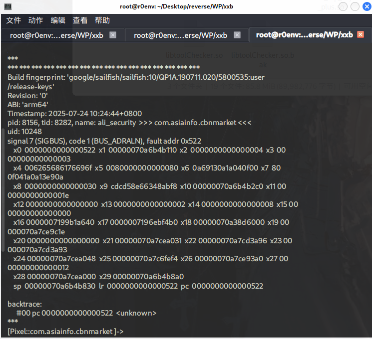


经过多次附加，发现都是一样的提示，pc 为522。猜测是检测到frida后通过`B 0x522`这样不存在的地址，导致app退出。这里X0、X30、PC都是0x522，所以在010editor中搜索`MOV X0, 0x522`，`MOV X30, 0x522`，的字节码，找到退出点。
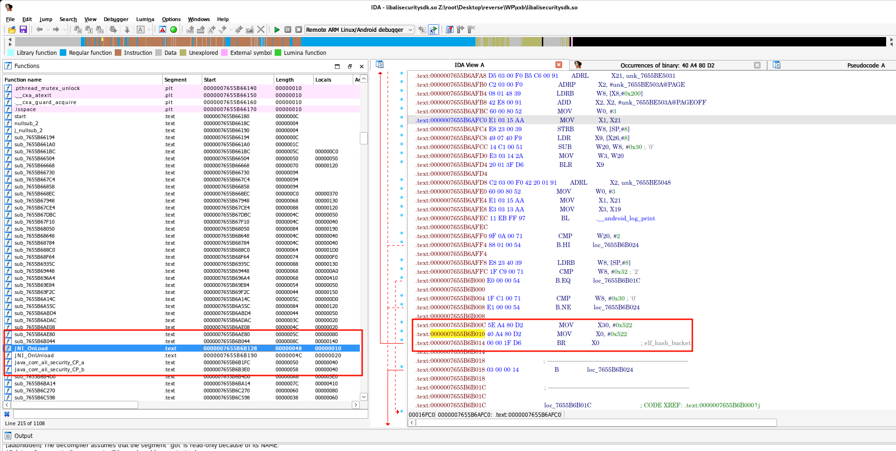

前面是通过cmp条件b.ne跳转，patch为b直接跳转即可。
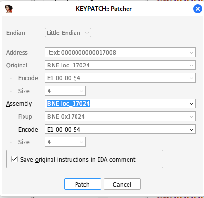

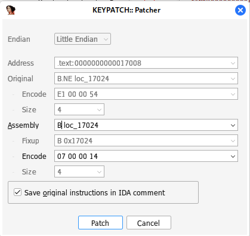


#### root检测

常用的root检测是通过检测su文件是否存在。hook下file的exists函数找到调用点。然后分析java层函数即可。

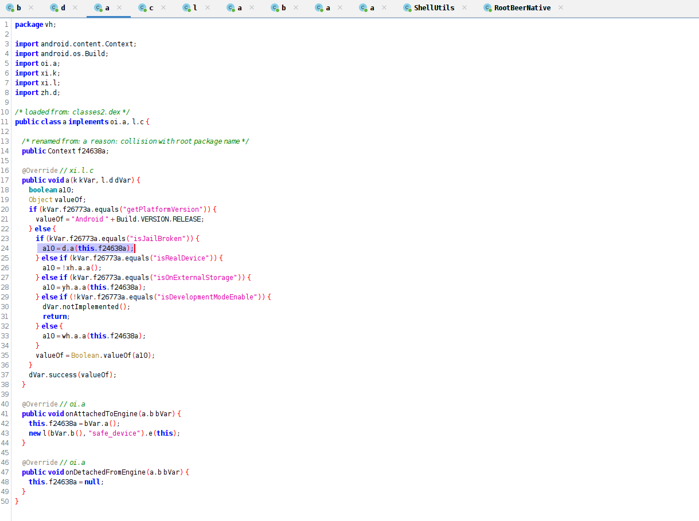

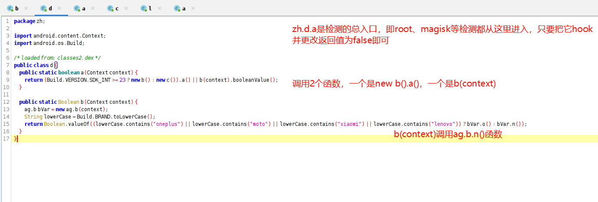

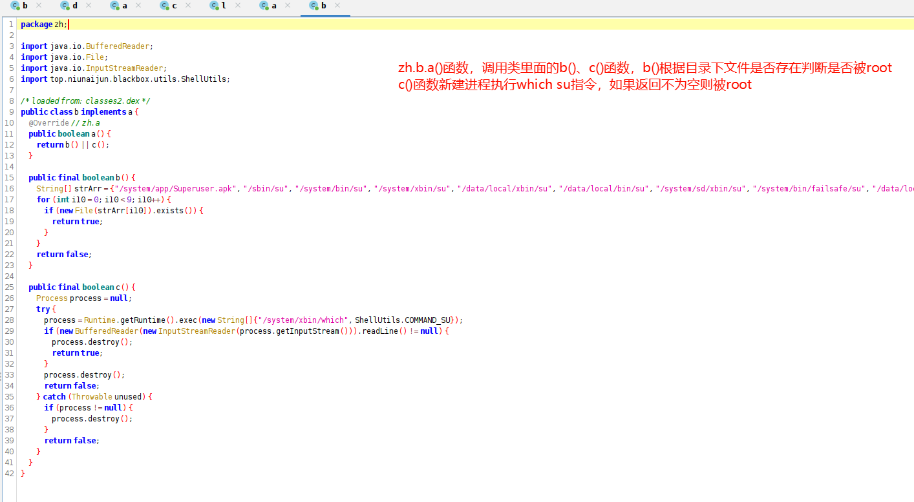

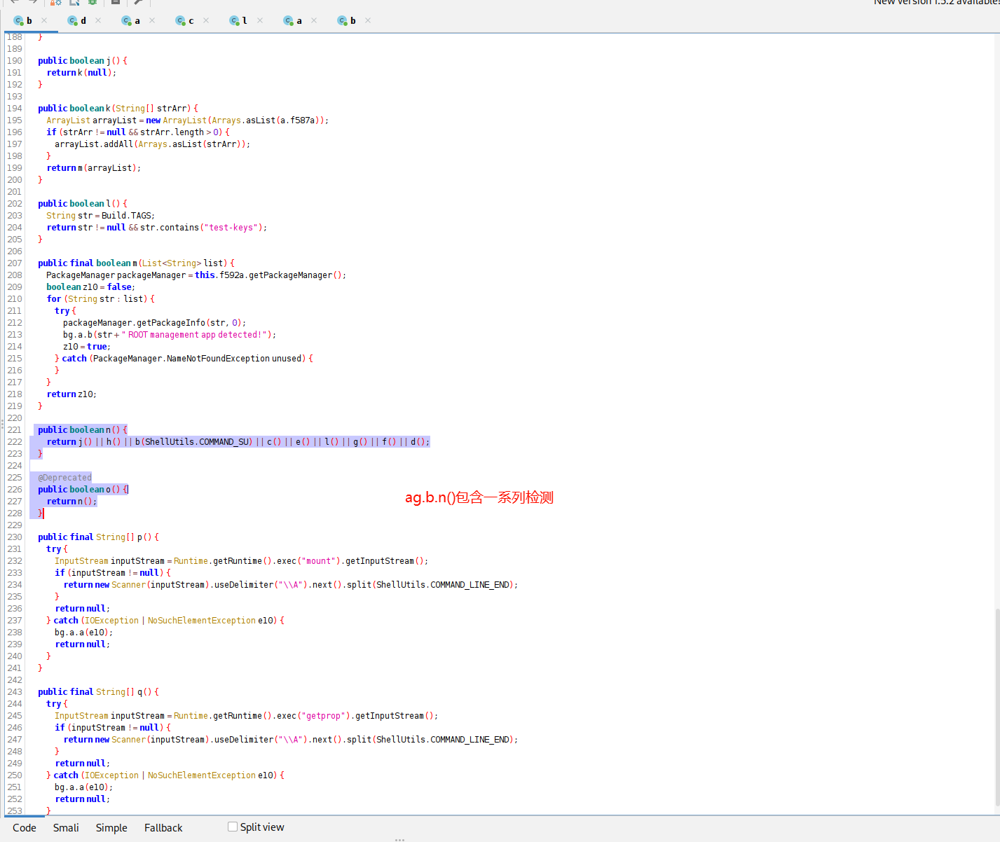

j()函数调用了m()函数，通过packagemanager获取packageinfo信息，str为com.topjohnwu.magisk等信息，这里检测magisk等是否安装

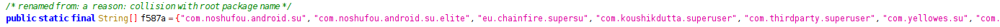

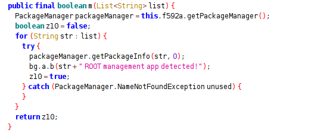

h()调用了m()函数，检测下面这些应用是否安装

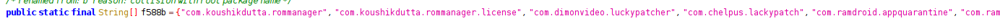

b()函数判断路径下以及系统环境路径下su是否存在，存在即root

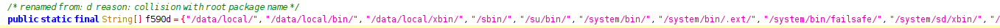

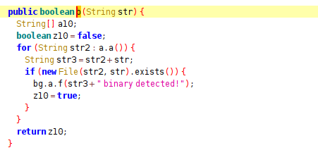

c()执行系统命令getprop获取属性，检测ro.debuggable和ro.secure，检测是否修改了系统属性可调试

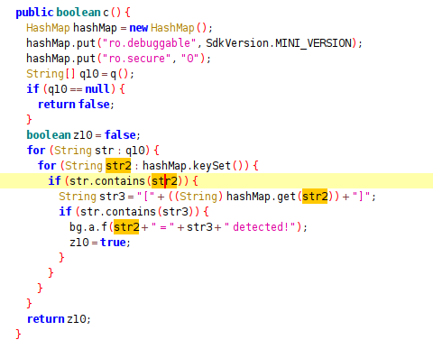

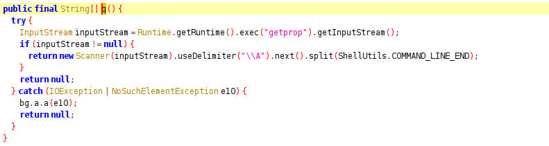

e()检测分区是否被挂载为可读写，未root的手机一般为只读

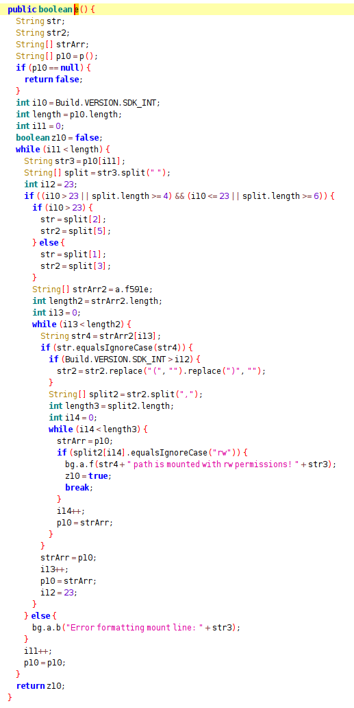

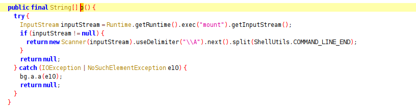

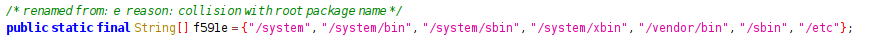

l()

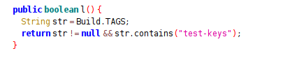

g()还是which su

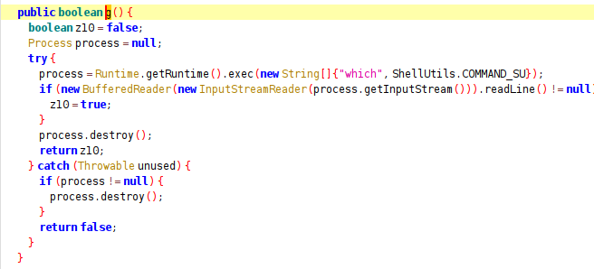

f()调用native函数检测路径下及系统环境路径su文件是否存在。通过fopen函数打开路径下文件，如果返回文件句柄则是存在文件，即被root

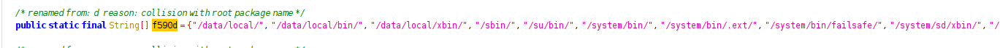

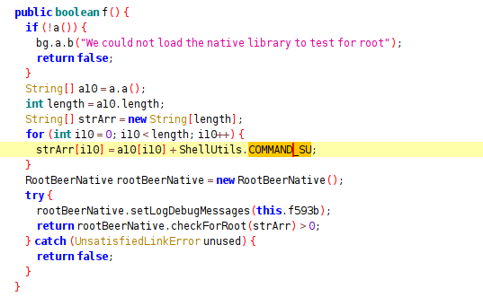

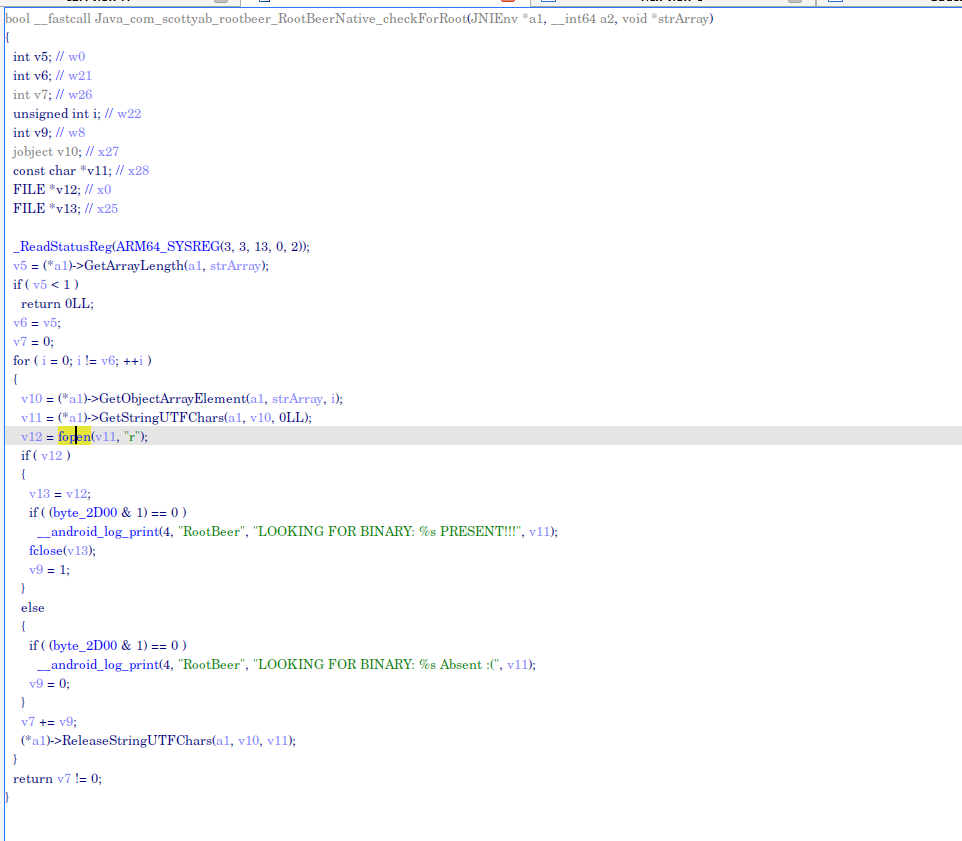

d()检测路径下magisk文件是否存在

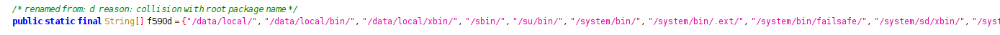

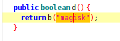

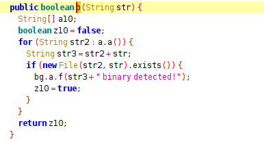


#### 最后脚本
<details>
<summary>hook脚本</summary>
<div style="max-height: 400px; overflow-y: auto; padding: 0 10px;">

```javascript
Java.perform(function () {

  var ret = frida_hook("zh.d","a",1);

  function frida_hook (targetClass,targetMethod,exeOringin) {
    // Hook 接口方法
    Java.use(targetClass)[targetMethod].implementation = function () {
      console.log("参数:", JSON.stringify(arguments));
      var stackTrace = Java.use("android.util.Log").getStackTraceString(
        Java.use("java.lang.Throwable").$new()
      );
      console.log("调用栈:\n", stackTrace);
      if(exeOringin){
        var ret = false;
        // var ret = this[targetMethod].apply(this, arguments)
        console.log("ret:",ret,typeof(ret),"\n");
        return ret;
      }else{console.log("no exeOrigin");};

    };
  }

  deDetectFrida();
});

function deDetectRoot() {
  var targetClass = Java.use("vh.a");
  targetClass.a.implementation = function (c, d) {
    // var originalResult = this.a();
    // var modifiedResult = false;
    console.log("[+] Hooked vh.a.a()");
    // console.log("Original return value:", originalResult);
    // console.log("Modified return value:", modifiedResult);
    console.log("\n");
    // return modifiedResult;
  };
}

function deDetectFrida() {
  const system = Java.use('java.lang.System');
  const Runtime = Java.use('java.lang.Runtime');
  const VMStack = Java.use('dalvik.system.VMStack');
  system.loadLibrary.implementation = function (path) {
    console.log(path);
    //this.loadLibrary(path);
    console.log('System.loadLibrary("' + path + '")');

    const loaded = Runtime.getRuntime().loadLibrary0(VMStack.getCallingClassLoader(), path);

    if (path == "alisecuritysdk") {
      var module = Process.getModuleByName("libalisecuritysdk.so");
      var targetAddress = module.base.add(0x17008);
      var patchedBytes = Memory.readByteArray(targetAddress, 4);
      console.log("Oringin bytes: " + arrayBufferToHex(patchedBytes));
      var newInstructions = [0x07, 0x00, 0x00, 0x14];
      Memory.protect(targetAddress, 4, 'rwx');
      Memory.writeByteArray(targetAddress, newInstructions);
      var patchedBytes = Memory.readByteArray(targetAddress, 4);
      console.log("Patched bytes: " + arrayBufferToHex(patchedBytes));
    }
    console.log("\n");
  }
}

function arrayBufferToHex(buffer) {
  var arr = new Uint8Array(buffer);
  var hex = '';
  for (var i = 0; i < arr.length; i++) {
    var h = arr[i].toString(16);
    hex += (h.length === 1 ? '0' + h : h) + ' ';
  }
  return hex.trim();
}

```
</div>
</details>

#### 结果
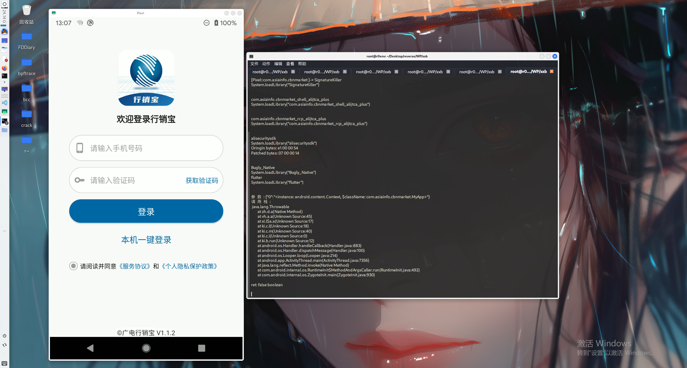

#### patch相关文件，重打包apk
root检测修改如下，修改为0x0即可

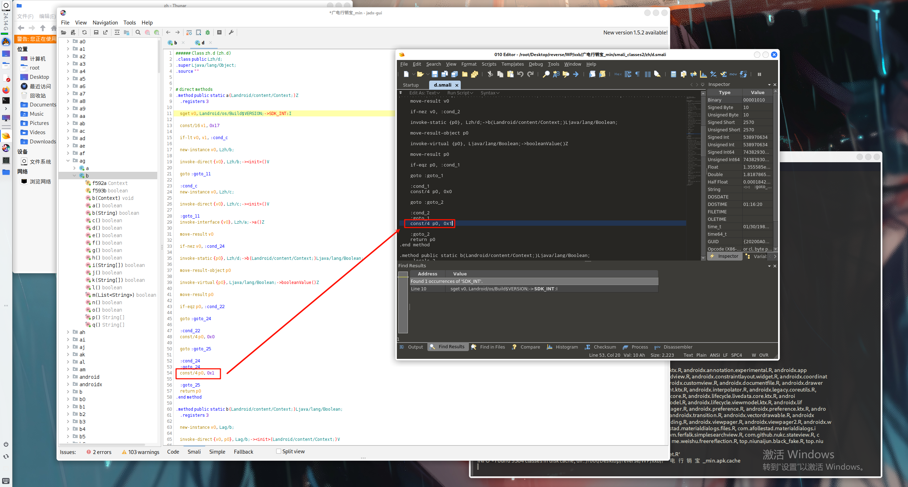

frida修改libalisecuritysdk.so即可

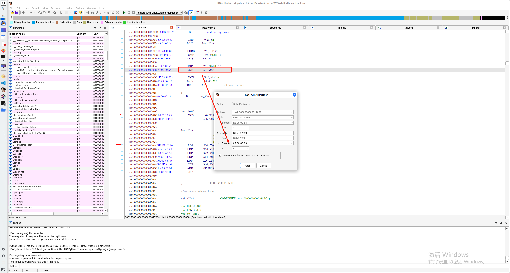
